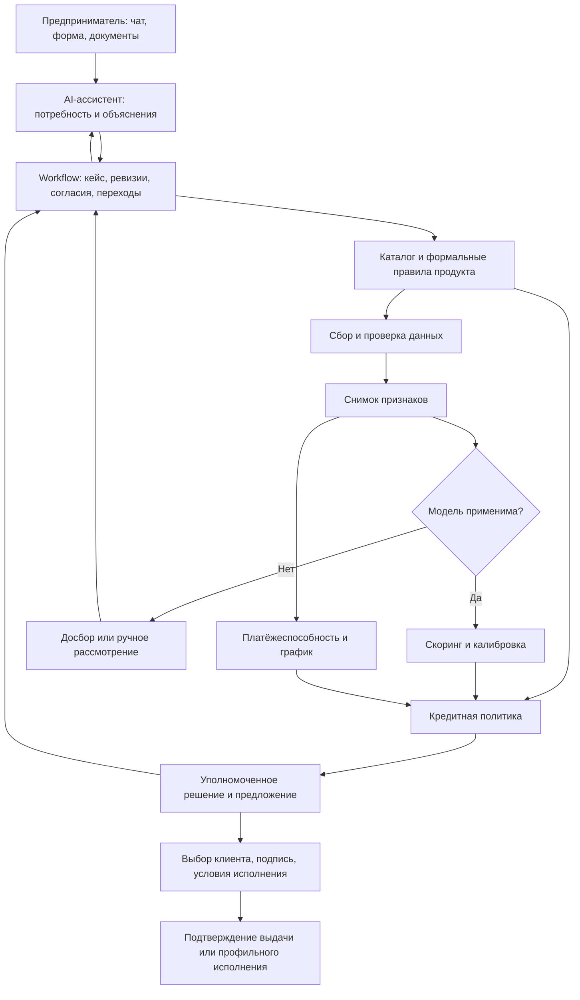

# AURELIUS: как ММБ получает кредит и где работают AI и скоринг

## Последние изменения · 24.10.2026: типизация и уточнение данных

Pydantic теперь проверяет patch по отдельным полям и цитатам: некорректная сумма не теряет корректную цель/срок и не перезаписывает прежнее значение. После одной repair-попытки возвращаются пригодные поля и типизированные замечания; незавершённое уточнение хранится в кейсе. Чат задаёт адресные вопросы, единый лог содержит DataResolutionPlan.

Добавлен read-only lookup_business_profile до полного запроса: только legal_form по доверенной company_id, с согласием, provenance и cutoff. VERIFIED факты могут заполнить отсутствующую форму; неподтверждённые/будущие/конфликтующие данные и ошибки источника приводят к вопросу пользователю. Сумма, срок и цель новой потребности из прошлых заявок не извлекаются.

Проверка: **91 тест прошёл**, включая реальную PostgreSQL. В браузере gpt-oss:20b + HTTP workflow для «измени сумму на −100 рублей» вернул адресный вопрос, сохранил 3 млн ₽ и показал INVALID/ASK_USER в общем логе.

Product approval/dates и неутверждённые ML-преобразования отмечаются как задачи разработчика, а не как вопросы клиенту. М4 не запускается. Осталось расширить проверенные источники/политику свежести, собрать русский eval-набор LLM, реализовать согласия/IAM/документы и утвердить условия/формулы. Подробный список изменений и TODO — в [POSTGRES_INTEGRATION](../docs/POSTGRES_INTEGRATION.md#последние-правки-pydantic-и-адресные-уточнения--24102026).


## Актуализация · 24.10.2026: PostgreSQL и модули 1–3

Приняты решения пользователя: 16 продуктовых направлений сохраняются, бизнес-БД поддерживает R01–R03; workflow/сессии/аудит/checkpoints перенесены в PostgreSQL; М3 сохраняет проверяемый snapshot и блокирует готовность при неизвестных признаках без выдуманных формул и инференса М4. Деплой — Docker PostgreSQL с однократным восстановлением backup в пустой том.

Реализованы PostgreSQL repository, миграция app-схемы, адаптер M2, snapshot M3, привязка company_id из доверенного серверного контекста, общий лог 1–3 и явный legacy SQLite import. Реальное восстановление: 30 тестовых компаний, 3 продукта, 99 требований. Проверены PostgreSQL workflow, replay без дубликатов, изоляция, согласия, advisory lock и импорт. Старые разделы со статусом до интеграции ниже сохраняются как история.

Узкие места: отсутствуют product approval/dates/source_checked в исходных terms; не утверждены mapping и формулы для 16/23 признаков, отрасли, ставки/периоды и историческая доступность; будущие 53+12×8 не совпадают с экспериментами. Реальный IAM, durable consent, файлы, М4/policy и М5 ещё впереди. Подробный текущий контракт, запуск, миграции, решения и TODO: [POSTGRES_INTEGRATION](../docs/POSTGRES_INTEGRATION.md).


Выжимка материалов проекта. Последняя фиксация реализации и решений: **24 октября 2026 года**.

Текущий статус — в разделе 8; принятые решения, узкие места, план работ и журнал этапов — в разделах 12–15. Этот файл используем как сводную точку фиксации состояния проекта; подробные контракты остаются в спецификациях модулей.

ММБ здесь — малый и микробизнес. Документ объединяет задание, требования, архитектуру, исследовательские конспекты, сохранённые продуктовые страницы, иллюстрации и текущую реализацию. Он описывает проект AURELIUS; закрытая методология Альфа-Банка и его пороги решений нам неизвестны. Проектные предложения и числовые примеры ниже не являются правилами банка.

## 1. Главная идея

**AURELIUS превращает потребность предпринимателя в проверенное кредитное досье, проводит его через оценку риска и кредитную политику и объясняет результат в одном кабинете.**

В системе четыре разных вопроса:

| Вопрос | Кто отвечает | Результат |
|---|---|---|
| Что нужно бизнесу и какой инструмент подходит? | Ассистент, каталог и формальные правила | Структурированный запрос и продукты-кандидаты |
| Какова вероятность согласованного неблагоприятного события? | Отдельная скоринговая модель | Оценка риска с горизонтом, версией и ограничениями |
| Может ли бизнес обслуживать этот кредит и разрешена ли сделка? | Расчёт платёжеспособности, кредитная политика, уполномоченный специалист | Решение и допустимые условия |
| Принято ли предложение, оформлено ли и исполнено финансирование? | Workflow и банковский контур | Подтверждённые подписи, условия и результат операции |

LLM помогает взаимодействовать с процессом. Финансовые вычисления и разрешённые действия выполняют сервисы и код.

## 2. Как предприниматель проходит кредитный путь

| Этап | Действие клиента | Работа системы/банка | Результат |
|---|---|---|---|
| 1. Потребность | «Нужно 3 млн на товар» | Уточнить субъект, цель, сумму, срок, дату потребности и источник возврата | Запрос; неизвестное отмечено явно |
| 2. Идентификация | Выбирает ИП/компанию, подтверждает полномочия | Проверить точного заёмщика, представителя и наличие действующей заявки | Кейс нужного субъекта без дубля |
| 3. Подбор | Уточняет разовую или повторную потребность | Проверить семейства продуктов и известные ограничения | Кандидаты, причины и требования к данным |
| 4. Доступ к данным | Предоставляет необходимые согласия и документы | Получить разрешённые сведения из источников | Досье с происхождением фактов |
| 5. Проверка | Отвечает на адресные уточнения | Сверить периоды, единицы, долги, обороты и полноту счетов | Проверенные факты либо запрос недостающего |
| 6. Признаки и риск | Видит ход рассмотрения | Зафиксировать snapshot; проверить применимость модели; рассчитать риск | Результат скоринга либо отдельный маршрут |
| 7. Решение | При необходимости уточняет параметры | Проверить платёжеспособность, ограничения, обеспечение и экономику | Одобрение, иные условия, уточнение, ручной разбор или отказ |
| 8. Выбор | Сравнивает и принимает предложение | Показать персональные условия, график и известные расходы | Сохранённый выбор по версии предложения |
| 9. Оформление и исполнение | Подписывает, выполняет условия | Проверить подписи/обеспечение; подтвердить банковскую операцию | Выдача либо иной результат по типу инструмента |
| 10. Обслуживание | Платит, смотрит график, обращается по договору | Учитывать платежи и изменения, собирать фактические исходы | Сопровождение и данные для будущего обучения |

Сбор данных итеративный: сначала минимальная потребность, затем требования выбранного продукта. Не нужно запрашивать весь возможный пакет в начале разговора. Создание банковской заявки может потребоваться раньше скоринга — это определяется интеграцией; сохраняется связь с тем же кейсом.

Для хакатонного MVP основной обязательный результат — прохождение заявки до результата рассмотрения. Подписание и выдачу разрешено моделировать; обслуживание можно оставить за границей MVP.

## 3. Какие данные нужны

### Минимум для начала подбора

В текущем модуле 1 обязательны `borrower_id`, форма бизнеса, цель, сумма в рублях и срок в месяцах. Идентификатор субъекта приходит из доверенного контекста. Это минимум для передачи запросу модулю 2, а не достаточное кредитное досье.

Далее уточняются дата потребности, источник возврата, повторяемость закупок, сезонность, обязательства и обеспечение.

### Данные для оценки и решения

| Блок | Что требуется | Источник/подтверждение | Для чего |
|---|---|---|---|
| Заёмщик и представитель | ИНН, ОГРН/ОГРНИП при применимости, форма, регистрация, отрасль, собственники, полномочия | Профиль, документы, ЕГРЮЛ/ЕГРИП, релевантные сведения реестра МСП | Субъект и формальная применимость |
| Запрос | Продукт/цель, сумма, срок, дата потребности, разовая/повторная задача | Клиент, контракт или смета при необходимости | Структура финансирования |
| Финансовое положение | Доходы, расходы, активы, обязательства, прибыль, доступный денежный поток | Бухгалтерская, налоговая и управленческая информация по типу бизнеса | Устойчивость и источник погашения |
| Движение денег | Поступления, выплаты, остатки, назначения и контрагенты за выбранное окно | Банковские выписки по необходимым счетам | Динамика, сезонность, концентрация и доступный платёж |
| Действующий долг | Остатки, графики, ежемесячные платежи, просрочки, поручительства | Договоры/справки, внутренние сведения и разрешённые отчёты БКИ | Совокупная нагрузка и платёжная дисциплина |
| Продажи | Эквайринг, касса, продажи, возвраты, комиссии и выплаты маркетплейсов | Разрешённые источники и документы | Подтверждение продаж и специфики бизнеса |
| Внешние события | Статус бизнеса, релевантные ограничения, судебные/исполнительные события при включении в маршрут | Доступные официальные источники/провайдеры | Проверки и факторы риска с учётом смысла события |
| Обеспечение | Предмет, права, оценка, обременения, поручитель | Документы и профильная проверка | Условия сделки и ожидаемое возмещение |
| Профильная сделка | Объект, продавец, договор, поставка, дебитор, первоначальный взнос | Документы конкретного маршрута | Ипотека, автокредит, лизинг, гарантия, факторинг |
| Доступ и аудит | Полномочия, scope/срок согласий, версии документов, даты получения | Доверенный контур приложения | Разрешение действий и воспроизводимость |

Это проектная матрица источников, а не универсальный список обязательных документов любого банка. Период выписок и состав сведений задаются продуктом и моделью. Предложенные в архитектуре 12 месяцев не являются общим требованием ко всем заявителям.

В локальном сборе Альфа-Банка, блоки `common-011`/`common-061`, перечислены анкета предприятия/ИП, сведения и согласия участников, паспорта участвующих физлиц; по ситуации — подтверждение цели и финансового положения, сведения о других кредитах и графиках, документы по структуре собственности. Набор зависит от продукта и рассмотрения. Официальные материалы также разделяют [документы ИП](https://alfabank.ru/help/articles/sme/profits/kakie-dokumenty-nuzhny-dlya-kreditovaniya-ip/) и [документы юрлица](https://alfabank.ru/help/articles/sme/profits/dokumenty-dlya-kreditovaniya-yuridicheskogo-lica/).

### Как превращать документы в признаки

`Документ/источник → извлечённый факт → нормализация и сверка → вычисляемый признак → неизменяемый snapshot`.

Для факта сохраняются субъект, значение, единица, период, источник, статус проверки, дата события и дата доступности. Для признака — формула и версия. В историческом расчёте допустимо только `available_at <= decision_at`.

Критические правила:

- Переводы между своими счетами и полученные займы не считаются продажами.
- Поступления по эквайрингу/маркетплейсу и соответствующие операции по счёту не учитываются дважды.
- Выручка, прибыль и деньги для обслуживания долга — разные величины.
- Отсутствие баланса у ИП и неполная история остаются пропусками, а не нулями.
- Один счёт не доказывает полноту финансового контура.
- Сведения со слов клиента остаются неподтверждёнными до проверки.

В архитектуре заявлен стартовый размер: 53 статических признака, из них 45 числовых и 8 категориальных, плюс потенциально 12 месяцев × 8 денежных каналов. Покомпонентный утверждённый словарь всех 53 полей с формулами в просмотренных спецификациях не зафиксирован. Его ещё нужно составить и проверить на доступных данных.

## 4. Как принимается решение

**Решение — результат совместной проверки продукта, данных, риска, платёжеспособности, структуры и политики.** Одобрение по одному score не следует из материалов проекта.

| Проверка | Вопрос | Если не пройдена/не завершена |
|---|---|---|
| Формальные условия | Подходит ли субъект и запрос продукту? | Другой продукт, уточнение либо результат по правилам |
| Данные | Достаточно ли достоверной и актуальной информации? | Адресный досбор/ручная сверка |
| Применимость модели | Совпадают ли рынок, продукт, популяция, горизонт и схема признаков? | `UNSUPPORTED_MODEL`, профильный/ручной маршрут |
| Риск | Укладывается ли оценка в политику продукта? | Допустимая альтернатива, ручное решение или отказ |
| Платёжеспособность | Хватит ли денег на существующий и новый долг, включая стресс? | Пересмотр суммы/срока/графика или иной исход |
| Обеспечение и структура | Выполнимы ли условия сделки? | Досбор, иное обеспечение или пересмотр |
| Экономика и полномочия | Разрешена ли сделка с учётом потерь, расходов, лимитов? | Изменение условий, уполномоченное рассмотрение или отказ |

Упрощённый показатель покрытия:

`DSCR = CFADS / (платежи по существующему долгу + платежи по новому кредиту)`.

CFADS — нормализованный денежный поток, доступный для обслуживания долга. Числитель и знаменатель берутся за одинаковый период. Для сезонного бизнеса важны отдельные месяцы и сценарии, а не только среднее за год. Конкретный порог — параметр политики продукта.

Для экономики сделки в материалах используется приближение `EL ≈ PD × LGD × EAD`: вероятность события × доля потерь при нём × экспозиция. Определения и горизонты должны согласовываться. Это не готовая формула ставки; запись «ставка ЦБ + маржа + risk cost» из ранних заметок недостаточна для реализации pricing.

Предлагаемые исходы: `NEEDS_INPUT`, `MANUAL_REVIEW`, одобрение, встречные условия, отказ. Ошибка источника/сервиса означает техническую задержку. Недоступная модель означает отсутствие применимой оценки. Эти случаи не должны превращаться в отрицательное кредитное решение.

Окончательное решение принадлежит уполномоченному банковскому контуру: автоматическим правилам в пределах полномочий либо специалисту. В автономном прототипе этот контур явно моделируется.

## 5. Как интегрируются ассистент и скоринговая модель



### Роль ассистента

Понять свободный запрос, извлечь поля, задать адресный вопрос, показать недостающие сведения, объяснить проверенный статус и разрешённые причины результата. В целевой системе может помогать с извлечением документов, но извлечённые поля проходят отдельную проверку.

Текущий `gpt-oss:20b` через ChatOllama извлекает намерение и изменения запроса со ссылкой на дословный фрагмент сообщения. LangGraph и обычный код выбирают инструменты и переходы; ответ пользователю строится по структурированному состоянию. Свободное решение модели не запускает банковские операции.

### Роль скоринговой модели

Получить проверенный snapshot и оценить конкретное событие на зафиксированном горизонте. Рабочая гипотеза архитектуры: существенная просрочка 90+ по новому договору в течение 12 месяцев после выдачи. Пока правило существенности, точная граница DPD, исключения и зрелость не утверждены, это проектный таргет.

В исследовательских конспектах также обсуждается дефолт компании. Это отдельный уровень наблюдения: его нельзя незаметно смешать с событием по договору. При узком таргете просрочки результат следует называть вероятностью этого события, а не полным банковским PD без согласованной методологии.

Предлагаемый ответ сервиса:

```json
{
  "case_id": "CASE-001",
  "revision": 1,
  "feature_snapshot_id": "FS-001",
  "status": "UNSUPPORTED_MODEL",
  "target_definition_version": "RF-SME-TARGET-DRAFT",
  "horizon_months": 12,
  "model_version": null,
  "calibrator_version": null,
  "calibrated_probability": null,
  "quality_flags": [],
  "explanation_ref": null
}
```

Это предложение контракта для модуля 4, а не уже работающий API. Если модель применима и валидирована, сервис возвращает её фактический результат; если нет — вероятность остаётся `null`.

В архитектуре рассматриваются MLP/ResNet или FT-Transformer; последовательный encoder возможен при настоящей истории. В конспектах дополнительно предложены логистическая регрессия и бустинг как базы сравнения. Финальный выбор не подтверждён экспериментом в этом репозитории.

Скриншоты в `assets/` иллюстрируют кредитные истории, табличные и последовательные данные, embeddings, объединение оценок и обработку разной длины последовательностей. Это полезные направления исследования. Показанные на слайдах улучшения Gini и объёмы данных не являются измеренными результатами AURELIUS. Социальные связи из отдельного слайда не включены в текущую спецификацию входа и не нужны для первого MVP.

### Как связываются компоненты

Общие ключи — `case_id`, `borrower_id`, `revision`, `feature_snapshot_id`, `correlation_id`. Дополнительно версионируются схема признаков, preprocessing, модель, калибратор, policy и предложение.

После изменения суммы/срока создаётся новая ревизия и пересчитываются зависимые результаты. Повторный скоринг требуется, если изменённые поля входят в валидированный вход модели. Расчёт по новому сценарию не доказывает причинного влияния изменения условий на дефолт.

Факторы модели и причины решения хранятся отдельно: например, модель может оценить риск как допустимый, а policy отклонить исходную сумму из-за платёжной нагрузки. Ассистент получает обе структуры и формирует согласованное объяснение.

Для банковских команд требуются проверенные полномочия, стадия, согласия и защита от повторного исполнения. Подписание, одобрение и отправка команды перечисления — отдельные факты; выдача показывается после подтверждения операции.

## 6. Что нужно для обучения скоринга

1. Исторические заявки и выдачи с датой решения и параметрами запроса.
2. Только те признаки и версии источников, которые были доступны на эту дату.
3. Графики, обязательства, платежи, распределение платежей по обязательствам, остатки, изменения договора и наблюдаемые исходы.
4. Однозначное правило таргета: событие, договор/заёмщик, горизонт, DPD, существенность, реструктуризации, исключения и зрелость.
5. Разделение по времени: train, настройка/калибровка, более поздний нетронутый тест; контроль повторных и связанных компаний.
6. Проверка ранжирования, калибровки и устойчивости: ROC-AUC/Gini, Log Loss, Brier, observed/expected, сегменты и неопределённость.
7. Проверка политики: одобрения при сопоставимом риске, потери, экономика, доля ручных решений.

Одобрение/отказ банка не заменяет метку возврата. Отказанная заявка не размечается дефолтом. Недавний кредит без полного наблюдения не становится хорошим автоматически. Последующие платежи используются для исходов, а не подмешиваются во вход первоначальной заявки.

Синтетические данные подходят для проверки конвейера и демонстрации сценариев. Они не подтверждают качество прогноза реальных дефолтов. В документах упоминается SBA-benchmark с иным рынком и списанием за 36 месяцев; файлы модели и обучающей витрины в просмотренном дереве проекта не найдены. Наличие готового российского скоринга не подтверждено.

## 7. Один пример, показывающий всю логику

Все числа учебные, ставка и порог не являются условиями Альфа-Банка.

Предприниматель просит 3 млн ₽ на товар на 24 месяца. Ассистент уточняет субъект, цикл продаж и долги. Каталог предлагает оборотный кредит и, если потребность повторная, проверку маршрута ВКЛ. Данные подтверждают CFADS 500 тыс. ₽ в месяц и действующие платежи 180 тыс. ₽.

При условной ставке 24% годовых, месячной ставке 2%, аннуитете и без включения дополнительных расходов новый платёж составляет примерно 158 613 ₽. Покрытие: `500 000 / (180 000 + 158 613) ≈ 1,48`.

В стресс-сценарии CFADS падает до 400 тыс. ₽: покрытие `≈ 1,18`. При условном учебном пороге 1,3 исходный сценарий проходит платёжный тест, стресс — нет. Система пересматривает сумму/график или направляет кейс специалисту.

Положительный результат платёжного теста не создаёт одобрение: ещё нужны применимый риск, остальные проверки и уполномоченное решение. Пока собственной пригодной модели нет, нельзя дописать в интерфейс вымышленную PD. После решения клиент получает конкретное предложение, выбирает его, оформляет документы; в DEMO итог исполнения явно обозначен симуляцией.

## 8. Что уже есть и чего пока нет

Срез на 23.10.2026 по коду и результатам предыдущего этапа разработки. Тогда прошли **62 автоматических теста** и проверки реального `gpt-oss:20b` через браузер. При текущем обновлении документации тесты и модель повторно не запускались. Это подтверждает проверенные сценарии, но не является нагрузочным тестированием или полной оценкой качества извлечения.

| Компонент | Обнаруженное состояние |
|---|---|
| Задание и требования | Есть исходный PDF, ABOUT.md и REQUIREMENTS.md |
| Предметная база | Сохранённый сбор 43 публичных страниц, общие блоки, таблицы, manifest и validation; это снимок, не банковская интеграция |
| Архитектура | Пять модулей, границы ответственности, исключения и проектные контракты |
| Исследование скоринга | Два тематических конспекта, варианты таргета, признаки, валидация и мониторинг |
| UI | Веб-кабинет, чат и один актуальный общий лог модулей 1–2: запрос, проверки, кандидаты, документы и следующий шаг |
| Модуль 1 | Реализованы LangGraph, ChatOllama gpt-oss:20b, типизированное извлечение, SQLite, ревизии и защита от повторов |
| Доступ к модулям | Восемь инструментов; по умолчанию `ProductModuleAdapter`, реализующий операции модуля 2 |
| Модуль 2 | Подключён в web и CLI: каталог 16 направлений, маршрутизация, `MATCH` / `NO_MATCH` / `UNKNOWN`, адресные требования, сохранение и пересмотр подбора |
| Каталог | Проектные карточки с версиями и источниками; утверждённые банковские пороги и актуальность не подтверждены, поэтому соответствующие проверки дают `UNKNOWN` |
| Модули 3–5 | Есть спецификации и интерфейсы; сбор подтверждённых данных, скоринг, расчёты и решение в рабочий конвейер не подключены |
| Файлы и факты | UI-вложения остаются в браузере; ссылки сохраняются непроверенными; извлечение финансовых документов не реализовано |
| Скоринговая модель | Локальные веса/витрина/отчёт валидации российского ММБ не найдены |
| Общая заявка | Чат хранит кейс в SQLite; черновики «Моих заявок» живут в localStorage и с ним не синхронизированы |
| Банковский контур | Нет реального решения, персональной цены, подписания и исполнения |
| Старый `personalCab/prom/lab` | Пример аналитического pipeline по СБЕР; источник архитектурного паттерна, не действующий кредитный скоринг |
| Поставка | Docker/compose в просмотренном дереве не найдены; требование задания ещё предстоит закрыть |

Фактическая текущая граница после успешного подбора: **`WAITING_DOCUMENTS`, `next_module=3`, `next_action=CONNECT_MODULE`, `error_code=MODULE_NOT_CONFIGURED`**. Модули 1–2 подготовили запрос, кандидатов и требования; модуль 3 ещё не начал сбор документов. Статус не означает отправку заявки в банк. Если подходящий маршрут не установлен или все кандидаты не подходят, возвращаются `NEEDS_INPUT` и `CLARIFY_PRODUCT_NEED`, без банковского отказа.

## 9. Предлагаемое продолжение MVP

Это рекомендация по сборке проекта из имеющихся материалов, а не уже выполненная реализация.

1. Зафиксировать один основной продукт — кредит на пополнение оборотных средств — и ограниченный набор синтетических профилей ИП/ООО.
2. Связать чат и «Мои заявки» с единым серверным кейсом.
3. Модуль 2 уже реализован. Следующий шаг по нему — согласовать карточки/условия и расширять правила по подтверждённым требованиям, сохраняя неизвестные значения явными.
4. Реализовать модуль 3: локальные симуляторы реестра/БКИ/финансовых данных, проверка и snapshot. При необходимости добавить один поддерживаемый формат выписки.
5. Реализовать расчёт графика, CFADS/нагрузки и отдельную policy с объяснимыми причинами.
6. Выбрать честный режим риска: демонстрационная балльная оценка с описанной формулой либо модель с доказанной применимостью. Баллы не подписывать как калиброванную вероятность без проверки.
7. Сделать экран банковской стороны для ручного решения и сохранения основания; персональные условия выдаёт демонстрационный банковский адаптер.
8. Показать одобрение, встречные условия, досбор, ручной разбор, отказ и техническую задержку. Проверить восстановление, повтор сообщения, изменение запроса и пересчёт.
9. При включении оформления добавить симуляцию подписи/выдачи, затем Docker, единый запуск и материалы поставки из задания.

Обслуживание, несколько кредиторов, социальный скоринг, сложные последовательные модели и все семейства продуктов можно развивать после связного основного сценария.

## 10. Несогласованности и решения, которые нужно закрыть

| Вопрос | Что есть в материалах | Что зафиксировать |
|---|---|---|
| Четыре или пять модулей | Исследовательская декомпозиция на 4 блока и продуктовая архитектура на 5 | Использовать 5 модулей как карту продукта; 4 блока — внутренний жизненный цикл риска |
| Уровень таргета | Дефолт компании и просрочка нового договора | Одну формальную спецификацию для первой модели |
| Выбор алгоритма | Логрег/бустинг в конспектах, DL в архитектуре | Baseline, эксперимент и критерий выбора; отсутствие модели обозначать явно |
| Размер входа | 53 статических поля и 12×8 временных каналов | Словарь полей, формулы, источники, окна, маски и минимальное покрытие |
| Правила продукта | Реализован проектный каталог 16 направлений с версиями и проверками | Нужны подтверждённые карточки и процесс актуализации; закрытые банковские пороги неизвестны |
| Обслуживание | В общей архитектуре есть, в требованиях предложено исключить из MVP | Основной сценарий до решения; глубину симуляции определить отдельно |
| Промышленность | Есть локальная DEMO-граница | Не заявлять production-аутентификацию и реальные согласия/операции как реализованные |
| Готовность модели | В документах упомянут внешний SBA-артефакт | Отдельно найти/подключить артефакт; не считать российским PD12 |

## 11. Карта источников проекта

- [Исходное задание](../Альфа_Хак_Умный_кредитный_кабинет.pdf), [его текст](../ABOUT.md), [требования](../REQUIREMENTS.md): цель, границы, сценарии и ограничения сдачи.
- [Общая архитектура](AI_CreditSys_Agent_Architecture.md): продуктовый путь, пять модулей, модель, полномочия и исключения.
- [Диалог](architecture/01_dialogue_and_workflow.md), [подбор](architecture/02_product_matching.md), [данные](architecture/03_data_and_features.md), [скоринг](architecture/04_scoring_and_offers.md), [решение](architecture/05_decision_and_servicing.md): детальные спецификации.
- [Конспект B2B](ResearchInfo/b2b_credit_scoring_chat_summary.md), [конспект скоринга](ResearchInfo/credit_scoring_chat_summary.md): признаки, обучение, метрики и политика; часть идей относится к торговому кредиту и требует адаптации.
- [База продуктов](../src/alfabank_mmb_credits.md), [границы сбора](../src/README.md), [перечень направлений](../servicesAlfa/AlfaRecs.md): публичная продуктовая информация, собранная 20.10.2026.
- [Иллюстрации](../assets/): кредитные истории, последовательные данные и экспериментальные подходы; не отчёт о собственной модели.
- [Модули 1–2](../personalCab/prom/prom_lab/ai_agents_lab/README.md), [его паттерны](../personalCab/prom/prom_lab/ai_agents_lab/AURELIUS.md), [кабинет](../personalCab/frontend/README.md): реализация, запуск и ограничения.
- Код сверки: `schemas/models.py`, `services/workflow_service.py`, `agents/workflow.py` в модуле 1; `personalCab/frontend/server.py` и `app.js`.

Внешняя сверка ограничена официальными материалами о документах ИП и юрлиц. Основная продуктовая страница при прямом обращении вернула 502; свежие тарифы, сроки решения и внутренние правила этим документом не подтверждаются. Для продуктовых выводов использован локальный снимок с явной датой.


## 12. Принятые решения на 23.10.2026

Это текущие решения реализации. Изменение решения фиксируем новой датированной записью, а не выдаём прежнее поведение за текущее.

| Решение | Что зафиксировано и почему | Где реализовано |
|---|---|---|
| Архитектура из пяти модулей | Сейчас подключены 1 и 2. Следующие этапы не имитируем успешными ответами | `architecture/01_dialogue_and_workflow.md`, `architecture/02_product_matching.md` |
| Роль LLM ограничена извлечением | Локальный Ollama `gpt-oss:20b` извлекает намерение и patch с дословными цитатами. Переходы, выбор tools, подбор продуктов и ответы по статусу определяются кодом; LLM не назначает ставки, PD и решения | `agents/factory.py`, `agents/workflow.py`, `services/product_matching.py` в workflow-пакете |
| Неизвестное не заполняется догадками | Неподтверждённые сведения клиента отделены от проверенных фактов; формальные условия имеют три исхода | `schemas/models.py`, `schemas/products.py`, `services/product_matching.py` |
| Каталог пока проектный | Покрыты все 16 направлений, но карточки не объявлены утверждёнными банковскими предложениями. Неизвестная граница диапазона не равна отсутствию ограничения | `catalog/products.json`, `schemas/products.py` |
| Профильные маршруты сохраняются | Лизинг, факторинг и гарантия имеют свои процессы и требования; их не подменяем обычным кредитом | `services/product_matching.py`, `catalog/products.json` |
| Пересмотр результатов | Изменение запроса создаёт новую ревизию и сбрасывает зависимости. Изменение каталога/актуальных подтверждённых фактов пересматривает подбор в текущей ревизии по `context_hash` | `services/workflow_service.py`, `services/product_matching.py`, `agents/workflow.py` |
| SQLite — источник состояния workflow | Храним кейсы, квитанции, аудит, checkpoints и web-сессии. История чата не заменяет заявку. Повтор того же ID и текста возвращает сохранённый результат | `repositories/case_repository.py`, `agents/workflow.py`, `personalCab/frontend/server.py` |
| Один общий лог в чате | Показываем последний актуальный лог модулей 1–2, без накопления отдельных логов модуля 1. Сообщения сохраняются, полный результат доступен в JSON | `personalCab/frontend/app.js`, `personalCab/frontend/server.py` |
| Доверенные права и согласия | Субъект, роль и полномочия задаёт сервер. Согласие из свободного текста не разрешает обращение к источникам. При неподключённом модуле 3 не объявляем сбор начатым | `services/workflow_service.py`, `personalCab/frontend/server.py` |
| Web остаётся локальным DEMO | Один Python-сервер отдаёт HTML/CSS/JS и API на loopback. Внешних банковских операций и production-аутентификации нет | `personalCab/frontend/server.py` |
| Замена значения не равна очистке | На живом диалоге обнаружено неверное очищение цели при «измени цель». Добавлены prompt, проверка допустимости `clear_fields`, корректирующая попытка и regression-тест. Это защита от конкретного сбоя, не гарантия идеального извлечения | `agents/factory.py`, `tests/test_extractor.py` |

Пути без полного префикса в таблицах этого раздела и далее относятся к `personalCab/prom/prom_lab/ai_agents_lab/`.

## 13. Узкие места и ограничения

Приоритет: **P0** — блокирует следующий сквозной этап; **P1** — нужен для устойчивого демонстрационного сценария; **P2** — оптимизация или подготовка к расширению. Это проектная оценка приоритетов, не результаты бенчмарка.

| Приоритет | Узкое место | Подтверждение / симптом | Последствие | Что сделать |
|---|---|---|---|---|
| P0 | Нет модуля 3 | Конвейер останавливается с `next_module=3` и `MODULE_NOT_CONFIGURED` | Нет подтверждённого досье, на котором можно строить оценку и решение | Реализовать адресный сбор, проверку фактов и snapshot по требованиям модуля 2; начать с локальных симуляторов |
| P0 | Неизвестны утверждённые условия продуктов | В текущих карточках `approved=false`, периоды действия и числовые пороги не заданы | Даже структурно подходящие продукты остаются `UNKNOWN`; это ожидаемое поведение, а не ошибка сравнения | Получить/согласовать условия либо явно версионированную DEMO-policy; не выдавать тестовые пороги за банковские |
| P1 | Два независимых представления заявки | Чат — SQLite; «Мои заявки» — localStorage | Сумма/цель на главной странице могут отличаться от текущего кейса чата | Один серверный case API для списка, карточки и диалога; перенос/маркировка старых локальных черновиков |
| P1 | Качество структурированного извлечения | Наблюдались ошибочные очистка цели и невалидный вывод; есть одна корректирующая попытка | Пользователь иногда должен уточнять/повторять запрос, семантически неверные извлечения не исключены | Набор русскоязычных диалогов, контроль ошибок по полям, тесты смены цели/суммы/неизвестности; метрики до дальнейшего изменения prompt |
| P1 | Латентность локального LLM | Вызовы синхронные, timeout клиента 120 с; возможны две попытки, frontend ждёт до 300 с | Длительное ожидание одного хода и занятый HTTP-поток; реальная пропускная способность не измерена | Измерить холодный/тёплый запуск, p50/p95, долю повторов и параллельную нагрузку; затем решать про очередь, статусы задач и лимиты |
| P1 | Сериализация по владельцу | `actor_lock` удерживается на весь `handle()`, включая LLM; второй ход получает конфликт | Один владелец не может параллельно обрабатывать несколько обращений; вкладки могут конфликтовать | Явная очередь/статус обработки и согласованный порядок команд; не убирать блокировку без замены гарантий |
| P1 | Вложения не являются входом модуля данных | Файлы остаются в браузере, ссылки только сохраняются, не скачиваются | Показанный файл ещё не даёт проверенных финансовых фактов | Серверное хранилище и document_id, привязка к субъекту/кейсу/версии, поддерживаемый формат выписки и проверка качества извлечения |
| P1 | Нет завершённого жизненного цикла заявок в UI | Web восстанавливает сессию; «Обновить» не создаёт новую заявку. При нескольких активных кейсах репозиторий требует выбора | Нельзя считать реализованными выбор независимого кейса, переключение компаний и новый процесс после завершения | Явные API/экраны создания и выбора кейса, продолжения/отмены и выбора субъекта без смешивания данных |
| P1 | Модули 4–5 пока отсутствуют | Есть спецификации и интерфейсы | Нет расчётов нагрузки, оценки риска, предложений, решения и ручного банковского этапа | Реализовать после контракта досье; разделить риск, платёжеспособность, policy и окончательное решение |
| P1 | Нет воспроизводимой поставки | В просмотренном дереве отсутствуют Docker/compose; запуск зависит от общего Python-окружения и локального Ollama | Запуск на другой машине ещё не подтверждён | Docker/compose, настройки/healthchecks, инструкция и тест чистого запуска; явно описать размещение модели |
| P2 | Ограничен диалоговый контекст | Кейс хранит 16 последних сообщений; в LLM передаются 8, содержание каждого ограничено 1000 символами | Структурированные поля сохраняются, но длинные повествовательные уточнения могут потеряться | Проверить длинные диалоги; выделять важные сведения в типизированное состояние, а не просто наращивать историю |
| P2 | Хранилище рассчитано на один хост | SQLite и POSIX `fcntl`, JSON кейса/аудита, checkpoints | Многопроцессная/многохостовая поставка и рост объёма требуют отдельной проверки | Измерить размер БД, задержки и конкуренцию; определить миграции, резервное копирование и политику хранения до смены СУБД |
| P2 | Общий лог не равен полной истории аудита | В интерфейсе один последний лог; старые результаты остаются в SQLite | Исследовать последовательность прошлых проверок через UI неудобно | Экран/экспорт аудита по case_id, revision и correlation_id, без перегрузки основного диалога |

Отдельное ограничение DEMO: cookie-профиль и серверная синтетическая идентичность не являются production-аутентификацией. До реальных данных и внешнего доступа нужны аутентификация, разграничение доступа, доверенный реестр согласий и соответствующее хранение документов. Сейчас эти возможности не заявляются как готовые.

Нагрузочные числа, целевые SLA и оценка расхода памяти **пока не измерены**. Тяжёлая модель и SQLite — кандидаты на исследование производительности, а не доказанные причины конкретного предела пользователей.

## 14. Следующие работы и критерии готовности

Порядок ниже — предлагаемый план, а не уже выданное одобрение на реализацию всех пунктов.

| Порядок | Работа | Основные места изменений | Критерий готовности |
|---|---|---|---|
| 1 | Объединить заявку в кабинете и чате | `personalCab/frontend/server.py`, `app.js`, `repositories/case_repository.py`, `schemas/models.py` | Список, карточка и чат показывают один case_id и одну ревизию после изменения и перезагрузки; новая заявка создаётся явно |
| 2 | Зафиксировать контракт модуля 3 и профильных фактов | `architecture/03_data_and_features.md`, `schemas/`, `services/` | У каждого факта есть субъект, источник, время/срок актуальности, статус проверки и связь со snapshot; неизвестное и ошибка источника различаются |
| 3 | Реализовать локальный сбор и проверку данных | Новый сервис/адаптер модуля 3, `repositories/`, consent-интерфейс | Только разрешённый сбор; адресный перечень документов; неполные, устаревшие и конфликтующие данные обрабатываются явно; повтор не создаёт дубль |
| 4 | Связать результаты модуля 3 с повторным подбором | `services/product_matching.py`, `agents/workflow.py`, общий лог | Подтверждённые факты пересматривают нужные проверки; сохраняются версия каталога и контекст, пользователь видит причину изменения |
| 5 | Согласовать карточки и DEMO-policy | `catalog/products.json`, `schemas/products.py`, тесты | Есть источник и период действия; тесты границ и конфликтов; демонстрационные значения помечены, ставки/пороги не выдумываются |
| 6 | Реализовать расчёты и режим риска модуля 4 | `architecture/04_scoring_and_offers.md`, новые сервисы и тесты | Воспроизводимые расчёты; явно выбран режим риска, без выдачи балла за валидированную PD; неподдерживаемый маршрут не обрабатывается чужими формулами |
| 7 | Реализовать решение и ручной этап модуля 5 | `architecture/05_decision_and_servicing.md`, policy, банковский DEMO-адаптер/UI | Различаются одобрение, иные условия, досбор, ручной разбор, отказ и техническая задержка; сохранены основания и полномочия |
| 8 | Устойчивость диалога и эксплуатационные замеры | `agents/factory.py`, API, тестовые диалоги и измерения | Зафиксированы качество извлечения, задержки, поведение повторов/конфликтов; решение об очереди и хранении опирается на результаты |
| 9 | Упаковать сквозной MVP | Docker/compose, README, fixtures и приёмочные сценарии | Чистый запуск и автономные демонстрации основных исходов без доступа к закрытым банковским системам |

Минимальная следующая веха: **единый серверный кейс → модуль 2 → адресный сбор модулем 3 → подтверждённый snapshot → повторный подбор**. До неё не расширяем демонстрационные обещания до реального скоринга/кредитного решения.

## 15. Журнал этапов и проверок

| Дата | Зафиксированное изменение | Проверка / граница |
|---|---|---|
| 21.10.2026 | Первый этап модуля 1: LangGraph, локальный `gpt-oss:20b`, SQLite, ревизии, согласия, идемпотентность | CLI и fixtures; граница первого этапа была перед модулем 2 |
| 22.10.2026 | Страница по референсу, затем личный кабинет; подключены HTTP API, реальный диалог и диагностический лог модуля 1 | Проверены сообщения, ревизии и восстановление; до подключения модуля 2 общий прогон составлял 35 тестов |
| 23.10.2026 | Подключён модуль 2: 16 направлений, трёхзначные проверки, документы, версии/пересмотр; отдельные логи заменены общим | Последний прогон: 62 теста. На реальном LLM проверены повторные закупки → ВКЛ, смена цели → автокредит/лизинг, восстановление и мобильный UI |
| 23.10.2026 | Исправлена обработка ошибочного `clear_fields` при замене цели; добавлен regression-тест | Исправленный маршрут транспорта проверен на живой модели; остаётся необходимость систематической оценки качества |
| 23.10.2026 | Обновлён этот сводный файл: текущее состояние, решения, узкие места и план следующего этапа | Только документация; в этой задаче повторный прогон тестов и генерация не выполнялись |

Как обновлять дальше: добавлять датированную строку этапа, корректировать раздел 8 и отмечать закрытые пункты разделов 13–14. Для новой проверки указывать команду/сценарий и фактический результат; предполагаемые улучшения не записывать как сделанные.


## Модули 1–5 DEMO · исправление разрывов 24.10.2026

Реализованы пять исправлений аудита, серверные единые заявки, новая сессия, выбор разрешённой компании, долговечные согласия/отзывы, анкета/проверка/обновление evidence, загрузка документов и отдельная связь повторного М2 с исходным снимком. М4 загружает настоящий зарегистрированный CatBoost на явном проверенном векторе; без данных возвращает null и причину. М5 сохраняет ручное решение, предложение, акцепт, подтверждённую симуляцию исполнения и платежей. Автоматические финансовые допущения и реальный банк не добавлялись. Полное руководство и границы: [DEMO_MODULES_1_5.md](../docs/DEMO_MODULES_1_5.md).

Валидация этапа М1–М5: 118 passed на отдельной PostgreSQL; Docker без сети — 104 passed / 14 skipped (PG-проверки выполнены отдельно). В браузере подтверждён путь gpt-oss → snapshot → настоящий CatBoost → ручное предложение → отдельный DEMO-акцепт → EXECUTED_DEMO. Скриншот и полный протокол — в руководстве модулей 1–5.

## 24.10.2026 · RAG требований к кредитным заявкам

Пользовательский JSON перенесён в `knowledge/`. Добавлен `personalCab/prom/rag`: 99 отдельных документов требований, Pydantic-проверка источника, локальные TF-IDF векторы и настоящий FAISS IndexFlatIP, LangGraph-подграф определения области, поиска и составления ответа по выдержкам. Основной диалог вызывает `retrieve_requirements`; справочные вопросы получают цитаты/JSON Pointer и SHA-256 версии без LLM-извлечения и изменения заявки. Обязательность ИП/ООО учитывается; неизвестные продукты и сведения остаются неизвестными. М2/М3 продолжают выполнять детерминированный сбор анкеты по PostgreSQL.

По явному уточнению пользователя целевые поля срока `R01_06`, `R02_06`, `R03_06` в JSON исправлены на `credit_applications.requested_term_months`. Автоматического преобразования месяцев в дни нет; схема и запись DRAFT уже поддерживают месяцы. Содержимое базы знаний не исполняется как инструкции и не утверждает условия/кредитные решения.

[Описание, схема, команды и ограничения RAG](../personalCab/prom/rag/README.md). Добавлены три функциональных теста: поиск и применимость/цитаты; версии/переиндексация/повреждённый источник; интеграция чата с LangGraph, сериализация и replay без изменения заявки.


### 2026-10-24 — клиентский вход и контроль изменений

- В PostgreSQL добавлены 30 синтетических клиентов: ФИО, уникальный логин, хеш пароля и уникальная привязка к бизнесу. PostgreSQL-кабинет требует входа; смена бизнеса клиентом запрещена.
- Корректные значения клиента сохраняются как актуальные заявленные сведения, с историей изменений и очередью проверки по реестрам для оператора. Неверные значения не заменяют известные.
- ИНН проверяется независимо от LLM; добавлены проверки ИНН/ОГРН/ОГРНИП/КПП в анкете. Изменения передаются в пакет ручного рассмотрения M5.
- Форма входа, выход, ИНН заявки и подсветка обновлены. Детали: docs/CLIENT_AUTH_AND_REVIEW.md. Реальные кредитные решения по-прежнему не выдаются.
