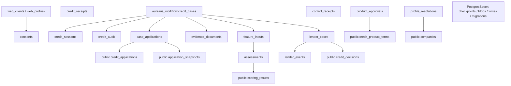
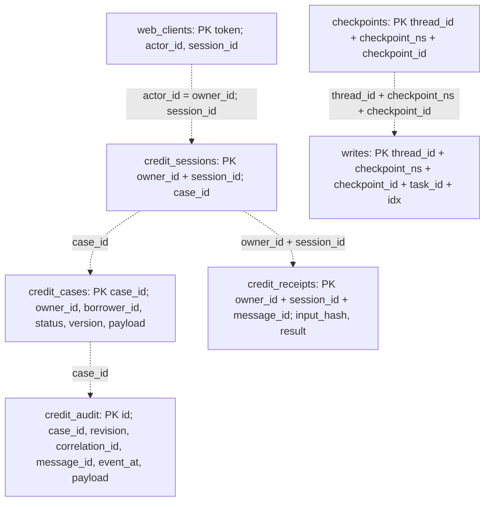

# 03.1. Схема БД и таблиц AURELIUS

## Расширение приложения · 24.10.2026

Исходные 34 public-таблицы сохранены. Миграция `scoring/bd/migrations/001_workflow.sql` добавляет отдельную `aurelius_workflow`: credit_cases, credit_sessions, credit_receipts, credit_audit, web_clients, case_applications. PostgresSaver создаёт там свои checkpoint-таблицы. Связь case/revision/product → company/application/snapshot имеет FK на public; M3 создаёт собственные DRAFT и MANUAL snapshots, не меняет seeded заявки. Bootstrap восстанавливает backup только в пустой том, миграции применяются отдельно. Реальное восстановление проверено: 30 компаний, 3 продукта, 99 требований. Подробнее: [контракт интеграции](../../docs/POSTGRES_INTEGRATION.md).

Актуальная структура рабочего дерева · 24.10.2026 · public DDL и additive runtime-миграции.

Источник PostgreSQL — [schema.sql](../../scoring/bd/schema.sql): **34 таблицы**, первичные/уникальные/внешние ключи и три триггера. Это проверка сохранённого DDL; она не подтверждает состояние запущенной БД или количество загруженных строк. SQLite описана по `CaseRepository`, frontend `ChatService` и используемой реализации `SqliteSaver` (состав служебных полей зависит от версии библиотеки).

## PostgreSQL: все таблицы и связи

Стрелка направлена от родительской таблицы к дочерней и означает наличие FK. Несколько FK одной пары объединены одной стрелкой; составные ключи раскрыты ниже. Диаграмма не утверждает обязательность дочерней строки и не изображает последовательность выполнения сервисов. В узлах показаны первичные ключи, полный словарь колонок приведён после схем.

```mermaid
flowchart LR
    application_data_requests["application_data_requests<br/>PK: request_id"]
    application_details["application_details<br/>PK: application_id"]
    application_field_history["application_field_history<br/>PK: history_id"]
    application_field_requirements["application_field_requirements<br/>PK: product_code, field_number"]
    application_field_values["application_field_values<br/>PK: application_id, field_code"]
    application_product_details["application_product_details<br/>PK: application_id"]
    application_product_terms["application_product_terms<br/>PK: offer_id"]
    application_snapshots["application_snapshots<br/>PK: snapshot_id"]
    bank_transactions["bank_transactions<br/>PK: transaction_id"]
    collateral["collateral<br/>PK: collateral_id"]
    companies["companies<br/>PK: company_id"]
    company_bank_accounts["company_bank_accounts<br/>PK: account_id"]
    company_contacts["company_contacts<br/>PK: contact_id"]
    company_data_provenance["company_data_provenance<br/>PK: provenance_id"]
    credit_applications["credit_applications<br/>PK: application_id"]
    credit_decisions["credit_decisions<br/>PK: decision_id"]
    credit_history_events["credit_history_events<br/>PK: event_id"]
    credit_line_operations["credit_line_operations<br/>PK: operation_id"]
    credit_obligations["credit_obligations<br/>PK: obligation_id"]
    credit_product_eligibility_rules["credit_product_eligibility_rules<br/>PK: rule_id"]
    credit_product_fees["credit_product_fees<br/>PK: fee_id"]
    credit_product_purposes["credit_product_purposes<br/>PK: purpose_id"]
    credit_product_rate_options["credit_product_rate_options<br/>PK: rate_option_id"]
    credit_product_repayment_options["credit_product_repayment_options<br/>PK: repayment_option_id"]
    credit_product_terms["credit_product_terms<br/>PK: terms_id"]
    credit_products["credit_products<br/>PK: product_code"]
    credit_repayment_history["credit_repayment_history<br/>PK: repayment_id"]
    data_quality_checks["data_quality_checks<br/>PK: check_id"]
    financial_statements["financial_statements<br/>PK: statement_id"]
    guarantors["guarantors<br/>PK: guarantor_id"]
    legal_events["legal_events<br/>PK: legal_event_id"]
    macro_indicators["macro_indicators<br/>PK: indicator_id"]
    risk_policy_parameters["risk_policy_parameters<br/>PK: policy_id"]
    scoring_results["scoring_results<br/>PK: scoring_result_id"]
    application_field_requirements --> application_data_requests
    application_field_requirements --> application_field_history
    application_field_requirements --> application_field_values
    companies --> bank_transactions
    companies --> collateral
    companies --> company_bank_accounts
    companies --> company_contacts
    companies --> company_data_provenance
    companies --> credit_applications
    companies --> credit_history_events
    companies --> credit_line_operations
    companies --> credit_obligations
    companies --> data_quality_checks
    companies --> financial_statements
    companies --> legal_events
    company_bank_accounts --> application_product_details
    credit_applications --> application_data_requests
    credit_applications --> application_details
    credit_applications --> application_field_history
    credit_applications --> application_field_values
    credit_applications --> application_product_details
    credit_applications --> application_product_terms
    credit_applications --> application_snapshots
    credit_applications --> collateral
    credit_applications --> credit_decisions
    credit_applications --> credit_line_operations
    credit_applications --> data_quality_checks
    credit_applications --> guarantors
    credit_applications --> scoring_results
    credit_obligations --> credit_history_events
    credit_obligations --> credit_repayment_history
    credit_product_rate_options --> application_product_terms
    credit_product_repayment_options --> application_product_terms
    credit_product_terms --> application_product_terms
    credit_product_terms --> credit_product_eligibility_rules
    credit_product_terms --> credit_product_fees
    credit_product_terms --> credit_product_purposes
    credit_product_terms --> credit_product_rate_options
    credit_product_terms --> credit_product_repayment_options
    credit_products --> application_field_requirements
    credit_products --> credit_applications
    credit_products --> credit_line_operations
    credit_products --> credit_product_terms
    credit_products --> risk_policy_parameters
    scoring_results --> credit_decisions
```

`macro_indicators` изолирована: явных FK нет. `company_data_provenance.target_table/target_record_pk/target_field` — текстовые ссылки, а не FK к каждой таблице. `scoring_results.feature_snapshot` — JSONB, а не FK к `application_snapshots`. Между `credit_decisions.policy_version` и `risk_policy_parameters` также нет FK. Исходный SQL описывает public-контур; подключённые сервисы и дополнительные связи показаны ниже.

## PostgreSQL: runtime, М4 и М5

Сплошные связи между workflow и public здесь включают как объявленные FK, так и связи сервисов; полный набор FK смотрите в миграциях `001_workflow.sql` / `002_cabinet_services.sql`. Родитель public.credit_cases не создаётся: все кейсы находятся в отдельной схеме aurelius_workflow. Продуктовые документы, входы, оценки и ручные решения имеют собственные идентификаторы. Поля управления и принадлежность проверяются сервером, JSON-данные не становятся полномочиями.

| Дополнительная таблица | Состав и назначение |
|---|---|
| `web_profiles` | actor_id PK, company_id: выбранная разрешённая компания |
| `consents` | actor/company/scope PK, granted_at, expires_at, revoked_at |
| `control_receipts` | actor/request_id PK, input_hash, payload: повторы контекстных команд |
| `evidence_documents` | document_id PK, case/owner/company, filename/type/hash, content BYTEA, extracted_data JSONB, uploaded_at |
| `feature_inputs` | input_id PK, case/revision/evidence/product, data JSONB, reviewed_by/at |
| `assessments` | assessment_id PK, case/revision/evidence/product/hash, data JSONB, scoring_result_id, created_at |
| `lender_cases` | lender_case_id PK, case/revision/product/evidence, data JSONB, version |
| `lender_events` | event_id PK, lender_case_id FK, event_type/actor/data/created_at |
| `product_approvals` | terms_id PK/FK, policy_version, approved_by/at, rule_mappings |
| `profile_resolutions` | resolution_id PK, company FK, legal_form, source_ref, available_at, reviewed_by/at |

Полный DDL: [002_cabinet_services.sql](../../scoring/bd/migrations/002_cabinet_services.sql). Повторный init не восстанавливает public-схему и не удаляет данные. Связь assessment и offer с evidence проверяет сервис; в JSON сохранены модель/схема/единицы/горизонт, для dynamic public.pd остаётся null. События lender_events фиксируют ручные решения, акцепты, симуляцию исполнения и платежей.

## SQLite: явный legacy/test режим М1–М2

Здесь пунктир означает **логическую связь без объявленного FK**. `web_clients.actor_id` соответствует `owner_id`. Связь checkpoints с доменной заявкой идёт через workflow и содержимое checkpoint, не через SQL FK. `SqliteSaver` создаёт служебные `checkpoints` и `writes` при работе; он хранит состояние графа отдельно от доменного `payload`. Поле `credit_cases.version` — версия хранения для конкурентного обновления; доменная `revision` находится в JSON `payload` и аудите. История сообщений также внутри `payload`, отдельной таблицы сообщений нет. Интерфейс теперь использует серверные кейсы; прежний localStorage не импортируется автоматически.

## Служебные поля SQLite SqliteSaver

| Таблица | Все поля |
|---|---|
| `checkpoints` | `thread_id`, `checkpoint_ns`, `checkpoint_id`, `parent_checkpoint_id`, `type`, `checkpoint`, `metadata` |
| `writes` | `thread_id`, `checkpoint_ns`, `checkpoint_id`, `task_id`, `task_path`, `idx`, `channel`, `type`, `value` |

Состав и PK проверены по установленному `langgraph.checkpoint.sqlite.SqliteSaver`; бинарные значения `checkpoint`, `metadata`, `value` сериализует библиотека.

## Граница PostgreSQL и SQLite

PostgreSQL является runtime-хранилищем. `case_applications` связывает case/revision/product с company/application/snapshot; доменные кейсы, receipts, сессии и checkpoints также находятся в aurelius_workflow. SQLite импортируется только явной командой. Обучение CatBoost остаётся файловым, online-инференс читает проверенные feature_inputs с привязкой к evidence.

## Целостность и аудит

- Составные FK привязывают анкетные поля к продукту и справочнику требований, предложение — к продукту и версии условий, счёт овердрафта — к компании, решение — к скорингу той же заявки.
- `trg_log_application_field_values`: после INSERT/UPDATE/DELETE значения записывается история; UPDATE логируется при изменении значения/источника/ссылки/верификации.
- `trg_immutable_application_field_history` и `trg_immutable_application_snapshots` запрещают UPDATE/DELETE истории и снимков.
- `application_snapshots` хранит JSONB-снимки SUBMISSION/DECISION/MANUAL с уникальностью `(application_id, snapshot_version)`; это ещё не отдельная версионированная ML-витрина.
- `scoring_results` хранит `pd`, но не имеет отдельных колонок определения события, горизонта и калибратора. Сохранять dynamic hazard как PD12 без расширения контракта нельзя.
- В aurelius_workflow добавлены документы, согласия, профиль, оценки, ручные предложения и события симуляции. Реальных банковских подписей и подтверждений выдачи нет. Наличие строки DEMO не является реальной банковской операцией.

## Полный словарь PostgreSQL

Типы и nullable взяты из DDL. CHECK, DEFAULT и действия ON DELETE следует смотреть в исходном SQL. `NULL` означает разрешённый пропуск; PK автоматически запрещает NULL независимо от явного NOT NULL.

### `application_data_requests`

PK: `request_id`.

| Колонка | Тип PostgreSQL | NULL |
|---|---|---|
| `request_id` | `bigint` | нет |
| `application_id` | `bigint` | нет |
| `product_code` | `character varying(10)` | нет |
| `field_code` | `text` | нет |
| `question_text` | `text` | нет |
| `request_status` | `character varying(20)` | нет |
| `requested_at` | `timestamp with time zone` | нет |
| `answered_at` | `timestamp with time zone` | да |
| `answer_value` | `jsonb` | да |

Внешние ключи:

- `application_data_requests_application_id_fkey`: `(application_id)` → `credit_applications(application_id)`.
- `fk_request_defined_field`: `(product_code, field_code)` → `application_field_requirements(product_code, field_code)`.
- `fk_request_same_product`: `(application_id, product_code)` → `credit_applications(application_id, product_code)`.

### `application_details`

PK: `application_id`.

| Колонка | Тип PostgreSQL | NULL |
|---|---|---|
| `application_id` | `bigint` | нет |
| `guarantor_participation` | `boolean` | да |
| `proposed_collateral` | `boolean` | да |
| `contact_full_name` | `text` | да |
| `contact_role` | `text` | да |
| `contact_phone` | `text` | да |
| `signer_full_name` | `text` | да |
| `signer_authority_basis` | `text` | да |
| `confirmation_version` | `text` | да |
| `confirmed_at` | `timestamp with time zone` | да |

Внешние ключи:

- `application_details_application_id_fkey`: `(application_id)` → `credit_applications(application_id)`.

### `application_field_history`

PK: `history_id`.

| Колонка | Тип PostgreSQL | NULL |
|---|---|---|
| `history_id` | `bigint` | нет |
| `application_id` | `bigint` | нет |
| `product_code` | `character varying(10)` | нет |
| `field_code` | `text` | нет |
| `old_value` | `jsonb` | да |
| `new_value` | `jsonb` | да |
| `changed_at` | `timestamp with time zone` | нет |
| `changed_by_type` | `character varying(20)` | нет |
| `source_type` | `character varying(20)` | нет |
| `source_reference` | `text` | да |
| `verification_status` | `character varying(20)` | нет |

Внешние ключи:

- `fk_history_defined_field`: `(product_code, field_code)` → `application_field_requirements(product_code, field_code)`.
- `fk_history_same_product`: `(application_id, product_code)` → `credit_applications(application_id, product_code)`.

### `application_field_requirements`

PK: `product_code, field_number`.

UNIQUE: `product_code, field_code`.

| Колонка | Тип PostgreSQL | NULL |
|---|---|---|
| `product_code` | `character varying(10)` | нет |
| `field_number` | `integer` | нет |
| `field_code` | `text` | нет |
| `field_label` | `text` | нет |
| `required_ip` | `boolean` | нет |
| `required_ooo` | `boolean` | нет |
| `format_rule` | `text` | да |
| `source_description` | `text` | да |
| `fill_method` | `text` | да |
| `target_db_field` | `text` | нет |

Внешние ключи:

- `application_field_requirements_product_code_fkey`: `(product_code)` → `credit_products(product_code)`.

### `application_field_values`

PK: `application_id, field_code`.

| Колонка | Тип PostgreSQL | NULL |
|---|---|---|
| `application_id` | `bigint` | нет |
| `field_code` | `text` | нет |
| `field_value` | `jsonb` | да |
| `value_source` | `character varying(20)` | да |
| `source_reference` | `text` | да |
| `obtained_at` | `timestamp with time zone` | да |
| `verification_status` | `character varying(20)` | да |
| `updated_at` | `timestamp with time zone` | нет |
| `changed_by_type` | `character varying(20)` | нет |
| `product_code` | `character varying(10)` | нет |

Внешние ключи:

- `application_field_values_application_id_fkey`: `(application_id)` → `credit_applications(application_id)`.
- `fk_value_defined_field`: `(product_code, field_code)` → `application_field_requirements(product_code, field_code)`.
- `fk_value_same_product`: `(application_id, product_code)` → `credit_applications(application_id, product_code)`.

### `application_product_details`

PK: `application_id`.

| Колонка | Тип PostgreSQL | NULL |
|---|---|---|
| `application_id` | `bigint` | нет |
| `max_tranche_term_value` | `integer` | да |
| `max_tranche_term_unit` | `character varying(10)` | да |
| `drawdown_start_date` | `date` | да |
| `drawdown_end_date` | `date` | да |
| `drawdown_period_months` | `integer` | да |
| `is_revolving` | `boolean` | да |
| `overdraft_bank_account_id` | `bigint` | да |
| `overdraft_account_ref` | `character varying(20)` | да |
| `overdraft_bank_name` | `text` | да |
| `overdraft_bank_bik` | `character varying(9)` | да |
| `company_id` | `bigint` | нет |

Внешние ключи:

- `application_product_details_application_id_fkey`: `(application_id)` → `credit_applications(application_id)`.
- `fk_details_bank_account_owner`: `(overdraft_bank_account_id, company_id)` → `company_bank_accounts(account_id, company_id)`.
- `fk_details_same_company`: `(application_id, company_id)` → `credit_applications(application_id, company_id)`.

### `application_product_terms`

PK: `offer_id`.

| Колонка | Тип PostgreSQL | NULL |
|---|---|---|
| `offer_id` | `bigint` | нет |
| `application_id` | `bigint` | нет |
| `terms_id` | `bigint` | нет |
| `rate_option_id` | `bigint` | да |
| `repayment_option_id` | `bigint` | да |
| `offered_amount` | `numeric(18,2)` | да |
| `offered_term_months` | `integer` | да |
| `offered_annual_rate_pct` | `numeric(9,4)` | да |
| `offered_tranche_term_value` | `integer` | да |
| `offered_tranche_term_unit` | `character varying(10)` | да |
| `offered_drawdown_period_months` | `integer` | да |
| `offered_service_cost` | `numeric(18,2)` | да |
| `offered_fees` | `jsonb` | да |
| `offered_conditions` | `jsonb` | да |
| `product_code` | `character varying(10)` | нет |
| `offer_status` | `character varying(20)` | нет |
| `created_at` | `timestamp with time zone` | нет |

Внешние ключи:

- `application_product_terms_application_id_fkey`: `(application_id)` → `credit_applications(application_id)`.
- `application_product_terms_rate_option_id_fkey`: `(rate_option_id)` → `credit_product_rate_options(rate_option_id)`.
- `application_product_terms_repayment_option_id_fkey`: `(repayment_option_id)` → `credit_product_repayment_options(repayment_option_id)`.
- `application_product_terms_terms_id_fkey`: `(terms_id)` → `credit_product_terms(terms_id)`.
- `fk_offer_rate_same_terms`: `(rate_option_id, terms_id)` → `credit_product_rate_options(rate_option_id, terms_id)`.
- `fk_offer_repayment_same_terms`: `(repayment_option_id, terms_id)` → `credit_product_repayment_options(repayment_option_id, terms_id)`.
- `fk_offer_same_product`: `(application_id, product_code)` → `credit_applications(application_id, product_code)`.
- `fk_offer_terms_same_product`: `(terms_id, product_code)` → `credit_product_terms(terms_id, product_code)`.

### `application_snapshots`

PK: `snapshot_id`.

UNIQUE: `application_id, snapshot_version`.

| Колонка | Тип PostgreSQL | NULL |
|---|---|---|
| `snapshot_id` | `bigint` | нет |
| `application_id` | `bigint` | нет |
| `snapshot_type` | `character varying(20)` | нет |
| `snapshot_data` | `jsonb` | нет |
| `created_at` | `timestamp with time zone` | нет |
| `created_by_type` | `character varying(20)` | нет |
| `snapshot_version` | `integer` | нет |

Внешние ключи:

- `application_snapshots_application_id_fkey`: `(application_id)` → `credit_applications(application_id)`.

### `bank_transactions`

PK: `transaction_id`.

| Колонка | Тип PostgreSQL | NULL |
|---|---|---|
| `transaction_id` | `bigint` | нет |
| `company_id` | `bigint` | нет |
| `account_ref` | `character varying(100)` | да |
| `bank_name` | `character varying(100)` | да |
| `transaction_date` | `timestamp with time zone` | нет |
| `amount` | `numeric(18,2)` | нет |
| `currency` | `character(3)` | нет |
| `direction` | `character varying(10)` | нет |
| `operation_category` | `character varying(30)` | нет |
| `counterparty_inn` | `character varying(12)` | да |
| `counterparty_name` | `text` | да |
| `payment_purpose` | `text` | да |
| `balance_after` | `numeric(18,2)` | да |
| `source_statement_id` | `character varying(100)` | да |
| `source_checked_at` | `timestamp with time zone` | да |

Внешние ключи:

- `bank_transactions_company_id_fkey`: `(company_id)` → `companies(company_id)`.

### `collateral`

PK: `collateral_id`.

| Колонка | Тип PostgreSQL | NULL |
|---|---|---|
| `collateral_id` | `bigint` | нет |
| `company_id` | `bigint` | нет |
| `application_id` | `bigint` | нет |
| `asset_type` | `character varying(20)` | нет |
| `asset_description` | `text` | да |
| `owner_type` | `character varying(20)` | нет |
| `owner_ref` | `text` | да |
| `estimated_market_value` | `numeric(18,2)` | да |
| `valuation_date` | `date` | да |
| `discount_rate` | `numeric(6,4)` | да |
| `estimated_liquidation_value` | `numeric(18,2)` | да |
| `encumbrance_status` | `character varying(20)` | нет |
| `registry_name` | `character varying(50)` | да |
| `registry_record_id` | `text` | да |
| `verification_date` | `timestamp with time zone` | да |
| `collateral_status` | `character varying(20)` | нет |

Внешние ключи:

- `collateral_application_id_fkey`: `(application_id)` → `credit_applications(application_id)`.
- `collateral_company_id_fkey`: `(company_id)` → `companies(company_id)`.
- `fk_collateral_same_company`: `(application_id, company_id)` → `credit_applications(application_id, company_id)`.

### `companies`

PK: `company_id`.

UNIQUE: `inn`.

| Колонка | Тип PostgreSQL | NULL |
|---|---|---|
| `company_id` | `bigint` | нет |
| `entity_type` | `character varying(30)` | нет |
| `inn` | `character varying(12)` | нет |
| `ogrn` | `character varying(13)` | да |
| `ogrnip` | `character varying(15)` | да |
| `name` | `text` | нет |
| `registration_date` | `date` | да |
| `status` | `character varying(30)` | нет |
| `status_date` | `date` | да |
| `okved_main` | `character varying(10)` | да |
| `region_code` | `character varying(10)` | да |
| `legal_address` | `text` | да |
| `director_name` | `text` | да |
| `director_authority_confirmed` | `boolean` | да |
| `information_reliability_status` | `character varying(30)` | нет |
| `source_checked_at` | `timestamp with time zone` | да |
| `created_at` | `timestamp with time zone` | нет |
| `updated_at` | `timestamp with time zone` | нет |
| `kpp` | `character varying(9)` | да |
| `legal_form` | `text` | да |
| `okved_main_name` | `text` | да |
| `actual_activity_description` | `text` | да |
| `actual_business_address` | `text` | да |
| `business_region` | `text` | да |
| `business_city` | `text` | да |
| `sme_category` | `character varying(20)` | да |
| `actual_activity_start_date` | `date` | да |
| `director_position` | `text` | да |

### `company_bank_accounts`

PK: `account_id`.

UNIQUE: `company_id, account_number`; `account_id, company_id`.

| Колонка | Тип PostgreSQL | NULL |
|---|---|---|
| `account_id` | `bigint` | нет |
| `company_id` | `bigint` | нет |
| `account_number` | `character varying(20)` | нет |
| `bank_name` | `text` | нет |
| `bank_bik` | `character varying(9)` | да |
| `account_status` | `character varying(20)` | нет |
| `source_checked_at` | `timestamp with time zone` | да |

Внешние ключи:

- `company_bank_accounts_company_id_fkey`: `(company_id)` → `companies(company_id)`.

### `company_contacts`

PK: `contact_id`.

| Колонка | Тип PostgreSQL | NULL |
|---|---|---|
| `contact_id` | `bigint` | нет |
| `company_id` | `bigint` | нет |
| `full_name` | `text` | нет |
| `contact_role` | `text` | да |
| `phone` | `text` | да |
| `authority_basis` | `text` | да |
| `is_current` | `boolean` | да |
| `source_checked_at` | `timestamp with time zone` | да |

Внешние ключи:

- `company_contacts_company_id_fkey`: `(company_id)` → `companies(company_id)`.

### `company_data_provenance`

PK: `provenance_id`.

| Колонка | Тип PostgreSQL | NULL |
|---|---|---|
| `provenance_id` | `bigint` | нет |
| `company_id` | `bigint` | нет |
| `target_table` | `text` | нет |
| `target_record_pk` | `jsonb` | нет |
| `target_field` | `text` | нет |
| `observed_value` | `jsonb` | да |
| `source_type` | `character varying(30)` | нет |
| `source_reference` | `text` | да |
| `obtained_at` | `timestamp with time zone` | нет |
| `verification_status` | `character varying(20)` | нет |
| `verified_at` | `timestamp with time zone` | да |

Внешние ключи:

- `company_data_provenance_company_id_fkey`: `(company_id)` → `companies(company_id)`.

### `credit_applications`

PK: `application_id`.

UNIQUE: `application_id, company_id`; `application_id, company_id, product_code`; `application_id, product_code`.

| Колонка | Тип PostgreSQL | NULL |
|---|---|---|
| `application_id` | `bigint` | нет |
| `company_id` | `bigint` | нет |
| `product_code` | `character varying(10)` | нет |
| `application_date` | `timestamp with time zone` | нет |
| `requested_amount` | `numeric(18,2)` | да |
| `requested_term_days` | `integer` | да |
| `purpose` | `text` | да |
| `requested_monthly_payment` | `numeric(18,2)` | да |
| `application_status` | `character varying(20)` | нет |
| `missing_data_status` | `character varying(20)` | нет |
| `decision_date` | `timestamp with time zone` | да |
| `requested_data_deadline` | `timestamp with time zone` | да |
| `requested_term_months` | `integer` | да |

Внешние ключи:

- `credit_applications_company_id_fkey`: `(company_id)` → `companies(company_id)`.
- `credit_applications_product_code_fkey`: `(product_code)` → `credit_products(product_code)`.

### `credit_decisions`

PK: `decision_id`.

| Колонка | Тип PostgreSQL | NULL |
|---|---|---|
| `decision_id` | `bigint` | нет |
| `application_id` | `bigint` | нет |
| `scoring_result_id` | `bigint` | да |
| `policy_version` | `character varying(50)` | нет |
| `decided_at` | `timestamp with time zone` | нет |
| `eligibility_status` | `character varying(20)` | нет |
| `decision` | `character varying(20)` | нет |
| `approved_amount` | `numeric(18,2)` | да |
| `approved_term_days` | `integer` | да |
| `reasons` | `jsonb` | да |

Внешние ключи:

- `credit_decisions_application_id_fkey`: `(application_id)` → `credit_applications(application_id)`.
- `credit_decisions_scoring_result_id_fkey`: `(scoring_result_id)` → `scoring_results(scoring_result_id)`.
- `fk_decision_scoring_same_application`: `(scoring_result_id, application_id)` → `scoring_results(scoring_result_id, application_id)`.

### `credit_history_events`

PK: `event_id`.

| Колонка | Тип PostgreSQL | NULL |
|---|---|---|
| `event_id` | `bigint` | нет |
| `company_id` | `bigint` | нет |
| `obligation_id` | `bigint` | да |
| `event_type` | `character varying(20)` | нет |
| `event_date` | `date` | нет |
| `overdue_days` | `integer` | да |
| `overdue_amount` | `numeric(18,2)` | да |
| `resolution_date` | `date` | да |
| `event_status` | `character varying(20)` | нет |
| `source_event_id` | `text` | да |
| `source_checked_at` | `timestamp with time zone` | да |

Внешние ключи:

- `credit_history_events_company_id_fkey`: `(company_id)` → `companies(company_id)`.
- `credit_history_events_obligation_id_fkey`: `(obligation_id)` → `credit_obligations(obligation_id)`.
- `fk_credit_event_same_company`: `(obligation_id, company_id)` → `credit_obligations(obligation_id, company_id)`.

### `credit_line_operations`

PK: `operation_id`.

| Колонка | Тип PostgreSQL | NULL |
|---|---|---|
| `operation_id` | `bigint` | нет |
| `company_id` | `bigint` | нет |
| `application_id` | `bigint` | нет |
| `product_code` | `character varying(10)` | нет |
| `operation_date` | `timestamp with time zone` | нет |
| `operation_type` | `character varying(20)` | нет |
| `operation_amount` | `numeric(18,2)` | нет |
| `credit_limit` | `numeric(18,2)` | да |
| `outstanding_debt` | `numeric(18,2)` | да |
| `available_limit` | `numeric(18,2)` | да |
| `source_operation_id` | `text` | да |

Внешние ключи:

- `credit_line_operations_application_id_fkey`: `(application_id)` → `credit_applications(application_id)`.
- `credit_line_operations_company_id_fkey`: `(company_id)` → `companies(company_id)`.
- `credit_line_operations_product_code_fkey`: `(product_code)` → `credit_products(product_code)`.
- `fk_line_operation_same_company_product`: `(application_id, company_id, product_code)` → `credit_applications(application_id, company_id, product_code)`.

### `credit_obligations`

PK: `obligation_id`.

UNIQUE: `obligation_id, company_id`.

| Колонка | Тип PostgreSQL | NULL |
|---|---|---|
| `obligation_id` | `bigint` | нет |
| `company_id` | `bigint` | нет |
| `creditor_name` | `text` | да |
| `obligation_type` | `character varying(20)` | нет |
| `contract_ref` | `character varying(100)` | да |
| `contract_date` | `date` | да |
| `maturity_date` | `date` | да |
| `disbursement_date` | `date` | да |
| `actual_close_date` | `date` | да |
| `first_default_date` | `date` | да |
| `original_amount` | `numeric(18,2)` | да |
| `outstanding_balance` | `numeric(18,2)` | да |
| `monthly_payment` | `numeric(18,2)` | да |
| `interest_rate` | `numeric(8,4)` | да |
| `overdue_amount` | `numeric(18,2)` | да |
| `obligation_status` | `character varying(20)` | нет |

Внешние ключи:

- `credit_obligations_company_id_fkey`: `(company_id)` → `companies(company_id)`.

### `credit_product_eligibility_rules`

PK: `rule_id`.

UNIQUE: `terms_id, rule_code`.

| Колонка | Тип PostgreSQL | NULL |
|---|---|---|
| `rule_id` | `bigint` | нет |
| `terms_id` | `bigint` | нет |
| `rule_code` | `text` | нет |
| `rule_description` | `text` | нет |
| `parameter_name` | `text` | да |
| `comparison_operator` | `character varying(10)` | да |
| `threshold_value` | `jsonb` | да |
| `required_data_field` | `text` | да |
| `severity` | `character varying(20)` | нет |

Внешние ключи:

- `credit_product_eligibility_rules_terms_id_fkey`: `(terms_id)` → `credit_product_terms(terms_id)`.

### `credit_product_fees`

PK: `fee_id`.

| Колонка | Тип PostgreSQL | NULL |
|---|---|---|
| `fee_id` | `bigint` | нет |
| `terms_id` | `bigint` | нет |
| `fee_name` | `text` | нет |
| `fee_type` | `character varying(30)` | нет |
| `fee_value` | `numeric(18,4)` | да |
| `fee_frequency` | `text` | да |
| `applies_when` | `text` | да |

Внешние ключи:

- `credit_product_fees_terms_id_fkey`: `(terms_id)` → `credit_product_terms(terms_id)`.

### `credit_product_purposes`

PK: `purpose_id`.

| Колонка | Тип PostgreSQL | NULL |
|---|---|---|
| `purpose_id` | `bigint` | нет |
| `terms_id` | `bigint` | нет |
| `purpose_name` | `text` | нет |
| `is_allowed` | `boolean` | нет |
| `restriction_description` | `text` | да |

Внешние ключи:

- `credit_product_purposes_terms_id_fkey`: `(terms_id)` → `credit_product_terms(terms_id)`.

### `credit_product_rate_options`

PK: `rate_option_id`.

UNIQUE: `rate_option_id, terms_id`.

| Колонка | Тип PostgreSQL | NULL |
|---|---|---|
| `rate_option_id` | `bigint` | нет |
| `terms_id` | `bigint` | нет |
| `option_name` | `text` | нет |
| `min_annual_rate_pct` | `numeric(9,4)` | да |
| `max_annual_rate_pct` | `numeric(9,4)` | да |
| `additional_service_name` | `text` | да |
| `service_fee_type` | `character varying(30)` | да |
| `service_fee_frequency` | `character varying(20)` | да |
| `service_fee_amount` | `numeric(18,4)` | да |
| `discount_end_condition` | `text` | да |
| `max_tranche_term_days` | `integer` | да |
| `limit_review_frequency` | `character varying(30)` | да |
| `limit_reduction_protected` | `boolean` | да |
| `service_fee_allowed_pct` | `numeric(6,2)[]` | да |
| `max_tranche_term_months` | `integer` | да |

Внешние ключи:

- `credit_product_rate_options_terms_id_fkey`: `(terms_id)` → `credit_product_terms(terms_id)`.

### `credit_product_repayment_options`

PK: `repayment_option_id`.

UNIQUE: `repayment_option_id, terms_id`.

| Колонка | Тип PostgreSQL | NULL |
|---|---|---|
| `repayment_option_id` | `bigint` | нет |
| `terms_id` | `bigint` | нет |
| `repayment_type` | `character varying(30)` | нет |
| `principal_payment_frequency` | `character varying(20)` | да |
| `interest_payment_frequency` | `character varying(20)` | да |
| `automatic_from_account` | `boolean` | да |
| `description` | `text` | да |

Внешние ключи:

- `credit_product_repayment_options_terms_id_fkey`: `(terms_id)` → `credit_product_terms(terms_id)`.

### `credit_product_terms`

PK: `terms_id`.

UNIQUE: `product_code, version_code`; `terms_id, product_code`.

| Колонка | Тип PostgreSQL | NULL |
|---|---|---|
| `terms_id` | `bigint` | нет |
| `product_code` | `character varying(10)` | нет |
| `version_code` | `text` | нет |
| `effective_from` | `date` | да |
| `effective_to` | `date` | да |
| `min_amount` | `numeric(18,2)` | да |
| `max_amount` | `numeric(18,2)` | да |
| `min_contract_term_value` | `integer` | да |
| `max_contract_term_value` | `integer` | да |
| `contract_term_unit` | `character varying(10)` | да |
| `min_tranche_amount` | `numeric(18,2)` | да |
| `min_tranche_term_value` | `integer` | да |
| `max_tranche_term_value` | `integer` | да |
| `tranche_term_unit` | `character varying(10)` | да |
| `drawdown_period_months` | `integer` | да |
| `drawdown_end_before_maturity_months` | `integer` | да |
| `is_revolving` | `boolean` | да |
| `auto_renewal` | `boolean` | да |
| `renewal_period_months` | `integer` | да |
| `requires_collateral` | `boolean` | да |
| `guarantor_requirement` | `character varying(20)` | да |
| `min_business_age_months` | `integer` | да |
| `allowed_entity_types` | `text[]` | да |
| `allowed_sme_categories` | `text[]` | да |
| `source_url` | `text` | да |
| `source_checked_at` | `timestamp with time zone` | да |

Внешние ключи:

- `credit_product_terms_product_code_fkey`: `(product_code)` → `credit_products(product_code)`.

### `credit_products`

PK: `product_code`.

| Колонка | Тип PostgreSQL | NULL |
|---|---|---|
| `product_code` | `character varying(10)` | нет |
| `product_name` | `text` | нет |
| `product_type` | `character varying(20)` | нет |
| `active` | `boolean` | нет |

### `credit_repayment_history`

PK: `repayment_id`.

UNIQUE: `obligation_id, period_date`.

| Колонка | Тип PostgreSQL | NULL |
|---|---|---|
| `repayment_id` | `bigint` | нет |
| `obligation_id` | `bigint` | нет |
| `period_date` | `date` | нет |
| `scheduled_payment` | `numeric(18,2)` | да |
| `actual_payment` | `numeric(18,2)` | да |
| `outstanding_balance` | `numeric(18,2)` | да |
| `overdue_amount` | `numeric(18,2)` | да |
| `overdue_days` | `integer` | да |
| `default_flag` | `boolean` | да |
| `observation_status` | `character varying(20)` | нет |
| `source_record_id` | `text` | да |
| `source_checked_at` | `timestamp with time zone` | да |
| `created_at` | `timestamp with time zone` | нет |

Внешние ключи:

- `credit_repayment_history_obligation_id_fkey`: `(obligation_id)` → `credit_obligations(obligation_id)`.

### `data_quality_checks`

PK: `check_id`.

| Колонка | Тип PostgreSQL | NULL |
|---|---|---|
| `check_id` | `bigint` | нет |
| `company_id` | `bigint` | нет |
| `application_id` | `bigint` | да |
| `source_name` | `character varying(50)` | да |
| `field_name` | `character varying(100)` | да |
| `check_type` | `character varying(20)` | нет |
| `check_status` | `character varying(20)` | нет |
| `checked_at` | `timestamp with time zone` | нет |
| `data_as_of` | `timestamp with time zone` | да |
| `missing_fields` | `jsonb` | да |
| `conflict_description` | `text` | да |
| `severity` | `character varying(20)` | нет |
| `resolution_status` | `character varying(20)` | нет |
| `resolution_comment` | `text` | да |

Внешние ключи:

- `data_quality_checks_application_id_fkey`: `(application_id)` → `credit_applications(application_id)`.
- `data_quality_checks_company_id_fkey`: `(company_id)` → `companies(company_id)`.
- `fk_quality_same_company`: `(application_id, company_id)` → `credit_applications(application_id, company_id)`.

### `financial_statements`

PK: `statement_id`.

UNIQUE: `company_id, period_start, period_end, statement_type`.

| Колонка | Тип PostgreSQL | NULL |
|---|---|---|
| `statement_id` | `bigint` | нет |
| `company_id` | `bigint` | нет |
| `period_start` | `date` | нет |
| `period_end` | `date` | нет |
| `statement_type` | `character varying(20)` | нет |
| `revenue` | `numeric(18,2)` | да |
| `cost_of_sales` | `numeric(18,2)` | да |
| `gross_profit` | `numeric(18,2)` | да |
| `operating_expenses` | `numeric(18,2)` | да |
| `operating_profit` | `numeric(18,2)` | да |
| `net_profit` | `numeric(18,2)` | да |
| `total_assets` | `numeric(18,2)` | да |
| `current_assets` | `numeric(18,2)` | да |
| `cash_and_equivalents` | `numeric(18,2)` | да |
| `short_term_liabilities` | `numeric(18,2)` | да |
| `total_liabilities` | `numeric(18,2)` | да |
| `equity` | `numeric(18,2)` | да |
| `source_document_id` | `text` | да |
| `source_checked_at` | `timestamp with time zone` | да |
| `is_verified` | `boolean` | да |

Внешние ключи:

- `financial_statements_company_id_fkey`: `(company_id)` → `companies(company_id)`.

### `guarantors`

PK: `guarantor_id`.

| Колонка | Тип PostgreSQL | NULL |
|---|---|---|
| `guarantor_id` | `bigint` | нет |
| `application_id` | `bigint` | нет |
| `guarantor_type` | `character varying(20)` | нет |
| `name` | `text` | нет |
| `inn` | `character varying(12)` | да |
| `ogrn` | `character varying(13)` | да |
| `ogrnip` | `character varying(15)` | да |
| `relationship_type` | `character varying(20)` | нет |
| `existing_obligations_amount` | `numeric(18,2)` | да |
| `financial_capacity_status` | `character varying(20)` | нет |
| `source_checked_at` | `timestamp with time zone` | да |

Внешние ключи:

- `guarantors_application_id_fkey`: `(application_id)` → `credit_applications(application_id)`.

### `legal_events`

PK: `legal_event_id`.

| Колонка | Тип PostgreSQL | NULL |
|---|---|---|
| `legal_event_id` | `bigint` | нет |
| `company_id` | `bigint` | нет |
| `source_name` | `character varying(20)` | нет |
| `source_record_id` | `text` | да |
| `event_type` | `character varying(30)` | нет |
| `event_date` | `date` | да |
| `case_number` | `character varying(100)` | да |
| `counterparty_name` | `text` | да |
| `amount` | `numeric(18,2)` | да |
| `event_status` | `character varying(20)` | нет |
| `company_role` | `character varying(20)` | нет |
| `description` | `text` | да |
| `source_checked_at` | `timestamp with time zone` | да |

Внешние ключи:

- `legal_events_company_id_fkey`: `(company_id)` → `companies(company_id)`.

### `macro_indicators`

PK: `indicator_id`.

UNIQUE: `indicator_code, effective_date, source`.

| Колонка | Тип PostgreSQL | NULL |
|---|---|---|
| `indicator_id` | `bigint` | нет |
| `indicator_code` | `character varying(50)` | нет |
| `indicator_value` | `numeric(12,4)` | нет |
| `effective_date` | `date` | нет |
| `source` | `character varying(100)` | нет |
| `loaded_at` | `timestamp with time zone` | нет |

### `risk_policy_parameters`

PK: `policy_id`.

UNIQUE: `product_code, policy_version`.

| Колонка | Тип PostgreSQL | NULL |
|---|---|---|
| `policy_id` | `bigint` | нет |
| `product_code` | `character varying(3)` | нет |
| `policy_version` | `character varying(50)` | нет |
| `funding_spread_pct` | `numeric(8,4)` | нет |
| `operating_cost_pct` | `numeric(8,4)` | нет |
| `required_margin_pct` | `numeric(8,4)` | нет |
| `lgd_pct` | `numeric(8,4)` | нет |
| `effective_from` | `date` | нет |
| `effective_to` | `date` | да |
| `created_at` | `timestamp with time zone` | нет |

Внешние ключи:

- `risk_policy_parameters_product_fk`: `(product_code)` → `credit_products(product_code)`.

### `scoring_results`

PK: `scoring_result_id`.

UNIQUE: `scoring_result_id, application_id`.

| Колонка | Тип PostgreSQL | NULL |
|---|---|---|
| `scoring_result_id` | `bigint` | нет |
| `application_id` | `bigint` | нет |
| `model_version` | `character varying(50)` | нет |
| `scored_at` | `timestamp with time zone` | нет |
| `score` | `numeric(12,4)` | да |
| `pd` | `numeric(8,6)` | да |
| `risk_grade` | `character varying(20)` | нет |
| `feature_snapshot` | `jsonb` | да |
| `source_snapshot_date` | `timestamp with time zone` | да |

Внешние ключи:

- `scoring_results_application_id_fkey`: `(application_id)` → `credit_applications(application_id)`.

## Проверенные источники

- [PostgreSQL DDL](../../scoring/bd/schema.sql), [справочник БД](../../scoring/bd/README_bd.md), [seeds](../../scoring/bd/seeds/seed_aurelius.py).
- [SQLite-репозиторий](../../personalCab/prom/prom_lab/ai_agents_lab/repositories/case_repository.py), [HTTP-сервер](../../personalCab/frontend/server.py), [workflow и SqliteSaver](../../personalCab/prom/prom_lab/ai_agents_lab/agents/workflow.py).
- [Общая архитектура и список расхождений](00_architecture_overview.md).
