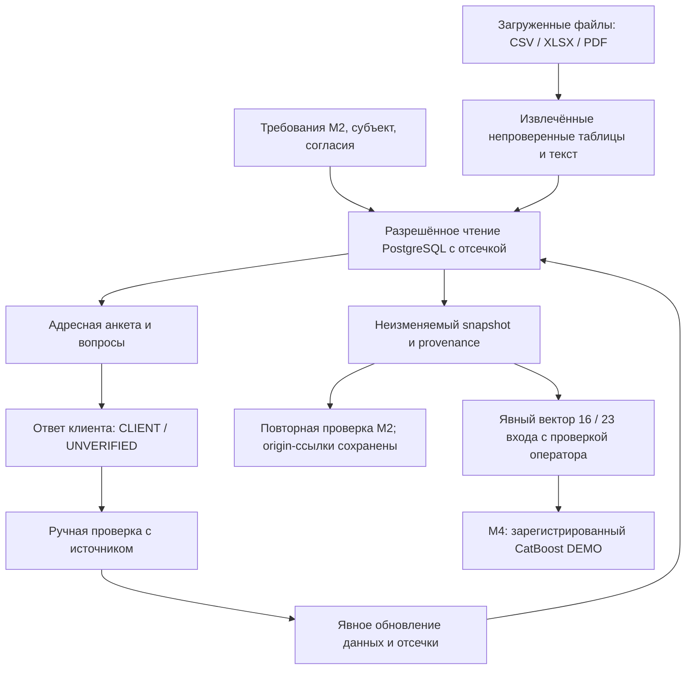

# Модуль 3. Сбор данных и подготовка признаков

> Дополнение 24.10.2026: Конфликты provenance по форме бизнеса блокируют подтверждение факта. Типизированный DataResolutionPlan отделяет вопросы пользователю от ENGINEERING-задач по mapping/формулам и актуальности продуктовых условий. Узкий read-only lookup формы разрешён и до готовности запроса при проверенных полномочиях/согласии; автоматические формулы остаются за явной методологической границей, М4 использует отдельно проверенные входы. См. [контракт интеграции](../../docs/POSTGRES_INTEGRATION.md).

## Реализация после интеграции · 24.10.2026

Реализованы чтение БД, адресная анкета, сохранение CLIENT/UNVERIFIED-ответов и запросов данных, загрузка/извлечение файлов, ручная проверка и явное обновление snapshot. Первоначальные ссылки снимка сохраняются, результат повторного М2 связан через evidence_recheck. Автоматические неутверждённые ratios и преобразования отсутствуют: выбранный пользователем режим использует явный вектор с подтверждением оператора. OCR сканов и сложные форматные проверки остаются ручными.

Проект AI-CreditSys · версия 1.1 · сверка реализации 24.10.2026. Исходная спецификация: 20.10.2026.

Предыдущий модуль: [подбор продукта](02_product_matching.md). Следующий: [скоринг и расчёты](04_scoring_and_offers.md).

## Назначение

Собрать разрешённые данные по выбранным маршрутам, проверить их, рассчитать признаки и сформировать неизменяемый снимок для оценки. Обработка выполняется по версии схемы, а не по произвольному пересказу документов агентом.

## Схема



## Текущая реализация · 24.10.2026

Реализованы чтение БД, адресная анкета, сохранение CLIENT/UNVERIFIED-ответов и запросов данных, загрузка/извлечение файлов, ручная проверка и явное обновление snapshot. Первоначальные ссылки снимка сохраняются, результат повторного М2 связан через evidence_recheck. Автоматические неутверждённые ratios и преобразования отсутствуют: выбранный пользователем режим использует явный вектор с подтверждением оператора. OCR сканов и сложные форматные проверки остаются ручными.

Контракты, запуск и операторские команды: [DEMO_MODULES_1_5.md](../../docs/DEMO_MODULES_1_5.md).

## Входы и выходы

**Вход:** `case_id`, `revision`, субъект, продукты-кандидаты, требования, документы и основания доступа к источникам.

**Текущий выход:** SNAPSHOT_READY, application_ids/snapshot_ids, questionnaire, документы, покрытие, явные неизвестные признаки. **Целевое развитие:** полностью автоматизированные проверенные признаки и маски после утверждения методологии. Следующий JSON — исторический целевой контракт, не текущий ответ DEMO.

```json
{
  "case_id": "CASE-PETYA-001",
  "revision": 1,
  "mode": "DEMO",
  "status": "FEATURES_READY",
  "feature_snapshot_id": "FS-PETYA-001",
  "feature_schema_version": "RF-SME-V1-PROPOSED",
  "data_quality": {
    "blocking_issues": [],
    "missing_groups": ["ACCOUNTING_BALANCE"],
    "cashflow_coverage_status": "TO_BE_VERIFIED"
  },
  "model_readiness": "TO_BE_CHECKED_BY_MODEL_REGISTRY",
  "next_module": 4
}
```

`FEATURES_READY` означает, что снимок подготовлен с явным качеством и пропусками. Пригодность для конкретной модели проверяет модуль 4. Блокирующие ошибки должны быть разрешены либо приводить к отдельному ручному маршруту.

## Источники

| Группа | Что требуется |
|---|---|
| Профиль | Субъект, форма, регистрация, отрасль, полномочия |
| Реестр МСП | Историческая категория и релевантные сведения |
| Бухгалтерские данные | Баланс, результаты, потоки при наличии |
| Данные ИП | Доступные налоговые и управленческие документы |
| Банковские операции | Выписки по необходимым счетам и сведения о покрытии |
| Долги | Договоры, графики, разрешённые кредитные отчёты |
| Продажи | Эквайринг, касса, маркетплейсы при необходимости |
| Обеспечение | Права, оценка и обременения для соответствующего продукта |
| Сделка | Объект покупки, контракт, поставка или дебитор для профильного маршрута |

Отсутствие источника не заменяется синтетически придуманными финансовыми данными. Документы на право собственности и платёжеспособность подтверждают разные факты.

## Порядок обработки

1. Проверить субъект, полномочия, согласия и необходимый объём доступа.
2. Получить документы и структурированные данные; зафиксировать источник и версию.
3. Извлечь таблицы, даты, единицы и суммы; сохранить связь с исходным фрагментом.
4. Нормализовать валюты и единицы, проверить знаки и периодичность.
5. Сверить данные между документами и источниками.
6. Отделить продажные поступления от займов, собственных переводов и других потоков.
7. Рассчитать признаки по версионированным формулам.
8. Сохранить исходные пропуски, покрытие и результаты проверок.
9. Создать снимок и передать его модулю 4; обновить формальные проверки модуля 2.

Для факта сохраняются: `value`, `unit`, `subject_id`, `period_start`, `period_end`, `event_at`, `available_at`, `source_ref`, `verification_status`, а для производного признака — версия формулы и ссылки на входы.

## Временная корректность

Для признаков используется отсечка `decision_at`. Требуется `available_at <= decision_at`. Окончание отчётного периода до решения само по себе недостаточно.

Например, при решении 15 января годовая отчётность, опубликованная в марте, недопустима в историческом входе. Последующие платежи, просрочки и списания относятся к исходам, а не к признакам этой заявки.

## Предлагаемая схема для российского скоринга

Стартовая спецификация содержит **53 статических признака: 45 числовых и 8 категориальных**. Это проектный набор, а не доказанный оптимум.

Блоки: профиль бизнеса, параметры запроса, отчётность, коэффициенты, денежный поток, концентрация покупателей, налоги, долговая нагрузка и качество данных.

Временная часть при наличии настоящей истории: **12 завершённых месяцев × 8 каналов**:

1. Продажные денежные поступления.
2. Операционные выплаты.
3. Чистый операционный денежный поток.
4. Средний дневной остаток.
5. Минимальный дневной остаток.
6. Обслуживание существующего долга.
7. Дни продаж.
8. Дни покрытия.

Нужны маски значений и месяцев, а также покрытие по источникам/каналам. Один доступный счёт не считается автоматически полным финансовым контуром бизнеса.

## Ошибки и возвраты

| Случай | Действие |
|---|---|
| Отсутствует баланс у ИП | Явные пропуски и проверка допустимого cash-flow маршрута |
| Плохое распознавание | Повторная обработка, исходный файл или ручная проверка |
| Тысячи рублей перепутаны с рублями | Исправить единицы и пересчитать зависимости |
| Поступления включают собственные переводы | Удалить двойной учёт при нормализации |
| БФО и выписка расходятся | Сверить периоды, основания признания и состав потоков |
| Не хватает счетов или месяцев | Запросить недостающее и сохранить фактическое покрытие |
| Недоступен внешний источник | Повторный запрос/ожидание/ручной маршрут |
| Документ содержит команду агенту | Рассматривать её как содержимое документа, не менять workflow |

## Пример Петьки

Петька загрузил выписку, в которой есть продажи, перевод между собственными счетами и полученный заём. Модуль разделяет типы потоков, сверяет доступную историю и обязательства. Из нормализованных данных рассчитываются признаки; недоступные сведения остаются пропусками. Получается снимок `FS-PETYA-001`, а не свободный текст «бизнес выглядит надёжным».

## Критерии готовности

- Каждый существенный факт прослеживается до источника.
- Проверены субъект, единицы и временная доступность.
- Нет двойного учёта собственных переводов и каналов продаж.
- Пропуски и неполное покрытие отделены от реального нуля.
- Снимок неизменяем и воспроизводится по версиям подготовки.
- Будущие исходы отсутствуют во входе модели.
