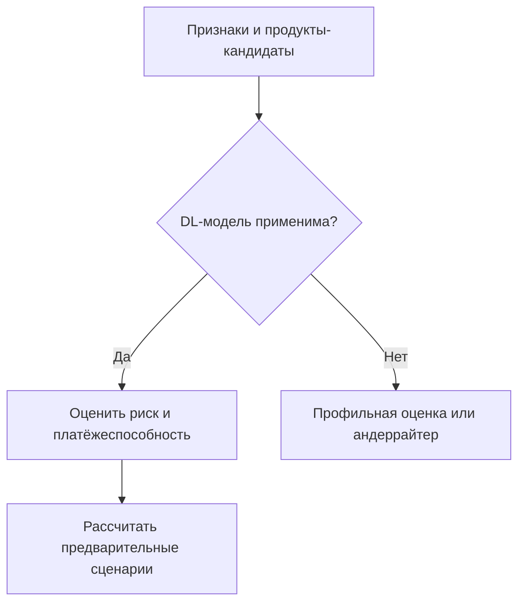

# Модуль 4. DL-скоринг и расчёт вариантов

Проект AI-CreditSys · версия 1.0 · 20.10.2026.

Предыдущий модуль: [данные и признаки](03_data_and_features.md). Следующий: [решение и сопровождение](05_decision_and_servicing.md).

## Назначение

Получить оценку риска для поддерживаемой постановки, проверить способность обслуживать долг и рассчитать разрешённые предварительные сценарии. Риск, платёжеспособность и цена являются отдельными расчётами внутри модуля.

## Схема



## Входы и выходы

**Вход:** версия запроса, снимок признаков, продукты-кандидаты, версии моделей, калибраторов, правил и методов расчёта стоимости.

**Выход:** статус оценки, риск при его доступности, флаги применимости, платёжные ограничения, предварительные сценарии и причины ручного маршрута.

Условный ответ для текущего демонстрационного контура:

```json
{
  "case_id": "CASE-PETYA-001",
  "revision": 1,
  "mode": "DEMO",
  "status": "MANUAL_REVIEW",
  "feature_snapshot_id": "FS-PETYA-001",
  "risk": {
    "status": "UNSUPPORTED_MODEL",
    "target": "y_dpd90_12m",
    "calibrated_probability": null,
    "reason": "NO_VALIDATED_RF_SME_MODEL"
  },
  "calculation": {
    "kind": "ILLUSTRATIVE",
    "amount_rub": 3000000,
    "term_months": 24,
    "assumed_annual_rate": 0.24,
    "monthly_payment_rub": 158613,
    "is_binding": false
  },
  "next_module": 5
}
```

Сценарный расчёт с явно указанными предположениями доступен отдельно от реального PD и банковского предложения. Отсутствующие комиссии/условия помечаются неизвестными, а не нулевыми.

## Проверка применимости модели

Registry содержит рынок, популяцию, продукты, стадию решения, определение события, горизонт, уровень договор/заёмщик, валюты/единицы, схему признаков, preprocessing, обработку пропусков, минимальное покрытие, калибратор и область подтверждённой применимости.

| Статус | Следующее действие |
|---|---|
| `OK` | Использовать результат в пределах утверждённой политики |
| `INSUFFICIENT_DATA` | Запросить данные через модуль 3 либо ручной маршрут |
| `UNSUPPORTED_MODEL` | Профильная оценка/андеррайтер |
| `TECHNICAL_ERROR` | Повторный запрос или ожидание; не кредитный отказ |

Текущий SBA-benchmark имеет другой рынок и таргет списания за 36 месяцев. Он не является российской моделью PD12 и не используется для реального одобрения ММБ.

## DL-скоринг

Для российской первой версии предлагается прогноз достижения существенной просрочки 90+ дней новым договором за 12 месяцев после выдачи. Признаки фиксируются до решения. Определение существенности и остальные правила разметки должны быть согласованы до обучения.

Возможный табличный encoder — компактная MLP/ResNet или FT-Transformer. Временной encoder добавляется после получения настоящих месячных последовательностей. LLM не вычисляет кредитную вероятность.

После инференса применяется проверенный калибратор. Значение sigmoid без оценки калибровки не считается автоматически надёжной вероятностью. Объяснение опирается на рассчитанные факторы и разрешённые reason codes; оно не является доказательством причинности.

Одна модель оборотного кредита не распространяется автоматически на факторинг, гарантии, ипотеку, овердрафты и лизинг.

## Платёжеспособность

Сервис отдельно рассчитывает нормализованный денежный поток для обслуживания долга, текущие платежи и нагрузку нового сценария. Для сезонного бизнеса проверяются соответствующие периоды и утверждённые стресс-сценарии.

Пример показателя:

\[
DSCR = \frac{CFADS}{DebtService_{existing} + DebtService_{new}}
\]

Периоды и единицы числителя/знаменателя должны совпадать. Выручка не подменяет CFADS. Конкретный порог задаётся политикой продукта.

## Политика и стоимость

- Приемлемая вероятность не гарантирует посильный платёж.
- Залог и поручительство могут изменить обеспечение и экономику сделки, но не создают денежный поток и не обязаны снижать PD.
- Ставка поступает из персонального банковского предложения или утверждённой методики. Минимум с рекламной страницы не подставляется как индивидуальная цена.
- Для каждого варианта учитываются известные проценты, комиссии, подписки, защита и график денежных потоков.
- Дополнительные услуги сравниваются отдельными вариантами и оформляются после выбора клиента.
- Для линии/овердрафта отдельно учитываются лимит, выборка и транши; для карты — операции и льготный период; для лизинга/гарантии/факторинга — профильная стоимость.
- Изменение параметров запроса создаёт новую ревизию. Повторный скоринг требуется, если затронут валидированный вход модели.

## Пример Петьки

Все числа учебные: 3 млн ₽ на 24 месяца под условные 24% годовых. Новый аннуитетный платёж ≈158 613 ₽. При CFADS 500 тыс. ₽/мес. и существующих платежах 180 тыс. ₽/мес. DSCR≈1,48. При снижении CFADS до 400 тыс. ₽ DSCR≈1,18.

Если учебный порог принят равным 1,3, второй сценарий требует пересмотра. Это не правило Альфа-Банка. Даже первый сценарий не означает одобрения без применимого риска, проверок и решения кредитора.

## Критерии готовности

- До инференса проверена применимость модели.
- Сохранены версии snapshot, preprocessing, модели, калибратора и policy.
- Недоступная вероятность остаётся `null`.
- Платёжные расчёты воспроизводимы и учитывают действующий долг.
- Предварительный сценарий явно отделён от банковского предложения.
- Техническая ошибка и неприемлемый риск имеют разные статусы.
