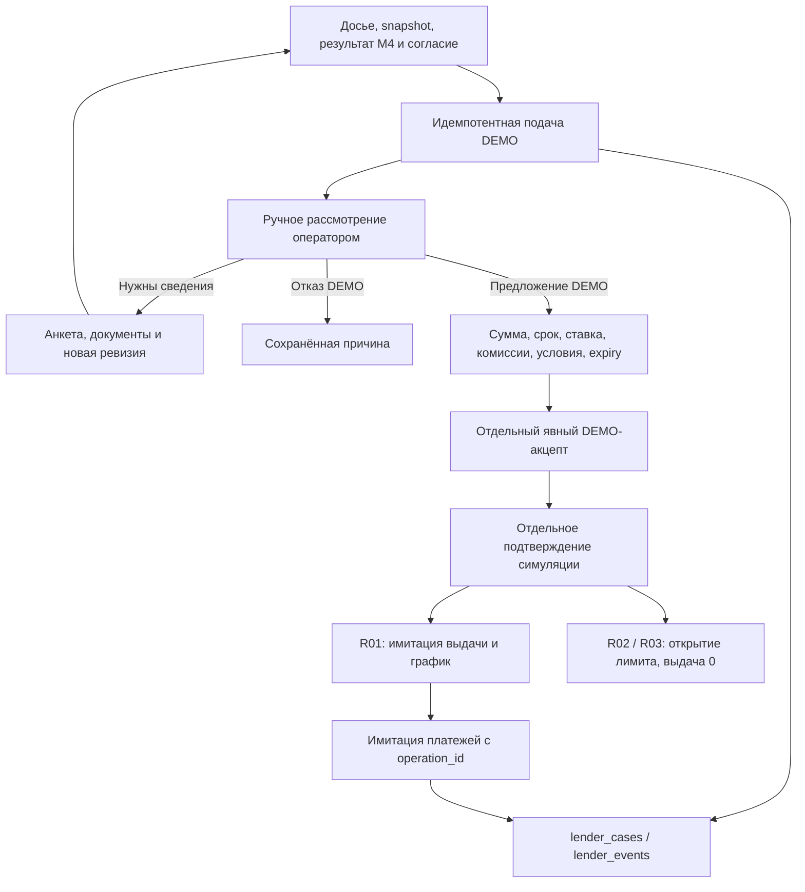

# Модуль 5. Банковское решение, оформление и сопровождение

Проект AI-CreditSys · версия 1.1 · сверка реализации 24.10.2026. Исходная спецификация: 20.10.2026.

Предыдущий модуль: [скоринг и расчёты](04_scoring_and_offers.md). Управление диалогом: [модуль 1](01_dialogue_and_workflow.md).

## Назначение

Передать согласованное досье в уполномоченный контур, получить банковское решение, сопроводить выбор и оформление, подтвердить исполнение и обслуживать договор. Для лизинга и других профильных инструментов используется соответствующий кредитор/провайдер.

## Схема



Запрос дополнительных документов возвращается в модуль 3. Место создания банковской заявки зависит от интеграции: если она требуется раньше, модуль вызывается после необходимого согласия и продолжает один существующий кейс.

## Текущая реализация · 24.10.2026

М5 реализован как согласованный пользователем DEMO-контур: подача, ручное OFFERED/DECLINED/REQUEST_DATA через доверенный CLI, предложение, отдельный акцепт и подтверждённая симуляция исполнения. Есть expiry, проверка актуальных revision/evidence/assessment, уникальные операции и журнал. R01 поддерживает график и имитацию платежей без комиссий; R02/R03 — только открытие лимита. Юридические подписи, реальные банковские команды и реальное сопровождение не выдаются за реализованные интеграции.

Контракты, запуск и операторские команды: [DEMO_MODULES_1_5.md](../../docs/DEMO_MODULES_1_5.md).

## Входы и выходы

**Вход:** `case_id`, `revision`, субъект и полномочия, согласия, досье, результаты проверок, сценарии и выбранное действие.

**Выход:** идентификатор банковской заявки, подтверждённый статус, персональное предложение, подписи, условия исполнения, идентификаторы операций и состояние обслуживания.

Условный статус до получения решения:

```json
{
  "case_id": "CASE-PETYA-001",
  "revision": 1,
  "mode": "DEMO",
  "status": "AWAITING_LENDER_REVIEW",
  "bank_application_id": null,
  "bank_offer_id": null,
  "is_binding": false,
  "signed_acceptance_ref": null,
  "execution_operation_id": null,
  "execution_status": "NOT_STARTED"
}
```

В `DEMO` используются демонстрационные адаптеры и не выполняются реальные финансовые операции. Недоступность собственной российской модели может направить кейс в разрешённое ручное/банковское рассмотрение, но не создаёт искусственный PD.

## Четыре уровня результата

| Уровень | Что разрешено сообщать |
|---|---|
| Подбор | Есть продукты-кандидаты |
| Предварительный расчёт | Есть сценарий с указанными предположениями |
| Подтверждённое решение/предложение | Кредитор предоставил условия и срок их действия |
| Исполнение | Операция или профильное обязательство фактически подтверждены |

Скоринг, предварительное одобрение, подпись и отправка команды перечисления не являются сами по себе подтверждением выдачи.

## Порядок работы

1. Найти существующую банковскую заявку, проверить revision и согласие на действие.
2. Передать досье и сохранить идентификатор операции подачи.
3. Получить подтверждённый статус; при необходимости запросить сведения через модуль 3.
4. Сохранить решение и персональное предложение с версией и сроком действия.
5. Передать условия в модуль 4 для проверяемого сравнения стоимости и нагрузки.
6. Получить выбор Петьки; отдельно зафиксировать выбранные платные услуги.
7. Собрать надлежащие подписи, проверить обеспечение и условия исполнения.
8. Выполнить разрешённую команду через банковский/профильный адаптер.
9. Подтвердить фактический результат и показать его пользователю.
10. Перейти к сопровождению договора.

Подписи, оформление обеспечения и другие условия могут обрабатываться параллельно. Исполнение ожидает полного набора необходимых подтверждений.

## Персональное предложение

Хранятся кредитор, продукт, `bank_offer_id`, версия, сумма, срок, ставка/порядок изменения, график, известные расходы, дополнительные услуги, обеспечение, условия до выдачи, срок действия и `is_binding`.

Итоговые банковские параметры могут отличаться от первоначального запроса. Такие изменения требуют нового расчёта и явного выбора пользователя. Текст «да» в чате не подменяет требуемую подпись.

## Подтверждение исполнения по инструменту

| Инструмент | Что подтверждать |
|---|---|
| Кредит одной суммой | Фактическое перечисление по условиям договора |
| ВКЛ/универсальный лимит | Открытие лимита отдельно от каждой выдачи транша |
| Овердрафт/карта | Доступность согласованного инструмента отдельно от использования средств |
| Банковская гарантия | Выпуск надлежащей гарантии и предусмотренное подтверждение передачи |
| Лизинг | Выполнение соответствующих этапов договора, включая передачу предмета |
| Факторинг | Принятие требования и финансирование подтверждённой сделки |

Факт открытия лимита не означает, что вся его сумма уже выдана клиенту.

## Отказы, задержки и изменения

| Случай | Действие |
|---|---|
| Кредитор запросил документы | Возврат в модуль 3 с конкретным перечнем |
| Ручное рассмотрение | Ожидание уполномоченного решения |
| Банковский отказ | Показать разрешённые причины и доступные альтернативы |
| Изменились сумма/срок/цена | Новая версия предложения и повторный выбор |
| Истёк срок предложения | Получить актуальную версию |
| Не выполнены условия обеспечения | Ожидание, исправление либо пересмотр структуры |
| Нет обязательной подписи | Ожидание оформления |
| Тайм-аут после подачи | Проверить существующую заявку по идентификатору |
| Тайм-аут после команды выдачи | `EXECUTION_UNKNOWN`; запросить статус операции |
| Повторный клик/сообщение | Использовать idempotency key, исключить дубль действия |
| Деньги перечислены, уведомление потеряно | Восстановить отображение по банковскому статусу |

Для изменяющих команд используются полномочия, stage/mode-проверки, revision, idempotency key и журнал результата. Неопределённый сетевой ответ разрешается сверкой, а не слепым повторным перечислением.

## Обслуживание

Сервис поддерживает просмотр заявок и графика, проверку платежей, запросы досрочного погашения, каникул, реструктуризации и рефинансирования. Применимость и последствия проверяются по актуальному договору и действующей программе.

Фиксируются графики, фактические платежи и их распределение, сторно, просрочки, изменения договора, закрытие и другие подтверждённые исходы. Для событий сохраняются дата действия и дата доступности.

Эти сведения попадают в отдельный контур подготовки будущих обучающих меток. Они не добавляются задним числом в признаки первоначального решения. Отклонённым заявкам не присваивается дефолт; новая версия модели не выпускается автоматически после единичного события.

## Пример Петьки

После рассмотрения кредитор предоставляет Петьке персональные условия. Модуль 4 пересчитывает нагрузку по реальному предложению. Петька выбирает вариант, подписывает документы, выполняются условия выдачи. Только после подтверждения банковской операции агент сообщает о перечислении и показывает график. Если ответ банка потерян, кейс ожидает сверки, а не запускает повторную выдачу.

## Критерии готовности

- Банковский статус прослеживается до подтверждённого ответа.
- Предложение имеет версию и срок действия.
- Выбор услуг и обязательные подписи сохранены.
- Повторные события не создают повторных финансовых операций.
- Исполнение подтверждается согласно типу инструмента.
- История обслуживания пригодна для последующей проверяемой разметки.
