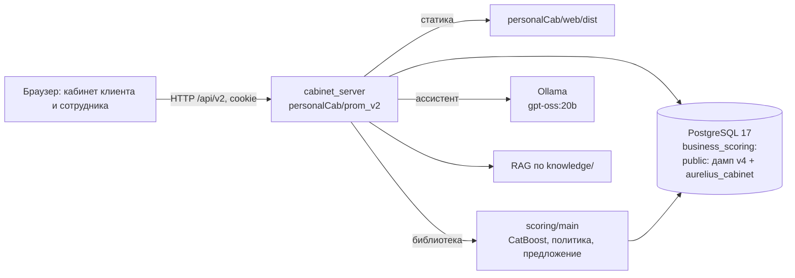

# AURELIUS — умный кредитный кабинет предпринимателя

Прототип цифрового кредитного конвейера для малого и микробизнеса, сделанный на хакатоне Альфа-Банка «Альфа Будущее». В одном веб-продукте собраны путь клиента и обработка заявки в банке: от черновика заявки до решения сотрудника и принятия предложения. Все данные синтетические, доступа к системам банка нет.

Проверено по коду коммита `6a9a4c1` (ветка `chore/cleanup-legacy`).

## Для кого

- **Клиент** — представитель ИП или юридического лица, оформляющий кредит от имени компании.
- **Сотрудник банка** — рассматривает заявки: запускает скоринг, проверяет сведения, запрашивает данные и принимает решение.

## Что умеет текущая версия

Клиент:
- входит по логину и паролю из БД; роль и компания определяются сервером;
- создаёт заявку на один из продуктов R01–R03, заполняет анкету по требованиям продукта, подтверждает сведения и отправляет заявку;
- в черновике может описать потребность ассистенту (`gpt-oss:20b` через Ollama). Ассистент предлагает значения полей с цитатами из сообщения, а в анкету они попадают только после явного подтверждения;
- отвечает на дозапрос банка текстом и файлом PDF или CSV;
- видит статус заявки, предложение банка (сумму, срок, ставку) или причину отказа от сотрудника; принимает предложение.

Сотрудник банка:
- видит общую очередь и «Мои разборы», берёт заявку в работу;
- запускает скоринг (`scoring/main`, CatBoost) и видит годовую PD, лимит PD и рассчитанное предложение, если для расчёта хватает финансовых данных; иначе скоринг возвращает ручную проверку без PD;
- фиксирует проверку сведений с указанием источника;
- принимает решение: одобрить рассчитанное предложение, отказать или запросить данные. Решение всегда сопровождается причиной.

Система сохраняет все изменения в PostgreSQL, проверяет роль и владельца заявки, версию и повтор запроса (`request_id`), ведёт журнал событий и снимает предложение, если исходные данные изменились до его принятия.

Сценарий завершается принятием предложения клиентом. Подписание документов и выдача средств в текущей версии не реализованы.

## Схема



Подробная архитектура — в [docs/05-architecture.md](docs/05-architecture.md).

## Запуск

Нужны Git и Docker Engine с Compose v2 (или Docker Desktop в режиме Linux-контейнеров). Python и Node на хосте не нужны. Для `gpt-oss:20b` нужно около 16 ГБ свободной RAM. На диске при встроенном Ollama нужно около 25 ГБ: модель 13,8 ГБ, образ Ollama 8,4 ГБ, образы кабинета и БД около 2 ГБ. Первый запуск включает загрузку образов, зависимостей и модели; время зависит от сети и кэша.

Linux / macOS:

```sh
git clone -b chore/cleanup-legacy https://github.com/CyberGeo335/AURELIUS.git
cd AURELIUS
cp .env.example .env
# Откройте .env и задайте непустой POSTGRES_PASSWORD.
sh start.sh
```

Windows PowerShell:

```powershell
git clone -b chore/cleanup-legacy https://github.com/CyberGeo335/AURELIUS.git
cd AURELIUS
Copy-Item .env.example .env
# Откройте .env и задайте непустой POSTGRES_PASSWORD.
powershell -NoProfile -ExecutionPolicy Bypass -File .\start.ps1
```

После готовности модели откройте http://127.0.0.1:5173.

Скрипт сначала проверяет внешний Ollama (`OLLAMA_BASE_URL`). Если тот недоступен, скрипт поднимает Ollama в Docker, скачивает модель и ждёт успешной проверки генерации. При первом запуске в пустой том восстанавливается синтетическая БД `scoring/bd/v_4 (actual)/business_scoring_wauth.backup`.

Статус и логи:

```sh
docker compose ps -a
docker compose logs -f model-init app
```

Переменные окружения, порты, остановка, сброс, GPU и частые ошибки описаны в [docs/09-deployment.md](docs/09-deployment.md).

## Тестовые учётные записи

В БД 32 синтетические учётные записи: 30 клиентов, каждый привязан к своей компании (26 юрлиц и 4 ИП), и 2 сотрудника банка. Состав соответствует манифесту дампа v4. Логины и пароли берутся из запущенной БД:

```sh
docker compose exec db sh -c 'psql -U "$POSTGRES_USER" -d "$POSTGRES_DB" -c "SELECT login, password, role, company_id FROM public.user_accounts ORDER BY role, login"'
```

`role=CLIENT` — клиент, `role=BANK_EMPLOYEE` — сотрудник банка.

Заявки из дампа отменены. Новые заявки создаются в ходе сценария.

## Сценарий проверки

Откройте `http://127.0.0.1:5173` после готовности сервисов.

1. **Учётки.** Получите клиента и сотрудника запросом из раздела выше. Для первого знакомства выберите клиента компании 45–64: у них заполнены реквизиты профиля.
2. **Клиент: заявка.** Откройте «Продукты» → «Новая заявка» у оборотного кредита. Заполните анкету, согласия и подтверждение корректности → «Отправить заявку».
3. **Ассистент.** В черновике сообщите сумму, срок, цель или недостающий реквизит. Проверьте значения и цитаты → «Подтвердить предложенные изменения».
4. **Сотрудник: рассмотрение.** Откройте заявку в очереди → «Взять в работу». Изучите расчёт, годовую PD, лимит PD, причины и рассчитанные условия. Зафиксируйте проверку с источником.
5. **Дозапрос.** Сотрудник выбирает поле и причину запроса. Клиент прикладывает PDF/CSV и отправляет ответ; сотрудник продолжает рассмотрение.
6. **Решение.** При наличии рассчитанного предложения сотрудник может одобрить его с причиной; клиент получает условия и принимает предложение. Альтернативный результат — отказ с причиной. Скоринговая рекомендация сама не является одобрением.
7. **API.** Импортируйте [коллекцию запросов](docs/api/aurelius.postman_collection.json), задайте учётки и `baseUrl`. Порядок сценариев описан в [06](docs/06-api.md#6-коллекция-запросов).

Подробные шаги — [03-demo-scenarios.md](docs/03-demo-scenarios.md), состав проверок и протоколы — [08-testing.md](docs/08-testing.md).

## Документация

| Файл | Что внутри |
|---|---|
| [docs/00-jury-guide.md](docs/00-jury-guide.md) | путеводитель и карта соответствия требованиям кейса |
| [docs/01-problem-and-scope.md](docs/01-problem-and-scope.md) | проблема, решение, границы MVP |
| [docs/02-decisions.md](docs/02-decisions.md) | ключевые решения, ограничения, развитие |
| [docs/03-demo-scenarios.md](docs/03-demo-scenarios.md) | демо-пути клиента и сотрудника |
| [docs/04-credit-process.md](docs/04-credit-process.md) | кредитный процесс, диаграмма состояний заявки, скоринг ≠ решение |
| [docs/05-architecture.md](docs/05-architecture.md) | архитектура и enterprise-аспекты |
| [docs/06-api.md](docs/06-api.md), [docs/api/openapi.yaml](docs/api/openapi.yaml), [docs/api/aurelius.postman_collection.json](docs/api/aurelius.postman_collection.json) | API, OpenAPI и коллекция запросов |
| [docs/07-data-model.md](docs/07-data-model.md) | модель данных, синтетические данные, учётки |
| [docs/08-testing.md](docs/08-testing.md) | тестовые сценарии и результаты прогонов |
| [docs/09-deployment.md](docs/09-deployment.md) | окружение, запуск, переменные, проблемы |
| [THIRD_PARTY_NOTICES.md](THIRD_PARTY_NOTICES.md) | сторонние компоненты, модели, датасеты, смоделированные интеграции |

Быстрый поиск обязательных артефактов и карта соответствия требованиям кейса — в [путеводителе для жюри](docs/00-jury-guide.md#4-технические-требования-и-обязательные-артефакты).

## Используемые компоненты

- Фронт: React 19, TypeScript, Vite, Tailwind CSS, Radix UI, Motion; шрифты Onest и Unbounded (`personalCab/web/package.json`, `package-lock.json`).
- Backend: Python 3.13, стандартный `http.server`, psycopg 3 (`personalCab/prom_v2/cabinet_server.py`, `requirements.txt`).
- БД: PostgreSQL 17.
- Скоринг: CatBoost, собственная модель `dt_monotone_v1`, обученная на синтетике (`scoring/main`).
- Ассистент: LangGraph, LangChain, Ollama, `gpt-oss:20b` (открытые веса); RAG на FAISS по `knowledge/`.

Версии зафиксированы в `requirements.lock.txt` и `personalCab/web/package-lock.json`, образ Ollama — по digest в `compose.yaml`. Полный перечень с лицензиями — в [THIRD_PARTY_NOTICES.md](THIRD_PARTY_NOTICES.md).

## Границы прототипа

Все данные синтетические. Внешние источники представлены локальными данными в БД. Скоринг использует модель и экономическую политику DEMO; окончательное решение принимает сотрудник. Реализованный положительный путь заканчивается принятием предложения, без подписания и выдачи средств.

Текущие материалы — `docs/00–09`. Постановка кейса — `docs/case/`, технические справочники — `docs/technical/`, материалы предыдущих этапов — `docs/history/`.

## Версия

Исполняемый код этой редакции — `6a9a4c15a0c0eee4c74a62a1e15b9e5bb704eaf6`, ветка `chore/cleanup-legacy`. Документационные изменения не меняют код, данные и конфигурацию запуска. Полный hash выбранного состояния репозитория можно получить командой `git rev-parse HEAD` и передать вместе с материалами сдачи до дедлайна.
