# 03. Демо-сценарии

Проверено на коммите `40b8038` (ветка `test-dev`).

Пути ниже проходятся вручную в интерфейсе кабинета после запуска по [09-deployment.md](09-deployment.md). Процесс и статусы — в [04-credit-process.md](04-credit-process.md), что видит каждая роль — в [06-api.md](06-api.md#24-что-видит-клиент-и-что-видит-сотрудник). Все данные синтетические.

**Как сняты скриншоты.** 26.10.2026, стенд из чистой копии `40b8038`, Chromium (Playwright 1.63.0) в Docker в сети стенда, окно 1440×900. Скрипт сам прошёл пути через интерфейс: вход, «Отправить заявку», «Взять в работу», «Повторить скоринг», «Зафиксировать проверку», «Сохранить решение», загрузка CSV, «Отправить ответ», сообщение и подтверждение в чате помощника, «Отменить заявку». Через API скрипт только создал черновики и заполнил анкету тем же набором полей, что и коллекция Postman ([06-api.md](06-api.md#6-коллекция-запросов)). Ассистент отвечал моделью `gpt-oss:20b` на CPU стенда.

Учётки: клиент — юрлицо «ООО "Тестовая компания 46"» (`company_id=46`, без намеренных пропусков реквизитов), сотрудник — одна из двух учёток `BANK_EMPLOYEE`. Как получить логин и пароль — [07-data-model.md](07-data-model.md#7-тестовые-учётные-записи).

Открывайте кабинет по `http://127.0.0.1:5173` (или `localhost`). По обычному HTTP на другом адресе интерфейс не выполняет действия (раздел [8](#8-известное-ограничение-интерфейса)).

| № | Путь | Роль | Итог |
|---|---|---|---|
| 1 | [Черновик → анкета → отправка](#1-клиент-оформляет-и-отправляет-заявку) | клиент | заявка на рассмотрении, скоринг выполнен |
| 2 | [В работу → скоринг → проверка → дозапрос](#2-сотрудник-рассматривает-заявку-и-запрашивает-данные) | сотрудник | заявка ждёт данных клиента |
| 3 | [Ответ на дозапрос с документом](#3-клиент-отвечает-на-дозапрос) | клиент | заявка снова на рассмотрении |
| 4 | [Отказ с причиной](#4-сотрудник-отказывает-клиент-видит-причину) | сотрудник, клиент | «Отказ», клиент видит причину сотрудника |
| 5 | [Ассистент в черновике](#5-ассистент-заполняет-черновик) | клиент | сумма, срок и цель из сообщения в анкете |
| 6 | [Отмена заявки](#6-отмена-заявки) | клиент | «Отменена» |
| 7 | [Что недоступно на исходных данных](#7-что-недоступно-на-исходных-данных) | — | одобрение и принятие предложения |

## 1. Клиент оформляет и отправляет заявку

**Цель:** выбрать продукт, заполнить анкету и отправить заявку в банк.

1. Откройте `http://127.0.0.1:5173`, введите логин и пароль клиента, нажмите «Войти в кабинет». Роль и компанию определяет сервер.

   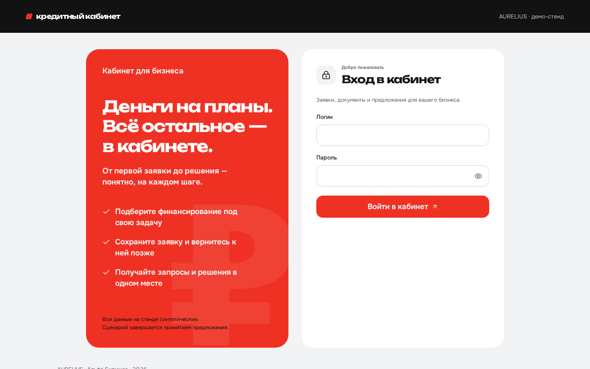

2. Главная клиента: последняя заявка со статусом и треком этапов, «Помощник с заявкой», карточка компании, список заявок, «Финансирование бизнеса».

   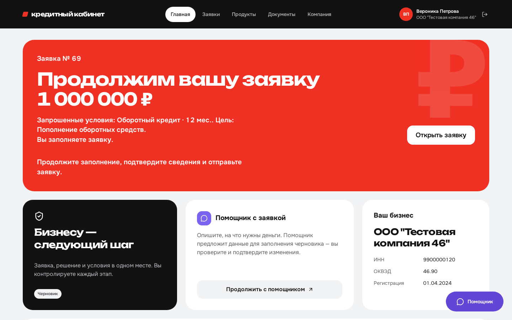

3. «Продукты»: три продукта из БД — «Овердрафт» (R03), «Кредитная линия» (R02), «Оборотный кредит» (R01). Нажмите «Новая заявка» у «Оборотного кредита».

   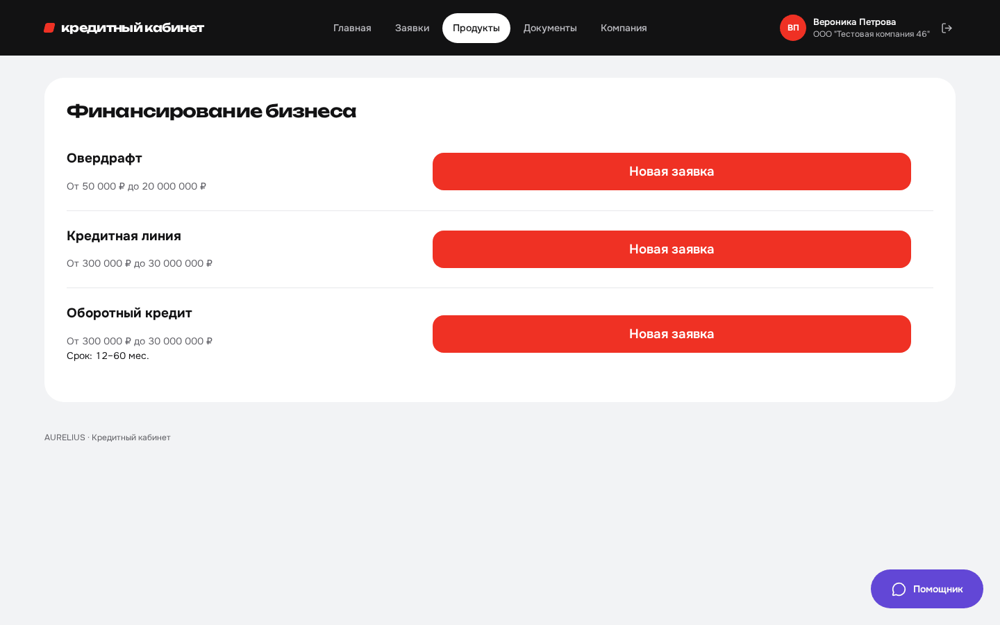

4. Откроется анкета из 5 шагов: «Запрос и условия», «Реквизиты бизнеса», «Контакты и подписант», «Подтверждение и согласия», «Проверка и отправка». Справа — сумма, срок, цель и «Готовность заявки» в процентах со списком того, что осталось заполнить. Реквизиты компании подставляются из её профиля в БД. Кнопки: «Сохранить черновик», «Дальше: …», «Сохранить и обсудить с ассистентом».

   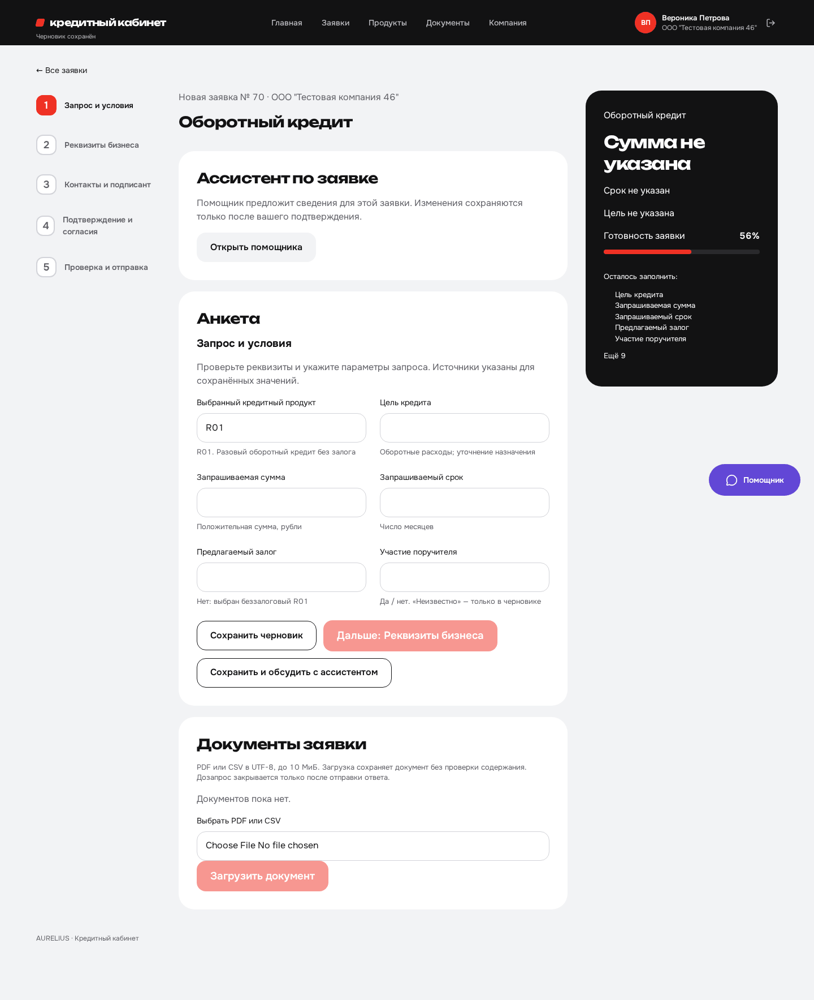

5. Заполните сумму (1 000 000 ₽), срок (12 мес.), цель, контакты, подписанта, отметьте согласия и подтверждение. На шаге «Проверка и отправка» готовность — 100%, надпись «Все обязательные сведения заполнены.». Нажмите «Отправить заявку».

   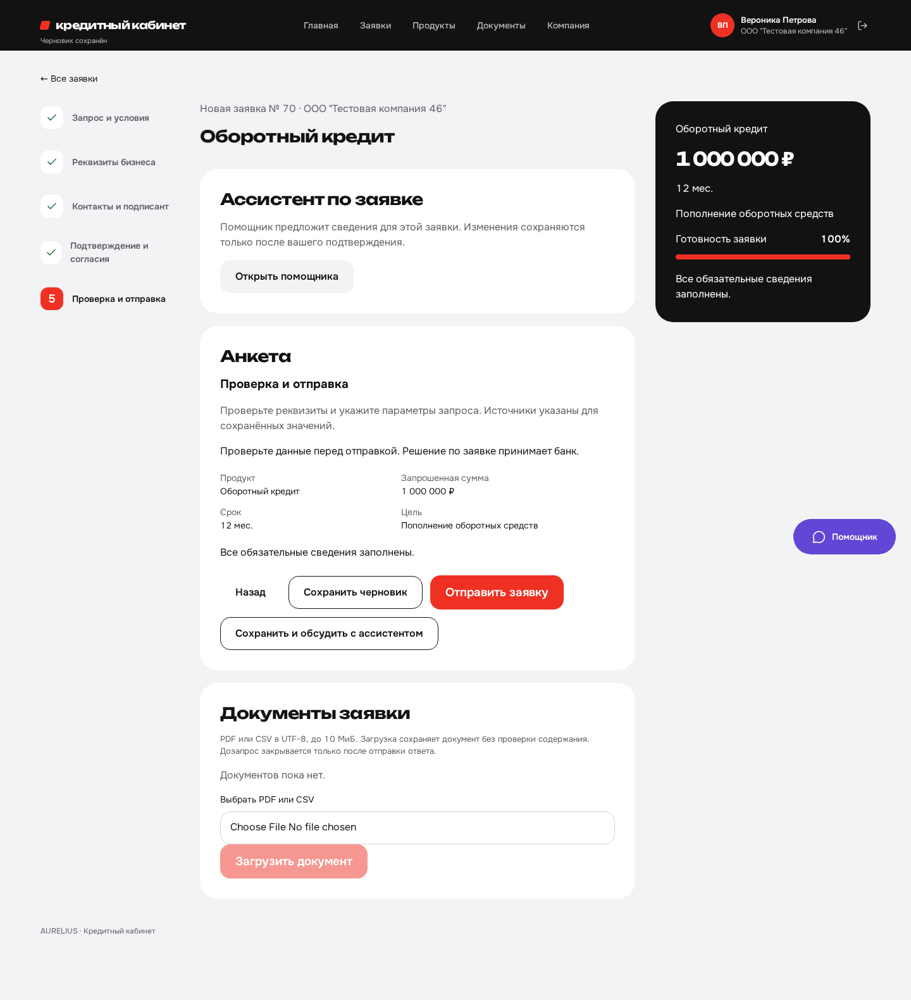

6. Заявка получает статус «Проверяет специалист», в треке пройден этап «Отправлена». Сразу после отправки выполнен скоринг. Его причину клиент не видит: в «Причинах решения» — «Решение ещё не принято.», потому что интерфейс показывает клиенту только причины сотрудника ([02-decisions.md](02-decisions.md#р6-клиенту-показываются-только-причины-сотрудника)).

   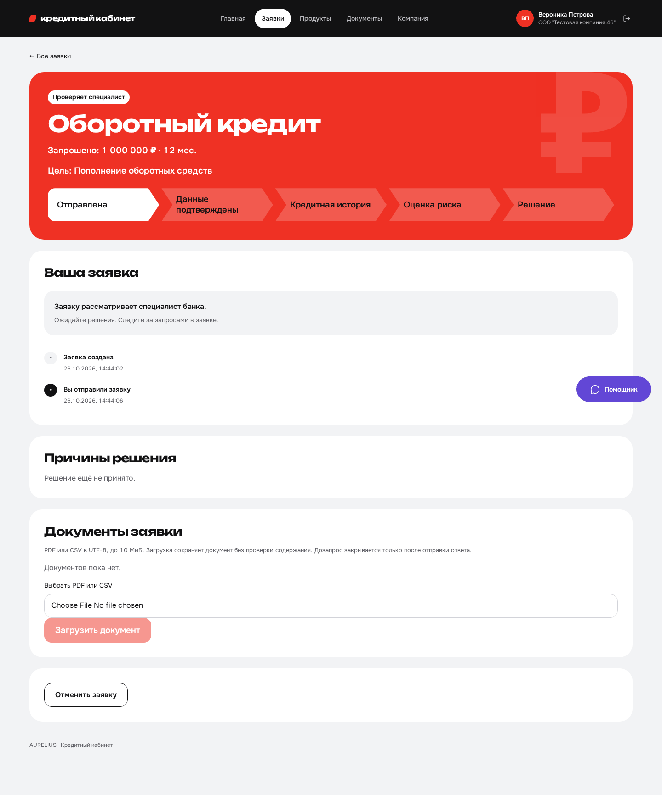

**Результат:** `application_status=UNDER_REVIEW`, решение скоринга `MANUAL_REVIEW` с причиной `DB_INPUTS_UNAVAILABLE`, без PD и предложения ([раздел 7](#7-что-недоступно-на-исходных-данных)).

## 2. Сотрудник рассматривает заявку и запрашивает данные

**Цель:** взять заявку в работу, посмотреть оценку, зафиксировать проверку и запросить уточнение.

1. Войдите как сотрудник. «Очередь»: сводка (заявок в очереди, ждут решения, ждут ответа клиента, среднее время до первого решения), фильтры по этапам, таблица с колонками «PD 12 мес.» и «Что требует внимания». Для новой заявки видна причина скоринга `DB_INPUTS_UNAVAILABLE`: «DB proxy needs 13 complete positive-revenue months; no zero-filling missing history», PD — «Нет оценки». На скриншоте между верхом и низом таблицы пропущены 30 отменённых заявок дампа.

   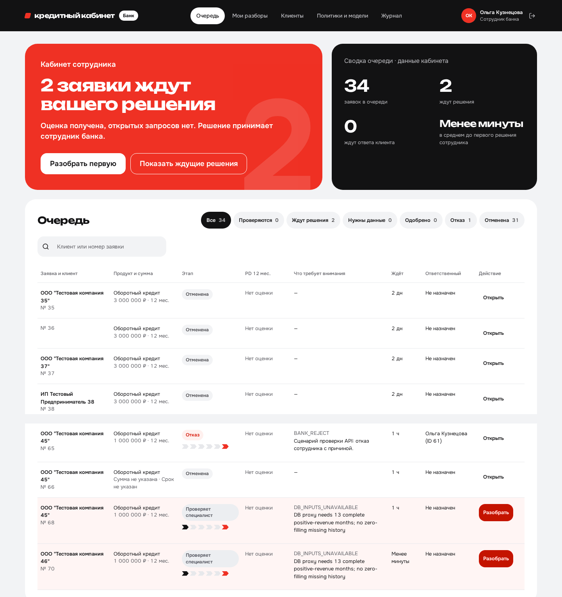

2. Откройте заявку («Разобрать»). Трек сотрудника — 6 этапов: «Приём», «Проверка данных», «Обогащение», «Скоринг», «Политика», «Решение». Ответственного нет; нажмите «Взять в работу». Без этого скоринг, проверки и решение недоступны.

   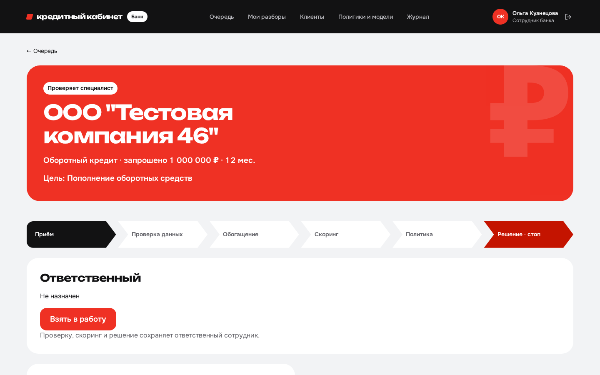

3. Ответственный назначен, доступна кнопка «Освободить заявку». Нажмите «Повторить скоринг» внизу страницы: расчёт запустится заново на тех же данных.

   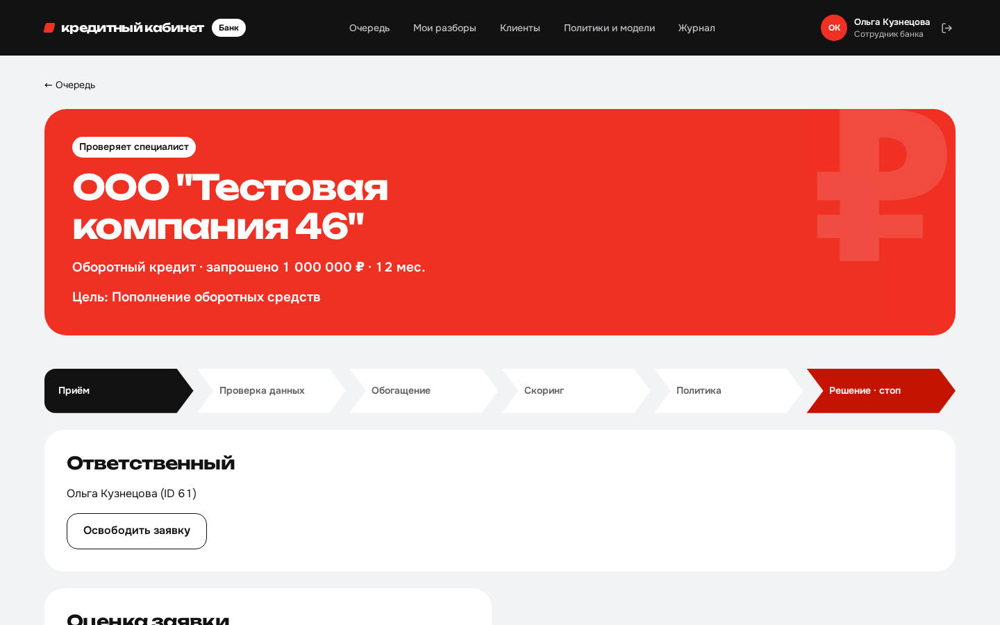

4. «Анкета клиента»: каждое поле с источником («Клиент») и статусом проверки («Не проверено»). Клиентские сведения не становятся проверенными автоматически ([02-decisions.md](02-decisions.md#р12-проверка-сотрудника-не-исправляет-исходные-данные)).

   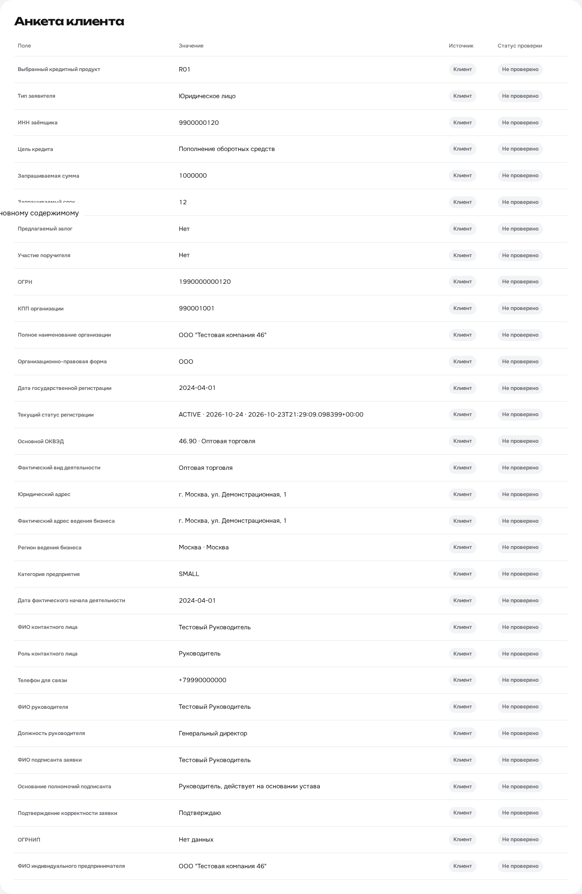

5. «Проверки сотрудника»: выберите вид «Расхождение выручки», укажите источник и результат, нажмите «Зафиксировать проверку». Запись появится в списке проверок с автором и временем.

   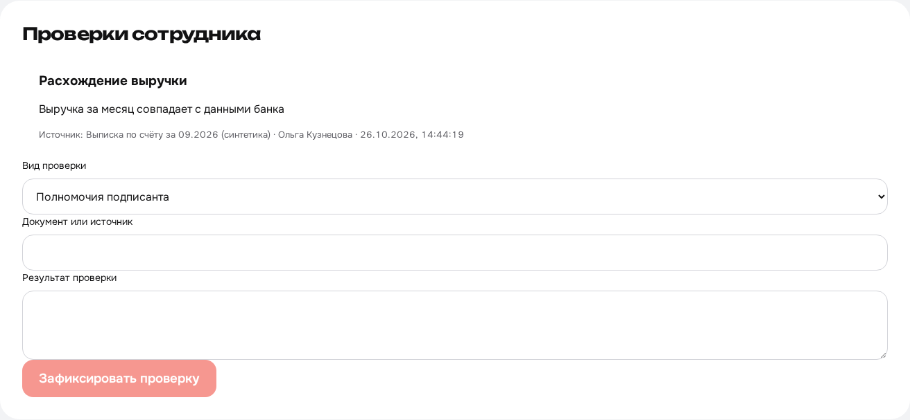

6. «Решение сотрудника»: выберите «Запросить данные», поле «Фактический адрес ведения бизнеса» и причину, которую увидит клиент. Блок «Клиент увидит» показывает предпросмотр. Пункт «Одобрить рассчитанные условия» недоступен: у расчёта нет предложения. Нажмите «Сохранить решение».

   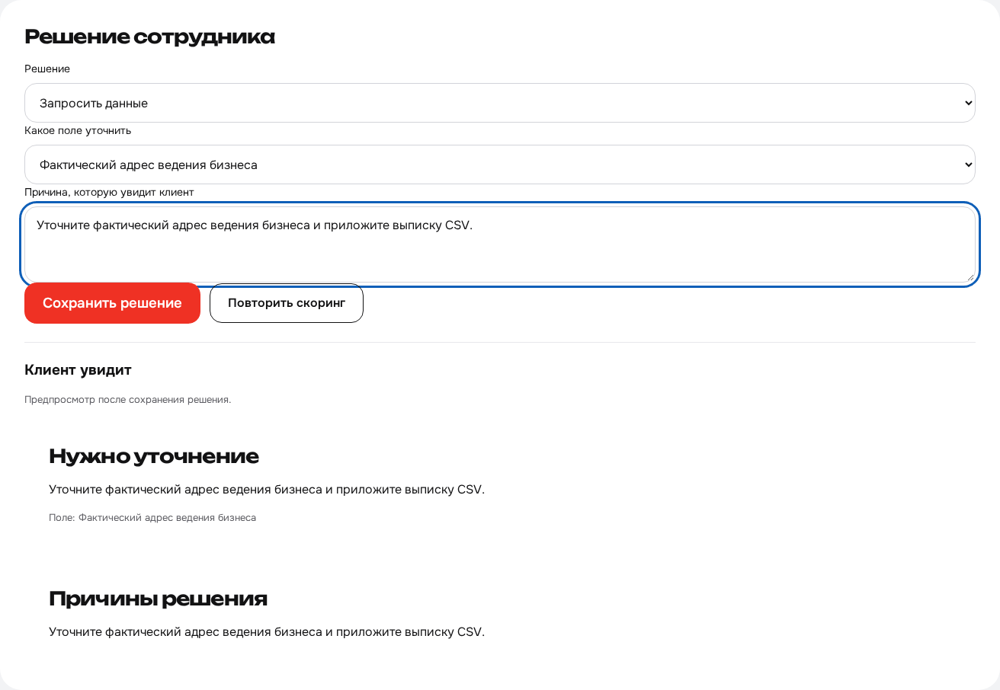

**Результат:** `application_status=AWAITING_DATA`, открытый дозапрос по полю `R01_20`, решение `REQUEST_DATA` с причиной `BANK_REQUEST_DATA`.

## 3. Клиент отвечает на дозапрос

**Цель:** ответить банку и приложить документ.

1. У клиента заявка в статусе «Нужны данные», на пункте «Заявки» в меню — счётчик. В карточке «Нужно уточнение» — вопрос сотрудника и поле анкеты, ниже «Документы дозапроса» и «Ваш ответ».

   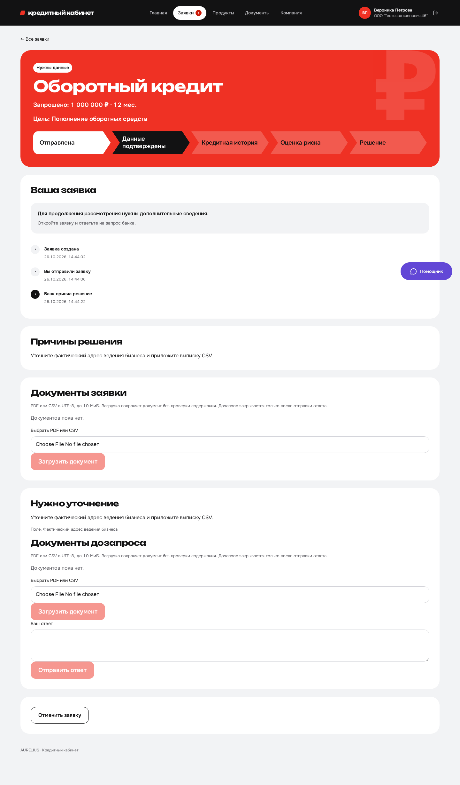

2. В «Документах дозапроса» выберите CSV-файл и нажмите «Загрузить документ». Затем впишите ответ и нажмите «Отправить ответ». Сама загрузка дозапрос не закрывает.

3. Заявка вернулась на рассмотрение. Документ виден в «Документах заявки» со статусом «Сохранён, не проверен» и номером дозапроса.

   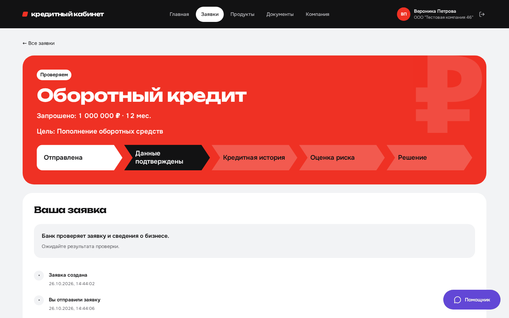

**Результат:** дозапрос `ANSWERED`, ответ записан в поле анкеты, документ сохранён как `STORED_UNVERIFIED`, заявка снова `UNDER_REVIEW`. Повторный скоринг сам не запускается.

## 4. Сотрудник отказывает, клиент видит причину

1. Сотрудник видит документ клиента и может его скачать.

   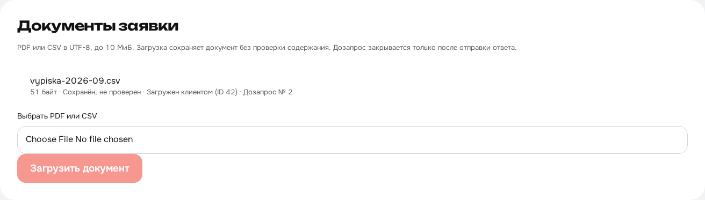

2. «Решение сотрудника»: «Отказать», причина для клиента, предпросмотр «Клиент увидит» → «Сохранить решение».

   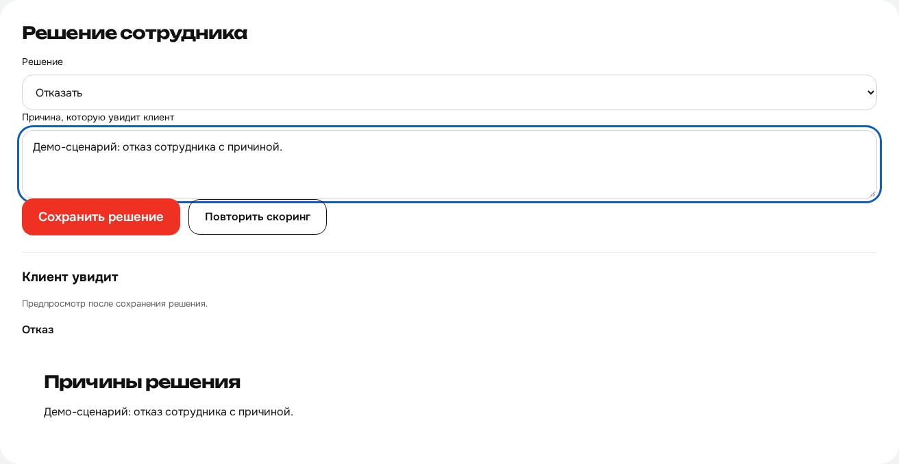

3. Заявка получает статус «Отказ», трек — «Решение · стоп».

   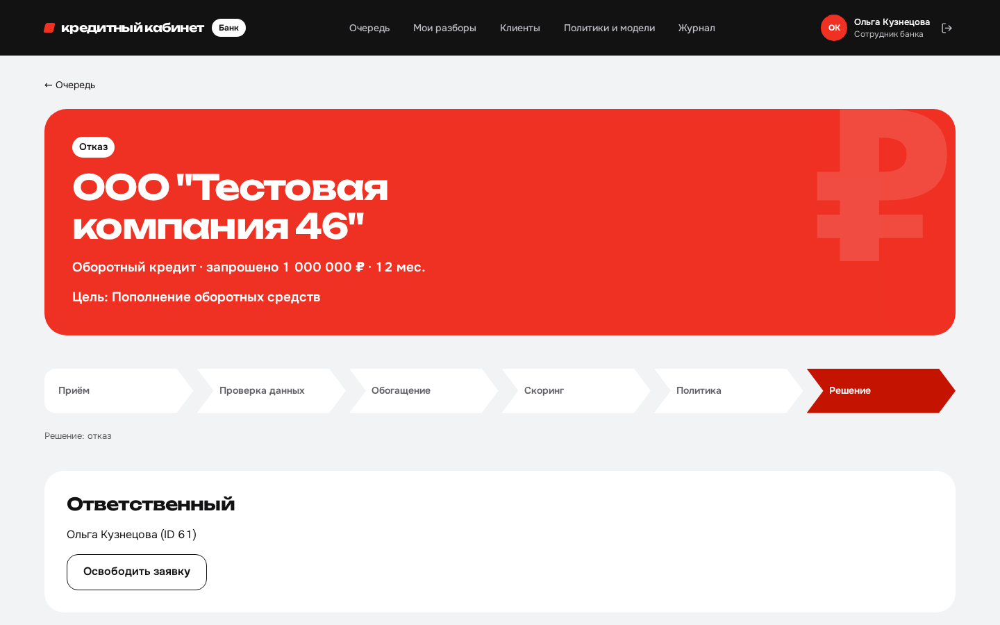

4. Клиент видит «Отказ», пометку «Решение: отказ» в треке и в «Причинах решения» — текст сотрудника. Внутренние причины скоринга клиенту не показываются.

   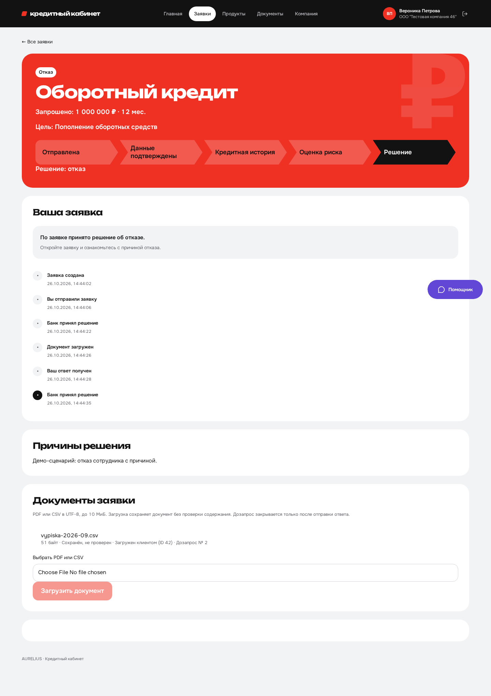

5. «Журнал» сотрудника: события заявки по времени — взята в работу, запрошен скоринг, проверка, решение, документ, ответ, решение.

   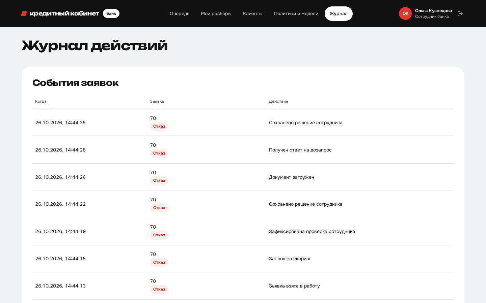

**Результат:** `application_status=REJECTED`, решение `REJECT` с причиной `BANK_REJECT`.

## 5. Ассистент заполняет черновик

**Цель:** описать потребность словами и перенести извлечённые сведения в анкету.

1. В новом черновике откройте «Помощник» и напишите: «Нужно 1 500 000 рублей на 12 месяцев на закупку товара для оптовой торговли.». Нажмите «Отправить сообщение».

   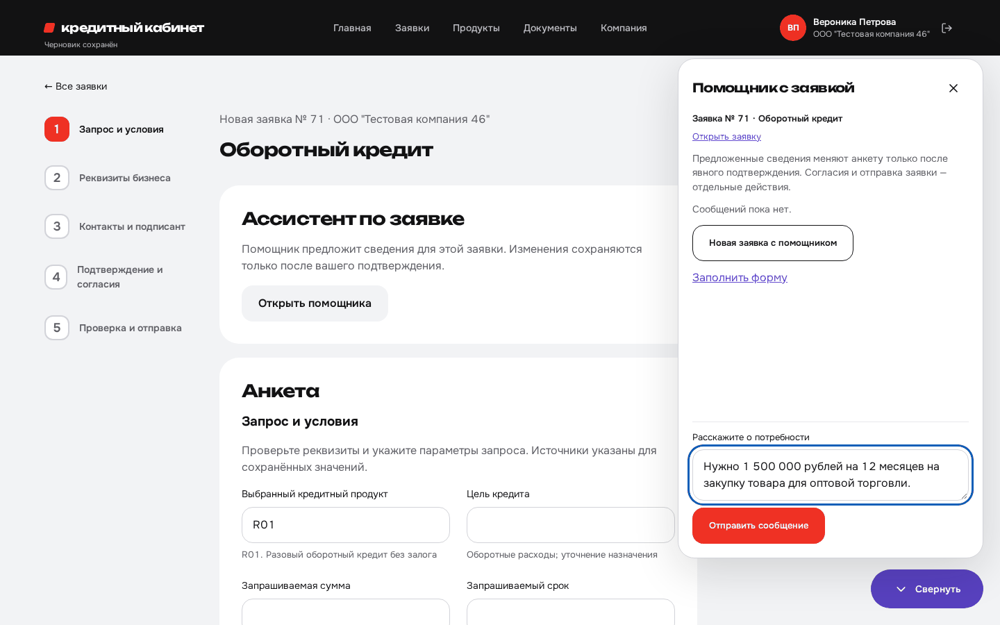

2. Через 91 секунду (модель на CPU стенда) помощник предложил сведения, каждое с цитатой из сообщения: цель «Закупка товаров» («на закупку товара»), сумма 1 500 000 («1 500 000 рублей»), срок 12 месяцев («12 месяцев»). Анкета пока не изменилась.

   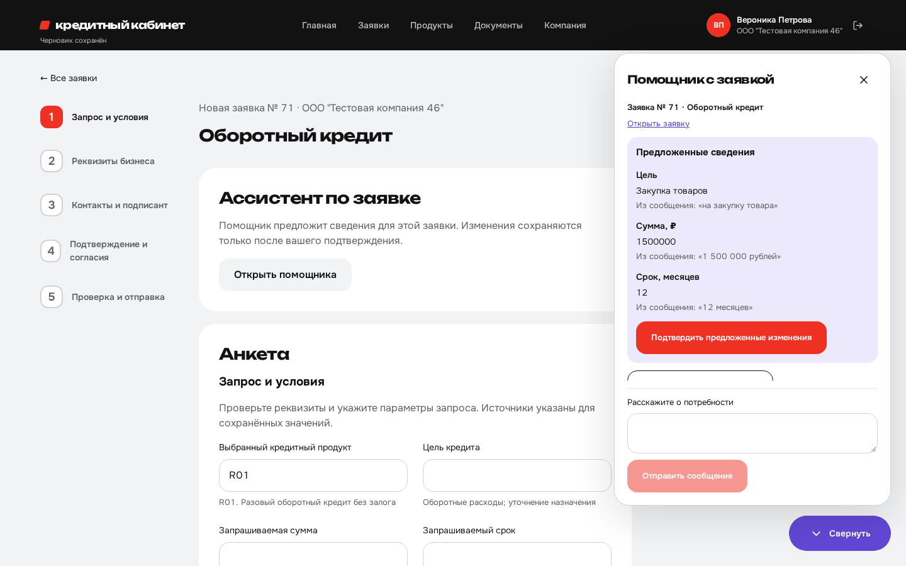

3. Нажмите «Подтвердить предложенные изменения». Помощник сообщает, что подтверждённые поля сохранены, и задаёт следующий вопрос. Над анкетой — «Подтверждённые изменения помощника применены».

   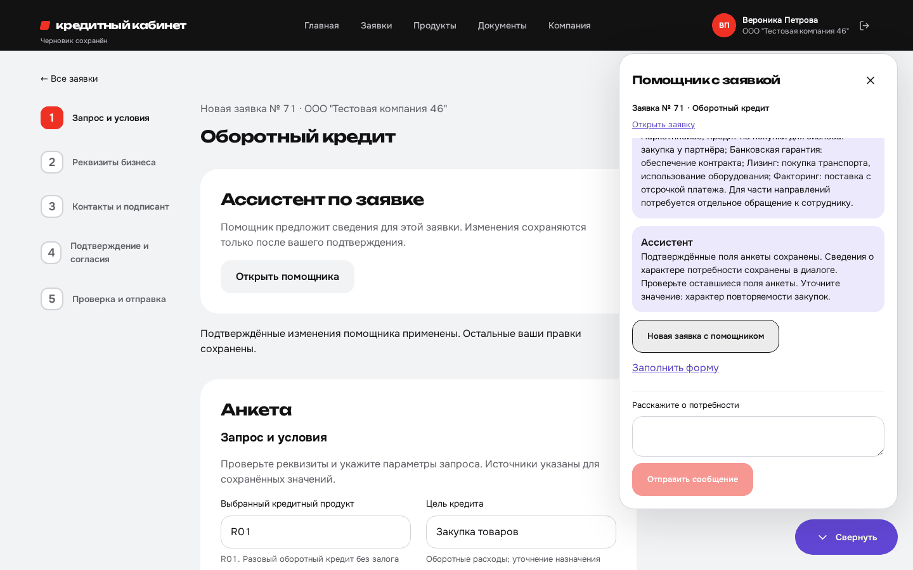

4. В анкете — сумма, срок и цель из сообщения. Остальные поля клиент заполняет сам.

   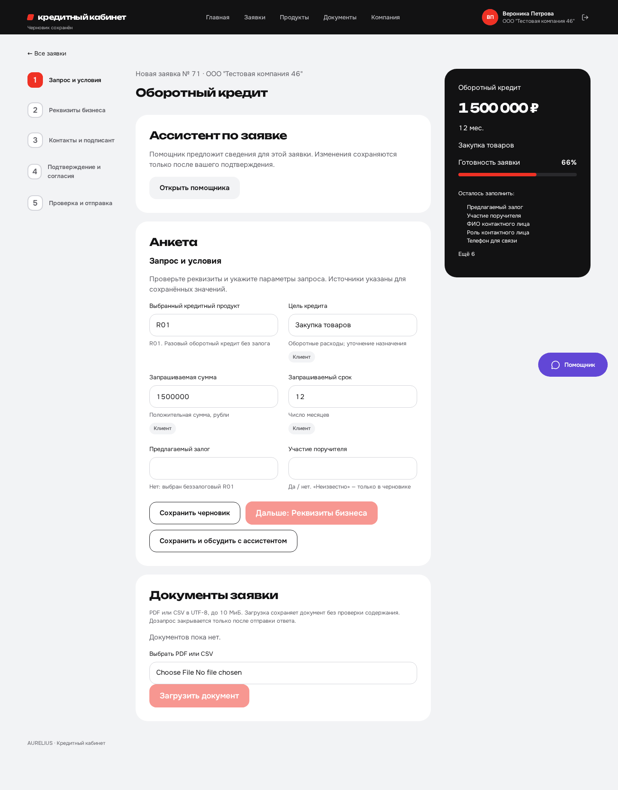

**Результат:** `requested_amount=1500000`, `requested_term_months=12`, `purpose=«Закупка товаров»`; значения записаны с `value_source=CLIENT`, `UNVERIFIED`. Без подтверждения анкета не меняется ([02-decisions.md](02-decisions.md#р7-ассистент-только-предлагает-клиент-подтверждает)).

## 6. Отмена заявки

На странице заявки нажмите «Отменить заявку». Статус — «Отменена». Отменить нельзя только отказанную, уже отменённую и заявку с принятым предложением.

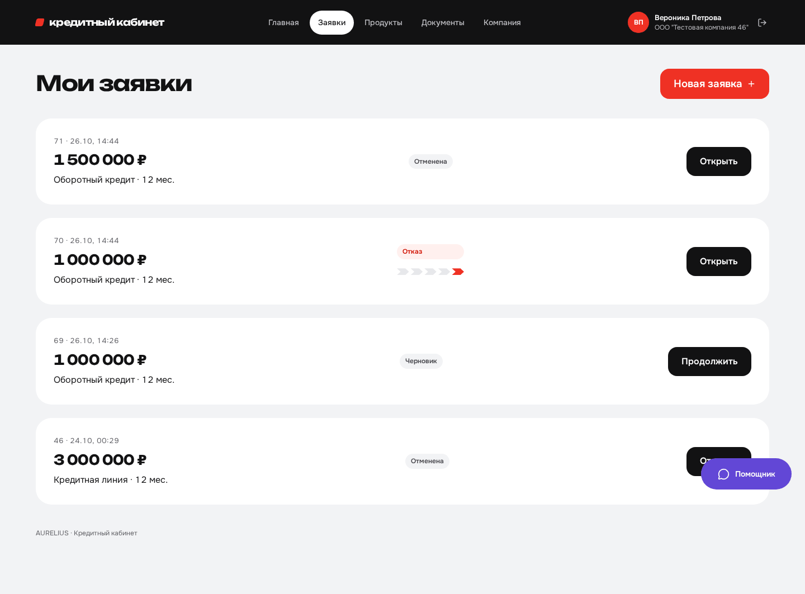

На скриншоте «Мои заявки» компании 46: 71 — отменённый черновик пути 5, 70 — отказ из путей 1–4, 69 — черновик предыдущей попытки съёмки, 46 — отменённая заявка дампа.

## 7. Что недоступно на исходных данных

| Шаг | Почему | Где видно |
|---|---|---|
| PD и лимит PD | у компаний 12 месяцев выручки, а скоринг требует 13 завершённых. Расчёт возвращает `MANUAL_REVIEW` с `DB_INPUTS_UNAVAILABLE`, без PD | «PD 12 мес.» — «Нет оценки» в очереди; «Оценка заявки» — «Нет данных» |
| «Одобрить рассчитанные условия» | у расчёта нет черновика предложения | пункт неактивен в «Решении сотрудника»; API отвечает 409 ([06-api.md](06-api.md#313-review)) |
| «Принять предложение» | нет одобренного предложения | кнопка появляется только при `APPROVED` и предложении `PROPOSED` |
| Подписание и выдача | не реализованы | сценарий заканчивается принятием предложения ([02-decisions.md](02-decisions.md#р14-сценарий-заканчивается-принятием-предложения)) |

Путь «одобрение → принятие → снятие устаревшего предложения» покрывает автоматический тест `test_actual_scorer_result_review_accept_and_client_redaction` (`personalCab/prom_v2/tests/test_cabinet.py`). Тест сам создаёт синтетическую компанию с 13 месяцами выручки, но требует отдельной тестовой БД. Результаты — в [08-testing.md](08-testing.md#22-пропущенные-python-тесты).

## 8. Известное ограничение интерфейса

Каждое действие в интерфейсе получает `request_id` через `crypto.randomUUID()` (`src/api/HttpCreditApi.ts`). Браузер даёт эту функцию только в безопасном контексте: HTTPS, `localhost`, `127.0.0.1`. Если открыть кабинет по обычному HTTP на другом адресе (например, `http://<IP сервера>:5173` при `APP_BIND_HOST=0.0.0.0`), вход проходит, но любое действие показывает ошибку `crypto.randomUUID is not a function`. Это воспроизведено на стенде 26.10.2026 (адрес контейнера в сети Docker) и в облачной среде. По `http://127.0.0.1:5173` всё работает.
