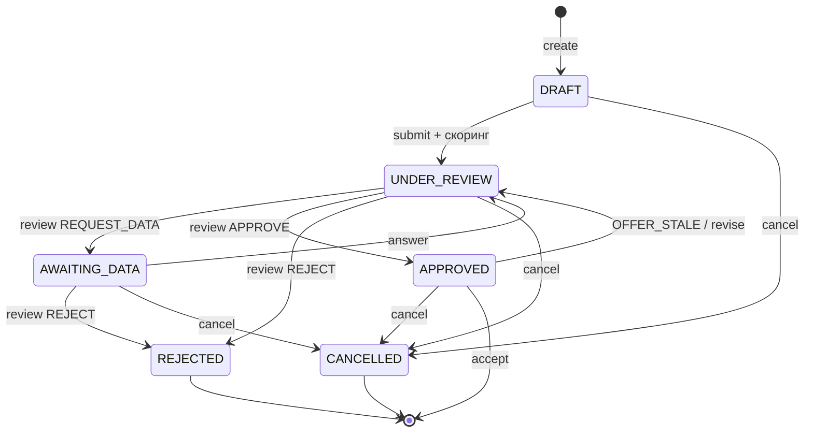
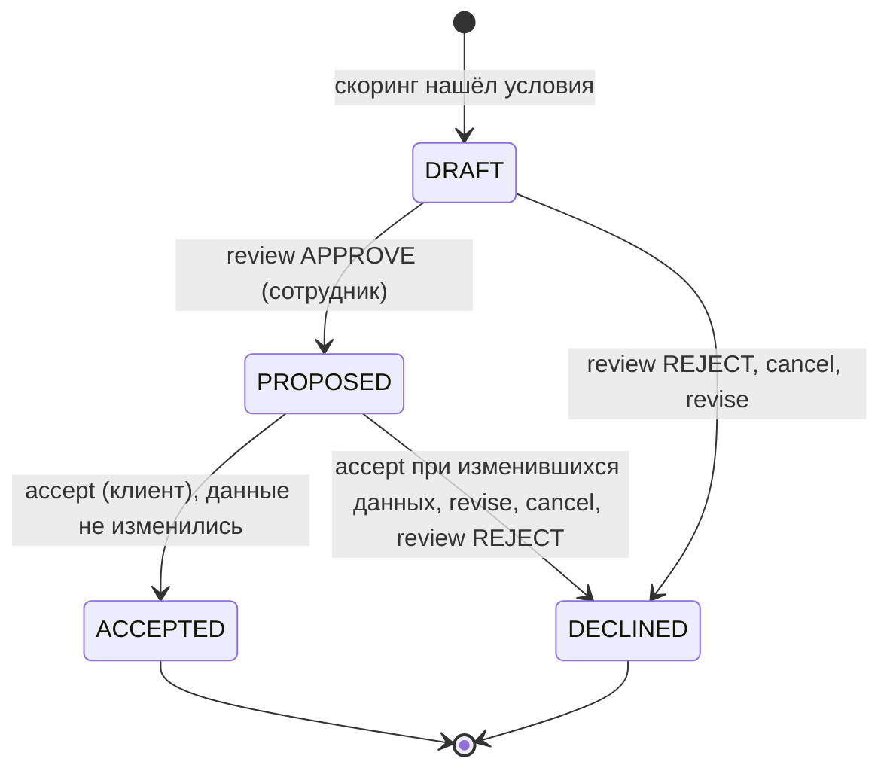

# 04. Кредитный процесс

Проверено на коммите `40b8038` (ветка `test-dev`).

Здесь описано, как заявка проходит путь от потребности клиента до результата в текущей версии (кабинет v3). Источники — код:
- `personalCab/prom_v2/cabinet.py` (`action`, `mutate`, `review`, `project`), `cabinet_freshness.py`, `cabinet_assistant.py`, `cabinet_documents.py`;
- `scoring/main`;
- фронт: `src/domain/status.ts`, `src/domain/serverStage.ts`, `src/components/v2/primitives.tsx`, `src/business/BusinessPages.tsx`;
- ограничения статусов в `scoring/bd/v_3 (actual)/schema_actual.sql`.

## 1. Участники

| Участник | Что делает в текущей версии | Как определяется |
|---|---|---|
| Клиент (`CLIENT`) | создаёт заявку, заполняет анкету, общается с ассистентом, отправляет заявку, отвечает на дозапрос, загружает документы, принимает предложение или отменяет заявку | `public.user_accounts.role`; компания клиента — `user_accounts.company_id` |
| Сотрудник банка (`BANK_EMPLOYEE`) | видит все заявки, берёт заявку в работу, запускает скоринг, фиксирует проверки, принимает решение | `public.user_accounts.role` |
| Ассистент (`gpt-oss:20b` через Ollama) | в черновике извлекает из сообщения клиента сумму, срок, цель, ИНН и форму бизнеса с цитатами. Поля анкеты меняет только после явного подтверждения клиентом | `cabinet_assistant.py` |
| Скоринг (`scoring/main`) | считает PD, лимит PD, платёжеспособность и черновик предложения, формирует рекомендацию | вызывается сервером кабинета как библиотека |
| Сервер кабинета | проверяет роли, владельца, версии и повторы запросов, переводит статусы, защищает от устаревших расчётов, ведёт журнал | `cabinet_server.py`, `cabinet.py` |

Роль, имя и компанию задаёт только сервер по сессии. Данные из формы входа прав не дают.

## 2. Этапы процесса

| № | Этап | Кто | Входные данные | Что происходит | Результат |
|---|---|---|---|---|---|
| 1 | Потребность и выбор продукта | клиент | продукт R01, R02 или R03 из действующего каталога | `create`: новая заявка компании клиента | `credit_applications` в статусе `DRAFT` |
| 2 | Анкета | клиент, ассистент | сумма, срок, цель; поля по `application_field_requirements` (99 требований для R01–R03); контакты и подписант; для R02/R03 срок транша; согласия | `save` сохраняет поля с `value_source=CLIENT`, `verification_status=UNVERIFIED` и историю изменений. `chat` даёт предложение ассистента с цитатами, `confirm_facts` переносит подтверждённые значения в анкету | заполненный черновик, версия заявки увеличивается |
| 3 | Подача | клиент | заполненная анкета, три подтверждения (`consentBki`, `consentData`, `businessConfirmed`), строка «Подтверждаю» | `submit` проверяет обязательные поля для ИП или юрлица, совпадение продукта, ИНН, суммы и срока, срок транша для R02/R03 | статус `UNDER_REVIEW`, `missing_data_status=COMPLETE`, `confirmed_at`; сразу запускается скоринг |
| 4 | Скоринг и расчёт предложения | система | данные из БД, а не из браузера: компания, операции по счёту, отчётность, обязательства, история платежей, условия продукта, политика, ключевая ставка | `run_application(id, save=True)` | `scoring_results` (если PD рассчитана), `credit_decisions` с решением библиотеки (`MANUAL_REVIEW` или `REJECT`), черновик предложения `application_product_terms` (`offer_status=DRAFT`), неизменяемый снимок `application_snapshots` (`DECISION`). Статус заявки не меняется |
| 5 | Рассмотрение | сотрудник | заявка, результат скоринга, документы | `claim` назначает ответственного. `verify` фиксирует проверку полномочий или выручки с источником и комментарием (только в журнале, исходные данные не меняются). `score` повторяет расчёт. Документы можно скачать | ответственный, записи проверок, актуальный расчёт |
| 6 | Дозапрос | сотрудник → клиент | поле анкеты и вопрос | `review` с `REQUEST_DATA` создаёт открытый запрос. Клиент отвечает (`answer`) и может приложить PDF или CSV (`upload`) | статус `AWAITING_DATA`. После ответа на последний открытый запрос — снова `UNDER_REVIEW`. Повторный скоринг не запускается автоматически |
| 7 | Решение | сотрудник | расчёт, проверки, ответы | `review`: `APPROVE`, `REJECT` или `REQUEST_DATA`, всегда с текстом причины | новая запись `credit_decisions` с причиной `BANK_APPROVE`, `BANK_REJECT` или `BANK_REQUEST_DATA`. При одобрении — `APPROVED`, предложение `PROPOSED`; при отказе — `REJECTED` |
| 8 | Принятие предложения | клиент | опубликованное предложение: сумма, срок, ставка | `accept` повторно проверяет, что исходные данные не изменились. Либо `cancel` | `offer_status=ACCEPTED`, статус заявки остаётся `APPROVED`. Если данные изменились, предложение снимается (см. раздел 5) |

Сценарий в текущей версии заканчивается на этапе 8. Подписание документов, выдача средств и обслуживание кредита не реализованы.

Обогащение из внешних источников (БКИ, ЕГРЮЛ/ЕГРИП, ФНС, Реестр МСП) в процессе отдельным шагом не выполняется. Эти сведения уже лежат в БД как синтетические данные, и скоринг читает их на этапе 4. Подробнее — в [THIRD_PARTY_NOTICES.md](../THIRD_PARTY_NOTICES.md#смоделированные-интеграции).

## 3. Диаграмма состояний заявки

Статусы `credit_applications.application_status` по ограничению схемы: `DRAFT`, `SUBMITTED`, `UNDER_REVIEW`, `AWAITING_DATA`, `APPROVED`, `REJECTED`, `CANCELLED`. На диаграмме — переходы, которые выполняет кабинет. Подписи — действия `/api/v2/action`; роли и условия — в таблице под диаграммой.



| Переход | Действие и роль | Условие |
|---|---|---|
| `[*]` → `DRAFT` | `create`, клиент | продукт R01–R03 активен |
| `DRAFT` → `UNDER_REVIEW` | `submit`, клиент; сразу после него — автоматический скоринг | анкета прошла проверки подачи |
| `UNDER_REVIEW` → `AWAITING_DATA` | `review` с `REQUEST_DATA`, ответственный сотрудник | есть расчёт; указано поле анкеты |
| `AWAITING_DATA` → `UNDER_REVIEW` | `answer`, клиент | ответ на последний открытый запрос |
| `UNDER_REVIEW` → `APPROVED` | `review` с `APPROVE`, ответственный сотрудник | есть черновик предложения, расчёт актуален, нет открытых запросов |
| `UNDER_REVIEW` / `AWAITING_DATA` → `REJECTED` | `review` с `REJECT`, ответственный сотрудник | есть расчёт |
| `APPROVED` → `UNDER_REVIEW` | `accept` при изменившихся данных (409 `OFFER_STALE`) или `revise`, клиент | предложение было `PROPOSED` |
| `DRAFT` / `UNDER_REVIEW` / `AWAITING_DATA` / `APPROVED` → `CANCELLED` | `cancel`, клиент | предложение ещё не принято |
| `APPROVED` → конец сценария | `accept`, клиент | данные не изменились; `offer_status=ACCEPTED`, статус заявки остаётся `APPROVED` |

Действия, которые статус не меняют:

| Статус | Действия |
|---|---|
| `DRAFT` | `save`, `chat`, `confirm_facts` (клиент), `upload` |
| `UNDER_REVIEW` | `claim`, `release`, `score`, `verify` (сотрудник), `upload` |
| `AWAITING_DATA` | `answer`, пока остаются другие открытые запросы (клиент); `review` с `REQUEST_DATA`, `claim`, `release`, `verify` (сотрудник); `upload` |

Пояснения по коду:

- `submit` переводит черновик сразу в `UNDER_REVIEW`. Статус `SUBMITTED` разрешён схемой и принимается действиями `claim`, `score`, `review` и `verify`, но в текущей версии ни одно действие кабинета его не устанавливает.
- `review APPROVE` из `AWAITING_DATA` на практике недоступен: одобрение запрещено, пока есть открытые запросы (`Сначала дождитесь ответов на открытые запросы.`), а после ответа на последний запрос заявка возвращается в `UNDER_REVIEW`.
- После принятия предложения (`offer_status=ACCEPTED`) отмена запрещена (`Предложение уже принято.`). Это конечная точка сценария в текущей версии.
- `revise` (изменение суммы и срока предложенного клиенту условия с новым расчётом) есть в API, но в HTTP-интерфейсе кабинета не вызывается: клиенту доступны только «Принять предложение» и «Отклонить и отменить заявку».
- `cancel` переводит в `DECLINED` предложения в статусах `DRAFT` и `PROPOSED`, а открытые запросы — в `CANCELLED`.
- `upload` не зависит от статуса заявки: документ можно приложить к любой своей заявке (клиент) или к любой заявке (сотрудник). Привязать его к дозапросу можно только к открытому.
- Каждое успешное действие увеличивает версию заявки (`aurelius_cabinet.application_state.version`) и пишет событие в `aurelius_cabinet.events`.

### Статусы предложения

`application_product_terms.offer_status`: `DRAFT`, `PROPOSED`, `ACCEPTED`, `DECLINED`. В кабинете предложение создаёт только скоринг: каждый расчёт с найденными условиями добавляет новую строку `DRAFT`. Текущим считается предложение из последнего расчёта кабинета (`latest_offer`).



### Решения

`credit_decisions.decision`: `APPROVE`, `REJECT`, `REQUEST_DATA`, `MANUAL_REVIEW`. Записи не изменяются, каждое решение — новая строка.

| Кто пишет | Значения | Причины (`reasons`) |
|---|---|---|
| Скоринг (`run_application`) | `MANUAL_REVIEW` или `REJECT`. `APPROVE` библиотека не возвращает | коды скоринга, например `BANK_CONFIRMATION_REQUIRED`, `REDUCED_AMOUNT`, `MVP_INPUTS_CONFIRMATION`, `INSUFFICIENT_CAPACITY`, `PD_LIMIT_EXCEEDED`, `DB_INPUTS_UNAVAILABLE` |
| Сотрудник (`review`) | `APPROVE`, `REJECT`, `REQUEST_DATA` | одна причина `BANK_<решение>` с текстом сотрудника |

`REJECT` от скоринга не переводит заявку в `REJECTED`: это рекомендация. Отказ фиксирует только сотрудник.

### Подписи статусов в интерфейсе

Фронт показывает статус по сочетанию статуса заявки, последнего решения и статуса предложения (`displayStatus` в `src/domain/status.ts`).

| `application_status` | Дополнительное условие | Подпись в интерфейсе |
|---|---|---|
| `DRAFT` | — | Черновик |
| `SUBMITTED` | — | Отправлена |
| `UNDER_REVIEW` | последнее решение `MANUAL_REVIEW` | Проверяет специалист |
| `UNDER_REVIEW` | иначе | Проверяем |
| `AWAITING_DATA` | — | Нужны данные |
| `APPROVED` | `offer_status=ACCEPTED` | Предложение принято |
| `APPROVED` | иначе | Одобрено |
| `REJECTED` | — | Отказ |
| `CANCELLED` | — | Отменена |

Если предложение снято из-за изменения данных, клиент видит: «Данные изменились. Требуется повторная проверка предложения.» (`httpClientStatus`).

Последнее решение для отображения выбирает сервер (`project`): если после последнего расчёта нет решения сотрудника, берётся решение скоринга из этого расчёта, иначе — последнее решение сотрудника.

## 4. Этапы трека в интерфейсе

Над карточкой заявки показывается трек этапов (`StageTrack`). Клиент видит 5 этапов, сотрудник — 6. Состояние каждого этапа вычисляет `stageFromServer` по данным `/api/v2/state`. Этап отмечается пройденным, только если для него есть собственное подтверждение; иначе он остаётся «Нет подтверждения».

| Клиент | Сотрудник | Когда отмечается пройденным |
|---|---|---|
| Отправлена | Приём | есть событие `submit` или статус `SUBMITTED`, `UNDER_REVIEW`, `AWAITING_DATA`, `APPROVED` |
| Данные подтверждены | Проверка данных | все обязательные поля анкеты имеют `verification_status=VERIFIED` и нет открытых запросов |
| Кредитная история | Обогащение | никогда: отдельного шага получения кредитной истории в текущей версии нет |
| Оценка риска | Скоринг | только у сотрудника: в расчёте есть годовая PD (`pd_application_1y`) от 0 до 1 |
| — | Политика | только у сотрудника: есть PD, версия политики и решение |
| Решение | Решение | текущий этап при `APPROVED`; при `REJECTED` — текущий с пометкой «Решение: отказ» |

Текущим этапом считается «Данные подтверждены» («Проверка данных»), когда заявка ждёт ответа на дозапрос. У сотрудника при решении скоринга `MANUAL_REVIEW` текущим становится «Решение» с пометкой «Ожидается решение сотрудника». Для черновика и отменённой заявки трек не показывается. Если предложение снято из-за изменения данных, ни один этап не отмечается и выводится подсказка «Требуется повторная проверка».

Анкета, заполненная клиентом, всегда сохраняется как `UNVERIFIED`, а `verify` пишет только запись в журнал. Поэтому этап «Данные подтверждены» в текущей версии на новых заявках не отмечается пройденным. Так и задумано: интерфейс не показывает подтверждение, которого не было.

## 5. Скоринг ≠ кредитное решение

В кейсе прямо сказано, что скоринг даёт оценку риска, а итоговое решение учитывает больше факторов. В AURELIUS это три разных слоя с разными ответственными.

### 5.1. Что делает скоринг (`scoring/main`)

Вызов: `run_application(application_id, save=True)` из `cabinet.py`. Все входы библиотека читает из БД сама; произвольный финансовый контекст из браузера не принимается.

1. Проверка допуска: статус компании, банкротство, продукт и его условия, тип заёмщика, срок, минимальная сумма. Блокирующее условие даёт `REJECT` с `eligibility_status=INELIGIBLE`.
2. Подготовка признаков модели по данным компании (контракт `db_auto_v3`). Нужны 13 завершённых месяцев положительной выручки (`REVENUE`, RUB), верифицированная отчётность, известные обязательства и история просрочек. Если данных не хватает, результат — `MANUAL_REVIEW` с `DB_INPUTS_UNAVAILABLE`, без PD. Недостающие наблюдения не дорисовываются.
3. Модель: CatBoost `dt_monotone_v1`, survival-модель на дискретном времени с ограничениями монотонности. Она даёт помесячные hazard, из которых считаются PD за 12 месяцев (`pd_application_1y`) и за срок кредита.
4. Платёжеспособность: свободный платёж `cash_available / minimum_dscr − existing_debt_service`, минимальное покрытие (DSCR) 1,20.
5. Подбор условий: сумма перебирается вниз от запрошенной с шагом 50 000 ₽. Для каждой суммы ставка перебирается вверх — от публичной базовой + 2 п.п. до 30% с шагом 0,5 п.п. Выбирается наибольшая сумма по минимальной проходящей ставке. Потолок 30% — допущение проекта, а не тариф банка.
6. Экономический лимит PD:

   ```text
   PD_limit_1y = (ставка − KEY_RATE − funding_spread − operating_cost − required_margin) / LGD
   ```

   С параметрами БД (`KEY_RATE`=14%, спред 1,5 п.п., расходы 2 п.п., маржа 3 п.п., LGD 45%) при ставке 29% лимит составляет около 18,89%. Условие проходит, если запас по ставке положительный и `pd_application_1y ≤ PD_limit_1y`.
7. Результат: при найденных условиях — `MANUAL_REVIEW` и черновик предложения с причиной `BANK_CONFIRMATION_REQUIRED` или `REDUCED_AMOUNT`. Если условий нет — `REJECT` с причинами (`INSUFFICIENT_CAPACITY`, `PD_LIMIT_EXCEEDED` и др.). Отдельно возвращается `automatic_recommendation`: `POSITIVE`, `NEGATIVE` или `REVIEW_REQUIRED`. В автоматическом режиме добавляется `MVP_INPUTS_CONFIRMATION`: сотрудник должен подтвердить индикативную цену и допущения, поэтому рекомендация — `REVIEW_REQUIRED`.

Источники: [`scoring/main/README.md`](../scoring/main/README.md), [`scoring/main/INTEGRATION.md`](../scoring/main/INTEGRATION.md), [`scoring/main/decision_engine/BASELINE.md`](../scoring/main/decision_engine/BASELINE.md), `scoring/main/pipeline.py`, [`ml_scoring/MODEL_REPAIR.md`](../scoring/main/ml_scoring/MODEL_REPAIR.md).

### 5.2. Что задаёт политика

| Слой политики | Где | Значения |
|---|---|---|
| Метод и правила расчёта | `scoring/main/decision_engine/policy.demo.json`, версия `DEMO_ANNUAL_PD_V2` | метод `annual_pd_limit`, минимальное покрытие 1,20, шаг суммы 50 000 ₽, отдельные пороги PD не заданы (`pd_limits` пуст), `demo_only=true` |
| Экономические параметры | `public.risk_policy_parameters`, версия `AURELIUS_MVP_20261024_V1` (R01–R03, с 24.10.2026 по 17.12.2026) | спред 1,5 п.п., операционные расходы 2 п.п., требуемая маржа 3 п.п., LGD 45% |
| Ключевая ставка | `public.macro_indicators` (`KEY_RATE`) | 14% с 27.07.2026 |
| Условия продуктов | `credit_products`, `credit_product_terms`, `credit_product_rate_options`, `credit_product_repayment_options` | суммы, сроки, ставки, графики R01–R03 |

Все значения — допущения демо, а не нормативы банка. Обоснование и источники — в `BASELINE.md`. Политика при Docker-запуске не меняется.

### 5.3. Что решает сотрудник и почему

Скоринг и политика не выдают окончательного одобрения. Решение принимает ответственный сотрудник (`review`):

- одобрить можно только рассчитанное предложение (`DRAFT`), только по актуальному расчёту (`SCORING_STALE`, если данные изменились) и только без открытых запросов;
- отказать и запросить данные можно и без предложения, например когда скоринг вернул ручную проверку без PD;
- причина обязательна и сохраняется как `BANK_APPROVE`, `BANK_REJECT` или `BANK_REQUEST_DATA`.

Так одна и та же оценка риска может привести к разным решениям. Причины: другие условия продукта, результаты проверок сотрудника (полномочия, выручка), ответы на дозапрос, допущения автоматического расчёта, которые сотрудник должен подтвердить.

### 5.4. Что видит каждая роль

| Данные | Клиент | Сотрудник |
|---|---|---|
| Предложение (сумма, срок, ставка) | только опубликованное: `APPROVED` и `PROPOSED` или `ACCEPTED` | рассчитанное и опубликованное |
| PD за 12 месяцев и лимит PD | нет | да |
| Полный результат скоринга (`assessment`) | не передаётся в API | да |
| Причины | в интерфейсе — только `BANK_APPROVE`, `BANK_REJECT`, `BANK_REQUEST_DATA` | все |
| Категории риска и факторы модели | нет | нет |
| Проверки сотрудника (`verify`) | нет | да |

Ограничение текущей версии: внутренние причины скоринга скрывает от клиента интерфейс (`src/domain/clientReasons.ts`). Сервер отдаёт клиенту поле `reasons` последнего решения без фильтрации (`cabinet.py`, `project`).

## 6. Защита от устаревшего расчёта

Предложение действительно, только пока не изменились данные, на которых оно рассчитано (`cabinet_freshness.py`).

- При каждом расчёте кабинет сохраняет отпечаток SHA-256 входов (`aurelius_cabinet.calculation_inputs`). В него входят:
  - параметры, анкета и подтверждение заявки, профиль компании;
  - операции, отчётность, обязательства, история просрочек, юридические события;
  - условия продукта, политика, ключевая ставка;
  - дата оценки и хэши кода, конфигурации и модели `scoring/main`.
- При одобрении отпечаток расчёта, решение и хэш предложения связываются в `aurelius_cabinet.offer_publications`.
- При `accept` всё сверяется заново. Если что-то изменилось, предложение переходит в `DECLINED`, заявка — в `UNDER_REVIEW`, причина пишется в `aurelius_cabinet.stale_offers`, клиент получает 409 `OFFER_STALE`. Это техническое снятие предложения, а не отказ: нужен новый скоринг и новое решение сотрудника.
- Пока идёт расчёт, исходные таблицы блокируются (`LOCK TABLE ... SHARE ROW EXCLUSIVE`). Это сознательная сериализация для локального демо.

## 7. Что упрощено и чего нет

| Тема | Текущая версия |
|---|---|
| Подписание и выдача | не реализованы. Сценарий завершается `offer_status=ACCEPTED` |
| Внешние проверки | отдельного вызова источников нет. Данные БКИ, реестров и выписки — синтетические строки в БД |
| Проверка документов | PDF и CSV проверяются только по формату и хранятся со статусом `STORED_UNVERIFIED`. Извлечения данных в признаки модели нет |
| Подтверждение анкеты | сотрудник фиксирует проверку в журнале; статус полей и исходные данные компании не меняются |
| Повторный скоринг после ответа на дозапрос | запускает сотрудник (`score`); автоматически не выполняется |
| Изменение условий клиентом (`revise`) | есть в API, в HTTP-интерфейсе не используется |
| Финансовая история в исходном дампе | 12 месяцев выручки на компанию; для расчёта PD нужно 13 завершённых. На исходных данных скоринг возвращает ручную проверку без PD |

> TODO: подтвердить последний пункт фактическим запуском скоринга на стенде (этап 4).
