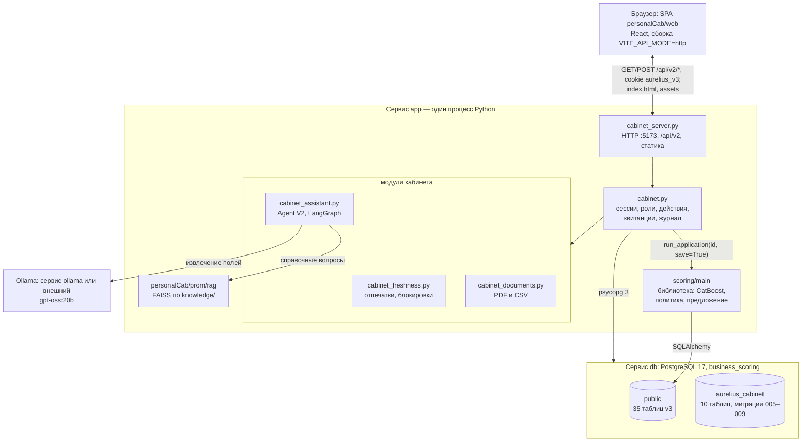
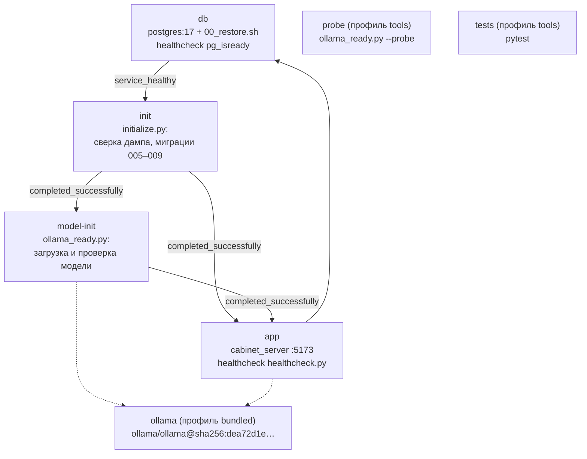
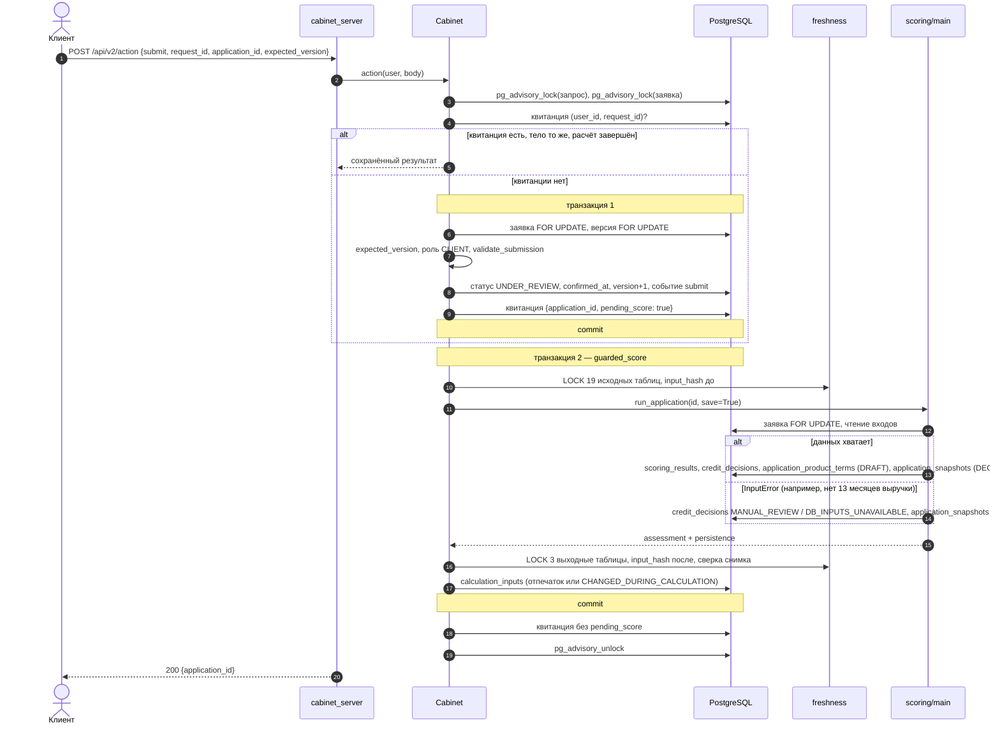
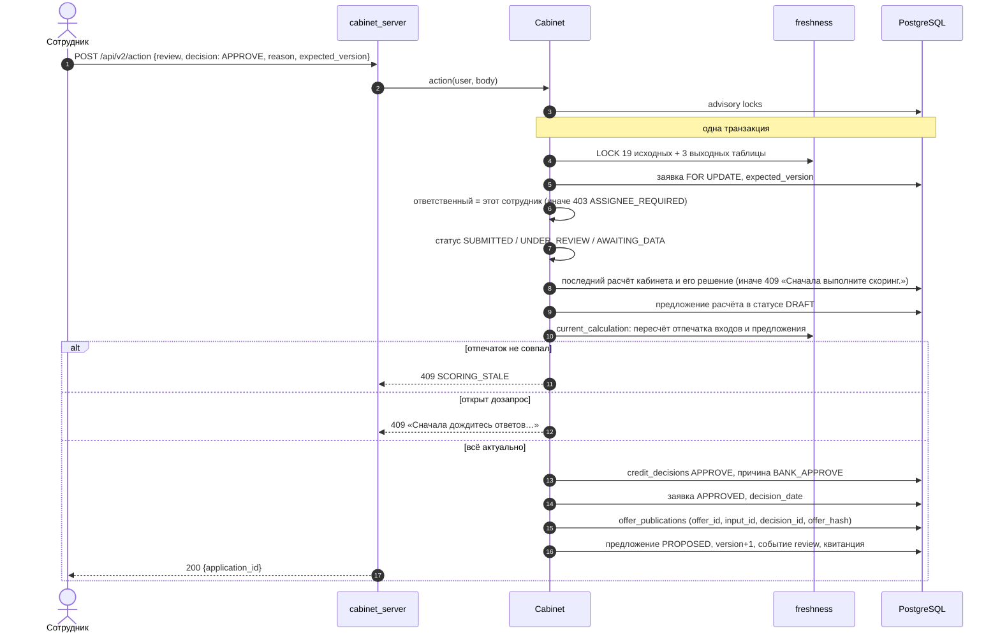
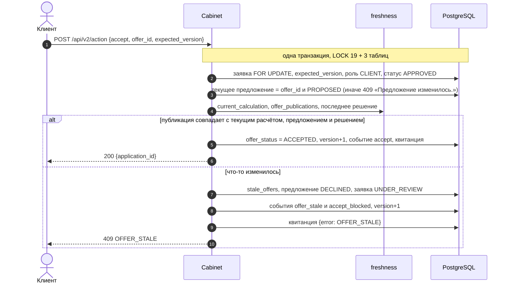
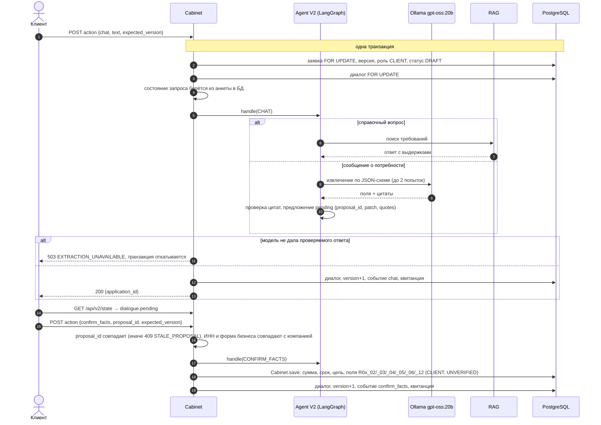

# 05. Архитектура

Проверено на коммите `40b8038` (ветка `test-dev`).

Документ описывает текущую версию — кабинет v3. Процесс и статусы заявки — в [04-credit-process.md](04-credit-process.md), решения и ограничения — в [02-decisions.md](02-decisions.md), запуск — в [09-deployment.md](09-deployment.md), API — в [06-api.md](06-api.md), таблицы — в [07-data-model.md](07-data-model.md).

Прежние серверы и фронты (`personalCab/frontend/`, `prom_v2/web_server.py`, БД `aurelius_v2`, миграции 001–004, mock-режим фронта) в запуск не входят и здесь не описаны.

## 1. Схема системы

Та же схема картинкой: [assets/architecture.svg](assets/architecture.svg).

Модули кабинета работают с БД через соединение `cabinet.py`. Что пишется в какую схему — в [07-data-model.md](07-data-model.md#4-кто-пишет-и-кто-читает).

Всё, кроме Ollama и PostgreSQL, работает в одном процессе Python. `scoring/main` подключается как библиотека, а не как отдельный сервис. RAG не обращается к модели: это лексический поиск по JSON с требованиями (`personalCab/prom/rag/README.md`).

### Сервисы Docker

По `compose.yaml`. Подробности о портах, томах и переменных — в [09-deployment.md](09-deployment.md#2-сервисы-и-порты).

`app`, `init`, `model-init`, `probe` и `tests` собираются из одного `Dockerfile` (`tests` — из стадии `test`). `ollama` запускается, только если скрипт `start.sh` / `start.ps1` не нашёл внешний Ollama. `probe` и `tests` штатный запуск не поднимает.

## 2. Компоненты и ответственность

| Компонент | Файлы | За что отвечает |
|---|---|---|
| Фронт | `personalCab/web/src`; клиент API — `src/api/HttpCreditApi.ts` и метод `request` в `src/api/HttpV2Api.ts` | интерфейс клиента и сотрудника. Читает `GET /api/v2/state`, все изменения отправляет через `POST /api/v2/action` (загрузку — через `/api/v2/documents`). Для каждого действия создаёт `request_id` (`crypto.randomUUID()`) и при повторе после сбоя отправляет то же тело. Скрывает от клиента причины скоринга (`src/domain/clientReasons.ts`) |
| HTTP-сервер | `personalCab/prom_v2/cabinet_server.py` | `ThreadingHTTPServer` на порту 5173. Маршруты `/api/v2/*`, проверка `Origin`, лимиты размера тела, cookie, перевод исключений в коды ответа. Раздаёт `personalCab/web/dist`; путь без расширения отдаёт `index.html`. Запросы не логирует (`log_message` пустой) |
| Ядро кабинета | `personalCab/prom_v2/cabinet.py`, класс `Cabinet` | вход и сессии; проекция заявки для роли (`project`); действия `/api/v2/action` (`action`, `mutate`): владение, роль, ответственный, версия, квитанции, advisory locks; анкета (`save`, `write_field`), проверки подачи (`validate_submission`), решение сотрудника (`review`); журнал `events` |
| Защита от устаревшего расчёта | `personalCab/prom_v2/cabinet_freshness.py` | блокировка 19 исходных и 3 выходных таблиц `public`, отпечаток SHA-256 входов расчёта, проверка актуальности перед одобрением и принятием, снятие устаревшего предложения |
| Документы | `personalCab/prom_v2/cabinet_documents.py` | проверка имени, формата и размера PDF / CSV, хранение байтов в `aurelius_cabinet.documents` |
| Ассистент | `personalCab/prom_v2/cabinet_assistant.py`, `agent.py`, `adapters.py`, `models.py` | действия `chat` и `confirm_facts` в черновике. Граф LangGraph `aurelius_agent_v2` (узлы `route` → `execute` → `project`) направляет сообщение либо в RAG, либо в извлечение через `gpt-oss:20b`. Диалог хранится в `aurelius_cabinet.dialogues` |
| Извлечение | `adapters.py` (`OllamaExtraction`), схема и промпт — `personalCab/prom/prom_lab/ai_agents_lab/agents/factory.py`, проверка цитат — `.../services/extraction_validation.py` | `ChatOllama` с `temperature=0`, структурированный вывод по JSON-схеме, таймаут 120 с, одна попытка исправления. Каждое значение должно подтверждаться цитатой из сообщения |
| Справочник требований (RAG) | `personalCab/prom/rag`, данные — `knowledge/Требования к кредитным заявкам.json` | TF-IDF слов и символьных n-грамм, индекс FAISS `IndexFlatIP` в памяти. Ответ собирается из найденных требований без генерации LLM |
| Каталог направлений | `adapters.py` (`CatalogProducts`) | 16 направлений каталога ассистента. С БД связаны только `term` → R01, `rcl` → R02, `overdraft` → R03 |
| Скоринг | `scoring/main` (`database.py`, `pipeline.py`, `application_service.py`, `ml_scoring/`, `decision_engine/`) | `run_application(application_id, save=True)`: читает данные заявки и компании из БД, считает PD и предложение, пишет результат в 4 таблицы `public`. Статус заявки не меняет. Подробно — [04-credit-process.md](04-credit-process.md#5-скоринг--кредитное-решение) |
| БД | PostgreSQL 17, БД `business_scoring` | `public` — бизнес-данные v3 (схема не меняется кабинетом), `aurelius_cabinet` — служебные данные кабинета. См. [07-data-model.md](07-data-model.md) |
| Развёртывание | `compose.yaml`, `Dockerfile`, `deploy/` | восстановление дампа, сверка, миграции, готовность модели, healthchecks |

Кабинет и скоринг работают с БД через разные соединения: кабинет — psycopg 3, скоринг — SQLAlchemy с уровнем изоляции `REPEATABLE READ` (`scoring/main/database.py`, `run_application`). Обе строки подключения собирает `deploy/runtime.py` из одних и тех же `PG_*`.

## 3. Потоки данных

На диаграммах `S` — `cabinet_server.py`, `C` — `Cabinet`, `F` — `cabinet_freshness.py`, `M` — `scoring/main`. Общий путь любого `POST`: проверка маршрута → `Origin` → размер тела → JSON-объект → сессия по cookie → `Cabinet.action`.

### 3.1. Подача заявки и автоматический скоринг

Что важно:
- Изменение заявки и квитанция записываются в одной транзакции. Скоринг идёт после неё. Если скоринг упал (`400 SCORING_INPUT_ERROR` или `503`), заявка уже в `UNDER_REVIEW`, а квитанция помечена `pending_score`. Повтор с тем же `request_id` и телом не меняет заявку повторно, а только досчитывает скоринг (`cabinet.py`, `action`; тест `test_scoring_outage_retries_submission_without_duplicate_mutation`).
- Если входы совпадают с уже посчитанными, библиотека возвращает прежний результат по `request_key` и новых строк не пишет (`run_application`). Кабинет всё равно добавляет запись `calculation_inputs`.
- Тот же путь проходят `score` (сотрудник) и `revise` (клиент).

### 3.2. Решение сотрудника: одобрение и публикация предложения

`REJECT` и `REQUEST_DATA` идут тем же путём без проверки отпечатка: создаётся запись `credit_decisions` с причиной `BANK_REJECT` / `BANK_REQUEST_DATA`, для дозапроса — строка `application_data_requests`.

На исходном дампе этот путь недоступен: скоринг не строит предложение, и одобрение отклоняется с 409 (см. [02-decisions.md](02-decisions.md#ограничения-текущей-версии)).

### 3.3. Принятие предложения клиентом

Снятие предложения сохраняется, хотя клиент получает 409: это результат действия, а не откат. Повтор того же запроса снова вернёт 409 `OFFER_STALE` из квитанции.

### 3.4. Шаг ассистента

- Подтверждённые значения пишутся той же функцией `Cabinet.save`, что и действие `save`, поэтому происхождение у них такое же: `value_source=CLIENT`, `verification_status=UNVERIFIED`.
- Действие `save` от клиента сбрасывает неподтверждённое предложение ассистента (`dialogues.payload.pending = null`).
- Вызов модели идёт внутри транзакции и под блокировкой заявки, до 120 секунд на обращение. Фронт ждёт ответа на `chat` до 10 минут (`HttpV2Api.ts`).
- При 503 ничего не сохраняется, квитанции нет, повтор с тем же `request_id` выполнится заново (тест `test_dialogue_model_outage_is_retryable_without_fake_history`).

## 4. Enterprise-аспекты (что реализовано)

### Аутентификация и сессии

- Вход: `POST /api/v2/login`, логин и пароль сверяются с `public.user_accounts` (только `is_active`). Пароль сравнивается как есть, через `secrets.compare_digest` (решение Р9 в [02-decisions.md](02-decisions.md#р9-пароли-демо-учёток-хранятся-как-есть)).
- Сессия: случайный токен `secrets.token_urlsafe(32)`. В `aurelius_cabinet.sessions` хранится только его SHA-256 и срок `now() + 8 hours`.
- Cookie: `aurelius_v3=<token>; HttpOnly; SameSite=Strict; Path=/api/v2; Max-Age=28800`. Выход удаляет запись сессии и ставит `Max-Age=0`.
- На каждом запросе пользователь заново читается из БД по хэшу токена. Отключённая учётка (`is_active=false`) теряет доступ сразу.
- Защита POST: `Origin` должен быть ровно `http://` + `Host`, иначе 403. CORS-заголовков сервер не выдаёт.
- Лимиты тела: больше 0 и не больше 2 МиБ, для `/api/v2/documents` — 14 МиБ; сам файл — до 10 МиБ.
- Ответы API: `Cache-Control: no-store`, `X-Content-Type-Options: nosniff`.

### Роли, владение, ответственный

- Роль и компания берутся только из сессии (`user_accounts.role`, `company_id`), не из тела запроса.
- Клиент видит и меняет только заявки своей компании. Чужая заявка и чужой документ — 404, а не 403, чтобы не раскрывать их существование (`Cabinet.owned`).
- Действия разделены по ролям: клиентские (`create`, `save`, `submit`, `chat`, `confirm_facts`, `answer`, `accept`, `revise`, `cancel`), сотрудника (`claim`, `release`, `score`, `verify`, `review`), общее (`upload`). Таблица — в [06-api.md](06-api.md#3-действия-post-apiv2action).
- Ответственный сотрудник (`aurelius_cabinet.assignments`, одна строка на заявку): `score`, `verify` и `review` доступны только ему, иначе 403 `ASSIGNEE_REQUIRED`. Освободить заявку может только он сам.
- Сотрудник не видит диалог клиента с ассистентом. Клиент не видит `assessment`, проверки сотрудника и неопубликованное предложение ([06-api.md](06-api.md#24-что-видит-клиент-и-что-видит-сотрудник)).

### Конкурентный доступ и идемпотентность

| Механизм | Где | Что даёт |
|---|---|---|
| `expected_version` | `aurelius_cabinet.application_state.version`; проверка в `mutate` под `FOR UPDATE` | все действия с заявкой, кроме `create`, применяются только к той версии, которую видел пользователь. Иначе 409 `STALE_CASE_VERSION`. Каждое успешное действие увеличивает версию на 1 |
| `request_id` и квитанции | `aurelius_cabinet.receipts`, ключ `(user_id, request_id)`, отпечаток SHA-256 всего тела | повтор с тем же телом возвращает сохранённый результат, не выполняя действие второй раз. Тот же `request_id` с другим телом — 409 `REQUEST_ID_REUSED`. Действие, завершившееся ошибкой, квитанции не оставляет |
| Advisory locks | `pg_advisory_lock(hashtextextended(…))` на ключи `cabinet-request:<user_id>:<request_id>` и `cabinet-application:<id>`, сессионные | параллельные повторы одного запроса и параллельные действия над одной заявкой выполняются по очереди. Блокировка держится и на время скоринга в отдельном соединении |
| Блокировки строк | `SELECT … FOR UPDATE` заявки, версии, назначения, дозапроса, диалога | исключают двойное назначение и гонки при ответе на дозапрос |
| Блокировки таблиц | `LOCK TABLE … IN SHARE ROW EXCLUSIVE MODE` на 19 исходных таблиц и 3 выходные (`cabinet_freshness.lock_inputs`); при скоринге, `review` и `accept` | пока идёт расчёт или проверка актуальности, другие клиенты БД не могут изменить его входы. Это сериализация для локального демо, а не масштабируемый протокол (Р10) |
| Атомарность | изменение заявки, версия, событие и квитанция — в одной транзакции | при сбое не остаётся половины действия |

### Аудит

- `aurelius_cabinet.events`: каждое успешное действие пишет строку (`application_id`, `user_id`, `action`, `details`, `created_at`). Кроме имён действий, бывают служебные `offer_stale` и `accept_blocked`. В `details` — данные проверки (`verify`), документа (`upload`), сотрудника (`claim` / `release`).
- История полей анкеты: каждое изменение значения пишется в `public.application_field_history` (старое и новое значение, кто и откуда). UPDATE и DELETE этой таблицы запрещены триггером `trg_immutable_application_field_history`.
- Снимки расчётов `public.application_snapshots` (`DECISION`) также защищены от изменения триггером `trg_immutable_application_snapshots`.
- Решения `public.credit_decisions` не изменяются кабинетом: каждое решение — новая строка.
- Связь «расчёт → решение → предложение» хранится в `aurelius_cabinet.calculation_inputs` и `offer_publications`, снятые предложения — в `stale_offers`.

Подробнее о составе таблиц — [07-data-model.md](07-data-model.md#3-служебная-схема-aurelius_cabinet).

### Актуальность расчёта (`cabinet_freshness.py`)

- Отпечаток входов `input_hash` — SHA-256 от:
  - заявки без полей `application_status` и `decision_date`;
  - строк 19 исходных таблиц, относящихся к заявке, компании, продукту, политике и ключевой ставке (`SOURCE_TABLES`);
  - индивидуальных предложений, созданных не скорингом;
  - даты оценки;
  - хэшей файлов `.py`, `.json`, `.cbm` в `scoring/main` (кроме `tests` и `reports`), то есть кода, конфигурации и весов модели.
- `calculation_hash` добавляет к нему выбранный и последний снимок расчёта.
- Перед одобрением и принятием отпечаток пересчитывается и сравнивается с сохранённым. Как это проявляется в процессе — [04-credit-process.md](04-credit-process.md#6-защита-от-устаревшего-расчёта).

### Миграции

- Кабинет применяет только миграции `personalCab/prom_v2/migrations/005–009` (`Cabinet.initialize`, сервис `init`). Все — `CREATE … IF NOT EXISTS`, повторный запуск безопасен. Таблиц `public` они не меняют (тест `test_migration_is_additive_and_idempotent`).
- Дамп восстанавливается только в пустой том (`deploy/00_restore.sh` вызывается штатным entrypoint PostgreSQL). Первый запуск сверяет число строк 5 таблиц и ставит отметку `aurelius_deploy.seed_validation`. Повторные запуски данные не трогают.

### Конфигурация

- Все настройки — в `.env` по шаблону `.env.example`. Файл исключён из Git и из Docker-контекста.
- Пароль БД обязателен: без него Compose не стартует (`${POSTGRES_PASSWORD:?…}`), а `deploy/runtime.py` отклоняет пустой.
- Строки подключения собираются внутри контейнера из `PG_*` с URL-кодированием и не выводятся в лог.
- Фронт собирается только в режиме `VITE_API_MODE=http`, иначе сборка образа останавливается (`Dockerfile`).

Таблица переменных — в [09-deployment.md](09-deployment.md#4-переменные-окружения).

### Готовность и healthchecks

| Сервис | Проверка |
|---|---|
| `db` | `pg_isready` каждые 3 с, до 40 попыток |
| `init` | завершается кодом 0 после сверки и миграций; иначе `app` не стартует |
| `model-init` | ждёт Ollama, при необходимости скачивает модель и проверяет генерацию; иначе `app` не стартует |
| `app` | `deploy/healthcheck.py` каждые 15 с: `GET /` отдаёт 200 с HTML, `GET /api/v2/session` без входа — 401 |

### Закреплённые версии

- Python-пакеты: `requirements.lock.txt` (подключается из `requirements.txt` через `-c`), после установки — `pip check`.
- npm: `personalCab/web/package-lock.json`, установка `npm ci`.
- Образ Ollama — по digest `sha256:dea72d1e…` в `compose.yaml`.
- Базовые образы `postgres:17`, `python:3.13-slim`, `node:24-alpine` закреплены только по тегу, не по digest.
- Модель `gpt-oss:20b` задаётся тегом в `.env` (`OLLAMA_MODEL`).
- Версия кода и весов скоринга входит в отпечаток каждого расчёта (см. выше).

### Что не попадает в логи

- Сервер кабинета не пишет журнал запросов вообще: `Handler.log_message` пустой, поэтому тела, пароли, cookie и параметры запросов не логируются. Выводится только строка запуска.
- Тексты ошибок БД клиенту не возвращаются: прочие исключения дают 503 с общим сообщением.
- Ассистент не пишет в ошибки текст сообщения клиента и ответ модели (`agent.py`, `_chat`).

## 5. Ограничения архитектуры

Что сознательно не сделано в текущей версии. Причины и план — в [02-decisions.md](02-decisions.md#ограничения-текущей-версии).

| Ограничение | Последствие |
|---|---|
| HTTPS не настроен | сервер принимает только `Origin: http://<Host>`. За HTTPS-прокси вход и действия получат 403 без доработки проверки |
| Пароли хранятся открытым текстом | демо-учётки синтетические; хэширования паролей и промышленной аутентификации нет (Р9) |
| Блокировки таблиц вместо протокола версий | на время расчёта, одобрения и принятия 22 таблицы `public` блокируются целиком. Для нагрузки нужен построчный протокол версий (Р10) |
| Фильтр причин для клиента только в интерфейсе | `GET /api/v2/state` отдаёт клиенту `reasons` последнего решения без фильтра, в том числе коды скоринга (Р6) |
| Один процесс без очереди задач | скоринг и вызов модели выполняются синхронно в потоке запроса. Ответ на `chat` может занимать до 120 с на обращение к модели |
| Нет журнала запросов | для разбора инцидентов есть только `events`, квитанции и данные заявки |
| Базовые образы закреплены по тегу | пересборка в другой день может взять другую патч-версию `postgres:17`, `python:3.13-slim`, `node:24-alpine` |
