# 07. Модель данных

Проверено на коммите `40b8038` (ветка `test-dev`).

Источники:
- структура `public` — `scoring/bd/v_3 (actual)/schema_actual.sql`;
- число строк — `scoring/bd/v_3 (actual)/manifest.json`, сверено со стендом (раздел 6.1);
- служебная схема — `personalCab/prom_v2/migrations/005–009`;
- кто что пишет — код `personalCab/prom_v2/cabinet*.py` и `scoring/main/database.py`.

Полный справочник таблиц и колонок — в [scoring/bd/README_bd.md](../scoring/bd/README_bd.md), раздел 9. Справочник в документации появится в расширенной части. Статусы и переходы — в [04-credit-process.md](04-credit-process.md#3-диаграмма-состояний-заявки).

## 1. Состав БД

БД `business_scoring`, PostgreSQL 17.

| Схема | Таблиц | Откуда | Кто меняет структуру |
|---|---:|---|---|
| `public` | 35 | дамп `business_scoring_wauth.backup` | никто: кабинет и скоринг работают со схемой как есть |
| `aurelius_cabinet` | 10 | миграции `005–009`, сервис `init` | только миграции кабинета (`CREATE … IF NOT EXISTS`) |
| `aurelius_deploy` | 1 | `deploy/00_restore.sh` | отметка о сверке дампа (`seed_validation`) |

В старом `scoring/bd/README_bd.md` (раздел 9) указаны 34 таблицы и встречается ссылка на `scenarios_30_updated.csv`, которого нет в репозитории; доступен `scoring/bd/scenarios_30.csv`. Для текущей версии источники структуры и чисел — схема и манифест v3, а не эта устаревшая цифра справочника. Переименование CSV и исправление исходного справочника требуют отдельного решения команды.

Число таблиц `public` посчитано по `CREATE TABLE` в `schema_actual.sql` (35) и по `information_schema.tables` на стенде (35). В `aurelius_cabinet` — по миграциям (10) и на стенде (10).

Из 35 таблиц `public` текущая версия работает с 27:

| Группа | Таблиц | Таблицы |
|---|---:|---|
| Кабинет и скоринг пишут | 10 | `credit_applications`, `application_details`, `application_product_details`, `application_field_values`, `application_field_history`, `application_data_requests`, `credit_decisions`, `application_product_terms`, `scoring_results`, `application_snapshots` |
| Только читаются | 17 | `companies`, `user_accounts`, `credit_products`, `credit_product_terms`, `credit_product_rate_options`, `credit_product_repayment_options`, `credit_product_eligibility_rules`, `credit_product_purposes`, `credit_product_fees`, `application_field_requirements`, `risk_policy_parameters`, `macro_indicators`, `bank_transactions`, `financial_statements`, `credit_obligations`, `credit_repayment_history`, `legal_events` |
| Не используются | 8 | `collateral`, `company_bank_accounts`, `company_contacts`, `company_data_provenance`, `credit_history_events`, `credit_line_operations`, `data_quality_checks`, `guarantors` |

Посчитано поиском имён таблиц в `personalCab/prom_v2/cabinet*.py` и `scoring/main/**/*.py` (без тестов). Неиспользуемые таблицы пусты в дампе (раздел 6.1).

## 2. ER-диаграмма ключевых таблиц `public`

Показаны ключевые колонки и внешние ключи из `schema_actual.sql`. Составные ключи вида `(application_id, product_code)` гарантируют, что связанные строки относятся к тому же продукту или той же компании, что и заявка.

```mermaid
erDiagram
    companies ||--o{ credit_applications : "company_id"
    companies ||--o{ bank_transactions : "company_id"
    companies ||--o{ financial_statements : "company_id"
    companies ||--o{ credit_obligations : "company_id"
    companies ||--o{ legal_events : "company_id"
    credit_obligations ||--o{ credit_repayment_history : "obligation_id"
    companies ||..o{ user_accounts : "company_id (без FK)"

    credit_products ||--o{ credit_product_terms : "product_code"
    credit_products ||--o{ application_field_requirements : "product_code"
    credit_products ||--o{ risk_policy_parameters : "product_code"
    credit_products ||--o{ credit_applications : "product_code"
    credit_product_terms ||--o{ credit_product_rate_options : "terms_id"
    credit_product_terms ||--o{ credit_product_repayment_options : "terms_id"

    credit_applications ||--o| application_details : "application_id"
    credit_applications ||--o| application_product_details : "application_id + company_id"
    credit_applications ||--o{ application_field_values : "application_id + product_code"
    application_field_requirements ||--o{ application_field_values : "product_code + field_code"
    credit_applications ||--o{ application_field_history : "application_id + product_code"
    application_field_requirements ||--o{ application_field_history : "product_code + field_code"
    credit_applications ||--o{ application_data_requests : "application_id + product_code"
    application_field_requirements ||--o{ application_data_requests : "product_code + field_code"
    credit_applications ||--o{ scoring_results : "application_id"
    credit_applications ||--o{ credit_decisions : "application_id"
    scoring_results |o--o{ credit_decisions : "scoring_result_id + application_id"
    credit_applications ||--o{ application_product_terms : "application_id + product_code"
    credit_product_terms ||--o{ application_product_terms : "terms_id + product_code"
    credit_product_rate_options |o--o{ application_product_terms : "rate_option_id + terms_id"
    credit_product_repayment_options |o--o{ application_product_terms : "repayment_option_id + terms_id"
    credit_applications ||--o{ application_snapshots : "application_id"

    companies {
        bigint company_id PK
        varchar entity_type "LEGAL_ENTITY | INDIVIDUAL_ENTREPRENEUR"
        varchar inn "UNIQUE, 10 или 12 цифр"
        varchar ogrn
        varchar ogrnip
        text name
        varchar status
        varchar information_reliability_status
    }
    user_accounts {
        bigint user_id PK
        varchar login "UNIQUE"
        text password "как есть, демо"
        varchar role "CLIENT | BANK_EMPLOYEE"
        bigint company_id "у CLIENT обязателен"
        boolean is_active
    }
    credit_products {
        varchar product_code PK "R01, R02, R03"
        varchar product_type
        boolean active
    }
    credit_product_terms {
        bigint terms_id PK
        varchar product_code FK
        text version_code
        date effective_from
        date effective_to
        numeric min_amount
        numeric max_amount
    }
    credit_product_rate_options {
        bigint rate_option_id PK
        bigint terms_id FK
        numeric min_annual_rate_pct
    }
    credit_product_repayment_options {
        bigint repayment_option_id PK
        bigint terms_id FK
        varchar repayment_type
    }
    application_field_requirements {
        varchar product_code PK
        int field_number PK
        text field_code "UNIQUE с product_code"
        boolean required_ip
        boolean required_ooo
        text target_db_field
    }
    credit_applications {
        bigint application_id PK
        bigint company_id FK
        varchar product_code FK
        numeric requested_amount
        int requested_term_months
        text purpose
        varchar application_status
        varchar missing_data_status
        timestamptz decision_date
    }
    application_details {
        bigint application_id PK
        text contact_full_name
        text signer_full_name
        timestamptz confirmed_at
        text confirmation_version
    }
    application_product_details {
        bigint application_id PK
        bigint company_id
        int max_tranche_term_value
        varchar max_tranche_term_unit
    }
    application_field_values {
        bigint application_id PK
        text field_code PK
        jsonb field_value
        varchar value_source
        varchar verification_status
        varchar changed_by_type
    }
    application_field_history {
        bigint history_id PK
        text field_code
        jsonb old_value
        jsonb new_value
        varchar changed_by_type
        varchar source_type
    }
    application_data_requests {
        bigint request_id PK
        text field_code
        text question_text
        varchar request_status "OPEN | ANSWERED | CANCELLED"
        jsonb answer_value
    }
    scoring_results {
        bigint scoring_result_id PK
        varchar model_version
        numeric pd "0..1"
        varchar risk_grade "скоринг пишет UNRATED"
        jsonb feature_snapshot
    }
    credit_decisions {
        bigint decision_id PK
        bigint scoring_result_id FK
        varchar policy_version
        varchar decision "APPROVE | REJECT | REQUEST_DATA | MANUAL_REVIEW"
        varchar eligibility_status
        numeric approved_amount
        jsonb reasons
    }
    application_product_terms {
        bigint offer_id PK
        bigint terms_id FK
        numeric offered_amount
        int offered_term_months
        numeric offered_annual_rate_pct
        jsonb offered_conditions
        varchar offer_status "DRAFT | PROPOSED | ACCEPTED | DECLINED"
    }
    application_snapshots {
        bigint snapshot_id PK
        varchar snapshot_type "SUBMISSION | DECISION | MANUAL"
        jsonb snapshot_data
        int snapshot_version "UNIQUE с application_id"
    }
    bank_transactions {
        bigint transaction_id PK
        timestamptz transaction_date
        numeric amount
        varchar direction "IN | OUT"
        varchar operation_category
    }
    financial_statements {
        bigint statement_id PK
        date period_start
        date period_end
        varchar statement_type
        numeric revenue
        boolean is_verified
    }
    credit_obligations {
        bigint obligation_id PK
        varchar obligation_type
        numeric outstanding_balance
        numeric monthly_payment
        varchar obligation_status
    }
    credit_repayment_history {
        bigint repayment_id PK
        bigint obligation_id FK
        date period_date
        int overdue_days
    }
    legal_events {
        bigint legal_event_id PK
        varchar event_type
        varchar event_status
    }
    risk_policy_parameters {
        bigint policy_id PK
        varchar product_code FK
        varchar policy_version
        numeric funding_spread_pct
        numeric operating_cost_pct
        numeric required_margin_pct
        numeric lgd_pct
        date effective_from
        date effective_to
    }
    macro_indicators {
        bigint indicator_id PK
        varchar indicator_code "KEY_RATE"
        numeric indicator_value
        date effective_date
    }
```



Что стоит знать о связях:
- `user_accounts.company_id` не объявлен внешним ключом. Связь «клиент → компания» обеспечивает только CHECK: у `CLIENT` компания обязательна, у `BANK_EMPLOYEE` — пуста.
- `credit_product_eligibility_rules`, `credit_product_purposes`, `credit_product_fees` связаны с `credit_product_terms` по `terms_id`; на диаграмме не показаны.
- `macro_indicators` и `risk_policy_parameters` (кроме `product_code`) ни с чем не связаны ключами. Скоринг выбирает строку по дате оценки.

## 3. Служебная схема `aurelius_cabinet`

Все таблицы созданы миграциями `005–009`. Внешние ключи ссылаются только на `public` и друг на друга; таблицы `public` миграции не меняют.

```mermaid
erDiagram
    user_accounts ||--o{ sessions : "user_id"
    credit_applications ||--o| application_state : "application_id"
    user_accounts ||--o{ receipts : "user_id"
    credit_applications ||--o{ events : "application_id"
    user_accounts ||--o{ events : "user_id"
    credit_applications ||--o{ documents : "application_id"
    user_accounts ||--o{ documents : "uploaded_by"
    application_data_requests |o--o{ documents : "data_request_id"
    credit_applications ||--o| assignments : "application_id"
    user_accounts ||--o{ assignments : "employee_id"
    credit_applications ||--o{ calculation_inputs : "application_id"
    application_snapshots ||--o{ calculation_inputs : "snapshot_id"
    application_product_terms ||--o| offer_publications : "offer_id"
    calculation_inputs ||--o{ offer_publications : "input_id"
    credit_decisions ||--o{ offer_publications : "decision_id"
    application_product_terms ||--o| stale_offers : "offer_id"
    credit_applications ||--o{ stale_offers : "application_id"
    credit_applications ||--o{ dialogues : "application_id"
    user_accounts ||--o{ dialogues : "user_id"
    companies ||--o{ dialogues : "company_id"

    sessions {
        text token_hash PK "SHA-256 токена"
        bigint user_id FK
        timestamptz expires_at
    }
    application_state {
        bigint application_id PK
        int version "expected_version"
        jsonb form_state
        timestamptz updated_at
    }
    receipts {
        bigint user_id PK
        text request_id PK
        text input_hash "SHA-256 тела"
        jsonb result
    }
    events {
        bigint event_id PK
        bigint application_id FK
        bigint user_id FK
        text action
        jsonb details
        timestamptz created_at
    }
    documents {
        bigint document_id PK
        bigint application_id FK
        bigint uploaded_by FK
        bigint data_request_id FK
        text filename
        text media_type "application/pdf | text/csv"
        bytea content "1 байт — 10 МиБ"
        text sha256
        text source "CLIENT_UPLOAD | EMPLOYEE_UPLOAD"
        text processing_status "STORED_UNVERIFIED"
    }
    assignments {
        bigint application_id PK
        bigint employee_id FK
        timestamptz assigned_at
    }
    calculation_inputs {
        bigint input_id PK
        bigint application_id FK
        bigint snapshot_id FK
        text input_hash
        text offer_hash
        timestamptz calculated_at
    }
    offer_publications {
        bigint offer_id PK
        bigint input_id FK
        bigint decision_id FK
        text offer_hash
        timestamptz published_at
    }
    stale_offers {
        bigint offer_id PK
        bigint application_id FK
        text reason
        timestamptz detected_at
    }
    dialogues {
        bigint application_id PK
        bigint user_id PK
        bigint company_id FK
        jsonb payload
        timestamptz updated_at
    }
```



| Таблица | Миграция | Назначение |
|---|---|---|
| `sessions` | 005 | сессии: хэш токена, пользователь, срок (8 часов) |
| `application_state` | 005 | версия заявки для `expected_version` и состояние формы (согласия, шаг) |
| `receipts` | 005 | квитанции действий по `(user_id, request_id)` с отпечатком тела и результатом |
| `events` | 005 | журнал действий по заявке |
| `documents` | 006 | байты PDF и CSV с SHA-256 и привязкой к дозапросу |
| `assignments` | 007 | ответственный сотрудник, не больше одного на заявку |
| `calculation_inputs` | 008 | отпечаток входов каждого расчёта кабинета и хэш его предложения |
| `offer_publications` | 008 | какое предложение опубликовано по какому расчёту и решению |
| `stale_offers` | 008 | предложения, снятые из-за изменения данных |
| `dialogues` | 009 | диалог клиента с ассистентом по заявке |

Как эти таблицы используются в потоках — [05-architecture.md](05-architecture.md#4-enterprise-аспекты-что-реализовано).

## 4. Кто пишет и кто читает

### 4.1. Записи в `public`

| Таблица | Кабинет (`cabinet.py`) | Скоринг (`run_application`) |
|---|---|---|
| `credit_applications` | `create` — INSERT; `save`, `revise` — сумма, срок, цель; `submit`, `review`, `answer`, `accept` (при снятии), `cancel`, `revise` — статус, `missing_data_status`, `decision_date` | только чтение (`FOR UPDATE`) |
| `application_details` | `save` — контакты и подписант; `submit` — `confirmed_at`, `confirmation_version` | читает |
| `application_product_details` | `save` — срок транша и параметры линии / овердрафта | читает |
| `application_field_values` | `save`, `confirm_facts`, `answer` — значения анкеты (`CLIENT`, `UNVERIFIED`) | читает |
| `application_field_history` | INSERT при каждом изменении значения (вместе с записью в `application_field_values`) | — |
| `application_data_requests` | `review REQUEST_DATA` — INSERT; `answer` — `ANSWERED`; `cancel` — `CANCELLED` | — |
| `credit_decisions` | `review` — INSERT решения сотрудника (`BANK_*`) | INSERT решения библиотеки (`MANUAL_REVIEW` / `REJECT`) |
| `application_product_terms` | меняет только `offer_status`: `PROPOSED` (`review APPROVE`), `ACCEPTED` (`accept`), `DECLINED` (`review REJECT`, `cancel`, `revise`, снятие) | INSERT черновика предложения (`DRAFT`) |
| `scoring_results` | — | INSERT, если PD рассчитана |
| `application_snapshots` | читает | INSERT снимка `DECISION` на каждый новый расчёт |

### 4.2. Только чтение

- Кабинет: `user_accounts` (вход и сессия), `companies`, `credit_products`, `credit_product_terms`, `application_field_requirements` (анкета, проверки подачи, `state`).
- Скоринг: компания, финансовые данные (`bank_transactions`, `financial_statements`, `credit_obligations`, `credit_repayment_history`, `legal_events`), условия продукта (`credit_product_*`), политика (`risk_policy_parameters`) и ключевая ставка (`macro_indicators`).
- `cabinet_freshness.py` читает 19 таблиц — входы расчёта — для отпечатка и на время расчёта блокирует их от записи ([05-architecture.md](05-architecture.md#актуальность-расчёта-cabinet_freshnesspy)).

Данные компании (`companies`) и финансовые таблицы кабинет не меняет никогда. Анкета клиента хранится отдельно, в `application_field_values`.

### 4.3. Защита от изменения

| Объект | Как защищён |
|---|---|
| `application_field_history` | триггер `trg_immutable_application_field_history`: UPDATE и DELETE запрещены |
| `application_snapshots` | триггер `trg_immutable_application_snapshots`: UPDATE и DELETE запрещены |
| `application_field_values` | триггер `trg_log_application_field_values` пишет в историю каждое INSERT, UPDATE и DELETE |
| `credit_decisions` | кабинет и скоринг только добавляют строки |

Одно изменение значения поля кабинетом даёт **две** строки в `application_field_history`: одну пишет триггер `trg_log_application_field_values` (с `source_reference=cabinet`), вторую — сам `Cabinet.write_field` (с `source_reference=NULL`). Проверено на стенде 26.10.2026: у заявки 68 сохранено 31 поле и 62 строки истории; по всем заявкам кабинета — 63 строки с `cabinet` и 63 с `NULL`. В данных дампа такого нет: 836 значений и 836 строк истории (их писал только триггер).

## 5. Статусы и ограничения

CHECK-ограничения из `schema_actual.sql` для полей состояния. Какие переходы выполняет кабинет — в [04-credit-process.md](04-credit-process.md#3-диаграмма-состояний-заявки).

| Таблица.поле | Допустимые значения |
|---|---|
| `credit_applications.application_status` | `DRAFT`, `SUBMITTED`, `UNDER_REVIEW`, `AWAITING_DATA`, `APPROVED`, `REJECTED`, `CANCELLED` (по умолчанию `DRAFT`) |
| `credit_applications.missing_data_status` | `COMPLETE`, `PARTIAL`, `CRITICAL_MISSING` (по умолчанию `PARTIAL`) |
| `credit_decisions.decision` | `APPROVE`, `REJECT`, `REQUEST_DATA`, `MANUAL_REVIEW` |
| `credit_decisions.eligibility_status` | `ELIGIBLE`, `INELIGIBLE`, `NEEDS_DATA` |
| `application_product_terms.offer_status` | `DRAFT`, `PROPOSED`, `ACCEPTED`, `DECLINED` (по умолчанию `DRAFT`) |
| `application_data_requests.request_status` | `OPEN`, `ANSWERED`, `CANCELLED` (по умолчанию `OPEN`) |
| `application_field_values.value_source` | `BANK`, `FNS`, `SME_REGISTER`, `BKI`, `CLIENT`, `CALCULATED`, `OTHER` или `NULL` |
| `application_field_values.verification_status` | `VERIFIED`, `UNVERIFIED`, `CONFLICT`, `EXPIRED` или `NULL` |
| `application_field_values.changed_by_type` | `CLIENT`, `BANK`, `SYSTEM`, `LLM` |
| `application_snapshots.snapshot_type` | `SUBMISSION`, `DECISION`, `MANUAL` |
| `scoring_results.risk_grade` | `LOW`, `MEDIUM`, `HIGH`, `VERY_HIGH`, `UNRATED`. Скоринг пишет только `UNRATED` |
| `scoring_results.pd` | от 0 до 1 или `NULL` |
| `user_accounts.role` | `CLIENT`, `BANK_EMPLOYEE`; у `CLIENT` обязателен `company_id`, у `BANK_EMPLOYEE` он пуст |
| `companies.entity_type` | `LEGAL_ENTITY`, `INDIVIDUAL_ENTREPRENEUR`. ИНН — 10 цифр у юрлица и 12 у ИП, ОГРН — 13 цифр, ОГРНИП — 15 |
| `aurelius_cabinet.documents.media_type` | `application/pdf`, `text/csv` |
| `aurelius_cabinet.documents.processing_status` | только `STORED_UNVERIFIED` |

Кабинет пишет `value_source=CLIENT` и `verification_status=UNVERIFIED`. Статусы `VERIFIED`, `CONFLICT`, `EXPIRED` схема допускает, но текущая версия их не выставляет (Р12 в [02-decisions.md](02-decisions.md#р12-проверка-сотрудника-не-исправляет-исходные-данные)).

## 6. Синтетические данные

Все данные в БД синтетические. Реальных клиентов, ИНН и операций нет, внешние источники (БКИ, ЕГРЮЛ/ЕГРИП, ФНС, Реестр МСП, выписка) смоделированы строками таблиц ([THIRD_PARTY_NOTICES.md](../THIRD_PARTY_NOTICES.md#смоделированные-интеграции)).

### 6.1. Контрольные числа

Число строк по `manifest.json` (снимок дампа на 24.10.2026, PostgreSQL 17.11) и на стенде 26.10.2026 (`tmp\docs-stage3-check.py`, запросы `count(*)` по всем таблицам). Стенд проверен после прогона коллекции, который создал 4 заявки.

| Таблица | `manifest.json` | Стенд | Расхождение |
|---|---:|---:|---|
| `companies` | 30 | 30 | — |
| `user_accounts` | 32 | 32 | — |
| `credit_products` | 3 | 3 | — |
| `credit_product_terms` | 3 | 3 | — |
| `credit_product_rate_options` | 6 | 6 | — |
| `credit_product_repayment_options` | 5 | 5 | — |
| `credit_product_purposes` | 4 | 4 | — |
| `application_field_requirements` | 99 | 99 | — |
| `risk_policy_parameters` | 3 | 3 | — |
| `macro_indicators` | 1 | 1 | — |
| `bank_transactions` | 720 | 720 | — |
| `financial_statements` | 60 | 60 | — |
| `credit_obligations` | 30 | 30 | — |
| `credit_repayment_history` | 180 | 180 | — |
| `credit_applications` | 30 | 34 | +4 заявки коллекции |
| `application_details` | 30 | 33 | +3 (заявки, где был `save`) |
| `application_product_details` | 0 | 3 | +3 (то же) |
| `application_field_values` | 836 | 898 | +62 (2 анкеты по 31 полю) |
| `application_field_history` | 836 | 962 | +126 (по 2 строки на изменение, см. 4.3) |
| `application_data_requests` | 0 | 1 | +1 дозапрос |
| `credit_decisions` | 0 | 4 | +2 решения скоринга, +2 решения сотрудника |
| `application_snapshots` | 0 | 2 | +2 снимка расчёта |
| остальные 13 таблиц `public` | 0 | 0 | — |

Итого: 27 таблиц совпадают с манифестом, 8 изменились только на данные тестовых заявок. В `aurelius_cabinet` в дампе данных нет: схема создаётся миграциями.

### 6.2. Что лежит в данных

| Что | Значение на стенде | Как посчитано |
|---|---|---|
| Компании | 30, `company_id` 35–64: 26 юрлиц, 4 ИП | `GROUP BY entity_type` |
| Компании без намеренных пропусков реквизитов | `company_id` 45–64: 17 юрлиц, 3 ИП | раздел 14.3 `README_bd.md`; число по типам — запросом |
| Компании с намеренными пропусками | 35–43: у каждой пропущен один реквизит — ИНН, наименование, ОГРН, ОГРНИП, юридический адрес, руководитель, ОКВЭД (код и название), дата регистрации, описание деятельности; 44 — без пропусков в проверенных полях | раздел 14.2 `README_bd.md`, сверено запросом `IS NULL` |
| Заявки дампа | 30, `application_id` 35–64, по одной на компанию; все `CANCELLED`; R01 — 18, R02 — 6, R03 — 6 | `GROUP BY application_status, product_code` |
| Выручка | по 12 месяцев на компанию: одна операция `IN` / `REVENUE` 15-го числа каждого месяца с 15.11.2025 по 15.10.2026; ещё 12 операций `OUT` / `OTHER` | `count(DISTINCT date_trunc('month', …))` |
| Отчётность | по 2 на компанию: `ANNUAL` за 2025 год и `MANAGEMENT` с 01.01.2026 по 24.10.2026, все `is_verified=true` | `GROUP BY statement_type` |
| Долг | у всех 30 компаний один действующий кредит (`LOAN`, `ACTIVE`), остаток от 150 000 до 18 000 000 ₽ | `GROUP BY obligation_type, obligation_status` |
| История платежей | по 6 месяцев на кредит (05.2026–10.2026), просрочек нет (`max(overdue_days)=0`) | `credit_repayment_history` |
| Судебные события, банкротства | нет (`legal_events` пуста) | `count(*)` |
| Продукты | R01 `TERM_LOAN`, R02 `CREDIT_LINE`, R03 `OVERDRAFT`, все активны; условия `ALFA_PUBLIC_2026` без срока действия | `credit_products`, `credit_product_terms` |
| Требования анкеты | R01 — 31 (обязательны 29 для юрлица и 24 для ИП), R02 и R03 — по 34 (32 и 27) | `application_field_requirements` |
| Политика | `AURELIUS_MVP_20261024_V1` для R01–R03, с 24.10.2026 по 17.12.2026: спред 1,5, расходы 2, маржа 3, LGD 45 | `risk_policy_parameters` |
| Ключевая ставка | 14% с 27.07.2026 (`CBR official decision 2026-07-24`) | `macro_indicators` |

Почему на этих данных нет PD: скоринг требует 13 завершённых месяцев положительной выручки, а в дампе 12. На стенде после `submit` скоринг вернул `MANUAL_REVIEW` с причиной `DB_INPUTS_UNAVAILABLE` («DB proxy needs 13 complete positive-revenue months; no zero-filling missing history»), без PD и без предложения ([06-api.md](06-api.md#6-коллекция-запросов)). Это ограничение текущей версии ([02-decisions.md](02-decisions.md#ограничения-текущей-версии)).

### 6.3. Как данные получены

- Дамп `scoring/bd/v_3 (actual)/business_scoring_wauth.backup` — полный снимок БД `business_scoring` на 24.10.2026: структура и все данные, включая учётки (`scoring/bd/v_3 (actual)/README.md`). При запуске он восстанавливается в пустой том один раз.
- Финансовые данные и анкеты дампа по составу совпадают с тем, что создаёт `scoring/bd/seeds/seed_aurelius.py` (30 сценариев AUR-01–AUR-30, префикс `AURELIUS_DEMO_20261024`): 12 месяцев операций по 2 в месяц, 2 отчётности, 1 кредит и 6 месяцев истории платежей на компанию. Список сценариев — `scoring/bd/scenarios_30.csv` и `scoring/bd/seeds/aurelius_30_ids.csv`.
- Реквизиты компаний после генерации правились вручную: пропуски у 35–43 и проверка полноты у 45–64 описаны в разделе 14 `README_bd.md` («Актуализация тестового контура AURELIUS (24.10.2026)»). Там же сказано, что `seed_aurelius.py` нельзя запускать повторно без адаптации.
- Учётки создавались скриптом `scoring/bd/seeds/seed_user_accounts.py` (вставка в `user_accounts`).
- `scoring/bd/seeds/seed_test_data.py` — более ранний генератор. Таблицы, которые заполняет только он (`scoring_results`, `credit_history_events`, `data_quality_checks`, `credit_line_operations`), в дампе пусты.

Сравнение составов сделано по коду генераторов и числам строк. Порядок, в котором скрипты применялись к БД, в репозитории не записан.

## 7. Тестовые учётные записи

В БД 32 активные учётки (`public.user_accounts`): 30 с ролью `CLIENT` — по одной на каждую компанию — и 2 с ролью `BANK_EMPLOYEE`. Логины и пароли синтетические; в документации они не приводятся. Их берут из запущенной БД запросом из [09-deployment.md](09-deployment.md#5-проверка-готовности):

```sh
docker compose exec db sh -c 'psql -U "$POSTGRES_USER" -d "$POSTGRES_DB" -c "SELECT login, password, role, company_id FROM public.user_accounts ORDER BY role, login"'
```

Чтобы выбрать клиента под нужный сценарий, добавьте тип компании:

```sh
docker compose exec db sh -c 'psql -U "$POSTGRES_USER" -d "$POSTGRES_DB" -c "SELECT u.login, u.password, u.role, u.company_id, c.entity_type FROM public.user_accounts u LEFT JOIN public.companies c USING (company_id) ORDER BY u.role, u.company_id"'
```

| Сценарий | Какую учётку взять |
|---|---|
| Сквозной сценарий и коллекция Postman | `CLIENT` юрлица с `company_id` 45–64 и любой `BANK_EMPLOYEE` |
| Проверка дозаполнения реквизитов | `CLIENT` с `company_id` 35–43 (у каждой компании свой пропуск) |
| Анкета ИП | `CLIENT` компании с `entity_type=INDIVIDUAL_ENTREPRENEUR` из 45–64 |

Пароли хранятся открытым текстом — это допущение демо (Р9 в [02-decisions.md](02-decisions.md#р9-пароли-демо-учёток-хранятся-как-есть)). Вывод запроса содержит пароли, поэтому не публикуйте его.
