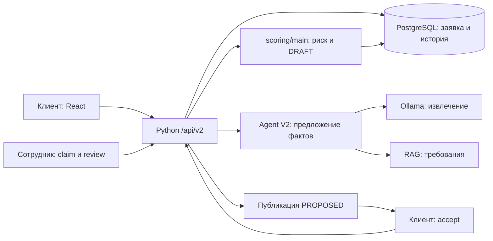

# Пять логических этапов

Рабочая система развёртывается как React + Python кабинет + PostgreSQL + Ollama; scoring/main вызывается библиотекой. Этапы ниже не являются пятью отдельно развёрнутыми сервисами.

| Этап | Историческая идея M1–M5 | Текущая реализация |
|---|---|---|
| [01 Вход и диалог](01-intake-and-assistant.md) | M1 — клиентский вход и orchestration | cabinet_server, Agent V2, cabinet_assistant |
| [02 Продукт и анкета](02-products-and-requirements.md) | M1/M2 — структурирование потребности | catalog, requirements БД, cabinet.save/validate_submission |
| [03 Данные и происхождение](03-data-and-evidence.md) | M2/M3 — сбор и проверка сведений | v4, application_facts, feature_builder, документы и verify |
| [04 Скоринг и условия](04-scoring-and-offer.md) | M4 — риск и условия | scoring/main: pipeline, decision_engine, credit_offer |
| [05 Рассмотрение и принятие](05-review-and-acceptance.md) | M5 — банковский результат | cabinet.review/accept и freshness |

Это редакционное сопоставление функций с [исторической архитектурой](../../history/architecture/architecture/), а не утверждение о подключённых исторических модульных адаптерах. В общем Agent V2 существуют более широкие порты, но кабинет использует только ограниченный dialogue-мост. [Архитектура основного комплекта](../../05-architecture.md) остаётся краткой схемой runtime.

## Поток работающего контура

Стрелки показывают вызовы и действия, а не отдельные deployment-единицы. Любое сохранение и переход проходят серверную проверку; клиентская кнопка не заменяет авторизацию.
