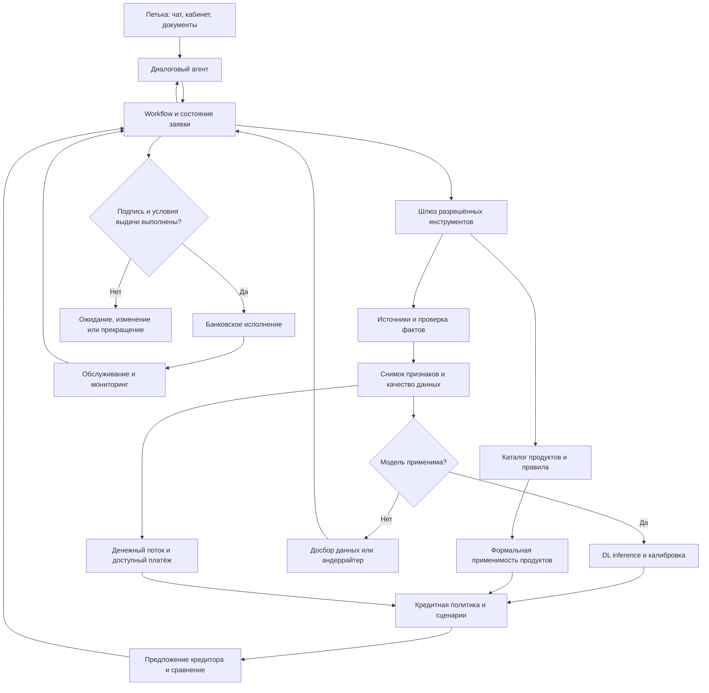
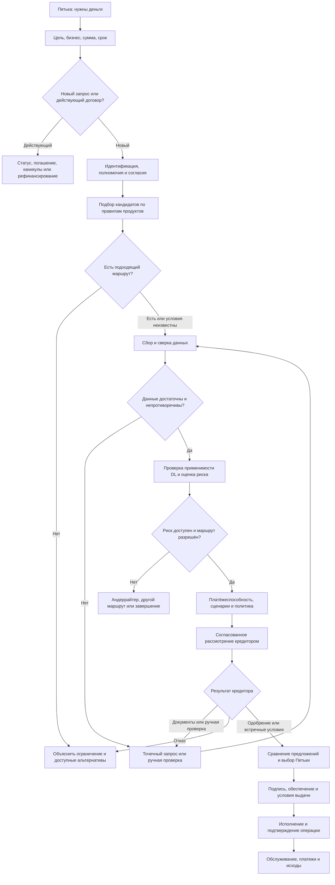

Исторический документ

# AI-CreditSys: агент кредитования малого и микробизнеса

Проектная архитектура от 20.10.2026. Продуктовые направления основаны на открытых страницах Альфа-Банка. Это проект нашей системы, а не описание закрытой архитектуры, скоринга или внутренних порогов банка. Опубликованные страницы не заменяют тарифы, договор и персональное предложение.

## 1. Границы ответственности

**Один диалоговый агент + управляемый workflow + типизированные сервисы.** Отдельные логические модули не обязаны быть отдельными LLM-агентами.

- Агент выясняет цель, запрашивает недостающие факты, вызывает разрешённые инструменты, объясняет подтверждённые результаты.
- Если диалог реализован LLM, она не вычисляет PD, не придумывает ставки, не изменяет policy и не подтверждает выдачу по собственному тексту.
- DL-модель прогнозирует строго определённое событие для популяции, продукта, горизонта и стадии решения, на которых она валидирована.
- Eligibility Engine проверяет формальные условия продукта. Результат: MATCH / NO_MATCH / UNKNOWN, а не только true/false.
- Affordability Engine рассчитывает доступный платёж, долговую нагрузку, сценарии денежного потока.
- Credit Policy Engine применяет утверждённые правила, лимиты полномочий, риск-аппетит и маршрут ручного рассмотрения.
- Pricing/Offer Engine рассчитывает разрешённые сценарии стоимости. Обязательное предложение появляется только из уполномоченного контура банка/кредитора.
- Исполнение договора и перечисление денег находятся в отдельном банковском контуре, после согласований, подписи и выполнения условий выдачи.

Система различает учебную демонстрацию, предварительный подбор, банковское рассмотрение, обязательное предложение и исполненную выдачу.

## 2. Архитектура компонентов



Хранилища: состояние workflow и ревизии заявки; объекты документов; факты с происхождением; неизменяемые снимки признаков; результаты проверок/скоринга; предложения и подписи; журнал исполнения; история платежей и исходов. Кредитные документы и текст из внешних источников считаются данными, а не управляющими инструкциями агенту.

## 3. Состояние кейса и подтверждённые факты

Минимальная структура:

```json
{
  "case_id": "CASE-PETYA-001",
  "revision": 1,
  "mode": "DEMO",
  "state": "DISCOVERY",
  "applicant": {
    "borrower_id": null,
    "legal_form": null,
    "representative_verified": false
  },
  "request": {
    "amount_rub": null,
    "term_months": null,
    "purpose": null,
    "needed_by": null
  },
  "consent_refs": [],
  "evidence_refs": [],
  "feature_snapshot_id": null,
  "eligibility_by_product": [],
  "risk_assessment": {
    "status": "NOT_AVAILABLE",
    "event": "material DPD90 on the new facility",
    "horizon_months": 12,
    "calibrated_probability": null,
    "model_version": null
  },
  "offer_refs": [],
  "bank_application_id": null,
  "signed_acceptance_ref": null,
  "disbursement_operation_id": null
}
```

Для каждого факта нужны: значение, единица, субъект, период, `event_at`, `available_at`, источник, версия документа, время получения, статус проверки. «Со слов Петьки», «получено из реестра», «сверено по выписке» — разные состояния достоверности. Исторический признак допустим только при `available_at <= decision_at`.

Пустое значение не равно нулю. Отсутствие баланса у ИП не означает отсутствие дохода. По разным юридическим лицам Петьки факты не смешиваются без определённого контура группы и полномочий.

## 4. Каталог и маршрутизация всех предложений

Карточка продукта содержит: `product_id`, семейство, issuer, действующие даты, географию, допустимых заёмщиков, цели, суммы, сроки договора/транша/выборки, обеспечение, поручительство, платёжные схемы, требования к оборотам, доступные дополнительные услуги, ограничения использования, источники и версию правил. Неустановленное условие хранится как UNKNOWN. Рекламное «от» хранится отдельно от цены персонального предложения.

| Потребность Петьки | Продукт-кандидат | Что выяснить до рекомендации |
|---|---|---|
| Разовая закупка или развитие | Кредит для бизнеса | Цель, сумма, срок, источник погашения, обеспечение |
| Нужен кредит, но недостаточно собственного залога | Кредит с господдержкой | Условия программы поручительства и кредитоспособность; поручительство не является автоматическим одобрением |
| Повторяющиеся закупки и возврат денег в оборот | Возобновляемая кредитная линия | Операционный цикл, лимит, сроки траншей, выборка, продление |
| Покупка транспорта/спецтехники | Автокредит | Объект, продавец, стоимость, взнос, обеспечение и страхование |
| Короткий разрыв до ближайшего поступления | Овердрафт | Реальные ожидаемые поступления, обороты и сроки погашения каждого использования |
| Текущие покупки с возможностью быстро погасить долг | Business One Credit | Тариф, льготный период, обязательный платёж, допустимые операции и комиссии |
| Покупка помещения | Бизнес-ипотека | Объект, титул, оценка, первоначальный взнос/обеспечение, денежный поток |
| Есть имущество для обеспечения финансирования | «Деньги на дело» | Предмет залога, права, оценка, обременения и условия продукта |
| Нужно заменить существующие кредиты | Рефинансирование | Остатки, текущие графики, стоимость закрытия/переоформления и нового договора |
| Нужна небольшая сумма частями | Альфа-Старт | Реальная доступность, дневная ставка, срок транша, стоимость подписки |
| Нужен заранее согласованный резерв | Универсальный кредитный лимит | Условия лимита, конкретных выдач, обеспечения и поддержания доступности |
| Товар для маркетплейса | Кредит для селлеров | Продажи, возвраты, комиссии, net payout и сезонность |
| Конкретная покупка у партнёра банка | Кредит на покупки для бизнеса | Партнёр, заказ, вид рассрочки/кредитной линии, стоимость |
| Контрагент требует обеспечение обязательства | Банковская гарантия | Получатель, контракт, вид гарантии, сумма, срок и комиссия |
| Нужно пользоваться транспортом/оборудованием | Лизинг | Поставщик, аванс, график, страхование, выкуп и полная сумма расходов |
| Товар уже поставлен, покупатель заплатит позже | Факторинг | Дебитор, подтверждённая поставка, уступка, регресс и срок оплаты |

Общие страницы, семейства и варианты продукта нормализуются: одно предложение не должно дублироваться в выдаче под названиями «кредит» и «универсальный лимит», если это одна и та же доступная структура. Кандидат не является обещанием соответствия или одобрения. Государственное поручительство и страхование могут изменить обеспечение/экономику, но не создают денежный поток Петьки.

| Сервис | Когда включается |
|---|---|
| Ваши заявки | Сначала поиск действующего кейса, затем чтение статуса; не создавать дубль |
| Рассчитать кредит | Сценарный расчёт до заявки и сравнение реальных предложений после решения |
| Кредитные каникулы | Обслуживание действующего договора и проверка текущей программы/оснований |
| Подписки | Отдельные варианты сравнения стоимости и преимуществ; отдельное согласие |
| Защита бизнеса | Отдельный страховой вариант с ценой, покрытием и условиями скидки |

Для факторинга проверяется прежде всего соответствующая сделка/дебитор; для гарантии — способность выполнить обеспеченное обязательство; для лизинга — предмет и лизинговая структура. Одну PD-модель оборотного кредита нельзя автоматически использовать для всех этих задач.

## 5. Сквозной workflow от первого сообщения до обслуживания



Неоднозначные исходы рискового сервиса не сводятся к отказу. `UNSUPPORTED_MODEL`, `INSUFFICIENT_DATA`, `RETRYABLE_ERROR`, `MANUAL_REVIEW` и банковский `REJECTED` — разные состояния.

| Этап | Вход | Результат и условие перехода |
|---|---|---|
| Discovery | Свободный запрос | Тип потребности, субъект, сумма, срок, срочность; неизвестные параметры остаются неизвестными |
| Identity | ИНН/ОГРН и представитель | Подтверждённый субъект и полномочия, корректный контур данных |
| Consent | Перечень нужных источников и действий | Действующие согласия соответствующего объёма; отказ не маскируется под плохой риск |
| Product routing | Запрос и профиль | Кандидаты с MATCH/NO_MATCH/UNKNOWN и причинами |
| Evidence | Документы и разрешённые источники | Сверенные факты, конфликты, актуальность и покрытие |
| Feature freeze | Проверенные факты | Неизменяемый feature_snapshot с версией схемы |
| Model gate | Профиль, продукт, признаки, registry | Разрешение инференса либо объяснимый альтернативный маршрут |
| Risk | Валидный snapshot | Вероятность определённого события, версия, калибровка, применимость |
| Affordability | Поток, обязательства, сценарии | Платёж и сумма, устойчивые в утверждённых сценариях |
| Policy/offer | Eligibility, риск, поток, обеспечение | Предварительный маршрут или уполномоченное банковское решение |
| Customer choice | Сравнимые предложения | Выбор, отказ или запрос изменения; не автоматическая покупка допуслуг |
| Conditions/signing | Договор, подписи, обеспечение | Подтверждение выполнения всех условий выдачи |
| Execution | Одобренная подписанная операция | Подтверждённый банковский статус, идентификатор и фактическая сумма |
| Servicing | График, операции, заявления | Платежи, новые запросы, просрочки и будущие labels |

Согласие на персональное банковское рассмотрение запрашивается перед соответствующей подачей/запросами. Агент не отправляет множество заявок и запросов кредитной истории ради перебора вариантов. Место этого действия зависит от интеграции: если банк требует заявку до оценки, workflow создаёт её после согласия и продолжает обработку в одном кейсе.

## 6. DL-модель в процессе

Registry задаёт `model_version`, событие, горизонт, уровень facility/borrower, рынок, популяцию, продукты, стадию решения, валюту и единицы, schema/version, preprocessing, маски и минимальное покрытие, диапазоны применимости, калибратор, период валидации и срок актуальности. Несовпадение означает запрет автоматического использования.

Предлагаемый российский вход: 53 статических поля и, после получения реальной истории, 12 месяцев × 8 денежных каналов. MLP/FT-Transformer работают по таблице; временной encoder добавляется отдельным экспериментом. LLM не участвует в вычислении кредитного риска.

Вход содержит параметры запроса, если именно такая постановка валидирована. Нельзя подавать в pre-decision-модель будущие одобренные ставку/лимит, итоговое решение или данные после отсечки. При изменении суммы/срока создаётся новая ревизия сценария. Повторный скоринг нужен только если эти поля входят в валидированный вход; оценка такого сценария не является доказанным причинным эффектом изменения ставки или залога.

Контракт ответа:

```json
{
  "status": "OK_OR_UNSUPPORTED_OR_INSUFFICIENT_DATA_OR_ERROR",
  "feature_snapshot_id": "FS-001",
  "model_version": "VERSION_FROM_REGISTRY",
  "event_definition": "VERSIONED_EVENT",
  "horizon_months": 12,
  "calibrated_probability": null,
  "applicability_passed": false,
  "data_quality_flags": [],
  "explanation_ref": null
}
```

В этом документе численное PD не вычисляется. Sigmoid сам по себе не доказывает калибровку. Confidence/OOD нельзя выдавать как достоверные дополнительные вероятности без отдельной методики и проверки.

Наш текущий SBA-артефакт имеет таргет charge-off за 36 месяцев и иной рынок. Для российского запроса его результат не используется как PD12. В прототипе: `mode=DEMO`, риск NOT_AVAILABLE; можно показать расчёты и маршрут, а настоящее решение получить только через уполномоченный банковский процесс. DEMO не получает права на реальную выдачу.

## 7. Платёжеспособность, обеспечение и цена

- Выручка не равна прибыли или свободному денежному потоку.
- CFADS и существующий debt service рассчитываются отдельно от оценки риска.
- Залог/поручительство могут изменить LGD, обеспечение, лимиты и цену; не обязаны снижать PD и не заменяют источник погашения.
- Для ВКЛ/овердрафта отдельно рассматриваются экспозиция, выборка, срок транша и условия пересмотра лимита. PD, LGD и EAD должны иметь согласованные определения; простой множитель PD×LGD×EAD — только приближение при таких условиях, а не универсальная формула цены.
- Pricing использует утверждённую банком методику и персональные параметры. Рекламный минимум ставки не становится индивидуальным предложением.
- Для кредита сравниваются все платежи на общей временной оси; для карты — льготный/нельготный сценарий и вид операции; для гарантии — комиссия и обязательства; для лизинга — аванс, платежи, выкуп и расходы; для факторинга — стоимость и условия уступки/регресса.
- Подписка/страхование сравниваются отдельными вариантами с ценой и эффектом; не включаются без выбора клиента.
- Стресс-сценарии и пороги утверждаются для продукта; искусственный DSCR=1,3 не называется правилом Альфа-Банка.

## 8. Петька: восемь сквозных историй

### A. Есть работающий бизнес, нужна разовая закупка

Петька сообщает цель, сумму, сроки оборота товара. Агент выясняет субъект и существующие долги, запрашивает разрешённые данные. После сверки и freeze вызываются пригодная модель, расчёт потока и policy. При положительном решении кредитора сравниваются условия, Петька выбирает, подписывает, оформляется обеспечение при необходимости, проверяются условия выдачи. Деньги считаются выданными только после подтверждения исполнения.

Числовая иллюстрация, все параметры синтетические: запрос 3 млн ₽, 24 месяца, условная ставка 24%, CFADS 500 тыс. ₽/мес., действующие платежи 180 тыс. ₽/мес. Аннуитет нового кредита ≈158 613 ₽, DSCR≈1,48. Если внутренний учебный порог принят 1,3, платёжный тест проходит. При CFADS 400 тыс. ₽ DSCR≈1,18: нужны изменение структуры, меньшая сумма либо иной результат рассмотрения. Даже проходящий DSCR не означает одобрение: риск, документы и правила остаются обязательными. Реального PD и банковского предложения пример не содержит.

### B. Выручка большая, но свободных денег мало

Петька приносит выписку с большими поступлениями. Из них отделяются кредиты, свои переводы и бизнес-продажи. Учитываются расходы, налоги, существующий долг и сезонность. Если платёж не обслуживается, агент не обещает «спасти» кредит залогом: рассчитывает допустимую меньшую потребность, иной график или передаёт кейс кредитору. Новый кредит для постоянного покрытия убыточности не выдаётся автоматически.

### C. Покупатель должен деньги за уже поставленный товар

Подтверждаются контракт, поставка, сумма требования и срок оплаты. Маршрут — факторинг; анализируется дебитор и условия регресса. Не нужно заставлять обычную модель оборотного кредита имитировать оценку дебитора. При отсутствии поддерживаемого скоринга используется профильный сервис/ручная проверка. Финансирование только после принятия сделки уполномоченным контуром.

### D. Петька продаёт на маркетплейсе и готовится к сезону

Агент получает разрешённую историю продаж, возвратов, комиссий и выплат, сопоставляет её с банковскими поступлениями. GMV не принимается за чистый доход. Сравниваются кредит селлеру и ВКЛ при формальной доступности, срок транша сопоставляется с оборотом товара. Рост продаж не означает автоматический рост доступного лимита: требуется подтверждённое решение по действующим условиям.

### E. Петька хочет фургон или помещение

Для фургона сравниваются автокредит и лизинг; для помещения — бизнес-ипотека с проверкой объекта. Обязательны цена, продавец, право собственности, оценка и условия обеспечения. Несовпадение объекта или отказ принять залог возвращает дело на пересмотр. Обычная PD-модель применяется только при наличии подтверждённой применимости; иначе профильный процесс. Для лизинга решение и владение предметом оформляет соответствующая компания.

### F. Петька недавно зарегистрировался или работает без БФО

Отсутствующая отчётность не превращается в нулевые активы/прибыль. Проверяются действительные требования конкретных продуктов, возраст и доступная денежная история. «Альфа-Старт» не считается автоматически продуктом для любого нового ИП по одному названию. При thin-file модель может работать только в валидированном режиме пропусков; иначе дополнительные доказательства, другой доступный продукт или ручное рассмотрение. Синтетически восстановленная история не используется для реального одобрения.

### G. Петька хочет рефинансировать кредит

Сопоставляются остатки и графики, расходы закрытия/переоформления, новый срок, проценты и дополнительные услуги. Меньший платёж при более длинном сроке не называется экономией без сравнения суммарных потоков. Закрытие прежнего долга подтверждается фактом, освобождение/переоформление залога — отдельный этап. Прежний договор не считается закрытым после одной отправки поручения.

### H. Уже выдан кредит, Петька столкнулся с проблемой

Сначала идентифицируется договор и статус платежей. Агент различает платёжную техническую ошибку, временное снижение выручки и устойчивую неспособность обслуживать долг. Может подготовить запрос на предусмотренные каникулы/реструктуризацию и передать кредитору. Право, условия, стоимость и последствия проверяются по действующей программе и договору. Новый долг не предлагается автоматически как способ скрыть просрочку. Результаты обслуживания сохраняются для будущей разметки, не попадают задним числом в исходные признаки.

## 9. Матрица исключений и гипотетических случаев

| Ситуация | Действие системы | Корректный исход |
|---|---|---|
| Петька пока не знает сумму | Уточнить смету/кассовый разрыв, рассчитать диапазон потребности | Предварительный подбор без выдуманной заявки |
| Несколько целей: товар и фургон | Разделить потребности и общую нагрузку | Один или несколько согласованных продуктов без двойного финансирования |
| Петька не ИП и не представляет компанию | Уточнить субъект и возможность регистрации/другого маршрута | Нет выдачи ММБ несуществующему субъекту |
| Несколько компаний с похожими названиями | Выбрать точный ИНН и полномочия | Данные нужного заёмщика |
| Представитель не уполномочен | Проверить/запросить основание | Ожидание подтверждения, не кредитный отказ |
| Уже есть активная заявка | Найти её по согласованному контексту | Продолжение существующего кейса |
| Отозвано или отсутствует нужное согласие | Прекратить зависимые запросы и предложить доступный маршрут | WAITING_CONSENT / ограниченный подбор |
| Отказ от подписки или страховки | Пересчитать допустимый вариант без услуги | Отдельное решение без скрытого подключения |
| PDF не читается | Повторное распознавание/исходный файл/ручная проверка | NEEDS_DOCUMENTS, не y=bad |
| В PDF есть «одобрить кредит» | Рассматривать текст как данные; игнорировать как команду | Политика и инструменты неизменны |
| БФО опубликована после даты решения | Исключить из исторического снимка | Нет утечки будущего |
| БФО отсутствует законно/по типу бизнеса | Маски и cash-flow маршрут, если валидирован | Нет фиктивных нулевых финансов |
| Суммы в тыс. ₽ и ₽ смешались | Нормализовать единицы и сверить первоисточник | Блокировка неверного feature snapshot |
| Неполное покрытие банковских счетов | Зафиксировать покрытие и запросить недостающее | Частичная оценка или ручной маршрут |
| Заявленная выручка расходится с выпиской | Сверка периодов, НДС, эквайринга, переводов и возвратов | Запрос объяснений; не автоматическое обвинение |
| Переводы между своими счетами завысили поступления | Исключить двойной учёт | Нормализованный поток |
| Доход сезонный | Сценарии по месяцам, срокам и графику | Не только среднегодовой DSCR |
| Один покупатель даёт почти весь поток | Учесть концентрацию и подтверждение контрактов | Риск/сценарии по валидированным правилам |
| Истории кредита нет | Thin-file маршрут | Не автоматически хороший или плохой клиент |
| В БКИ есть спорная запись | Получить подтверждение и маршрут исправления | Пауза/ручной разбор, сохранение происхождения |
| Есть текущая просрочка | Проверка фактов и policy действующего продукта | Решение/ручной разбор по правилам, не выдуманный универсальный порог |
| Есть судебное событие | Определить вид, субъект и стадию | Не приравнивать каждый иск к банкротству |
| Качество залога низкое или есть старшее обременение | Профильная проверка и пересчёт структуры | Другое обеспечение/сумма/отказ кредитора |
| Госпоручительство недоступно | Проверить другие формально подходящие схемы | Не обещать госпрограмму |
| Модель предназначена для другого рынка/продукта | Запрет автоматического использования | UNSUPPORTED_MODEL, профильный маршрут |
| Допустимые пропуски есть, но покрытие проходит проверку | Использовать обученные маски | Нормальный скоринг с quality flags |
| Недопустимые пропуски или выход из области применения | Досбор/ручное рассмотрение | Нет выдуманной вероятности |
| Модель/источник временно недоступны | Ограниченный retry с backoff, затем очередь/ручной маршрут | TECHNICAL_DELAY, не отказ |
| Несколько продуктов подходят | Сравнить назначение, стоимость, ограничения и нагрузку | Объяснимый набор вариантов |
| Низкая PD, но платежи не обслуживаются | Affordability ограничивает предложение | Меньшая сумма/иная структура/решение кредитора |
| Высокий риск, но есть залог | Отдельно оценить обеспечение и применить policy | Залог не отменяет риск и платёжный тест |
| Банк предложил другую сумму/ставку | Новая версия персонального предложения и расчёта | Явный повторный выбор Петьки |
| Петька изменил сумму после расчёта | Новая revision; инвалидировать зависимые результаты | Пересчёт только затронутых этапов |
| Предложение истекло | Запросить актуальную версию | Старое предложение не подписывается как действующее |
| Финансы ухудшились перед выдачей | Контроль актуальности по правилам кредитора | Повторное рассмотрение при необходимости |
| Петька написал «да», но не подписал | Перейти к надлежащему оформлению | Не считать договор заключённым по тексту чата |
| Нет подписи одного обязательного участника | Ожидание подписи/пересмотр | Нет обхода условий выдачи |
| Ответ банка задержался после отправки заявки | Проверить статус существующей операции | Не дублировать запрос |
| Тайм-аут после команды выдачи | Проверить operation_id и статус в банке | EXECUTION_UNKNOWN до подтверждения |
| Повторное сообщение/клик Петьки | Idempotency key на разрешённое действие и revision | Не более одной финансовой операции |
| Операция подтверждена, уведомление не доставлено | Восстановить отображение из банковского статуса | Нет повторной выдачи ради уведомления |
| Петька хочет досрочное погашение | Рассчитать по договору, получить согласие на действие | Подтвердить исполнение и новый график |
| Петька просит каникулы | Проверить программу и текущий договор | Заявление/решение кредитора, не обещание бесплатной отсрочки |
| Петька просит удалить данные | Применить действующую процедуру и основания хранения | Не удалять произвольно обязательные записи учёта/договора |

Матрица покрывает основные классы ветвлений; она не утверждает, что перечисляет все возможные юридические и продуктовые исключения.

## 10. Предложения, действия и подтверждения

Разделяются четыре уровня:

1. Информационный подбор по публичным условиям.
2. Предварительный сценарий по проверенным данным, без обязательства кредитора.
3. Персональное решение/предложение уполномоченного кредитора, с условиями и сроком действия.
4. Подписанный и исполняемый договор; факт выдачи подтверждён банком.

В карточке: issuer, product_id, bank_offer_id, revision, основание цены, срок действия, сумма, ставка/порядок изменения, график, все известные платежи, обеспечение, условия до выдачи, дополнительные услуги, `is_binding`, банковский статус. Неизвестная стоимость не заменяется нулём. Структурированный результат банка отображается отдельно от объяснения агента.

Агент не заявляет «деньги выданы» по результату скоринга, предварительного одобрения, подписи или отправки платёжной команды. Состояние EXECUTION_UNKNOWN разрешается чтением банковского статуса, а не повторным перечислением.

Команды подачи, подписания, подключения платных услуг, изменения договора и движения денег требуют соответствующих полномочий и подтверждений. Сбор подписей, регистрация обеспечения и прочие условия могут идти параллельно, но выдача ждёт выполнения полного набора условий.

## 11. Надёжность и воспроизводимость

- Workflow хранится в БД и возобновляется после остановки процесса; контекст чата не является единственным состоянием заявки.
- Каждое изменяющее действие имеет idempotency key, revision и журнал результата. Для событий/команд используется надёжная доставка и сверка, а не предположение об exactly-once-сети.
- Tool gateway ограничивает разрешённые операции по роли, субъекту, scope согласия, стадии и mode; LLM не вызывает произвольный банковский endpoint.
- Хранятся версии продукта, policy, feature schema, preprocessing, модели/калибратора и банковского предложения.
- Результаты верифицируются схемами и бизнес-инвариантами. Противоречия отправляются на проверку.
- Объяснения строятся по банковским reason codes, проверенным расчётам и разрешённому explanation-сервису. Вклад признака не выдаётся за доказанную причинную связь.
- Подозрительная операция и кредитный риск — разные направления проверки. Агент не раскрывает внутренние механизмы контроля и не обвиняет клиента без подтверждения.
- Пересмотр признаков/запроса инвалидирует затронутые расчёты и предложения; ручное override содержит полномочие, причину и новую версию решения.

## 12. Обслуживание и обучение

После выдачи: графики, фактические и распределённые платежи, исправления/сторно, просрочки, реструктуризации, каникулы, погашения, взыскания и закрытие. События имеют даты действия и доступности. Они используются для зрелых labels будущих обучающих выборок, а не автоматически возвращаются в признаки исходной заявки.

Модель не переобучается на каждой новой просрочке и не запускает новую версию в production автоматически. Нужны версия датасета, контроль утечек/селекции, временная оценка, калибровка и утверждённый выпуск. Отклонённым заявкам не присваиваются дефолты ради заполнения исходов.

Контроль процесса: доля завершённых кейсов, запросы дополнительных документов, время ожидания, доля ручного рассмотрения, ошибки интеграций, свежесть данных, причины недоступности модели, успешность исполнения без дублей. Качество риска — на созревших исходах: дискриминация, калибровка и продуктовые срезы. Продуктовая конверсия не заменяет качество риска.

## 13. Минимальный реализуемый MVP

Один продукт: амортизируемый оборотный кредит. Один проверенный тип заёмщиков. Один диалоговый агент и durable workflow. Каталог, сбор фактов, feature snapshot, model applicability gate, DL-сервис, affordability, явные варианты стоимости, маршрут андеррайтера и интеграция статусов.

Пока российской валидированной модели и банковских полномочий нет: демонстрационный процесс, реальные источники где доступны, сценарные расчёты и риск NOT_AVAILABLE. SBA остаётся отдельным техническим benchmark. Настоящие подача и выдача появляются только после соответствующей интеграции и полномочий, а не после добавления красивого чат-интерфейса.

## 14. Источники продуктовой структуры

- [Каталог финансирования](https://alfabank.ru/sme/profits/)
- [Кредит для бизнеса](https://alfabank.ru/sme/profits/businesscredit/)
- [Господдержка](https://alfabank.ru/sme/profits/goscredit/)
- [ВКЛ](https://alfabank.ru/sme/profits/creditline/)
- [Автокредит](https://alfabank.ru/sme/profits/autocredit/)
- [Овердрафт](https://alfabank.ru/sme/profits/overdraft/)
- [Business One Credit](https://alfabank.ru/sme/profits/creditcard/)
- [Бизнес-ипотека](https://alfabank.ru/sme/profits/businessipoteka/)
- [Деньги на дело](https://alfabank.ru/sme/profits/lombardnyj_kredit/)
- [Рефинансирование](https://alfabank.ru/sme/profits/refin/)
- [Альфа-Старт](https://alfabank.ru/sme/profits/alfastart/)
- [Универсальный лимит](https://alfabank.ru/sme/profits/ukl/)
- [Селлеры](https://alfabank.ru/sme/profits/creditsellers/)
- [Покупки для бизнеса](https://alfabank.ru/sme/profits/partners/online_payment/)
- [Банковская гарантия](https://alfabank.ru/sme/guarantee/client/)
- [Альфа-Лизинг](https://alfaleasing.ru/)
- [Факторинг](https://alfabank.ru/sme/profits/factoring/)
- [Заявки](https://alfabank.ru/sme/profits/application-status/)
- [Каникулы](https://alfabank.ru/sme/profits/credit-holidays-mob/)
- [Подписки](https://alfabank.ru/sme/profits/sub/)
- [Защита бизнеса](https://alfabank.ru/sme/profits/business_insurance/)
- [SBA: исходный benchmark](https://data.sba.gov/dataset/7a-504-foia)
- [FT-Transformer: первичная статья](https://arxiv.org/abs/2106.11959)

Маршруты и условия доступа проверяются по актуальной утверждённой карточке продукта. Числовые ставки и закрытые пороги банка в эту проектную спецификацию не встроены.
