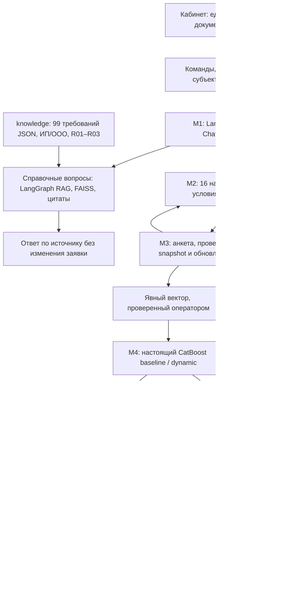

Исторический документ

# Архитектура AURELIUS · модули 1–5 DEMO

Актуальная схема рабочего дерева · 24.10.2026. PostgreSQL — основное хранилище; SQLite — явный режим совместимости для М1–М2. Согласованный режим: настоящий CatBoost на явных входах, ручное рассмотрение и только симуляция исполнения.

## Документы модулей

- [RAG требований: схема, контракт и проверки](../../personalCab/prom/rag/README.md).
- [01 Диалог и workflow](01_dialogue_and_workflow.md).
- [02 Подбор](02_product_matching.md).
- [03 Данные и анкета](03_data_and_features.md).
- [03.1 БД и таблицы](03.1_database_schema.md).
- [04 CatBoost и расчёты](04_scoring_and_offers.md).
- [05 Ручное решение и симуляция](05_decision_and_servicing.md).
- [Запуск, контракты и операторские команды](../../docs/DEMO_MODULES_1_5.md).

## Границы реализации

Все 16 направлений сохранены; сбор бизнес-данных подключён для R01–R03. Синтетические модели зарегистрированы для R01, остальные маршруты требуют профильной модели или ручного решения. Нет придуманного approval/PD или автоматического переноса процентов/дней/месяцев. Условия продукта без ручного подтверждения и семантики остаются UNKNOWN.

CSV/XLSX и доступный текст PDF извлекаются как непроверенные данные; OCR и сложные форматные проверки выполняются вручную. Production IAM, реальные юридические подписи, банковские API, реальная выдача и реальные дефолтные метки в DEMO не имитируются как факты. Бизнес-строки не имеют полного исторического версионирования: snapshot честно отражает доступное покрытие и ограничения.
