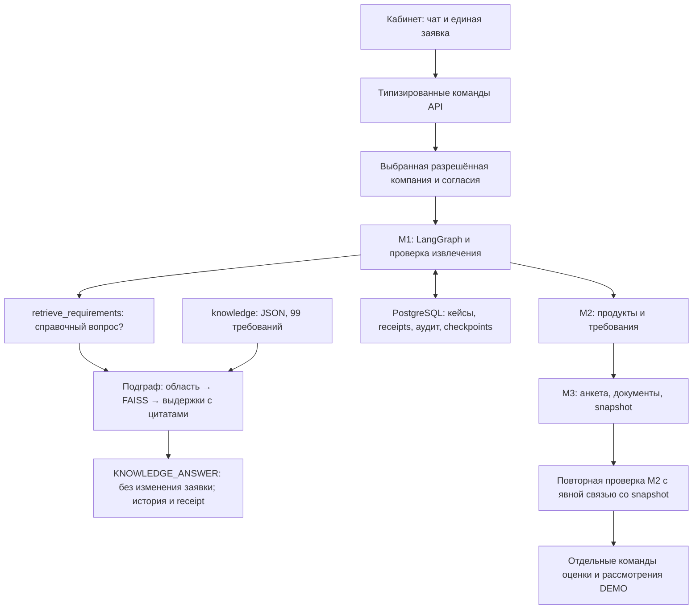

Исторический документ

# Модуль 1. Диалог и управление заявкой

> Дополнение 24.10.2026: Добавлена поэлементная Pydantic-валидация извлечения, сохранение пригодных полей при repair, типизированные замечания/план уточнений и адресные вопросы. Перед готовностью запроса доступен минимальный lookup_business_profile: только legal_form, доверенный actor/company, согласие и VERIFIED provenance. Цель/сумма/срок уточняются у клиента. См. последний раздел [контракта интеграции](../../docs/POSTGRES_INTEGRATION.md).

## Реализация после интеграции · 24.10.2026

Кабинет и чат используют один серверный кейс. Исправлены подтверждение прежнего значения после ошибки, сохранение замечаний при repair и создание новой сессии после закрытия обращения. Команды изменения запроса, обновления evidence, оценки, подачи, акцепта и исполнения задаются API, не LLM. Роли и разрешённые компании задаёт оператор; согласия выдаются и отзываются отдельными элементами интерфейса и хранятся в PostgreSQL.

Проект AI-CreditSys · версия 1.1 · сверка реализации 24.10.2026. Исходная спецификация: 20.10.2026.

Это спецификация проектируемой системы. Примеры Петьки условные; закрытые процессы и правила Альфа-Банка не воспроизводятся.

## Назначение

Преобразовать сообщение предпринимателя в структурированный запрос и управлять его прохождением по остальным четырём модулям. Диалоговый агент уточняет неизвестное и объясняет результаты. Оркестратор хранит состояние, проверяет допустимость переходов и вызывает инструменты.

| Модуль | Результат |
|---|---|
| **1. Диалог и workflow** | Структурированный запрос и текущее состояние |
| [2. Подбор продукта](02_product_matching.md) | Продукты-кандидаты и требования |
| [3. Данные и признаки](03_data_and_features.md) | Проверенный снимок признаков |
| [4. Скоринг и расчёты](04_scoring_and_offers.md) | Риск и предварительные сценарии |
| [5. Решение и сопровождение](05_decision_and_servicing.md) | Решение кредитора и подтверждённое исполнение |

## Схема



## Текущая реализация · 24.10.2026

Добавлен [RAG требований на FAISS и LangGraph](../../personalCab/prom/rag/README.md). Справочные вопросы идут по отдельной ветке без LLM-извлечения и бизнес-действий; результат содержит ссылки на записи JSON и SHA-256 версии. При отсутствии подтверждённого ответа ассистент сообщает об этом. Срок договора в справочнике привязан к `credit_applications.requested_term_months`.

Кабинет и чат используют один серверный кейс. Исправлены подтверждение прежнего значения после ошибки, сохранение замечаний при repair и создание новой сессии после закрытия обращения. Команды изменения запроса, обновления evidence, оценки, подачи, акцепта и исполнения задаются API, не LLM. Роли и разрешённые компании задаёт оператор; согласия выдаются и отзываются отдельными элементами интерфейса и хранятся в PostgreSQL.

Контракты, запуск и операторские команды: [DEMO_MODULES_1_5.md](../../docs/DEMO_MODULES_1_5.md).

## Входы и выходы

**Вход:** сообщение, приложенные ссылки на документы, идентификатор сессии, сохранённое состояние кейса, ответы инструментов и других модулей.

**Выход:** запрос клиента, список неизвестных полей, статус, следующий разрешённый шаг и сообщение пользователю.

Общий конверт межмодульного обмена: `case_id`, `revision`, `mode`, `status`, `correlation_id` и ссылки на результаты. Примеры JSON ниже иллюстрируют данные, а не полную формальную JSON Schema.

```json
{
  "case_id": "CASE-PETYA-001",
  "revision": 1,
  "mode": "DEMO",
  "status": "REQUEST_READY",
  "request": {
    "borrower_id": "BORROWER-PETYA-001",
    "legal_form": "IP",
    "purpose": "INVENTORY",
    "amount_rub": 3000000,
    "term_months": 24,
    "needed_by": null
  },
  "unknown_fields": ["needed_by"],
  "next_module": 2
}
```

`DEMO` не имеет полномочий на реальные финансовые операции. Запрошенные сумма и срок сохраняются отдельно от одобренных впоследствии условий.

## Что выясняет агент

1. Какой субъект представляет Петька: ИП или конкретная компания, кто уполномочен действовать.
2. На что нужны деньги, разовая это потребность или повторяющаяся.
3. Сумма, срок, дата потребности, предполагаемый источник возврата.
4. Известные обязательства, сезонность и возможное обеспечение.
5. Есть ли действующая заявка или договор, к которому относится обращение.

Короткий запрос не запускает сбор всех возможных документов. Сначала определяется потребность, затем модуль 2 формирует требования подходящих маршрутов.

## Workflow и состояние

Оркестратор сохраняет состояние в устойчивом хранилище. История чата помогает диалогу, но не заменяет запись заявки.

| Состояние | Следующее действие |
|---|---|
| `DISCOVERY` | Уточнить потребность |
| `NEEDS_INPUT` | Дождаться конкретного ответа клиента |
| `WAITING_CONSENT` | Получить требуемое согласие перед зависимым действием |
| `REQUEST_READY` | Передать запрос модулю 2 |
| `WAITING_DOCUMENTS` | Сопроводить запрос модуля 3 |
| `WAITING_EXTERNAL` | Получить статус существующего внешнего процесса |
| `MANUAL_REVIEW` | Передать кейс уполномоченному специалисту |
| `COMPLETED` / `CANCELLED` | Завершить диалог с сохранением фактического результата |

При изменении цели, суммы или срока увеличивается `revision`. Оркестратор инвалидирует зависящие от изменения расчёты и предложения. Проверенные факты могут использоваться повторно, если их актуальность и область применения сохранены.

## Инструменты и ограничения

Предлагаемые операции: `load_case`, `find_existing_application`, `update_request`, `get_product_candidates`, `get_data_requirements`, `request_evidence`, `get_assessment_status`, `get_bank_status`.

Оркестратор проверяет роль, стадию, субъект, действующие согласия и режим работы перед вызовом инструмента. Диалоговая модель не получает произвольный доступ к банковским операциям. Текст клиента или документа не изменяет правила доступа.

Если используется LLM, ей поручаются извлечение намерения, формирование уточнений и объяснение подтверждённых результатов. Проценты, PD и платёжные графики приходят из соответствующих сервисов.

## Исключения

| Случай | Реакция |
|---|---|
| Петька не знает сумму | Помочь уточнить потребность и собственные средства |
| Несколько компаний | Уточнить нужный субъект; не смешивать их данные |
| Несколько целей | Разделить потребности и учитывать общую нагрузку |
| Уже есть заявка | Продолжить существующий кейс |
| Отказ от доступа к источнику | Остановить зависимые запросы, проверить альтернативный маршрут |
| Повторное сообщение | Не создавать повторное изменяющее действие |
| Пользователь изменил запрос | Создать новую ревизию и пересчитать зависимости |
| Ошибка инструмента | Сообщить о задержке и сохранить кейс; не объявлять кредитный отказ |

## Пример Петьки

Петька: «Нужно три миллиона на товар». Агент уточняет субъект, срок использования денег и ожидаемую дату поступлений. Сохраняет запрос на 3 млн ₽ и 24 месяца, оставляя неизвестные поля явными. После этого модуль 2 проверяет продуктовые маршруты. Сведения со слов клиента ещё не считаются проверенными.

## Критерии готовности

- Состояние заявки восстанавливается после перезапуска.
- Недостающие данные не выдумываются.
- Повторный запрос не создаёт дубль заявки.
- Изменение запроса обновляет ревизию и зависимые результаты.
- Согласия и полномочия проверяются перед соответствующими действиями.
- Сообщение клиенту соответствует структурированному статусу процесса.

## Реализация первого этапа · 21.10.2026

Код и запуск: [personalCab/prom/prom_lab/ai_agents_lab](../../personalCab/prom/prom_lab/ai_agents_lab/README.md).
Паттерн и декомпозиция: [AURELIUS.md](../../personalCab/prom/prom_lab/ai_agents_lab/AURELIUS.md).

Реализованы LangGraph workflow, извлечение запроса через LangChain ChatOllama `gpt-oss:20b`, SQLite-кейсы и checkpoints, ревизии, идемпотентность сообщений, контроль согласий/полномочий и интерфейсы восьми инструментов. Модули 2–5 подключаются через адаптеры и по умолчанию явно недоступны: готовый запрос останавливается в `REQUEST_READY` с передачей модулю 2. Банковские интеграции и финансовое исполнение не реализованы.

В тестах проверяются восстановление, повторы, ревизии, согласия и ошибки. Production-аутентификация, callbacks внешних процессов, проверка актуальности финансовых фактов и дочерние заявки для нескольких целей остаются вне первого этапа.

### Второй этап · 23.10.2026

Модуль 2 подключён по умолчанию: после подготовки запроса выполняются подбор и формирование требований. Граница неподключённых модулей перенесена на модуль 3. Текущий контракт и ограничения — в [спецификации модуля 2](02_product_matching.md). В кабинете используется один общий лог модулей 1–2. Замена цели не должна очищать известные параметры: некорректный `clear_fields` без явной просьбы удалить/неизвестного значения отправляется на корректирующую попытку.
