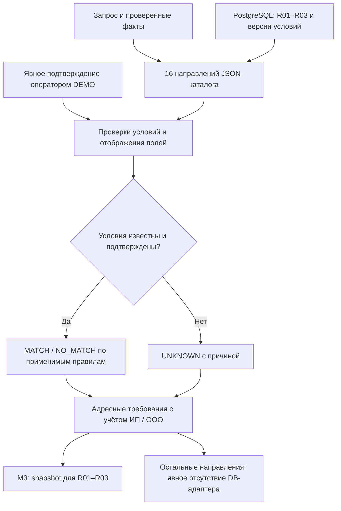

Исторический документ

# Модуль 2. Подбор кредитного продукта

## Реализация после интеграции · 24.10.2026

Подбор читает JSON и PostgreSQL. Сопоставление term→R01, rcl→R02, overdraft→R03 реализовано. Применимость 99 полевых требований фильтруется для ИП/ООО. Условия становятся исполняемыми только после явного подтверждения версии оператором DEMO; дополнительные SQL-правила требуют явного отображения поля и сохраняют UNKNOWN при неподтверждённой семантике. Оборотный цикл и срок транша разделены.

Проект AI-CreditSys · версия 1.1 · сверка реализации 24.10.2026. Исходная спецификация: 20.10.2026.

Предыдущий модуль: [диалог и workflow](01_dialogue_and_workflow.md). Следующий: [данные и признаки](03_data_and_features.md).

## Назначение

Выбрать подходящие направления финансирования и проверить известные формальные условия. Результат — кандидаты и требования к данным. Окончательное решение принимает уполномоченный кредитор в модуле 5.

Маршрутизация ниже является проектным предложением. Актуальная доступность определяется утверждённой карточкой продукта; рекламное описание не заменяет тарифы и персональные условия.

## Схема



## Текущая реализация · 24.10.2026

Подбор читает JSON и PostgreSQL. Сопоставление term→R01, rcl→R02, overdraft→R03 реализовано. Применимость 99 полевых требований фильтруется для ИП/ООО. Условия становятся исполняемыми только после явного подтверждения версии оператором DEMO; дополнительные SQL-правила требуют явного отображения поля и сохраняют UNKNOWN при неподтверждённой семантике. Оборотный цикл и срок транша разделены.

Контракты, запуск и операторские команды: [DEMO_MODULES_1_5.md](../../docs/DEMO_MODULES_1_5.md).

## Входы и выходы

**Вход:** `case_id`, `revision`, запрос, известный профиль бизнеса, подтверждённость фактов, действующие продуктовые правила.

**Выход:** кандидаты, статус соответствия, причины, неизвестные условия и требования к источникам/документам.

```json
{
  "case_id": "CASE-PETYA-001",
  "revision": 1,
  "mode": "DEMO",
  "status": "PRODUCTS_READY",
  "catalog_version": "CATALOG-V1-EXAMPLE",
  "candidates": [
    {
      "product_family": "WORKING_CAPITAL_TERM_LOAN",
      "eligibility": "UNKNOWN",
      "reasons": ["ONE_TIME_INVENTORY_PURCHASE"],
      "missing_checks": ["BUSINESS_TENURE", "VERIFIED_CASHFLOW"],
      "requirements_ref": "REQ-TERM-001"
    },
    {
      "product_family": "REVOLVING_CREDIT_LINE",
      "eligibility": "UNKNOWN",
      "reasons": ["REPEATED_PURCHASES_TO_CONFIRM"],
      "missing_checks": ["OPERATING_CYCLE", "PRODUCT_ELIGIBILITY"],
      "requirements_ref": "REQ-RCL-001"
    }
  ],
  "next_module": 3
}
```

Статус `PRODUCTS_READY` означает готовность списка кандидатов к следующему этапу. Он не означает, что все кандидаты одобрены или уже имеют `MATCH`.

## Каталог продуктов

Карточка содержит идентификатор, семейство, кредитора, источник и версию условий, период действия, допустимых заёмщиков, цели, суммы, сроки, обеспечение, графики, ограничения использования, требования к оборотам и дополнительные услуги.

Срок договора, срок транша и период выборки хранятся отдельно. Опубликованный минимум ставки хранится отдельно от индивидуального предложения. Неустановленные условия обозначаются `UNKNOWN`, а не нулём или отсутствием ограничения.

## Маршруты всех направлений

| Потребность | Продукт-кандидат | Что проверить |
|---|---|---|
| Разовая закупка, развитие | Кредит для бизнеса | Цель, источник возврата, сумма, срок |
| Недостаточно собственного обеспечения | Кредит с господдержкой | Соответствие программе и условиям поручительства |
| Повторные закупки | Возобновляемая кредитная линия | Операционный цикл и сроки траншей |
| Транспорт, спецтехника | Автокредит | Объект, продавец, обеспечение, взнос |
| Короткий кассовый разрыв | Овердрафт | Поступления и сроки возврата |
| Текущие расходы по карте | Business One Credit | Тариф, операции, льготный период, погашение |
| Покупка помещения | Бизнес-ипотека | Объект, оценка, титул, денежный поток |
| Финансирование под имущество | «Деньги на дело» | Объект залога, права и обременения |
| Замена существующих кредитов | Рефинансирование | Остатки, графики и стоимость замены |
| Небольшая потребность частями | Альфа-Старт | Фактические требования, дневная ставка и транши |
| Резерв финансирования | Универсальный кредитный лимит | Условия лимита и конкретных выдач |
| Закупки для маркетплейсов | Кредит для селлеров | Продажи, возвраты, выплаты и сезонность |
| Покупка у партнёра | Кредит на покупки для бизнеса | Партнёр, заказ и схема оплаты |
| Обеспечение обязательства | Банковская гарантия | Контракт, получатель, вид и срок гарантии |
| Использование техники/оборудования | Лизинг | Предмет, аванс, платежи, выкуп |
| Ожидание оплаты поставки | Факторинг | Дебитор, поставка, уступка и регресс |

Для гарантий, факторинга и лизинга модуль выбирает профильный процесс. Их требования не подменяются правилами обычного оборотного кредита.

## Алгоритм подбора

1. Определить характер потребности и нормализовать продукты по семействам.
2. Отобрать структурно подходящие варианты.
3. Проверить доступные формальные условия.
4. Присвоить каждому условию и кандидату `MATCH`, `NO_MATCH` или `UNKNOWN`.
5. Зафиксировать причины и недостающие проверки.
6. Передать требования модулю 3.
7. После проверки фактов повторить затронутые условия и обновить кандидатов.

Первичное ранжирование основывается на соответствии потребности и известным ограничениям. Стоимостное сравнение выполняет модуль 4, персональные условия поступают из уполномоченного контура.

## Сервисы рядом с кредитом

- **Ваши заявки:** переход к существующему кейсу через модули 1 и 5.
- **Рассчитать кредит:** расчёты в модуле 4.
- **Кредитные каникулы:** обслуживание договора в модуле 5.
- **Подписки и защита бизнеса:** варианты стоимости в модуле 4; выбор и оформление в модуле 5.

## Исключения

| Случай | Реакция |
|---|---|
| Требование продукта неизвестно | `UNKNOWN`, уточнение источника или запрос кредитору |
| Нет кандидатов | Показать конкретные ограничения и допустимые альтернативы |
| Каталог устарел | Обновить условия или передать на проверку |
| Несколько названий одной структуры | Удалить дубли по семейству и идентификатору предложения |
| Обеспечение отсутствует | Проверить другие подходящие структуры; не обещать одобрение |
| Бизнес новый | Проверять реальные правила; название «Старт» не доказывает доступность |
| Данные изменились | Перепроверить условия для новой ревизии |

`NO_MATCH` по продукту не приравнивается к плохой кредитной истории или банковскому отказу.

## Пример Петьки

Для закупки товара на 3 млн ₽ первоначально рассматриваются разовый кредит и ВКЛ. Если закупка действительно разовая, приоритет получает соответствующая структура. Если товар закупается постоянно, отдельно уточняются цикл оборота и потребность в траншах. Оба варианта остаются предварительными до проверки условий и данных.

## Критерии готовности

- Каждая рекомендация имеет объяснимую связь с потребностью.
- Версия правил и источник сохранены.
- Неизвестные условия видны отдельно.
- Список требований позволяет модулю 3 выполнить адресный сбор данных.
- Неподдерживаемые формы финансирования направляются в профильный процесс.

Источник продуктовой структуры: [каталог финансирования Альфа-Банка](https://alfabank.ru/sme/profits/). Числовые ставки и закрытые пороги банка в спецификацию не встроены.

## Реализация · 23.10.2026

Подключён к `WorkflowApp` по умолчанию через `ProductModuleAdapter`:

- `personalCab/prom/prom_lab/ai_agents_lab/services/product_matching.py` — маршруты и трёхзначные проверки;
- `schemas/products.py` — типизированные карточки, проверки, кандидаты и требования;
- `catalog/products.json` — все 16 направлений, версии и источники;
- `Case.product_selection` и `Case.product_requirements` — сохранение результатов в runtime-хранилище (PostgreSQL по умолчанию, SQLite в legacy);
- единый лог модулей 1–2 в чате кабинета.

Каталог содержит **проектные**, а не утверждённые кредитором карточки. Числовые ограничения и период действия не подставлены предположениями. Проверка актуальности такой карточки и неизвестных формальных условий возвращает `UNKNOWN`. Отсутствующая числовая граница не трактуется как отсутствие ограничения; отсутствие границы должно быть явно разрешено соответствующим флагом правила. Срок договора, срок транша и период выборки представлены раздельно.

Сначала подбирается структура по `purpose`, `financing_need` и `recurring`, затем проверяются условия. Без указанной повторяемости для закупки товара доступны разовый кредит и ВКЛ с уточнением; при явной постоянной потребности приоритет получает ВКЛ. Профильные процессы сохраняют отдельные требования для лизинга, факторинга и гарантии. Неподходящие по структуре направления отражены в общем логе отдельно от кандидатов.

**Исторический legacy/SQLite-контракт этапа 23.10.2026:** после успешного подбора возвращаются `PRODUCTS_READY` и требования. Без PostgreSQL-адаптера оркестратор останавливается перед модулем 3: `WAITING_DOCUMENTS`, `next_module=3`, `error_code=MODULE_NOT_CONFIGURED`. Сбор файлов не объявляется начатым и согласие на недоступный сервис не запрашивается. Если маршрут не установлен или все кандидаты не подходят, возвращается `CLARIFY_PRODUCT_NEED`, без передачи модулю 3 и без кредитного отказа.

При изменении запроса результаты инвалидируются новой ревизией. При изменении каталога или подтверждённых фактов подбор обновляется в той же ревизии с новым `context_hash`. Учитываются только факты, переданные доверенным контуром, с полями `field`, `value`, `borrower_id`, `source_ref`, `confirmed=true`, `scope=PRODUCT_MATCHING`, `verified_at`, `valid_until`. Чужие, просроченные, будущие и конфликтующие факты не превращаются в подтверждённые значения. Текст клиента заполняет только явно неподтверждённые поля запроса.

Документы в каталоге — адресный предварительный перечень проекта, а не окончательный список кредитора. Требование актуальной карточки направлено владельцу каталога/кредитору, а не клиенту.
