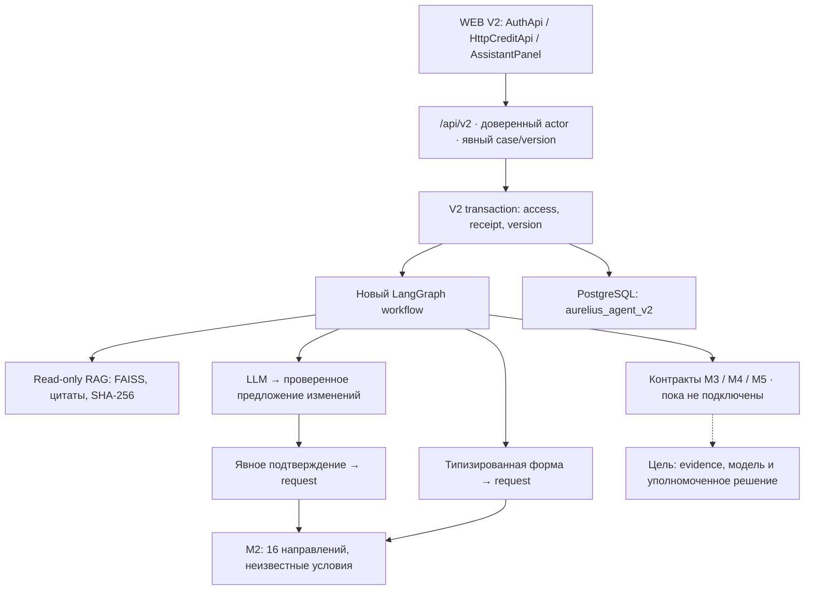

Исторический документ

# V2 · обзор и границы

## Задача

Новый кабинет должен показывать один долговечный кейс независимо от ввода через чат или форму. Диалоговый агент помогает сформулировать потребность, извлекает предложения изменений и объясняет подтверждённое состояние; сервер управляет командами и полномочиями. RAG отвечает по справочнику, не меняя факты заявки.

V2 сохраняет экраны WEB: главная, продукты, заявки, мастер, документы, компания, карточка решения; банковское рабочее место подключается отдельным доверенным контуром. Функциональные ID V2 используются для трассируемости, а не объявляются автоматически выполненными.

## Две версии

| Часть | V1 | V2 |
| --- | --- | --- |
| Архитектура | `DataAndArcBuild/architecture` | `DataAndArcBuild/architecture_v2` |
| Агент | `personalCab/prom` | `personalCab/prom_v2` |
| UI | `personalCab/frontend` | `personalCab/web`, подключение к V2 впереди |
| Runtime | `aurelius_workflow` | `aurelius_agent_v2` |
| API | `/api/...` существующего сервера | `/api/v2/...` отдельного gateway |

V1 workflow не вызывается новым агентом и не мигрируется при запуске V2. Разрешено переиспользование проверенных библиотечных примитивов: Pydantic-схем значений, поэлементной валидации, каталога, RAG, схемы/базовых правил извлечения и конфигурации PG. Эти зависимости перечислены в ADR; это не физически независимая поставка и не копия всего старого агента.

## Режимы

- **WEB mock:** существующий автономный прототип, синтетические решения и таймеры; не переключается автоматически.
- **Agent V2 DEMO / PostgreSQL:** основной runtime ядра, отдельные таблицы, без реальных финансовых действий.
- **Agent V2 memory:** только явно выбранный временный demo/test режим, теряет данные при остановке; не fallback.
- **Будущий интегрированный DEMO:** WEB + V2 + доверенные M3–M5; готовность определяется интеграционными проверками, а не существованием экранов.

Перенос банковских правил из mock не подразумевается. Автоодобрение, правовая модель БКИ, новая финансовая методология и production IAM требуют самостоятельных согласованных решений.
