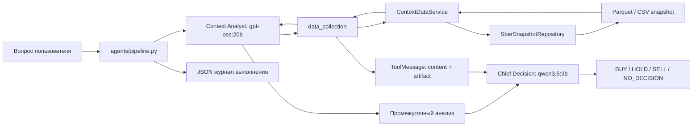
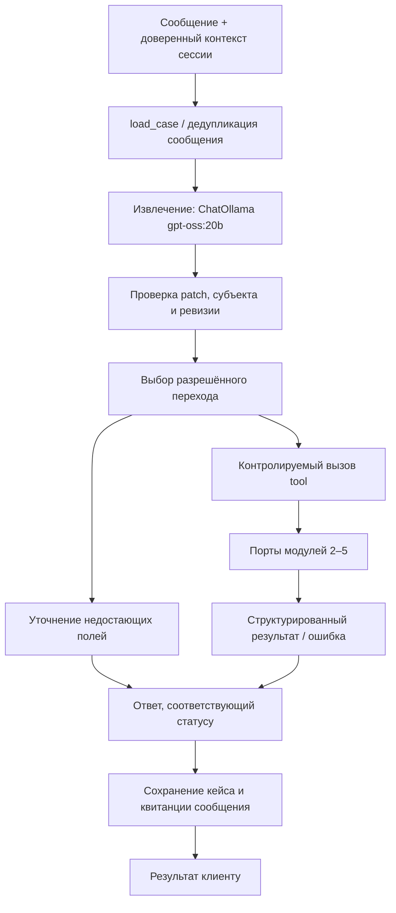

# AURELIUS: паттерн агентного приложения

> Обновление 24.10.2026: runtime использует PostgreSQL и модули 1–5 DEMO; SQLite ниже описывает прежний/явный legacy режим. Актуальный запуск Docker, snapshot-контракт и ограничения: [интеграция PostgreSQL](../../../../docs/POSTGRES_INTEGRATION.md). М4 использует настоящий CatBoost на явных проверенных входах, М5 — ручное решение и симуляцию. Актуальные контракты: [модули 1–5](../../../../docs/DEMO_MODULES_1_5.md). Последующие разделы сохраняют историческую декомпозицию первого этапа.

Дата: 21.10.2026. Исходный пример: `personalCab/prom/lab/ai_agents_lab`.
Реализация кредитного диалога: `personalCab/prom/prom_lab/ai_agents_lab`.
Спецификация: `DataAndArcBuild/architecture/01_dialogue_and_workflow.md`.

## 1. Как устроен исходный агент-брокер

Это последовательный pipeline из двух специализированных агентов с инструментальным сбором контекста. Он анализирует СБЕР и не является кредитным workflow.

### Декомпозиция

| Слой | Файлы исходного примера | Ответственность |
| --- | --- | --- |
| Вход | `main.py` | CLI, вопрос, JSON либо человекочитаемый результат |
| Оркестрация | `agents/pipeline.py` | Порядок вызовов, передача контекста, извлечение ToolMessage, журнал |
| Агенты | `agents/factory.py` | Создание LangChain `create_agent`, модель, роли, prompts и доступные tools |
| Инструменты | `agent_tools/tools.py` | Типизированный интерфейс `data_collection`, формат `content_and_artifact` |
| Контракты | `schemas/tools.py` | Pydantic: вход инструмента и ограничения аргументов |
| Предметная логика | `services/context_data_service.py` | Выбор временного окна, исключение target, агрегаты, ограничение объёма новостей |
| Доступ к данным | `repositories/sber_snapshot_repository.py` | Путь, загрузка, обязательные поля и сортировка snapshot |

Инструмент получает вопрос, число месяцев, опорный месяц и лимиты объёма. Возвращает две формы одного результата: `content` для модели и `artifact` для приложения. Pipeline извлекает artifact непосредственно из ToolMessage и явно передаёт его следующему агенту. Метаданные не считаются известными модели, если не были включены в её сообщения.

Разделение ролей: аналитик собирает контекст; главный агент формирует итоговый ответ. Инструменты, вычисления и чтение данных вынесены из prompts в обычный проверяемый код. Подмена источника данных не требует переписывать агентный pipeline.

### Границы исходного примера

- Сохранение JSON-журнала не является устойчивым состоянием заявки.
- В нём нет ревизий, идемпотентности сообщений, согласий и проверки полномочий.
- Оценка токенов по длине строки приблизительная.
- Исключение target-полей полезно, но само по себе не доказывает временную доступность каждого признака.
- Второй агент в примере использует другую модель. В новой реализации ядро — **Ollama `gpt-oss:20b`**, как задано пользователем.

## 2. Перенос паттерна на модуль 1

Сохраняется цепочка «оркестратор → типизированный инструмент → сервис → репозиторий». LLM извлекает намерение и изменения запроса, а переходы workflow и действия определяются кодом.

Здесь один диалоговый LLM-компонент выполняет функцию аналитика потребности; LangGraph выполняет функцию главного координатора. Финальное кредитное решение не делегируется ни одному из них. Ответ формируется по статусу и подтверждённым результатам, без генерации ставок, PD и одобрения.

## 3. Состав реализации

| Каталог / файл | Назначение |
| --- | --- |
| `schemas/` | Запрос, patch, намерение, доверенный actor, согласия, кейс, результаты tools |
| `agents/factory.py` | ChatOllama, structured output и prompt извлечения |
| `agents/workflow.py` | LangGraph: загрузка → извлечение → переход → ответ → фиксация |
| `agent_tools/tools.py` | LangChain tools с `content_and_artifact`, привязанные к доверенному контексту |
| `services/` | Проверка доступа, переходы, ревизии, адаптеры модулей 2–5 |
| `repositories/` | SQLite-кейсы, квитанции сообщений и аудит |
| `main.py` | CLI с постоянными session/message id и выбором субъекта |
| `tests/` | Восстановление, повторы, ревизии, отказы tools, согласия, изоляция субъектов |

## 4. Инструменты

| Tool | Назначение | Контроль |
| --- | --- | --- |
| `load_case` | Прочитать кейс текущего владельца/сессии | Actor и область субъекта |
| `find_existing_application` | Найти существующий кейс текущего субъекта | Владелец, субъект, активность |
| `update_request` | Применить валидированный patch | Роль, стадия, субъект, ревизия |
| `get_product_candidates` | Передать запрос модулю 2 | REQUEST_READY, полнота, полномочия |
| `get_data_requirements` | Получить адресные требования | Подтверждённый результат модуля 2 той же ревизии |
| `request_evidence` | Создать запрос доказательств через модуль 3 | Требования, субъект, действующее согласие |
| `get_assessment_status` | Проверить ранее созданную оценку | Ссылка на процесс, ревизия, согласие |
| `get_bank_status` | Получить статус существующей заявки | Ссылка на заявку, субъект, согласие |

Tools не передаются модели как набор произвольных банковских действий. Их выбирает граф; actor, mode, согласия, case_id и revision привязываются приложением. Все операции записывают tool trace и correlation_id. Стабильный ключ идемпотентности передаётся внешнему адаптеру; повторять изменяющее действие без поддержки этого ключа внешней системой нельзя.

## 5. Состояние и гарантии

- Кейс имеет `case_id`, `revision`, `mode=DEMO`, `status`, `correlation_id`, запрос, неизвестные поля и ссылки на результаты.
- Неизвестные поля остаются `null`; значения со слов пользователя не становятся проверенными фактами.
- Для первичной передачи модулю 2 требуются субъект, форма, одна цель, сумма и срок. Остальные неизвестные поля возвращаются явно и уточняются адресно.
- Изменение запроса создаёт новую ревизию и инвалидирует зависимые продуктовые, расчётные и офертные результаты. Проверенные факты другого субъекта не переносятся.
- Запрошенные условия хранятся отдельно от одобренных. Модуль 1 не создаёт одобрений.
- Повтор `(actor_id, session_id, message_id)` с тем же содержимым возвращает сохранённый результат. Повтор id с другим содержимым — ошибка конфликта.
- Доменная запись хранится в SQLite отдельно от истории чата; SqliteSaver сохраняет checkpoints LangGraph. После перезапуска восстанавливается кейс.
- Конкурентная запись проверяет версию хранения; потерянное обновление не перезаписывает чужие изменения.
- Согласия и полномочия поступают только из доверенного контекста приложения. Фраза в тексте, документе или ответе модели их не выдаёт.
- Метки CANCEL/MANUAL_REVIEW проверяются по явной просьбе в сообщении. Ошибочная метка отмены для изменения суммы не отменяет кейс. Повтор уже известных значений не считается новым изменением; новое значение требует дословной цитаты.
- Ошибка сервиса — задержка процесса, а не кредитный отказ. Неподключённый модуль возвращает явный статус недоступности.

## 6. Область первого этапа

Реализуется модуль 1 и контракты интеграции. Реальных банковских интеграций, скоринга, выдачи кредита и автоматического извлечения финансовых фактов из документов здесь нет. Адаптеры остальных модулей по умолчанию отключены; сценарии с подключёнными адаптерами проверяются тестами на явных fixtures.

Демо-режим не имеет инструментов финансового исполнения. Ссылки на документы сохраняются как непроверенные входы и не скачиваются автоматически. Для production понадобятся аутентификация, реестр согласий, защищённое хранилище, серверная сериализация обращений и реальные адаптеры модулей.

## 7. Справочные материалы

- [Спецификация модуля 1](../../../../DataAndArcBuild/architecture/01_dialogue_and_workflow.md).
- [LangGraph persistence](https://docs.langchain.com/oss/python/langgraph/persistence).
- [LangChain ChatOllama](https://docs.langchain.com/oss/python/integrations/chat/ollama).

Команды запуска и текущие ограничения — в `README.md` рядом с реализацией.
