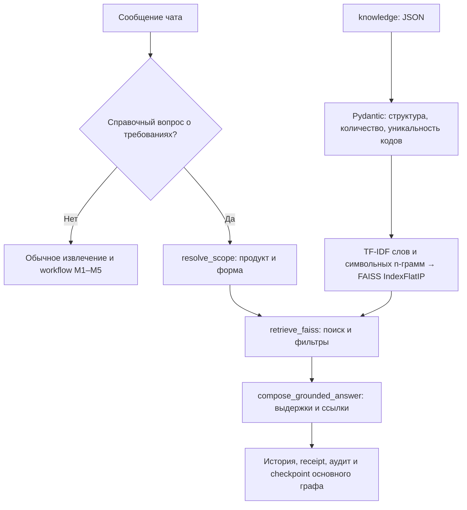

# RAG требований к кредитным заявкам

Справочный поиск подключён к диалоговому LangGraph. Источник — [JSON с 99 требованиями](../../../knowledge/Требования%20к%20кредитным%20заявкам.json) для R01, R02, R03. Каждое требование — отдельный документ с кодом поля, форматом, источником данных, способом заполнения, целевым полем БД и обязательностью для ИП/ООО.

## Как работает



`agents/workflow.py` вызывает узел `retrieve_requirements` после `load_case`. Для справочного сообщения он запускает подграф `RequirementsRAG.graph`, пропускает LLM-извлечение и бизнес-действия и возвращает `next_action=KNOWLEDGE_ANSWER`. Статус, ревизия, параметры и ссылки на бизнес-результаты заявки сохраняются. Сообщение и ответ записываются обычным механизмом истории/receipt/audit. Повтор того же `message_id` возвращает первоначальный ответ, даже если справочник затем изменился.

Это локальный **лексический extractive RAG**, а не нейросетевой семантический поиск. Векторы строятся из TF-IDF слов и символьных n-грамм длиной 3–5; нормированные векторы ищутся по скалярному произведению в настоящем FAISS. Ответ собирается из найденных записей, без свободной генерации LLM. Для 99 структурированных требований такой режим работает без Ollama, скачивания embedding-модели и сетевого сервиса; свободные перефразирования и опечатки поддерживаются ограниченно.

Индекс строится при первом справочном запросе и хранится в памяти процесса. На каждом поиске читаются байты JSON; SHA-256 идентифицирует версию. Изменение содержимого вызывает новый индекс, кэш удерживает не более двух версий. Бинарный индекс и pickle не используются. В Docker копируется папка `knowledge`; после изменения JSON образ нужно пересобрать.

## Контракт ответа и область поиска

`DialogueResult.knowledge_answer` и `workflow_log.knowledge_answer` содержат:

- `status`: `FOUND`, `NOT_FOUND`, `CLARIFY_PRODUCT`, `UNSUPPORTED_LEGAL_FORM` или `UNAVAILABLE`;
- `query`, `product_codes`, `legal_form`, `source_sha256`, `retrieval=FAISS_TFIDF_WORD_CHAR_V1`;
- `answer` и `citations`: код поля, выдержки, обязательность ИП/ООО, целевое поле, score и `source_ref` с JSON Pointer вида `knowledge/…json#/products/R01/requirements/2`.

Явный R01/R02/R03 или название продукта в вопросе определяет область справки. Иначе берутся кандидаты текущего кейса; если их ещё нет, ассистент просит уточнить продукт. Явная форма в вопросе определяет область справки и **не меняет** форму клиента. Без явной формы используется форма текущего запроса; если неизвестна, обязательность показывается для обеих форм. АО/OTHER не приравниваются к ООО.

Общий вопрос «Какие требования к заявке R02 для ИП?» выдаёт полный применимый перечень. Предметный поиск возвращает до шести записей. В прямом вопросе о КПП для ИП допускается запись ООО с явным пояснением, что для ИП она не отмечена обязательной. Неизвестный продукт и отсутствие предметного совпадения дают `NOT_FOUND`; отсутствующий, повреждённый или структурно несогласованный JSON — `UNAVAILABLE`.

В JSON по указанию пользователя исправлены три назначения срока договора: `R01_06`, `R02_06`, `R03_06` → `credit_applications.requested_term_months`. Месяцы не переводятся в дни. Срок транша и период выборки остаются отдельными требованиями.

Справочник описывает заполнение анкеты. Он не является подтверждением клиентских фактов, согласием или правилом одобрения. Его текст не передаётся LLM как инструкции, не исполняется и не создаёт изменения в БД. М2/М3 продолжают использовать типизированные требования PostgreSQL для проверки и сбора анкеты; загрузка JSON не перезаписывает их. Изменение источника не пересобирает уже сохранённые снимки и не заменяет утверждение условий оператором.

## Проверка без сервера

Из корня репозитория:

```sh
/Users/retro0/projects/PyVenv/venv_core/bin/python -m pip install -r personalCab/prom/prom_lab/ai_agents_lab/requirements.txt
/Users/retro0/projects/PyVenv/venv_core/bin/python -m personalCab.prom.rag 'Какой формат ИНН для R01 ООО?'
/Users/retro0/projects/PyVenv/venv_core/bin/python -m personalCab.prom.rag 'Какие требования к заявке R02 для ИП?'
/Users/retro0/projects/PyVenv/venv_core/bin/python -m pytest personalCab/prom/prom_lab/ai_agents_lab/tests/test_requirements_rag.py -q
```

Три функциональных теста проверяют: (1) реальный FAISS на 99 записях, точность ссылок, продукт/форму, месяцы и отсутствие ответа без источника; (2) смену версии, переиндексацию и ошибки источника; (3) вызов через основной LangGraph, отсутствие изменения заявки и вызова LLM, сериализацию HTTP-ответа, replay и восстановление после перезапуска. Тесты не требуют Ollama или бизнес-БД.

Результат проверки 24.10.2026: **3 passed** для RAG; полный набор frontend/workflow с локальными HTTP-портами и отдельной seeded тестовой PostgreSQL-БД — **121 passed**, без пропусков. FAISS выдаёт три предупреждения DeprecationWarning из своих SWIG-биндингов; тесты проходят. CLI отдельно подтвердил `R02_06` → `requested_term_months`. Рабочая БД не изменялась.
