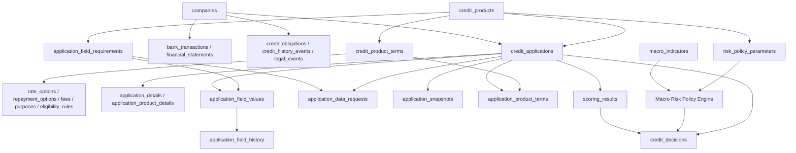

# Справочник базы данных PostgreSQL

> Обновление 24.10.2026: runtime использует PostgreSQL и модули 1–3; SQLite ниже описывает прежний/явный legacy режим. Актуальный запуск Docker, snapshot-контракт и ограничения: [интеграция PostgreSQL](../../docs/POSTGRES_INTEGRATION.md). М4 не подключён.

**Назначение документа:** интеграционный справочник по каждой таблице и колонке: что читать, куда писать, какой источник предполагается, как связывать записи. Полное описание структуры базы данных MVP кредитного кабинета для малого бизнеса, состава хранимых сведений, связей между таблицами, источников автозаполнения и правил работы с отсутствующими данными. Это документация к базовой схеме и применённой дополнительной миграции `AURELIUS_add_macro_risk_tables.sql`.

**Исторический срез на 23.10.2026:** в действующей БД `business_scoring` подтверждены 34 таблицы; ранее установлено, что 6 исходных таблиц содержат данные, наполнение двух новых таблиц отдельно не проверялось. Загружены три кредитных продукта и 99 требований к полям анкет. Это описание состояния до загрузки тестовых компаний; актуализация тестового контура приведена в разделе 14. Базовая структура описана по `schema.sql`, дополнительные таблицы — по SQL-миграции и результатам проверок в pgAdmin; некоторые столбцы продуктовых таблиц добавлялись позднее. При расхождении с текущей БД приоритет имеет фактическая схема PostgreSQL. Подключения к реальным источникам не подтверждены. Упоминания внешних реестров обозначают возможные источники, а не готовые интеграции.

## 1. Назначение системы и границы MVP

AURELIUS обеспечивает выбор одного из трёх кредитных сценариев, сбор сведений о заёмщике, автоматическое заполнение анкеты из доступного профиля компании, уточнение недостающих сведений посредством LLM, проверку условий продукта, расчёт риска и фиксацию решения.

| Код | Сценарий | Основные особенности |
|---|---|---|
| `R01` | Разовый оборотный кредит без залога | Сумма, срок, цель, ставка, график платежей |
| `R02` | Возобновляемая кредитная линия | Лимит, период выборки, срок транша, восстановление лимита |
| `R03` | Овердрафт | Лимит, расчётный счёт, поступления, срок задолженности, погашение из поступлений |

Структура не содержит таблиц хранения файлов документов, согласий или пользовательских аккаунтов. Пользовательские аккаунты предполагаются во внешнем сервисе. Отсутствие этих таблиц **не отменяет** юридические требования к обработке персональных данных в реальном банковском продукте; для демонстрационного MVP используются синтетические сведения.

## 2. Развёртывание и состав

Схема: `AURELIUS_final_schema_corrected.sql`; СУБД: PostgreSQL (DDL использует `JSONB`, `IDENTITY`, PL/pgSQL, составные FK). Выполнять целиком в **новой пустой** базе данных. Не запускать поверх действующей базы с данными. Скрипт создаёт 32 базовые таблицы, индексы, ограничения, функции и триггеры. В нём нет `INSERT` и начальных данных.

Проверка числа таблиц после выполнения:

```sql
SELECT table_name
FROM information_schema.tables
WHERE table_schema = 'public' AND table_type = 'BASE TABLE'
ORDER BY table_name;
```

**Дополнительная миграция:** `AURELIUS_add_macro_risk_tables.sql` добавляет `macro_indicators` и `risk_policy_parameters` поверх действующей схемы. В текущей БД наличие обеих таблиц подтверждено запросом в pgAdmin; содержимое таблиц отдельно не проверялось. Итого 34 таблицы. При развёртывании с нуля сначала выполняется базовая схема в пустой БД, затем дополнительная миграция, и только потом загружаются справочные данные.

**Текущее состояние:** строки `credit_products` (3) и `application_field_requirements` (99) уже загружены в действующую БД. Указанный выше SQL-файл — схема для развёртывания с нуля, а не миграция действующей базы. Состояние фактических данных описано в разделе 13.

## 3. Логическая модель



## 4. Каталог таблиц

| Функциональный блок | Таблицы | Что содержат |
|---|---|---|
| Профиль компании | `companies`, `company_contacts`, `company_bank_accounts` | Регистрация, контакты, счета |
| Финансовые данные | `bank_transactions`, `financial_statements` | Операции, обороты, отчётность |
| Кредитная и юридическая история | `credit_obligations`, `credit_repayment_history`, `credit_history_events`, `legal_events` | Долги, платежи, просрочки, события |
| Продуктовый каталог | `credit_products`, `credit_product_terms`, `credit_product_rate_options`, `credit_product_repayment_options`, `credit_product_purposes`, `credit_product_eligibility_rules`, `credit_product_fees` | Условия и ограничения продуктов |
| Заявка | `credit_applications`, `application_details`, `application_product_details`, `application_field_requirements`, `application_field_values`, `application_data_requests` | Анкеты, значения, недостающие сведения |
| Аудит | `company_data_provenance`, `application_field_history`, `application_snapshots`, `data_quality_checks` | Источники, история, снимки, проверки |
| Оценка и решение | `scoring_results`, `credit_decisions`, `application_product_terms` | Риск, решение, предложение |
| Макроэкономика и риск-политика | `macro_indicators`, `risk_policy_parameters` | Временные ряды макропоказателей и параметры допустимого риска по продуктам |
| Обеспечение и использование линии | `collateral`, `guarantors`, `credit_line_operations` | Залог, поручители, операции |

## 5. Правила автозаполнения анкеты и диалога LLM

1. Клиент выбирает `R01`, `R02` или `R03`, компания определяется по `company_id` из авторизованного банковского кабинета (без запроса ИНН для идентификации), создаётся новая `credit_applications` в состоянии `DRAFT`.
2. Приложение читает `application_field_requirements` для выбранного продукта и типа заёмщика (`required_ip` / `required_ooo`). В справочнике уже содержатся 99 строк требований исходной книги (31/34/34); **сама схема их не содержит**.
3. По `target_db_field` сервис ищет значение в таблицах компании, финансов, долгов и контактов. Строка `target_db_field` — метаданные, а не автоматический исполняемый SQL; нужен явный безопасный маппинг в коде.
4. Каждое найденное значение записывается в `application_field_values` с `value_source`, `source_reference`, `obtained_at`, `verification_status`.
5. Если обязательное значение отсутствует, создаётся `application_data_requests`. LLM формулирует понятный вопрос **только по существующему `field_code`**, но не создаёт произвольные колонки.
6. Ответ клиента сохраняется как `value_source='CLIENT'`, по умолчанию без подтверждения. Триггер добавляет запись в `application_field_history`.
7. Перед отправкой выполняются проверки полноты, формата, согласованности и свежести (`data_quality_checks`); приложение создаёт `application_snapshots` типа `SUBMISSION`.
8. Сервис применяет условия продукта, рассчитывает риск, фиксирует предложение и решение; при решении создаёт снимок типа `DECISION`.

## 6. Каталог кредитных продуктов и расчёт условий

`credit_products` определяет код и тип продукта. `credit_product_terms` хранит набор условий конкретной версии: диапазон суммы, срок договора, транши, период выборки, восстановление лимита, продление, обеспечение, категории заёмщиков и ссылку на источник условий. `credit_product_rate_options` хранит варианты годовых ставок и дополнительных услуг; `credit_product_repayment_options` — допустимые графики; `credit_product_purposes` — цели; `credit_product_eligibility_rules` — дополнительные критерии; `credit_product_fees` — комиссии.

`application_product_terms` хранит **предложенные конкретной заявке** сумму, срок, ставку, график, стоимость услуг и комиссии. Внешние ключи запрещают связывать предложение с версией условий другого продукта, а ставку/график — с другой версией. Публичная ставка «от» не является индивидуальной одобренной ставкой; расчёт конкретной ставки требует отдельной политики.

**Особенности:** для R01 — единоразовая выдача и график; для R02 — срок линии не равен сроку транша, лимит восстанавливается; для R03 — привязка к счёту и погашение из поступлений. Версии условий могут иметь даты, но пересечение периодов не запрещается намеренно.

## 7. Целостность, аудит, история и ограничения

- `application_field_values` и `application_data_requests` ссылаются на существующие коды полей соответствующего продукта в `application_field_requirements`.
- `credit_decisions` ссылается на `scoring_results` **той же заявки**; `credit_line_operations` — на согласованные заявку, компанию и продукт.
- `application_product_details.overdraft_bank_account_id` может ссылаться только на счёт компании, связанной с заявкой.
- Триггер `aurelius_log_field_change()` журналирует вставку, изменение значения/источника/статуса и удаление полей анкеты в `application_field_history`.
- `application_field_history` и `application_snapshots` защищены от обычных UPDATE/DELETE триггером; это не криптографическая защита от администратора БД.
- `company_data_provenance` хранит происхождение значения по `target_table`, `target_record_pk`, `target_field`, `observed_value`; при этом **нет универсального FK на произвольную таблицу** — валидность адресата проверяет приложение.
- Типы, `CHECK`, `UNIQUE` и FK ограничивают структуру, но **не реализуют автоматически** все бизнес-правила: полноту по ИП/ООО, возраст бизнеса на дату заявки, проверку разрешённых целей, кредитную политику, доступность реестра и расчёт долговой нагрузки. Эти правила выполняет сервис.
- `scoring_results.pd` — поле оценки вероятности дефолта.

### Интерпретация источников в модели БД

| Источник исследования | Таблицы | Примечание |
|---|---|---|
| ЕГРЮЛ/ЕГРИП, реестр МСП, «Прозрачный бизнес», DaData | `companies`, `company_contacts`, `company_data_provenance` | Реквизиты и регистрационный профиль; доступность API зависит от источника |
| ГИР БО, опубликованные сведения ФНС о доходах/расходах | `financial_statements`, `company_data_provenance` | Историческая отчётность, не текущие денежные потоки |
| Внутренние банковские данные, Alfa API, выписка клиента | `company_bank_accounts`, `bank_transactions`, `financial_statements` | Счета, операции, агрегаты; нельзя считать данными всех банков |
| БКИ, НБКИ, ЦККИ | `credit_obligations`, `credit_repayment_history`, `credit_history_events` | ЦККИ даёт перечень бюро, не детальные обязательства; сведения БКИ требуют законного доступа |
| КАД Арбитр, Федресурс/ЕФРСБ, ФССП | `legal_events`, `company_data_provenance` | Тип события, дата, роль, стадия, ссылка на запись |
| Реестр залогов движимого имущества, ЕГРН | `collateral`, `company_data_provenance` | Только при применимости и наличии законного доступа; MVP не хранит сами документы |
| ЕИС закупок и данные клиента | `application_details`, `application_field_values`, `company_data_provenance` | Договорные/проектные сведения, если требуются анкетой |

## 8. Как разработчику определить, откуда читать и куда писать

| Сценарий | Сначала прочитать | Если отсутствует | Куда записать полученное |
|---|---|---|---|
| Клиент ввёл ИНН | `companies.inn` | Проверить ЕГРЮЛ/ЕГРИП (если подключено), иначе спросить клиента | `companies`; происхождение в `company_data_provenance` |
| Автозаполнение анкеты | `application_field_requirements` → `target_db_field` → типизированная таблица | `application_data_requests` и вопрос клиенту | `application_field_values`; при подтверждении — целевое типизированное поле |
| Финансовые показатели | `financial_statements` по `company_id` и доступному периоду | ГИР БО/отчётность клиента | `financial_statements` |
| Обороты | `bank_transactions` по компании, датам и категориям | АБС/выписка клиента | `bank_transactions` |
| Кредитная нагрузка | `credit_obligations`, `credit_repayment_history` | АБС/БКИ при доступе | Те же таблицы + `credit_history_events` |
| Выбор продукта | `credit_products`, `credit_product_terms` | Не подменять неизвестные условия | В заявке — `credit_applications`; предложение — `application_product_terms` |
| Ставка и график | `credit_product_rate_options`, `credit_product_repayment_options` по `terms_id` | Требуется конкретизация предложения | `application_product_terms` |
| Скоринг и решение | `application_snapshots`, финансовые таблицы | Не запускать скоринг до завершения проверки полноты на предыдущем этапе; отсутствие внутренних настроек обрабатывать как ошибку конфигурации | `scoring_results`, затем `credit_decisions` |

**Существенное различие:** `application_field_values` хранит снимок значения *для конкретной заявки*, а `companies` и связанные таблицы — переиспользуемые данные компании. Ответ клиента не должен автоматически перезаписывать проверенный реестровый факт.

## 9. Справочник всех 34 таблиц: назначение, колонки, источники и маршруты данных

Каждая таблица описана как **контракт интеграции**: что хранит, откуда потенциально поступает информация, куда записывать и откуда её читать. Источники (ЕГРЮЛ, ЕГРИП, ГИР БО, БКИ, АБС и др.) указаны как **проектируемые источники**, а не как уже работающие подключения. По последней подтверждённой проверке заполнены только продуктовые справочники; содержимое двух новых таблиц после миграции не проверялось (см. разделы 13–14).

**Правило:** идентификаторы и служебные статусы формирует приложение/БД; внешние источники не должны передавать их произвольно. `NULL` означает отсутствие подтверждённого значения, не ноль. Для полей из реестров сохранять происхождение в `company_data_provenance`; для полей анкеты — в `application_field_values`.

### 9.1. `companies`

Основная карточка юридического лица или ИП. Постоянный внутренний идентификатор — `company_id`; ИНН может отсутствовать до уточнения клиентом. Для известных ИНН сохраняется уникальность (`UNIQUE (inn)`). Данные реестров не равны подтверждению фактической деятельности.

**Предполагаемый первичный источник:** ЕГРЮЛ/ЕГРИП ФНС; реестр МСП; CRM/анкета клиента. **Чтение:** по связанному `company_id`, `application_id`, `product_code` или `terms_id` (в зависимости от таблицы); для истории учитывать дату наблюдения. **Запись:** сервис-владелец данных, не LLM напрямую.

| Колонка | SQL-тип | Обязательность | Что хранит / как использовать | Откуда брать / кто записывает |
|---|---|---|---|---|
| `company_id` | `BIGINT` | — | Идентификатор записи / внешний ключ для связи таблиц | Генерирует БД или ссылка на существующую запись AURELIUS |
| `entity_type` | `VARCHAR(30)` | обязательное | Тип заёмщика: LEGAL_ENTITY / INDIVIDUAL_ENTREPRENEUR | ЕГРЮЛ/ЕГРИП ФНС; тип из анкеты |
| `inn` | `VARCHAR(12)` | допускается `NULL` в профиле | ИНН компании; при отсутствии запросить в анкете, не использовать для идентификации авторизованного клиента | ЕГРЮЛ/ЕГРИП ФНС; ответ клиента |
| `ogrn` | `VARCHAR(13)` | — | ОГРН юридического лица | ЕГРЮЛ ФНС |
| `ogrnip` | `VARCHAR(15)` | — | ОГРНИП предпринимателя | ЕГРИП ФНС |
| `name` | `TEXT` | допускается `NULL` в профиле | Наименование компании / ФИО ИП; при отсутствии запросить в анкете | ЕГРЮЛ/ЕГРИП, клиент — по контексту таблицы |
| `registration_date` | `DATE` | — | Дата государственной регистрации | ЕГРЮЛ/ЕГРИП ФНС |
| `status` | `VARCHAR(30)` | обязательное | Статус записи / результата | Сервис-владелец таблицы; только допустимые значения CHECK |
| `status_date` | `DATE` | — | Дата события или граница периода | Из соответствующего источника записи / расчёт по событиям |
| `okved_main` | `VARCHAR(10)` | — | Основной код ОКВЭД | ЕГРЮЛ/ЕГРИП ФНС |
| `region_code` | `VARCHAR(10)` | — | Region code | Источник таблицы: ЕГРЮЛ/ЕГРИП ФНС; реестр МСП; CRM/анкета клиента; конкретный маппинг уточняется при интеграции |
| `legal_address` | `TEXT` | — | Юридический адрес | ЕГРЮЛ ФНС |
| `director_name` | `TEXT` | — | ФИО руководителя | ЕГРЮЛ ФНС / документы компании |
| `director_authority_confirmed` | `BOOLEAN` | — | Director authority confirmed | Источник таблицы: ЕГРЮЛ/ЕГРИП ФНС; реестр МСП; CRM/анкета клиента; конкретный маппинг уточняется при интеграции |
| `information_reliability_status` | `VARCHAR(30)` | обязательное | Статус записи / результата | Сервис-владелец таблицы; только допустимые значения CHECK |
| `source_checked_at` | `TIMESTAMPTZ` | — | Время соответствующего события или проверки | Системное время / дата проверки источника; не подставлять дату публикации |
| `created_at` | `TIMESTAMPTZ` | обязательное | Время соответствующего события или проверки | Системное время / дата проверки источника; не подставлять дату публикации |
| `updated_at` | `TIMESTAMPTZ` | обязательное | Время соответствующего события или проверки | Системное время / дата проверки источника; не подставлять дату публикации |
| `kpp` | `VARCHAR(9)` | — | КПП организации | ЕГРЮЛ ФНС |
| `legal_form` | `TEXT` | — | Legal form | Источник таблицы: ЕГРЮЛ/ЕГРИП ФНС; реестр МСП; CRM/анкета клиента; конкретный маппинг уточняется при интеграции |
| `okved_main_name` | `TEXT` | — | Название основного вида деятельности | Классификатор ОКВЭД по коду из ЕГРЮЛ/ЕГРИП |
| `actual_activity_description` | `TEXT` | — | Фактическая деятельность | Клиент / CRM |
| `actual_business_address` | `TEXT` | — | Фактический адрес деятельности | Клиент / CRM, не подменять юридическим адресом |
| `business_region` | `TEXT` | — | Business region | Источник таблицы: ЕГРЮЛ/ЕГРИП ФНС; реестр МСП; CRM/анкета клиента; конкретный маппинг уточняется при интеграции |
| `business_city` | `TEXT` | — | Business city | Источник таблицы: ЕГРЮЛ/ЕГРИП ФНС; реестр МСП; CRM/анкета клиента; конкретный маппинг уточняется при интеграции |
| `sme_category` | `VARCHAR(20)` | — | Категория субъекта МСП | Единый реестр субъектов МСП ФНС |
| `actual_activity_start_date` | `DATE` | — | Дата фактического начала деятельности | Клиент / CRM |
| `director_position` | `TEXT` | — | Должность руководителя | ЕГРЮЛ / документы компании |

### 9.2. `company_contacts`

Контакты и представители компании; могут быть известны банку или получены от клиента.

**Предполагаемый первичный источник:** CRM банка / сведения клиента. **Чтение:** по связанному `company_id`, `application_id`, `product_code` или `terms_id` (в зависимости от таблицы); для истории учитывать дату наблюдения. **Запись:** сервис-владелец данных, не LLM напрямую.

| Колонка | SQL-тип | Обязательность | Что хранит / как использовать | Откуда брать / кто записывает |
|---|---|---|---|---|
| `contact_id` | `BIGINT` | — | Идентификатор записи / внешний ключ для связи таблиц | Генерирует БД или ссылка на существующую запись AURELIUS |
| `company_id` | `BIGINT` | обязательное | Идентификатор записи / внешний ключ для связи таблиц | Генерирует БД или ссылка на существующую запись AURELIUS |
| `full_name` | `TEXT` | обязательное | Full name | Источник таблицы: CRM банка / сведения клиента; конкретный маппинг уточняется при интеграции |
| `contact_role` | `TEXT` | — | Contact role | Источник таблицы: CRM банка / сведения клиента; конкретный маппинг уточняется при интеграции |
| `phone` | `TEXT` | — | Phone | Источник таблицы: CRM банка / сведения клиента; конкретный маппинг уточняется при интеграции |
| `authority_basis` | `TEXT` | — | Authority basis | Источник таблицы: CRM банка / сведения клиента; конкретный маппинг уточняется при интеграции |
| `is_current` | `BOOLEAN` | — | Логический признак | Источник таблицы или правило системы |
| `source_checked_at` | `TIMESTAMPTZ` | — | Время соответствующего события или проверки | Системное время / дата проверки источника; не подставлять дату публикации |

### 9.3. `company_bank_accounts`

Счета компании и реквизиты обслуживающего банка; БИК сам по себе не подтверждает владение счётом.

**Предполагаемый первичный источник:** АБС банка / реквизиты клиента; БИК — справочник ЦБ. **Чтение:** по связанному `company_id`, `application_id`, `product_code` или `terms_id` (в зависимости от таблицы); для истории учитывать дату наблюдения. **Запись:** сервис-владелец данных, не LLM напрямую.

| Колонка | SQL-тип | Обязательность | Что хранит / как использовать | Откуда брать / кто записывает |
|---|---|---|---|---|
| `account_id` | `BIGINT` | — | Идентификатор записи / внешний ключ для связи таблиц | Генерирует БД или ссылка на существующую запись AURELIUS |
| `company_id` | `BIGINT` | обязательное | Идентификатор записи / внешний ключ для связи таблиц | Генерирует БД или ссылка на существующую запись AURELIUS |
| `account_number` | `VARCHAR(20)` | обязательное | Расчётный счёт | АБС / реквизиты клиента |
| `bank_name` | `TEXT` | обязательное | Bank name | Источник таблицы: АБС банка / реквизиты клиента; БИК — справочник ЦБ; конкретный маппинг уточняется при интеграции |
| `bank_bik` | `VARCHAR(9)` | — | БИК банка | Реквизиты счёта / справочник Банка России |
| `account_status` | `VARCHAR(20)` | обязательное | Статус записи / результата | Сервис-владелец таблицы; только допустимые значения CHECK |
| `source_checked_at` | `TIMESTAMPTZ` | — | Время соответствующего события или проверки | Системное время / дата проверки источника; не подставлять дату публикации |

### 9.4. `bank_transactions`

Поток операций по счетам: входящие/исходящие суммы, назначения и категории. Основа расчёта оборотов.

**Предполагаемый первичный источник:** АБС / банковская выписка (по доступным счетам). **Чтение:** по связанному `company_id`, `application_id`, `product_code` или `terms_id` (в зависимости от таблицы); для истории учитывать дату наблюдения. **Запись:** сервис-владелец данных, не LLM напрямую.

| Колонка | SQL-тип | Обязательность | Что хранит / как использовать | Откуда брать / кто записывает |
|---|---|---|---|---|
| `transaction_id` | `BIGINT` | — | Идентификатор записи / внешний ключ для связи таблиц | Генерирует БД или ссылка на существующую запись AURELIUS |
| `company_id` | `BIGINT` | обязательное | Идентификатор записи / внешний ключ для связи таблиц | Генерирует БД или ссылка на существующую запись AURELIUS |
| `account_ref` | `VARCHAR(100)` | — | Идентификатор / ссылка на исходную запись | Метаданные источника, сохраняет загрузчик |
| `bank_name` | `VARCHAR(100)` | — | Bank name | Источник таблицы: АБС / банковская выписка (по доступным счетам); конкретный маппинг уточняется при интеграции |
| `transaction_date` | `TIMESTAMPTZ` | обязательное | Дата события или граница периода | Из соответствующего источника записи / расчёт по событиям |
| `amount` | `NUMERIC(18,2)` | обязательное | Amount | Источник таблицы: АБС / банковская выписка (по доступным счетам); конкретный маппинг уточняется при интеграции |
| `currency` | `CHAR(3)` | обязательное | Currency | Источник таблицы: АБС / банковская выписка (по доступным счетам); конкретный маппинг уточняется при интеграции |
| `direction` | `VARCHAR(10)` | обязательное | Direction | Источник таблицы: АБС / банковская выписка (по доступным счетам); конкретный маппинг уточняется при интеграции |
| `operation_category` | `VARCHAR(30)` | обязательное | Operation category | Источник таблицы: АБС / банковская выписка (по доступным счетам); конкретный маппинг уточняется при интеграции |
| `counterparty_inn` | `VARCHAR(12)` | — | ИНН контрагента | Банковская выписка / назначение платежа |
| `counterparty_name` | `TEXT` | — | Counterparty name | Источник таблицы: АБС / банковская выписка (по доступным счетам); конкретный маппинг уточняется при интеграции |
| `payment_purpose` | `TEXT` | — | Назначение платежа | Банковская выписка |
| `balance_after` | `NUMERIC(18,2)` | — | Остаток после операции | Банковская выписка / АБС |
| `source_statement_id` | `VARCHAR(100)` | — | Идентификатор записи / внешний ключ для связи таблиц | Генерирует БД или ссылка на существующую запись AURELIUS |
| `source_checked_at` | `TIMESTAMPTZ` | — | Время соответствующего события или проверки | Системное время / дата проверки источника; не подставлять дату публикации |

### 9.5. `financial_statements`

Показатели бухгалтерской/управленческой отчётности за период.

**Предполагаемый первичный источник:** ГИР БО ФНС (доступные ЮЛ) / отчётность клиента / управленческий учёт. **Чтение:** по связанному `company_id`, `application_id`, `product_code` или `terms_id` (в зависимости от таблицы); для истории учитывать дату наблюдения. **Запись:** сервис-владелец данных, не LLM напрямую.

| Колонка | SQL-тип | Обязательность | Что хранит / как использовать | Откуда брать / кто записывает |
|---|---|---|---|---|
| `statement_id` | `BIGINT` | — | Идентификатор записи / внешний ключ для связи таблиц | Генерирует БД или ссылка на существующую запись AURELIUS |
| `company_id` | `BIGINT` | обязательное | Идентификатор записи / внешний ключ для связи таблиц | Генерирует БД или ссылка на существующую запись AURELIUS |
| `period_start` | `DATE` | обязательное | Дата события или граница периода | Из соответствующего источника записи / расчёт по событиям |
| `period_end` | `DATE` | обязательное | Дата события или граница периода | Из соответствующего источника записи / расчёт по событиям |
| `statement_type` | `VARCHAR(20)` | обязательное | Statement type | Источник таблицы: ГИР БО ФНС (доступные ЮЛ) / отчётность клиента / управленческий учёт; конкретный маппинг уточняется при интеграции |
| `revenue` | `NUMERIC(18,2)` | — | Выручка за период | Бухгалтерская / управленческая отчётность |
| `cost_of_sales` | `NUMERIC(18,2)` | — | Себестоимость | Бухгалтерская / управленческая отчётность |
| `gross_profit` | `NUMERIC(18,2)` | — | Денежный показатель, руб. (если не указана иная валюта) | Финансовый источник таблицы или расчёт из операций |
| `operating_expenses` | `NUMERIC(18,2)` | — | Operating expenses | Источник таблицы: ГИР БО ФНС (доступные ЮЛ) / отчётность клиента / управленческий учёт; конкретный маппинг уточняется при интеграции |
| `operating_profit` | `NUMERIC(18,2)` | — | Денежный показатель, руб. (если не указана иная валюта) | Финансовый источник таблицы или расчёт из операций |
| `net_profit` | `NUMERIC(18,2)` | — | Чистая прибыль | Бухгалтерская / управленческая отчётность |
| `total_assets` | `NUMERIC(18,2)` | — | Денежный показатель, руб. (если не указана иная валюта) | Финансовый источник таблицы или расчёт из операций |
| `current_assets` | `NUMERIC(18,2)` | — | Денежный показатель, руб. (если не указана иная валюта) | Финансовый источник таблицы или расчёт из операций |
| `cash_and_equivalents` | `NUMERIC(18,2)` | — | Денежный показатель, руб. (если не указана иная валюта) | Финансовый источник таблицы или расчёт из операций |
| `short_term_liabilities` | `NUMERIC(18,2)` | — | Денежный показатель, руб. (если не указана иная валюта) | Финансовый источник таблицы или расчёт из операций |
| `total_liabilities` | `NUMERIC(18,2)` | — | Денежный показатель, руб. (если не указана иная валюта) | Финансовый источник таблицы или расчёт из операций |
| `equity` | `NUMERIC(18,2)` | — | Денежный показатель, руб. (если не указана иная валюта) | Финансовый источник таблицы или расчёт из операций |
| `source_document_id` | `TEXT` | — | Идентификатор записи / внешний ключ для связи таблиц | Генерирует БД или ссылка на существующую запись AURELIUS |
| `source_checked_at` | `TIMESTAMPTZ` | — | Время соответствующего события или проверки | Системное время / дата проверки источника; не подставлять дату публикации |
| `is_verified` | `BOOLEAN` | — | Логический признак | Источник таблицы или правило системы |

### 9.6. `credit_obligations`

Действующие и исторические долговые обязательства компании.

**Предполагаемый первичный источник:** АБС / БКИ при законном доступе / документы клиента. **Чтение:** по связанному `company_id`, `application_id`, `product_code` или `terms_id` (в зависимости от таблицы); для истории учитывать дату наблюдения. **Запись:** сервис-владелец данных, не LLM напрямую.

| Колонка | SQL-тип | Обязательность | Что хранит / как использовать | Откуда брать / кто записывает |
|---|---|---|---|---|
| `obligation_id` | `BIGINT` | — | Идентификатор записи / внешний ключ для связи таблиц | Генерирует БД или ссылка на существующую запись AURELIUS |
| `company_id` | `BIGINT` | обязательное | Идентификатор записи / внешний ключ для связи таблиц | Генерирует БД или ссылка на существующую запись AURELIUS |
| `creditor_name` | `TEXT` | — | Creditor name | Источник таблицы: АБС / БКИ при законном доступе / документы клиента; конкретный маппинг уточняется при интеграции |
| `obligation_type` | `VARCHAR(20)` | обязательное | Obligation type | Источник таблицы: АБС / БКИ при законном доступе / документы клиента; конкретный маппинг уточняется при интеграции |
| `contract_ref` | `VARCHAR(100)` | — | Идентификатор / ссылка на исходную запись | Метаданные источника, сохраняет загрузчик |
| `contract_date` | `DATE` | — | Дата события или граница периода | Из соответствующего источника записи / расчёт по событиям |
| `maturity_date` | `DATE` | — | Дата события или граница периода | Из соответствующего источника записи / расчёт по событиям |
| `disbursement_date` | `DATE` | — | Дата события или граница периода | Из соответствующего источника записи / расчёт по событиям |
| `actual_close_date` | `DATE` | — | Дата события или граница периода | Из соответствующего источника записи / расчёт по событиям |
| `first_default_date` | `DATE` | — | Дата первого события дефолта | История платежей / алгоритм определения 90+ DPD |
| `original_amount` | `NUMERIC(18,2)` | — | Денежный показатель, руб. (если не указана иная валюта) | Финансовый источник таблицы или расчёт из операций |
| `outstanding_balance` | `NUMERIC(18,2)` | — | Денежный показатель, руб. (если не указана иная валюта) | Финансовый источник таблицы или расчёт из операций |
| `monthly_payment` | `NUMERIC(18,2)` | — | Денежный показатель, руб. (если не указана иная валюта) | Финансовый источник таблицы или расчёт из операций |
| `interest_rate` | `NUMERIC(8,4)` | — | Ставка или процент по условию | Продуктовые условия / банковский договор / расчёт |
| `overdue_amount` | `NUMERIC(18,2)` | — | Денежный показатель, руб. (если не указана иная валюта) | Финансовый источник таблицы или расчёт из операций |
| `obligation_status` | `VARCHAR(20)` | обязательное | Статус записи / результата | Сервис-владелец таблицы; только допустимые значения CHECK |

### 9.7. `credit_repayment_history`

Периодические плановые и фактические платежи по обязательствам, просрочки и наблюдения дефолта.

**Предполагаемый первичный источник:** АБС / БКИ / история обслуживания кредита. **Чтение:** по связанному `company_id`, `application_id`, `product_code` или `terms_id` (в зависимости от таблицы); для истории учитывать дату наблюдения. **Запись:** сервис-владелец данных, не LLM напрямую.

| Колонка | SQL-тип | Обязательность | Что хранит / как использовать | Откуда брать / кто записывает |
|---|---|---|---|---|
| `repayment_id` | `BIGINT` | — | Идентификатор записи / внешний ключ для связи таблиц | Генерирует БД или ссылка на существующую запись AURELIUS |
| `obligation_id` | `BIGINT` | обязательное | Идентификатор записи / внешний ключ для связи таблиц | Генерирует БД или ссылка на существующую запись AURELIUS |
| `period_date` | `DATE` | обязательное | Дата события или граница периода | Из соответствующего источника записи / расчёт по событиям |
| `scheduled_payment` | `NUMERIC(18,2)` | — | Денежный показатель, руб. (если не указана иная валюта) | Финансовый источник таблицы или расчёт из операций |
| `actual_payment` | `NUMERIC(18,2)` | — | Денежный показатель, руб. (если не указана иная валюта) | Финансовый источник таблицы или расчёт из операций |
| `outstanding_balance` | `NUMERIC(18,2)` | — | Денежный показатель, руб. (если не указана иная валюта) | Финансовый источник таблицы или расчёт из операций |
| `overdue_amount` | `NUMERIC(18,2)` | — | Денежный показатель, руб. (если не указана иная валюта) | Финансовый источник таблицы или расчёт из операций |
| `overdue_days` | `INTEGER` | — | Длительность просрочки в днях | АБС / БКИ / расчёт по графику |
| `default_flag` | `BOOLEAN` | — | Признак дефолта на дату наблюдения | Расчёт из истории просрочки по согласованному определению |
| `observation_status` | `VARCHAR(20)` | обязательное | Статус записи / результата | Сервис-владелец таблицы; только допустимые значения CHECK |
| `source_record_id` | `TEXT` | — | Идентификатор записи / внешний ключ для связи таблиц | Генерирует БД или ссылка на существующую запись AURELIUS |
| `source_checked_at` | `TIMESTAMPTZ` | — | Время соответствующего события или проверки | Системное время / дата проверки источника; не подставлять дату публикации |
| `created_at` | `TIMESTAMPTZ` | обязательное | Время соответствующего события или проверки | Системное время / дата проверки источника; не подставлять дату публикации |

### 9.8. `credit_history_events`

Отдельные кредитные события: просрочка, реструктуризация, дефолт, списание.

**Предполагаемый первичный источник:** АБС / БКИ / кредитные события. **Чтение:** по связанному `company_id`, `application_id`, `product_code` или `terms_id` (в зависимости от таблицы); для истории учитывать дату наблюдения. **Запись:** сервис-владелец данных, не LLM напрямую.

| Колонка | SQL-тип | Обязательность | Что хранит / как использовать | Откуда брать / кто записывает |
|---|---|---|---|---|
| `event_id` | `BIGINT` | — | Идентификатор записи / внешний ключ для связи таблиц | Генерирует БД или ссылка на существующую запись AURELIUS |
| `company_id` | `BIGINT` | обязательное | Идентификатор записи / внешний ключ для связи таблиц | Генерирует БД или ссылка на существующую запись AURELIUS |
| `obligation_id` | `BIGINT` | — | Идентификатор записи / внешний ключ для связи таблиц | Генерирует БД или ссылка на существующую запись AURELIUS |
| `event_type` | `VARCHAR(20)` | обязательное | Event type | Источник таблицы: АБС / БКИ / кредитные события; конкретный маппинг уточняется при интеграции |
| `event_date` | `DATE` | обязательное | Дата события или граница периода | Из соответствующего источника записи / расчёт по событиям |
| `overdue_days` | `INTEGER` | — | Длительность просрочки в днях | АБС / БКИ / расчёт по графику |
| `overdue_amount` | `NUMERIC(18,2)` | — | Денежный показатель, руб. (если не указана иная валюта) | Финансовый источник таблицы или расчёт из операций |
| `resolution_date` | `DATE` | — | Дата события или граница периода | Из соответствующего источника записи / расчёт по событиям |
| `event_status` | `VARCHAR(20)` | обязательное | Статус записи / результата | Сервис-владелец таблицы; только допустимые значения CHECK |
| `source_event_id` | `TEXT` | — | Идентификатор записи / внешний ключ для связи таблиц | Генерирует БД или ссылка на существующую запись AURELIUS |
| `source_checked_at` | `TIMESTAMPTZ` | — | Время соответствующего события или проверки | Системное время / дата проверки источника; не подставлять дату публикации |

### 9.9. `legal_events`

Судебные, исполнительные, налоговые и банкротные события из проверяемых источников.

**Предполагаемый первичный источник:** КАД арбитр / ФССП / Федресурс / ФНС. **Чтение:** по связанному `company_id`, `application_id`, `product_code` или `terms_id` (в зависимости от таблицы); для истории учитывать дату наблюдения. **Запись:** сервис-владелец данных, не LLM напрямую.

| Колонка | SQL-тип | Обязательность | Что хранит / как использовать | Откуда брать / кто записывает |
|---|---|---|---|---|
| `legal_event_id` | `BIGINT` | — | Идентификатор записи / внешний ключ для связи таблиц | Генерирует БД или ссылка на существующую запись AURELIUS |
| `company_id` | `BIGINT` | обязательное | Идентификатор записи / внешний ключ для связи таблиц | Генерирует БД или ссылка на существующую запись AURELIUS |
| `source_name` | `VARCHAR(20)` | обязательное | Идентификатор / ссылка на исходную запись | Метаданные источника, сохраняет загрузчик |
| `source_record_id` | `TEXT` | — | Идентификатор записи / внешний ключ для связи таблиц | Генерирует БД или ссылка на существующую запись AURELIUS |
| `event_type` | `VARCHAR(30)` | обязательное | Event type | Источник таблицы: КАД арбитр / ФССП / Федресурс / ФНС; конкретный маппинг уточняется при интеграции |
| `event_date` | `DATE` | — | Дата события или граница периода | Из соответствующего источника записи / расчёт по событиям |
| `case_number` | `VARCHAR(100)` | — | Case number | Источник таблицы: КАД арбитр / ФССП / Федресурс / ФНС; конкретный маппинг уточняется при интеграции |
| `counterparty_name` | `TEXT` | — | Counterparty name | Источник таблицы: КАД арбитр / ФССП / Федресурс / ФНС; конкретный маппинг уточняется при интеграции |
| `amount` | `NUMERIC(18,2)` | — | Amount | Источник таблицы: КАД арбитр / ФССП / Федресурс / ФНС; конкретный маппинг уточняется при интеграции |
| `event_status` | `VARCHAR(20)` | обязательное | Статус записи / результата | Сервис-владелец таблицы; только допустимые значения CHECK |
| `company_role` | `VARCHAR(20)` | обязательное | Company role | Источник таблицы: КАД арбитр / ФССП / Федресурс / ФНС; конкретный маппинг уточняется при интеграции |
| `description` | `TEXT` | — | Description | Источник таблицы: КАД арбитр / ФССП / Федресурс / ФНС; конкретный маппинг уточняется при интеграции |
| `source_checked_at` | `TIMESTAMPTZ` | — | Время соответствующего события или проверки | Системное время / дата проверки источника; не подставлять дату публикации |

### 9.10. `credit_products`

Идентификаторы кредитных сценариев. В действующей БД подтверждены строки R01, R02 и R03 (см. раздел 13).

**Предполагаемый первичный источник:** Продуктовый каталог банка / исследование условий. **Чтение:** по связанному `company_id`, `application_id`, `product_code` или `terms_id` (в зависимости от таблицы); для истории учитывать дату наблюдения. **Запись:** сервис-владелец данных, не LLM напрямую.

| Колонка | SQL-тип | Обязательность | Что хранит / как использовать | Откуда брать / кто записывает |
|---|---|---|---|---|
| `product_code` | `VARCHAR(10)` | — | Идентификатор записи / внешний ключ для связи таблиц | Генерирует БД или ссылка на существующую запись AURELIUS |
| `product_name` | `TEXT` | обязательное | Product name | Источник таблицы: Продуктовый каталог банка / исследование условий; конкретный маппинг уточняется при интеграции |
| `product_type` | `VARCHAR(20)` | обязательное | Product type | Источник таблицы: Продуктовый каталог банка / исследование условий; конкретный маппинг уточняется при интеграции |
| `active` | `BOOLEAN` | обязательное | Active | Источник таблицы: Продуктовый каталог банка / исследование условий; конкретный маппинг уточняется при интеграции |

### 9.11. `credit_product_terms`

Версии и общие границы продуктовых условий.

**Предполагаемый первичный источник:** Исследование публичных условий банка / продуктовая политика. **Чтение:** по связанному `company_id`, `application_id`, `product_code` или `terms_id` (в зависимости от таблицы); для истории учитывать дату наблюдения. **Запись:** сервис-владелец данных, не LLM напрямую.

| Колонка | SQL-тип | Обязательность | Что хранит / как использовать | Откуда брать / кто записывает |
|---|---|---|---|---|
| `terms_id` | `BIGINT` | — | Идентификатор записи / внешний ключ для связи таблиц | Генерирует БД или ссылка на существующую запись AURELIUS |
| `product_code` | `VARCHAR(10)` | обязательное | Идентификатор записи / внешний ключ для связи таблиц | Генерирует БД или ссылка на существующую запись AURELIUS |
| `version_code` | `TEXT` | обязательное | Version code | Источник таблицы: Исследование публичных условий банка / продуктовая политика; конкретный маппинг уточняется при интеграции |
| `effective_from` | `DATE` | — | Effective from | Источник таблицы: Исследование публичных условий банка / продуктовая политика; конкретный маппинг уточняется при интеграции |
| `effective_to` | `DATE` | — | Effective to | Источник таблицы: Исследование публичных условий банка / продуктовая политика; конкретный маппинг уточняется при интеграции |
| `min_amount` | `NUMERIC(18,2)` | — | Денежный показатель, руб. (если не указана иная валюта) | Финансовый источник таблицы или расчёт из операций |
| `max_amount` | `NUMERIC(18,2)` | — | Денежный показатель, руб. (если не указана иная валюта) | Финансовый источник таблицы или расчёт из операций |
| `min_contract_term_value` | `INTEGER` | — | Min contract term value | Источник таблицы: Исследование публичных условий банка / продуктовая политика; конкретный маппинг уточняется при интеграции |
| `max_contract_term_value` | `INTEGER` | — | Max contract term value | Источник таблицы: Исследование публичных условий банка / продуктовая политика; конкретный маппинг уточняется при интеграции |
| `contract_term_unit` | `VARCHAR(10)` | — | Contract term unit | Источник таблицы: Исследование публичных условий банка / продуктовая политика; конкретный маппинг уточняется при интеграции |
| `min_tranche_amount` | `NUMERIC(18,2)` | — | Денежный показатель, руб. (если не указана иная валюта) | Финансовый источник таблицы или расчёт из операций |
| `min_tranche_term_value` | `INTEGER` | — | Min tranche term value | Источник таблицы: Исследование публичных условий банка / продуктовая политика; конкретный маппинг уточняется при интеграции |
| `max_tranche_term_value` | `INTEGER` | — | Max tranche term value | Источник таблицы: Исследование публичных условий банка / продуктовая политика; конкретный маппинг уточняется при интеграции |
| `tranche_term_unit` | `VARCHAR(10)` | — | Tranche term unit | Источник таблицы: Исследование публичных условий банка / продуктовая политика; конкретный маппинг уточняется при интеграции |
| `drawdown_period_months` | `INTEGER` | — | Drawdown period months | Источник таблицы: Исследование публичных условий банка / продуктовая политика; конкретный маппинг уточняется при интеграции |
| `drawdown_end_before_maturity_months` | `INTEGER` | — | Drawdown end before maturity months | Источник таблицы: Исследование публичных условий банка / продуктовая политика; конкретный маппинг уточняется при интеграции |
| `is_revolving` | `BOOLEAN` | — | Логический признак | Источник таблицы или правило системы |
| `auto_renewal` | `BOOLEAN` | — | Логический признак | Источник таблицы или правило системы |
| `renewal_period_months` | `INTEGER` | — | Renewal period months | Источник таблицы: Исследование публичных условий банка / продуктовая политика; конкретный маппинг уточняется при интеграции |
| `requires_collateral` | `BOOLEAN` | — | Логический признак | Источник таблицы или правило системы |
| `guarantor_requirement` | `VARCHAR(20)` | — | Код требования поручительства | Подтверждённые условия кредитного продукта |
| `min_business_age_months` | `INTEGER` | — | Min business age months | Источник таблицы: Исследование публичных условий банка / продуктовая политика; конкретный маппинг уточняется при интеграции |
| `allowed_entity_types` | `TEXT[]` | — | Допустимые типы заёмщиков | Подтверждённые условия кредитного продукта |
| `allowed_sme_categories` | `TEXT[]` | — | Allowed sme categories | Источник таблицы: Исследование публичных условий банка / продуктовая политика; конкретный маппинг уточняется при интеграции |
| `source_url` | `TEXT` | — | Идентификатор / ссылка на исходную запись | Метаданные источника, сохраняет загрузчик |
| `source_checked_at` | `TIMESTAMPTZ` | — | Время соответствующего события или проверки | Системное время / дата проверки источника; не подставлять дату публикации |

**Продуктовые значения:** для `R01/R02/R03` уже существуют `terms_id=1/2/3` и версия `ALFA_PUBLIC_2026`; детали и исключения — раздел 13.

### 9.12. `credit_product_rate_options`

Варианты процентной ставки и платных дополнительных услуг.

**Предполагаемый первичный источник:** Исследование тарифов банка / продуктовая политика. **Чтение:** по связанному `company_id`, `application_id`, `product_code` или `terms_id` (в зависимости от таблицы); для истории учитывать дату наблюдения. **Запись:** сервис-владелец данных, не LLM напрямую.

| Колонка | SQL-тип | Обязательность | Что хранит / как использовать | Откуда брать / кто записывает |
|---|---|---|---|---|
| `rate_option_id` | `BIGINT` | — | Идентификатор записи / внешний ключ для связи таблиц | Генерирует БД или ссылка на существующую запись AURELIUS |
| `terms_id` | `BIGINT` | обязательное | Идентификатор записи / внешний ключ для связи таблиц | Генерирует БД или ссылка на существующую запись AURELIUS |
| `option_name` | `TEXT` | обязательное | Option name | Источник таблицы: Исследование тарифов банка / продуктовая политика; конкретный маппинг уточняется при интеграции |
| `min_annual_rate_pct` | `NUMERIC(9,4)` | — | Минимальная рекламируемая ставка «от», % | Исследование условий банка |
| `max_annual_rate_pct` | `NUMERIC(9,4)` | — | Ставка или процент по условию | Продуктовые условия / банковский договор / расчёт |
| `additional_service_name` | `TEXT` | — | Additional service name | Источник таблицы: Исследование тарифов банка / продуктовая политика; конкретный маппинг уточняется при интеграции |
| `service_fee_type` | `VARCHAR(30)` | — | Service fee type | Источник таблицы: Исследование тарифов банка / продуктовая политика; конкретный маппинг уточняется при интеграции |
| `service_fee_frequency` | `VARCHAR(20)` | — | Service fee frequency | Источник таблицы: Исследование тарифов банка / продуктовая политика; конкретный маппинг уточняется при интеграции |
| `service_fee_amount` | `NUMERIC(18,4)` | — | Денежный показатель, руб. (если не указана иная валюта) | Финансовый источник таблицы или расчёт из операций |
| `discount_end_condition` | `TEXT` | — | Discount end condition | Источник таблицы: Исследование тарифов банка / продуктовая политика; конкретный маппинг уточняется при интеграции |

### 9.13. `credit_product_repayment_options`

Способы и периодичность погашения основного долга и процентов.

**Предполагаемый первичный источник:** Исследование условий погашения банка. **Чтение:** по связанному `company_id`, `application_id`, `product_code` или `terms_id` (в зависимости от таблицы); для истории учитывать дату наблюдения. **Запись:** сервис-владелец данных, не LLM напрямую.

| Колонка | SQL-тип | Обязательность | Что хранит / как использовать | Откуда брать / кто записывает |
|---|---|---|---|---|
| `repayment_option_id` | `BIGINT` | — | Идентификатор записи / внешний ключ для связи таблиц | Генерирует БД или ссылка на существующую запись AURELIUS |
| `terms_id` | `BIGINT` | обязательное | Идентификатор записи / внешний ключ для связи таблиц | Генерирует БД или ссылка на существующую запись AURELIUS |
| `repayment_type` | `VARCHAR(30)` | обязательное | Repayment type | Источник таблицы: Исследование условий погашения банка; конкретный маппинг уточняется при интеграции |
| `principal_payment_frequency` | `VARCHAR(20)` | — | Principal payment frequency | Источник таблицы: Исследование условий погашения банка; конкретный маппинг уточняется при интеграции |
| `interest_payment_frequency` | `VARCHAR(20)` | — | Interest payment frequency | Источник таблицы: Исследование условий погашения банка; конкретный маппинг уточняется при интеграции |
| `automatic_from_account` | `BOOLEAN` | — | Automatic from account | Источник таблицы: Исследование условий погашения банка; конкретный маппинг уточняется при интеграции |
| `description` | `TEXT` | — | Description | Источник таблицы: Исследование условий погашения банка; конкретный маппинг уточняется при интеграции |

### 9.14. `credit_product_purposes`

Разрешённые и ограниченные цели расходования.

**Предполагаемый первичный источник:** Исследование целей кредитования банка. **Чтение:** по связанному `company_id`, `application_id`, `product_code` или `terms_id` (в зависимости от таблицы); для истории учитывать дату наблюдения. **Запись:** сервис-владелец данных, не LLM напрямую.

| Колонка | SQL-тип | Обязательность | Что хранит / как использовать | Откуда брать / кто записывает |
|---|---|---|---|---|
| `purpose_id` | `BIGINT` | — | Идентификатор записи / внешний ключ для связи таблиц | Генерирует БД или ссылка на существующую запись AURELIUS |
| `terms_id` | `BIGINT` | обязательное | Идентификатор записи / внешний ключ для связи таблиц | Генерирует БД или ссылка на существующую запись AURELIUS |
| `purpose_name` | `TEXT` | обязательное | Purpose name | Источник таблицы: Исследование целей кредитования банка; конкретный маппинг уточняется при интеграции |
| `is_allowed` | `BOOLEAN` | обязательное | Логический признак | Источник таблицы или правило системы |
| `restriction_description` | `TEXT` | — | Restriction description | Источник таблицы: Исследование целей кредитования банка; конкретный маппинг уточняется при интеграции |

### 9.15. `credit_product_eligibility_rules`

Дополнительные критерии допуска с параметрами и порогами.

**Предполагаемый первичный источник:** Подтверждённая кредитная политика банка (пока не загружена). **Чтение:** по связанному `company_id`, `application_id`, `product_code` или `terms_id` (в зависимости от таблицы); для истории учитывать дату наблюдения. **Запись:** сервис-владелец данных, не LLM напрямую.

| Колонка | SQL-тип | Обязательность | Что хранит / как использовать | Откуда брать / кто записывает |
|---|---|---|---|---|
| `rule_id` | `BIGINT` | — | Идентификатор записи / внешний ключ для связи таблиц | Генерирует БД или ссылка на существующую запись AURELIUS |
| `terms_id` | `BIGINT` | обязательное | Идентификатор записи / внешний ключ для связи таблиц | Генерирует БД или ссылка на существующую запись AURELIUS |
| `rule_code` | `TEXT` | обязательное | Rule code | Источник таблицы: Подтверждённая кредитная политика банка (пока не загружена); конкретный маппинг уточняется при интеграции |
| `rule_description` | `TEXT` | обязательное | Rule description | Источник таблицы: Подтверждённая кредитная политика банка (пока не загружена); конкретный маппинг уточняется при интеграции |
| `parameter_name` | `TEXT` | — | Parameter name | Источник таблицы: Подтверждённая кредитная политика банка (пока не загружена); конкретный маппинг уточняется при интеграции |
| `comparison_operator` | `VARCHAR(10)` | — | Comparison operator | Источник таблицы: Подтверждённая кредитная политика банка (пока не загружена); конкретный маппинг уточняется при интеграции |
| `threshold_value` | `JSONB` | — | Threshold value | Источник таблицы: Подтверждённая кредитная политика банка (пока не загружена); конкретный маппинг уточняется при интеграции |
| `required_data_field` | `TEXT` | — | Required data field | Источник таблицы: Подтверждённая кредитная политика банка (пока не загружена); конкретный маппинг уточняется при интеграции |
| `severity` | `VARCHAR(20)` | обязательное | Статус записи / результата | Сервис-владелец таблицы; только допустимые значения CHECK |

### 9.16. `credit_product_fees`

Разовые и периодические комиссии.

**Предполагаемый первичный источник:** Подтверждённые тарифы банка (пока не загружены). **Чтение:** по связанному `company_id`, `application_id`, `product_code` или `terms_id` (в зависимости от таблицы); для истории учитывать дату наблюдения. **Запись:** сервис-владелец данных, не LLM напрямую.

| Колонка | SQL-тип | Обязательность | Что хранит / как использовать | Откуда брать / кто записывает |
|---|---|---|---|---|
| `fee_id` | `BIGINT` | — | Идентификатор записи / внешний ключ для связи таблиц | Генерирует БД или ссылка на существующую запись AURELIUS |
| `terms_id` | `BIGINT` | обязательное | Идентификатор записи / внешний ключ для связи таблиц | Генерирует БД или ссылка на существующую запись AURELIUS |
| `fee_name` | `TEXT` | обязательное | Fee name | Источник таблицы: Подтверждённые тарифы банка (пока не загружены); конкретный маппинг уточняется при интеграции |
| `fee_type` | `VARCHAR(30)` | обязательное | Fee type | Источник таблицы: Подтверждённые тарифы банка (пока не загружены); конкретный маппинг уточняется при интеграции |
| `fee_value` | `NUMERIC(18,4)` | — | Fee value | Источник таблицы: Подтверждённые тарифы банка (пока не загружены); конкретный маппинг уточняется при интеграции |
| `fee_frequency` | `TEXT` | — | Fee frequency | Источник таблицы: Подтверждённые тарифы банка (пока не загружены); конкретный маппинг уточняется при интеграции |
| `applies_when` | `TEXT` | — | Applies when | Источник таблицы: Подтверждённые тарифы банка (пока не загружены); конкретный маппинг уточняется при интеграции |

### 9.17. `credit_applications`

Основная запись заявки, её продукт, компания, запрошенные сумма/срок/цель и статус.

**Предполагаемый первичный источник:** Клиент / интерфейс подачи заявки. **Чтение:** по связанному `company_id`, `application_id`, `product_code` или `terms_id` (в зависимости от таблицы); для истории учитывать дату наблюдения. **Запись:** сервис-владелец данных, не LLM напрямую.

| Колонка | SQL-тип | Обязательность | Что хранит / как использовать | Откуда брать / кто записывает |
|---|---|---|---|---|
| `application_id` | `BIGINT` | — | Идентификатор записи / внешний ключ для связи таблиц | Генерирует БД или ссылка на существующую запись AURELIUS |
| `company_id` | `BIGINT` | обязательное | Идентификатор записи / внешний ключ для связи таблиц | Генерирует БД или ссылка на существующую запись AURELIUS |
| `product_code` | `VARCHAR(10)` | обязательное | Идентификатор записи / внешний ключ для связи таблиц | Генерирует БД или ссылка на существующую запись AURELIUS |
| `application_date` | `TIMESTAMPTZ` | обязательное | Дата события или граница периода | Из соответствующего источника записи / расчёт по событиям |
| `requested_amount` | `NUMERIC(18,2)` | — | Запрошенная сумма кредита или лимит | Клиент |
| `requested_term_days` | `INTEGER` | — | Запрошенный срок в днях (если применимо) | Клиент |
| `purpose` | `TEXT` | — | Цель кредита в заявке | Клиент; сверка с каталогом целей |
| `requested_monthly_payment` | `NUMERIC(18,2)` | — | Денежный показатель, руб. (если не указана иная валюта) | Финансовый источник таблицы или расчёт из операций |
| `application_status` | `VARCHAR(20)` | обязательное | Статус записи / результата | Сервис-владелец таблицы; только допустимые значения CHECK |
| `missing_data_status` | `VARCHAR(20)` | обязательное | Статус записи / результата | Сервис-владелец таблицы; только допустимые значения CHECK |
| `decision_date` | `TIMESTAMPTZ` | — | Время соответствующего события или проверки | Системное время / дата проверки источника; не подставлять дату публикации |
| `requested_data_deadline` | `TIMESTAMPTZ` | — | Requested data deadline | Источник таблицы: Клиент / интерфейс подачи заявки; конкретный маппинг уточняется при интеграции |
| `requested_term_months` | `INTEGER` | — | Запрошенный срок договора в месяцах | Клиент |

### 9.18. `application_details`

Контакты, подписант и общие параметры анкеты.

**Предполагаемый первичный источник:** Клиент / CRM / подтверждение полномочий. **Чтение:** по связанному `company_id`, `application_id`, `product_code` или `terms_id` (в зависимости от таблицы); для истории учитывать дату наблюдения. **Запись:** сервис-владелец данных, не LLM напрямую.

| Колонка | SQL-тип | Обязательность | Что хранит / как использовать | Откуда брать / кто записывает |
|---|---|---|---|---|
| `application_id` | `BIGINT` | — | Идентификатор записи / внешний ключ для связи таблиц | Генерирует БД или ссылка на существующую запись AURELIUS |
| `guarantor_participation` | `BOOLEAN` | — | Guarantor participation | Источник таблицы: Клиент / CRM / подтверждение полномочий; конкретный маппинг уточняется при интеграции |
| `proposed_collateral` | `BOOLEAN` | — | Proposed collateral | Источник таблицы: Клиент / CRM / подтверждение полномочий; конкретный маппинг уточняется при интеграции |
| `contact_full_name` | `TEXT` | — | Contact full name | Источник таблицы: Клиент / CRM / подтверждение полномочий; конкретный маппинг уточняется при интеграции |
| `contact_role` | `TEXT` | — | Contact role | Источник таблицы: Клиент / CRM / подтверждение полномочий; конкретный маппинг уточняется при интеграции |
| `contact_phone` | `TEXT` | — | Contact phone | Источник таблицы: Клиент / CRM / подтверждение полномочий; конкретный маппинг уточняется при интеграции |
| `signer_full_name` | `TEXT` | — | Signer full name | Источник таблицы: Клиент / CRM / подтверждение полномочий; конкретный маппинг уточняется при интеграции |
| `signer_authority_basis` | `TEXT` | — | Signer authority basis | Источник таблицы: Клиент / CRM / подтверждение полномочий; конкретный маппинг уточняется при интеграции |
| `confirmation_version` | `TEXT` | — | Confirmation version | Источник таблицы: Клиент / CRM / подтверждение полномочий; конкретный маппинг уточняется при интеграции |
| `confirmed_at` | `TIMESTAMPTZ` | — | Время соответствующего события или проверки | Системное время / дата проверки источника; не подставлять дату публикации |

### 9.19. `application_product_details`

Специфические поля заявки для линии и овердрафта.

**Предполагаемый первичный источник:** Клиент / продуктовый каталог / АБС для счетов. **Чтение:** по связанному `company_id`, `application_id`, `product_code` или `terms_id` (в зависимости от таблицы); для истории учитывать дату наблюдения. **Запись:** сервис-владелец данных, не LLM напрямую.

| Колонка | SQL-тип | Обязательность | Что хранит / как использовать | Откуда брать / кто записывает |
|---|---|---|---|---|
| `application_id` | `BIGINT` | — | Идентификатор записи / внешний ключ для связи таблиц | Генерирует БД или ссылка на существующую запись AURELIUS |
| `max_tranche_term_value` | `INTEGER` | — | Max tranche term value | Источник таблицы: Клиент / продуктовый каталог / АБС для счетов; конкретный маппинг уточняется при интеграции |
| `max_tranche_term_unit` | `VARCHAR(10)` | — | Max tranche term unit | Источник таблицы: Клиент / продуктовый каталог / АБС для счетов; конкретный маппинг уточняется при интеграции |
| `drawdown_start_date` | `DATE` | — | Дата события или граница периода | Из соответствующего источника записи / расчёт по событиям |
| `drawdown_end_date` | `DATE` | — | Дата события или граница периода | Из соответствующего источника записи / расчёт по событиям |
| `drawdown_period_months` | `INTEGER` | — | Drawdown period months | Источник таблицы: Клиент / продуктовый каталог / АБС для счетов; конкретный маппинг уточняется при интеграции |
| `is_revolving` | `BOOLEAN` | — | Логический признак | Источник таблицы или правило системы |
| `overdraft_bank_account_id` | `BIGINT` | — | Идентификатор записи / внешний ключ для связи таблиц | Генерирует БД или ссылка на существующую запись AURELIUS |
| `overdraft_account_ref` | `VARCHAR(20)` | — | Номер счёта подключения овердрафта | АБС / выбор клиентом своего счёта |
| `overdraft_bank_name` | `TEXT` | — | Overdraft bank name | Источник таблицы: Клиент / продуктовый каталог / АБС для счетов; конкретный маппинг уточняется при интеграции |
| `overdraft_bank_bik` | `VARCHAR(9)` | — | БИК банка счёта овердрафта | АБС / реквизиты банка / справочник Банка России |
| `company_id` | `BIGINT` | обязательное | Идентификатор записи / внешний ключ для связи таблиц | Генерирует БД или ссылка на существующую запись AURELIUS |

### 9.20. `application_field_requirements`

Справочник полей анкеты по продуктам; обязателен для работы автозаполнения.

**Предполагаемый первичный источник:** Исходная Excel-анкета (99 требований). **Чтение:** по связанному `company_id`, `application_id`, `product_code` или `terms_id` (в зависимости от таблицы); для истории учитывать дату наблюдения. **Запись:** сервис-владелец данных, не LLM напрямую.

| Колонка | SQL-тип | Обязательность | Что хранит / как использовать | Откуда брать / кто записывает |
|---|---|---|---|---|
| `product_code` | `VARCHAR(10)` | обязательное | Идентификатор записи / внешний ключ для связи таблиц | Генерирует БД или ссылка на существующую запись AURELIUS |
| `field_number` | `INTEGER` | обязательное | Порядковый номер поля | Исходная Excel-анкета |
| `field_code` | `TEXT` | обязательное | Машинный код поля анкеты | Справочник application_field_requirements |
| `field_label` | `TEXT` | обязательное | Читаемое название поля анкеты | Исходная Excel-анкета |
| `required_ip` | `BOOLEAN` | обязательное | Обязательность для ИП | Исходная Excel-анкета |
| `required_ooo` | `BOOLEAN` | обязательное | Обязательность для ООО | Исходная Excel-анкета |
| `format_rule` | `TEXT` | — | Format rule | Источник таблицы: Исходная Excel-анкета (99 требований); конкретный маппинг уточняется при интеграции |
| `source_description` | `TEXT` | — | Ожидаемый источник поля анкеты | Исходная Excel-анкета / методика заполнения |
| `fill_method` | `TEXT` | — | Метод получения значения | Исходная Excel-анкета / методика заполнения |
| `target_db_field` | `TEXT` | обязательное | Путь к целевому полю хранения | Маппинг анкеты; интерпретируется сервисом, не SQL |

**Алгоритм:** читать строки по `product_code`, выбрать `required_ip` либо `required_ooo`, затем по `target_db_field` обратиться к разрешённому маппингу колонок в коде. Не выполнять текст `target_db_field` как произвольный SQL.

### 9.21. `application_field_values`

Текущие значения полей анкеты и их происхождение.

**Предполагаемый первичный источник:** Сервис автозаполнения / ответы клиента / проверенные источники. **Чтение:** по связанному `company_id`, `application_id`, `product_code` или `terms_id` (в зависимости от таблицы); для истории учитывать дату наблюдения. **Запись:** сервис-владелец данных, не LLM напрямую.

| Колонка | SQL-тип | Обязательность | Что хранит / как использовать | Откуда брать / кто записывает |
|---|---|---|---|---|
| `application_id` | `BIGINT` | обязательное | Идентификатор записи / внешний ключ для связи таблиц | Генерирует БД или ссылка на существующую запись AURELIUS |
| `field_code` | `TEXT` | обязательное | Машинный код поля анкеты | Справочник application_field_requirements |
| `field_value` | `JSONB` | — | Значение поля в JSONB | Автозаполнение или ответ клиента |
| `value_source` | `VARCHAR(20)` | — | Value source | Источник таблицы: Сервис автозаполнения / ответы клиента / проверенные источники; конкретный маппинг уточняется при интеграции |
| `source_reference` | `TEXT` | — | Идентификатор / ссылка на исходную запись | Метаданные источника, сохраняет загрузчик |
| `obtained_at` | `TIMESTAMPTZ` | — | Время соответствующего события или проверки | Системное время / дата проверки источника; не подставлять дату публикации |
| `verification_status` | `VARCHAR(20)` | — | Статус записи / результата | Сервис-владелец таблицы; только допустимые значения CHECK |
| `updated_at` | `TIMESTAMPTZ` | обязательное | Время соответствующего события или проверки | Системное время / дата проверки источника; не подставлять дату публикации |
| `changed_by_type` | `VARCHAR(20)` | обязательное | Changed by type | Источник таблицы: Сервис автозаполнения / ответы клиента / проверенные источники; конкретный маппинг уточняется при интеграции |
| `product_code` | `VARCHAR(10)` | обязательное | Идентификатор записи / внешний ключ для связи таблиц | Генерирует БД или ссылка на существующую запись AURELIUS |

### 9.22. `application_data_requests`

Вопросы по недостающим полям и полученные ответы.

**Предполагаемый первичный источник:** Сервис анкетирования / LLM / ответы клиента. **Чтение:** по связанному `company_id`, `application_id`, `product_code` или `terms_id` (в зависимости от таблицы); для истории учитывать дату наблюдения. **Запись:** сервис-владелец данных, не LLM напрямую.

| Колонка | SQL-тип | Обязательность | Что хранит / как использовать | Откуда брать / кто записывает |
|---|---|---|---|---|
| `request_id` | `BIGINT` | — | Идентификатор записи / внешний ключ для связи таблиц | Генерирует БД или ссылка на существующую запись AURELIUS |
| `application_id` | `BIGINT` | обязательное | Идентификатор записи / внешний ключ для связи таблиц | Генерирует БД или ссылка на существующую запись AURELIUS |
| `field_code` | `TEXT` | обязательное | Машинный код поля анкеты | Справочник application_field_requirements |
| `question_text` | `TEXT` | обязательное | Вопрос о недостающем значении | Сервис анкетирования / LLM |
| `request_status` | `VARCHAR(20)` | обязательное | Статус записи / результата | Сервис-владелец таблицы; только допустимые значения CHECK |
| `requested_at` | `TIMESTAMPTZ` | обязательное | Время соответствующего события или проверки | Системное время / дата проверки источника; не подставлять дату публикации |
| `answered_at` | `TIMESTAMPTZ` | — | Время соответствующего события или проверки | Системное время / дата проверки источника; не подставлять дату публикации |
| `answer_value` | `JSONB` | — | Полученный ответ в JSONB | Ответ клиента |

### 9.23. `company_data_provenance`

Сведения о происхождении отдельных значений в карточках и связанных таблицах компании.

**Предполагаемый первичный источник:** Сервис загрузки данных / метаданные источника. **Чтение:** по связанному `company_id`, `application_id`, `product_code` или `terms_id` (в зависимости от таблицы); для истории учитывать дату наблюдения. **Запись:** сервис-владелец данных, не LLM напрямую.

| Колонка | SQL-тип | Обязательность | Что хранит / как использовать | Откуда брать / кто записывает |
|---|---|---|---|---|
| `provenance_id` | `BIGINT` | — | Идентификатор записи / внешний ключ для связи таблиц | Генерирует БД или ссылка на существующую запись AURELIUS |
| `company_id` | `BIGINT` | обязательное | Идентификатор записи / внешний ключ для связи таблиц | Генерирует БД или ссылка на существующую запись AURELIUS |
| `target_table` | `TEXT` | обязательное | Target table | Источник таблицы: Сервис загрузки данных / метаданные источника; конкретный маппинг уточняется при интеграции |
| `target_record_pk` | `JSONB` | обязательное | Target record pk | Источник таблицы: Сервис загрузки данных / метаданные источника; конкретный маппинг уточняется при интеграции |
| `target_field` | `TEXT` | обязательное | Target field | Источник таблицы: Сервис загрузки данных / метаданные источника; конкретный маппинг уточняется при интеграции |
| `observed_value` | `JSONB` | — | Observed value | Источник таблицы: Сервис загрузки данных / метаданные источника; конкретный маппинг уточняется при интеграции |
| `source_type` | `VARCHAR(30)` | обязательное | Идентификатор / ссылка на исходную запись | Метаданные источника, сохраняет загрузчик |
| `source_reference` | `TEXT` | — | Идентификатор / ссылка на исходную запись | Метаданные источника, сохраняет загрузчик |
| `obtained_at` | `TIMESTAMPTZ` | обязательное | Время соответствующего события или проверки | Системное время / дата проверки источника; не подставлять дату публикации |
| `verification_status` | `VARCHAR(20)` | обязательное | Статус записи / результата | Сервис-владелец таблицы; только допустимые значения CHECK |
| `verified_at` | `TIMESTAMPTZ` | — | Время соответствующего события или проверки | Системное время / дата проверки источника; не подставлять дату публикации |

### 9.24. `application_field_history`

Неизменяемый журнал изменений значений полей анкеты.

**Предполагаемый первичный источник:** Системный журнал изменений анкеты. **Чтение:** по связанному `company_id`, `application_id`, `product_code` или `terms_id` (в зависимости от таблицы); для истории учитывать дату наблюдения. **Запись:** сервис-владелец данных, не LLM напрямую.

| Колонка | SQL-тип | Обязательность | Что хранит / как использовать | Откуда брать / кто записывает |
|---|---|---|---|---|
| `history_id` | `BIGINT` | — | Идентификатор записи / внешний ключ для связи таблиц | Генерирует БД или ссылка на существующую запись AURELIUS |
| `application_id` | `BIGINT` | обязательное | Идентификатор записи / внешний ключ для связи таблиц | Генерирует БД или ссылка на существующую запись AURELIUS |
| `product_code` | `VARCHAR(10)` | обязательное | Идентификатор записи / внешний ключ для связи таблиц | Генерирует БД или ссылка на существующую запись AURELIUS |
| `field_code` | `TEXT` | обязательное | Машинный код поля анкеты | Справочник application_field_requirements |
| `old_value` | `JSONB` | — | Old value | Источник таблицы: Системный журнал изменений анкеты; конкретный маппинг уточняется при интеграции |
| `new_value` | `JSONB` | — | New value | Источник таблицы: Системный журнал изменений анкеты; конкретный маппинг уточняется при интеграции |
| `changed_at` | `TIMESTAMPTZ` | обязательное | Changed at | Источник таблицы: Системный журнал изменений анкеты; конкретный маппинг уточняется при интеграции |
| `changed_by_type` | `VARCHAR(20)` | обязательное | Changed by type | Источник таблицы: Системный журнал изменений анкеты; конкретный маппинг уточняется при интеграции |
| `source_type` | `VARCHAR(20)` | обязательное | Идентификатор / ссылка на исходную запись | Метаданные источника, сохраняет загрузчик |
| `source_reference` | `TEXT` | — | Идентификатор / ссылка на исходную запись | Метаданные источника, сохраняет загрузчик |
| `verification_status` | `VARCHAR(20)` | обязательное | Статус записи / результата | Сервис-владелец таблицы; только допустимые значения CHECK |

### 9.25. `application_snapshots`

Неизменяемые снимки состояния анкеты на момент подачи/решения.

**Предполагаемый первичный источник:** Сервис анкетирования / снимок заявки. **Чтение:** по связанному `company_id`, `application_id`, `product_code` или `terms_id` (в зависимости от таблицы); для истории учитывать дату наблюдения. **Запись:** сервис-владелец данных, не LLM напрямую.

| Колонка | SQL-тип | Обязательность | Что хранит / как использовать | Откуда брать / кто записывает |
|---|---|---|---|---|
| `snapshot_id` | `BIGINT` | — | Идентификатор записи / внешний ключ для связи таблиц | Генерирует БД или ссылка на существующую запись AURELIUS |
| `application_id` | `BIGINT` | обязательное | Идентификатор записи / внешний ключ для связи таблиц | Генерирует БД или ссылка на существующую запись AURELIUS |
| `snapshot_type` | `VARCHAR(20)` | обязательное | Snapshot type | Источник таблицы: Сервис анкетирования / снимок заявки; конкретный маппинг уточняется при интеграции |
| `snapshot_data` | `JSONB` | обязательное | Snapshot data | Источник таблицы: Сервис анкетирования / снимок заявки; конкретный маппинг уточняется при интеграции |
| `created_at` | `TIMESTAMPTZ` | обязательное | Время соответствующего события или проверки | Системное время / дата проверки источника; не подставлять дату публикации |
| `created_by_type` | `VARCHAR(20)` | обязательное | Created by type | Источник таблицы: Сервис анкетирования / снимок заявки; конкретный маппинг уточняется при интеграции |
| `snapshot_version` | `INTEGER` | обязательное | Snapshot version | Источник таблицы: Сервис анкетирования / снимок заявки; конкретный маппинг уточняется при интеграции |

### 9.26. `data_quality_checks`

Результаты проверки полноты, формата, согласованности, свежести и идентификации.

**Предполагаемый первичный источник:** Сервис проверки качества данных. **Чтение:** по связанному `company_id`, `application_id`, `product_code` или `terms_id` (в зависимости от таблицы); для истории учитывать дату наблюдения. **Запись:** сервис-владелец данных, не LLM напрямую.

| Колонка | SQL-тип | Обязательность | Что хранит / как использовать | Откуда брать / кто записывает |
|---|---|---|---|---|
| `check_id` | `BIGINT` | — | Идентификатор записи / внешний ключ для связи таблиц | Генерирует БД или ссылка на существующую запись AURELIUS |
| `company_id` | `BIGINT` | обязательное | Идентификатор записи / внешний ключ для связи таблиц | Генерирует БД или ссылка на существующую запись AURELIUS |
| `application_id` | `BIGINT` | — | Идентификатор записи / внешний ключ для связи таблиц | Генерирует БД или ссылка на существующую запись AURELIUS |
| `source_name` | `VARCHAR(50)` | — | Идентификатор / ссылка на исходную запись | Метаданные источника, сохраняет загрузчик |
| `field_name` | `VARCHAR(100)` | — | Field name | Источник таблицы: Сервис проверки качества данных; конкретный маппинг уточняется при интеграции |
| `check_type` | `VARCHAR(20)` | обязательное | Check type | Источник таблицы: Сервис проверки качества данных; конкретный маппинг уточняется при интеграции |
| `check_status` | `VARCHAR(20)` | обязательное | Статус записи / результата | Сервис-владелец таблицы; только допустимые значения CHECK |
| `checked_at` | `TIMESTAMPTZ` | обязательное | Checked at | Источник таблицы: Сервис проверки качества данных; конкретный маппинг уточняется при интеграции |
| `data_as_of` | `TIMESTAMPTZ` | — | Data as of | Источник таблицы: Сервис проверки качества данных; конкретный маппинг уточняется при интеграции |
| `missing_fields` | `JSONB` | — | Missing fields | Источник таблицы: Сервис проверки качества данных; конкретный маппинг уточняется при интеграции |
| `conflict_description` | `TEXT` | — | Conflict description | Источник таблицы: Сервис проверки качества данных; конкретный маппинг уточняется при интеграции |
| `severity` | `VARCHAR(20)` | обязательное | Статус записи / результата | Сервис-владелец таблицы; только допустимые значения CHECK |
| `resolution_status` | `VARCHAR(20)` | обязательное | Статус записи / результата | Сервис-владелец таблицы; только допустимые значения CHECK |
| `resolution_comment` | `TEXT` | — | Resolution comment | Источник таблицы: Сервис проверки качества данных; конкретный маппинг уточняется при интеграции |

### 9.27. `scoring_results`

Результаты модели риска с версией модели и снимком признаков.

**Предполагаемый первичный источник:** ML-сервис AURELIUS. **Чтение:** по связанному `company_id`, `application_id`, `product_code` или `terms_id` (в зависимости от таблицы); для истории учитывать дату наблюдения. **Запись:** сервис-владелец данных, не LLM напрямую.

| Колонка | SQL-тип | Обязательность | Что хранит / как использовать | Откуда брать / кто записывает |
|---|---|---|---|---|
| `scoring_result_id` | `BIGINT` | — | Идентификатор записи / внешний ключ для связи таблиц | Генерирует БД или ссылка на существующую запись AURELIUS |
| `application_id` | `BIGINT` | обязательное | Идентификатор записи / внешний ключ для связи таблиц | Генерирует БД или ссылка на существующую запись AURELIUS |
| `model_version` | `VARCHAR(50)` | обязательное | Версия скоринговой модели | Реестр моделей / ML-сервис |
| `scored_at` | `TIMESTAMPTZ` | обязательное | Время соответствующего события или проверки | Системное время / дата проверки источника; не подставлять дату публикации |
| `score` | `NUMERIC(12,4)` | — | Score | Источник таблицы: ML-сервис AURELIUS; конкретный маппинг уточняется при интеграции |
| `pd` | `NUMERIC(8,6)` | — | Вероятность дефолта (доля от 0 до 1) | ML-модель AURELIUS |
| `risk_grade` | `VARCHAR(20)` | обязательное | Категория кредитного риска | ML/правила градации риска |
| `feature_snapshot` | `JSONB` | — | Признаки на момент скоринга | ML-пайплайн AURELIUS |
| `source_snapshot_date` | `TIMESTAMPTZ` | — | Дата события или граница периода | Из соответствующего источника записи / расчёт по событиям |

### 9.28. `credit_decisions`

Решение по заявке, отдельное от численной оценки риска.

**Предполагаемый первичный источник:** Decision Engine / кредитная политика. **Чтение:** по связанному `company_id`, `application_id`, `product_code` или `terms_id` (в зависимости от таблицы); для истории учитывать дату наблюдения. **Запись:** сервис-владелец данных, не LLM напрямую.

| Колонка | SQL-тип | Обязательность | Что хранит / как использовать | Откуда брать / кто записывает |
|---|---|---|---|---|
| `decision_id` | `BIGINT` | — | Идентификатор записи / внешний ключ для связи таблиц | Генерирует БД или ссылка на существующую запись AURELIUS |
| `application_id` | `BIGINT` | обязательное | Идентификатор записи / внешний ключ для связи таблиц | Генерирует БД или ссылка на существующую запись AURELIUS |
| `scoring_result_id` | `BIGINT` | — | Идентификатор записи / внешний ключ для связи таблиц | Генерирует БД или ссылка на существующую запись AURELIUS |
| `policy_version` | `VARCHAR(50)` | обязательное | Policy version | Источник таблицы: Decision Engine / кредитная политика; конкретный маппинг уточняется при интеграции |
| `decided_at` | `TIMESTAMPTZ` | обязательное | Время соответствующего события или проверки | Системное время / дата проверки источника; не подставлять дату публикации |
| `eligibility_status` | `VARCHAR(20)` | обязательное | Статус записи / результата | Сервис-владелец таблицы; только допустимые значения CHECK |
| `decision` | `VARCHAR(20)` | обязательное | Статус записи / результата | Сервис-владелец таблицы; только допустимые значения CHECK |
| `approved_amount` | `NUMERIC(18,2)` | — | Денежный показатель, руб. (если не указана иная валюта) | Финансовый источник таблицы или расчёт из операций |
| `approved_term_days` | `INTEGER` | — | Approved term days | Источник таблицы: Decision Engine / кредитная политика; конкретный маппинг уточняется при интеграции |
| `reasons` | `JSONB` | — | Reasons | Источник таблицы: Decision Engine / кредитная политика; конкретный маппинг уточняется при интеграции |

### 9.29. `application_product_terms`

Предложенные условия по конкретной заявке.

**Предполагаемый первичный источник:** Decision Engine / калькулятор / продуктовый каталог. **Чтение:** по связанному `company_id`, `application_id`, `product_code` или `terms_id` (в зависимости от таблицы); для истории учитывать дату наблюдения. **Запись:** сервис-владелец данных, не LLM напрямую.

| Колонка | SQL-тип | Обязательность | Что хранит / как использовать | Откуда брать / кто записывает |
|---|---|---|---|---|
| `offer_id` | `BIGINT` | — | Идентификатор записи / внешний ключ для связи таблиц | Генерирует БД или ссылка на существующую запись AURELIUS |
| `application_id` | `BIGINT` | обязательное | Идентификатор записи / внешний ключ для связи таблиц | Генерирует БД или ссылка на существующую запись AURELIUS |
| `terms_id` | `BIGINT` | обязательное | Идентификатор записи / внешний ключ для связи таблиц | Генерирует БД или ссылка на существующую запись AURELIUS |
| `rate_option_id` | `BIGINT` | — | Идентификатор записи / внешний ключ для связи таблиц | Генерирует БД или ссылка на существующую запись AURELIUS |
| `repayment_option_id` | `BIGINT` | — | Идентификатор записи / внешний ключ для связи таблиц | Генерирует БД или ссылка на существующую запись AURELIUS |
| `offered_amount` | `NUMERIC(18,2)` | — | Предложенная сумма / лимит | Decision Engine / кредитное предложение |
| `offered_term_months` | `INTEGER` | — | Offered term months | Источник таблицы: Decision Engine / калькулятор / продуктовый каталог; конкретный маппинг уточняется при интеграции |
| `offered_annual_rate_pct` | `NUMERIC(9,4)` | — | Индивидуальная годовая ставка, % | Decision Engine / банк; не равна автоматически ставке «от» |
| `offered_tranche_term_value` | `INTEGER` | — | Offered tranche term value | Источник таблицы: Decision Engine / калькулятор / продуктовый каталог; конкретный маппинг уточняется при интеграции |
| `offered_tranche_term_unit` | `VARCHAR(10)` | — | Offered tranche term unit | Источник таблицы: Decision Engine / калькулятор / продуктовый каталог; конкретный маппинг уточняется при интеграции |
| `offered_drawdown_period_months` | `INTEGER` | — | Offered drawdown period months | Источник таблицы: Decision Engine / калькулятор / продуктовый каталог; конкретный маппинг уточняется при интеграции |
| `offered_service_cost` | `NUMERIC(18,2)` | — | Offered service cost | Источник таблицы: Decision Engine / калькулятор / продуктовый каталог; конкретный маппинг уточняется при интеграции |
| `offered_fees` | `JSONB` | — | Комиссии предложения в JSONB | Калькулятор / тарифные условия предложения |
| `offered_conditions` | `JSONB` | — | Дополнительные условия предложения | Decision Engine / банк |
| `product_code` | `VARCHAR(10)` | обязательное | Идентификатор записи / внешний ключ для связи таблиц | Генерирует БД или ссылка на существующую запись AURELIUS |
| `offer_status` | `VARCHAR(20)` | обязательное | Статус записи / результата | Сервис-владелец таблицы; только допустимые значения CHECK |
| `created_at` | `TIMESTAMPTZ` | обязательное | Время соответствующего события или проверки | Системное время / дата проверки источника; не подставлять дату публикации |

**Связи:** выбранные `rate_option_id` и `repayment_option_id` должны принадлежать тому же `terms_id`; `product_code` предложения должен совпадать с продуктом заявки и условиями.

### 9.30. `collateral`

Предметы залога, оценка, обременения и результаты проверки.

**Предполагаемый первичный источник:** Клиент / оценщик / ЕГРН / реестр залогов при доступе. **Чтение:** по связанному `company_id`, `application_id`, `product_code` или `terms_id` (в зависимости от таблицы); для истории учитывать дату наблюдения. **Запись:** сервис-владелец данных, не LLM напрямую.

| Колонка | SQL-тип | Обязательность | Что хранит / как использовать | Откуда брать / кто записывает |
|---|---|---|---|---|
| `collateral_id` | `BIGINT` | — | Идентификатор записи / внешний ключ для связи таблиц | Генерирует БД или ссылка на существующую запись AURELIUS |
| `company_id` | `BIGINT` | обязательное | Идентификатор записи / внешний ключ для связи таблиц | Генерирует БД или ссылка на существующую запись AURELIUS |
| `application_id` | `BIGINT` | обязательное | Идентификатор записи / внешний ключ для связи таблиц | Генерирует БД или ссылка на существующую запись AURELIUS |
| `asset_type` | `VARCHAR(20)` | обязательное | Asset type | Источник таблицы: Клиент / оценщик / ЕГРН / реестр залогов при доступе; конкретный маппинг уточняется при интеграции |
| `asset_description` | `TEXT` | — | Asset description | Источник таблицы: Клиент / оценщик / ЕГРН / реестр залогов при доступе; конкретный маппинг уточняется при интеграции |
| `owner_type` | `VARCHAR(20)` | обязательное | Owner type | Источник таблицы: Клиент / оценщик / ЕГРН / реестр залогов при доступе; конкретный маппинг уточняется при интеграции |
| `owner_ref` | `TEXT` | — | Идентификатор / ссылка на исходную запись | Метаданные источника, сохраняет загрузчик |
| `estimated_market_value` | `NUMERIC(18,2)` | — | Estimated market value | Источник таблицы: Клиент / оценщик / ЕГРН / реестр залогов при доступе; конкретный маппинг уточняется при интеграции |
| `valuation_date` | `DATE` | — | Дата события или граница периода | Из соответствующего источника записи / расчёт по событиям |
| `discount_rate` | `NUMERIC(6,4)` | — | Ставка или процент по условию | Продуктовые условия / банковский договор / расчёт |
| `estimated_liquidation_value` | `NUMERIC(18,2)` | — | Estimated liquidation value | Источник таблицы: Клиент / оценщик / ЕГРН / реестр залогов при доступе; конкретный маппинг уточняется при интеграции |
| `encumbrance_status` | `VARCHAR(20)` | обязательное | Статус записи / результата | Сервис-владелец таблицы; только допустимые значения CHECK |
| `registry_name` | `VARCHAR(50)` | — | Registry name | Источник таблицы: Клиент / оценщик / ЕГРН / реестр залогов при доступе; конкретный маппинг уточняется при интеграции |
| `registry_record_id` | `TEXT` | — | Идентификатор записи / внешний ключ для связи таблиц | Генерирует БД или ссылка на существующую запись AURELIUS |
| `verification_date` | `TIMESTAMPTZ` | — | Дата события или граница периода | Из соответствующего источника записи / расчёт по событиям |
| `collateral_status` | `VARCHAR(20)` | обязательное | Статус записи / результата | Сервис-владелец таблицы; только допустимые значения CHECK |

### 9.31. `guarantors`

Поручители и сведения о них.

**Предполагаемый первичный источник:** Клиент / поручитель / ЕГРЮЛ-ЕГРИП / проверка полномочий. **Чтение:** по связанному `company_id`, `application_id`, `product_code` или `terms_id` (в зависимости от таблицы); для истории учитывать дату наблюдения. **Запись:** сервис-владелец данных, не LLM напрямую.

| Колонка | SQL-тип | Обязательность | Что хранит / как использовать | Откуда брать / кто записывает |
|---|---|---|---|---|
| `guarantor_id` | `BIGINT` | — | Идентификатор записи / внешний ключ для связи таблиц | Генерирует БД или ссылка на существующую запись AURELIUS |
| `application_id` | `BIGINT` | обязательное | Идентификатор записи / внешний ключ для связи таблиц | Генерирует БД или ссылка на существующую запись AURELIUS |
| `guarantor_type` | `VARCHAR(20)` | обязательное | Guarantor type | Источник таблицы: Клиент / поручитель / ЕГРЮЛ-ЕГРИП / проверка полномочий; конкретный маппинг уточняется при интеграции |
| `name` | `TEXT` | обязательное | Наименование компании / ФИО ИП или участника записи | ЕГРЮЛ/ЕГРИП, клиент — по контексту таблицы |
| `inn` | `VARCHAR(12)` | — | ИНН компании | ЕГРЮЛ/ЕГРИП ФНС; ввод клиента для поиска |
| `ogrn` | `VARCHAR(13)` | — | ОГРН юридического лица | ЕГРЮЛ ФНС |
| `ogrnip` | `VARCHAR(15)` | — | ОГРНИП предпринимателя | ЕГРИП ФНС |
| `relationship_type` | `VARCHAR(20)` | обязательное | Relationship type | Источник таблицы: Клиент / поручитель / ЕГРЮЛ-ЕГРИП / проверка полномочий; конкретный маппинг уточняется при интеграции |
| `existing_obligations_amount` | `NUMERIC(18,2)` | — | Денежный показатель, руб. (если не указана иная валюта) | Финансовый источник таблицы или расчёт из операций |
| `financial_capacity_status` | `VARCHAR(20)` | обязательное | Статус записи / результата | Сервис-владелец таблицы; только допустимые значения CHECK |
| `source_checked_at` | `TIMESTAMPTZ` | — | Время соответствующего события или проверки | Системное время / дата проверки источника; не подставлять дату публикации |

### 9.32. `credit_line_operations`

Операции использования лимита, погашения и изменения задолженности.

**Предполагаемый первичный источник:** АБС / учёт операций линии или овердрафта. **Чтение:** по связанному `company_id`, `application_id`, `product_code` или `terms_id` (в зависимости от таблицы); для истории учитывать дату наблюдения. **Запись:** сервис-владелец данных, не LLM напрямую.

| Колонка | SQL-тип | Обязательность | Что хранит / как использовать | Откуда брать / кто записывает |
|---|---|---|---|---|
| `operation_id` | `BIGINT` | — | Идентификатор записи / внешний ключ для связи таблиц | Генерирует БД или ссылка на существующую запись AURELIUS |
| `company_id` | `BIGINT` | обязательное | Идентификатор записи / внешний ключ для связи таблиц | Генерирует БД или ссылка на существующую запись AURELIUS |
| `application_id` | `BIGINT` | — | Идентификатор записи / внешний ключ для связи таблиц | Генерирует БД или ссылка на существующую запись AURELIUS |
| `product_code` | `VARCHAR(10)` | обязательное | Идентификатор записи / внешний ключ для связи таблиц | Генерирует БД или ссылка на существующую запись AURELIUS |
| `operation_date` | `TIMESTAMPTZ` | обязательное | Дата события или граница периода | Из соответствующего источника записи / расчёт по событиям |
| `operation_type` | `VARCHAR(20)` | обязательное | Operation type | Источник таблицы: АБС / учёт операций линии или овердрафта; конкретный маппинг уточняется при интеграции |
| `operation_amount` | `NUMERIC(18,2)` | обязательное | Денежный показатель, руб. (если не указана иная валюта) | Финансовый источник таблицы или расчёт из операций |
| `credit_limit` | `NUMERIC(18,2)` | — | Денежный показатель, руб. (если не указана иная валюта) | Финансовый источник таблицы или расчёт из операций |
| `outstanding_debt` | `NUMERIC(18,2)` | — | Денежный показатель, руб. (если не указана иная валюта) | Финансовый источник таблицы или расчёт из операций |
| `available_limit` | `NUMERIC(18,2)` | — | Денежный показатель, руб. (если не указана иная валюта) | Финансовый источник таблицы или расчёт из операций |
| `source_operation_id` | `TEXT` | — | Идентификатор записи / внешний ключ для связи таблиц | Генерирует БД или ссылка на существующую запись AURELIUS |

### 9.33. `macro_indicators`

Исторические значения макроэкономических индикаторов. В MVP предполагается загрузка ключевой ставки Банка России (`KEY_RATE`); сама таблица допускает другие неотрицательные показатели. **Интеграция с Банком России пока не подтверждена**. Значения хранятся в процентах для процентных индикаторов, но универсальная единица измерения для всех возможных кодов не задана.

**Предполагаемый источник:** официальные данные Банка России; запись — отдельный сервис загрузки. **Чтение:** последнее применимое значение по `indicator_code` и `effective_date` на дату оценки; при наличии нескольких источников необходимо явно выбрать доверенный источник.

| Колонка | SQL-тип | Обязательность | Что хранит / как использовать | Откуда брать / кто записывает |
|---|---|---|---|---|
| `indicator_id` | `BIGINT` (IDENTITY, PK) | обязательное | Идентификатор наблюдения | PostgreSQL |
| `indicator_code` | `VARCHAR(50)` | обязательное | Код показателя, например `KEY_RATE`; не может быть пустым | Загрузчик / справочник кодов в приложении |
| `indicator_value` | `NUMERIC(12,4)` | обязательное | Значение показателя; `CHECK >= 0`, для `KEY_RATE` дополнительно `<= 100` | Официальный источник / загрузчик |
| `effective_date` | `DATE` | обязательное | Дата начала действия или применимости значения | Источник макроданных |
| `source` | `VARCHAR(100)` | обязательное | Идентификатор источника, например `CBR`; не может быть пустым | Загрузчик |
| `loaded_at` | `TIMESTAMPTZ` | обязательное | Время загрузки, по умолчанию `CURRENT_TIMESTAMP` | PostgreSQL |

**Ограничения и индексы:** `UNIQUE (indicator_code, effective_date, source)`; индекс `macro_indicators_latest_idx (indicator_code, effective_date DESC)`. Значения показателя могут корректироваться источником: правило обработки пересмотров должно определяться загрузчиком. Таблица не имеет FK на заявку или скоринг.

### 9.34. `risk_policy_parameters`

Версионируемые параметры упрощённого расчёта экономически допустимого риска по продуктам R01, R02 и R03. Значения задаются кредитной политикой либо явно обозначенными допущениями MVP; **публичные продуктовые тарифы не подтверждают LGD, спред, расходы или требуемую маржу**.

**Предполагаемый источник:** утверждённая риск-политика / настройки демонстрационного MVP. **Чтение:** по `product_code` и дате действия политики. **Запись:** администратор политики или специализированный сервис; LLM не изменяет параметры.

| Колонка | SQL-тип | Обязательность | Что хранит / как использовать | Откуда брать / кто записывает |
|---|---|---|---|---|
| `policy_id` | `BIGINT` (IDENTITY, PK) | обязательное | Идентификатор версии параметров | PostgreSQL |
| `product_code` | `VARCHAR(3)` | обязательное | Код продукта; FK на `credit_products(product_code)` | Продуктовый каталог |
| `policy_version` | `VARCHAR(50)` | обязательное | Непустой код версии политики | Администратор политики |
| `funding_spread_pct` | `NUMERIC(8,4)` | обязательное | Спред к ключевой ставке, процентные пункты; от −100 до 100 | Настройки политики |
| `operating_cost_pct` | `NUMERIC(8,4)` | обязательное | Условная годовая доля операционных расходов, 0–100% | Настройки политики |
| `required_margin_pct` | `NUMERIC(8,4)` | обязательное | Требуемая годовая маржа, 0–100% | Настройки политики |
| `lgd_pct` | `NUMERIC(8,4)` | обязательное | Доля потерь при дефолте, 0–100%; для деления в формуле переводить в доли единицы | Настройки политики |
| `effective_from` | `DATE` | обязательное | Начало действия версии | Администратор политики |
| `effective_to` | `DATE` | — | Конец действия версии включительно, либо `NULL` | Администратор политики |
| `created_at` | `TIMESTAMPTZ` | обязательное | Время создания записи, по умолчанию `CURRENT_TIMESTAMP` | PostgreSQL |

**Ограничения и индексы:** `UNIQUE (product_code, policy_version)`; `CHECK` для диапазонов процентов, дат и непустой версии; индекс `risk_policy_parameters_lookup_idx (product_code, effective_from DESC)`. **Пересечение периодов действия политик на уровне БД не запрещено**; при нескольких применимых версиях приложение должно разрешать неоднозначность, а не выбирать случайную запись. При `lgd_pct = 0` упрощённая формула с делением на LGD неприменима: сервис должен обрабатывать этот случай явно.

## 10. Внешние ключи и связи: как читать схему

Большинство таблиц компании связываются по `company_id`; заявки — по `application_id`; продуктовые правила — по `product_code` и `terms_id`; кредитные платежи — по `obligation_id`. Особо важны составные ограничения:

| Дочерняя таблица | Связь | Инвариант |
|---|---|---|
| `credit_decisions` | `(scoring_result_id, application_id)` → `scoring_results` | Результат скоринга той же заявки |
| `credit_line_operations` | `(application_id, company_id, product_code)` → `credit_applications` | Операция той же компании и продукта |
| `collateral` | `(application_id, company_id)` → `credit_applications` | Залог привязан к компании заявки |
| `application_field_values` | `(product_code, field_code)` → `application_field_requirements` | Значение только для определённого поля |
| `application_data_requests` | `(product_code, field_code)` → `application_field_requirements` | LLM не создаёт неизвестные коды полей |
| `application_product_terms` | `(terms_id, product_code)` → `credit_product_terms` | Версия условий соответствует продукту |
| `application_product_terms` | `(rate_option_id, terms_id)` → `credit_product_rate_options` | Вариант ставки соответствует версии |
| `application_product_terms` | `(repayment_option_id, terms_id)` → `credit_product_repayment_options` | График соответствует версии |
| `application_product_details` | `(overdraft_bank_account_id, company_id)` → `company_bank_accounts` | Счёт принадлежит компании заявки |

## 11. Примечания для разработчиков и аналитиков

- **Отдельная анкета ≠ отдельная таблица на каждый продукт.** Общие поля хранятся в `credit_applications`, `application_details`, `application_field_values`; специфические — в `application_product_details`.
- **Значение анкеты ≠ официальный профиль компании.** Ответ клиента может отличаться от ЕГРЮЛ/ЕГРИП; источник и статус подтверждения обязательны для правильной интерпретации.
- **Отсутствие события ≠ отсутствие риска.** Неизвестный статус в БКИ/ФССП/КАД не означает, что просрочек и производств нет.
- **Структура каталога ≠ индивидуальное предложение банка.** В действующей БД внесены публичные диапазоны сумм, сроки, ставки «от» и варианты погашения R01–R03; фактическая ставка, комиссии и индивидуальные условия определяются отдельно. См. раздел 13.
- **Поля из Excel:** исходная книга `AURELIUS_Три_заявки_R01_R02_R03.xlsx` определяет конкретные 99 требований; их метаданные уже загружены в действующую БД (`application_field_requirements`: R01 — 31, R02 — 34, R03 — 34). Для детального построчного сопоставления можно использовать прежний `AURELIUS_final_README.md` и `application_fields_mapping.xlsx`, если они доступны. Этот README посвящён устройству самой БД.
- **Реестр не гарантирует интеграцию.** Перед подключением проверить условия использования, возможность автоматизированного доступа, полноту и свежесть данных.

## 12. Проверочные запросы структуры БД

```sql
-- Таблицы
SELECT table_name FROM information_schema.tables
WHERE table_schema='public' AND table_type='BASE TABLE' ORDER BY table_name;

-- Колонки и типы
SELECT table_name, ordinal_position, column_name, data_type, is_nullable
FROM information_schema.columns
WHERE table_schema='public' ORDER BY table_name, ordinal_position;

-- Внешние ключи и их определения
SELECT conrelid::regclass AS child_table, conname,
       pg_get_constraintdef(oid) AS definition
FROM pg_constraint WHERE contype='f' ORDER BY child_table::text, conname;

-- Триггеры аудита
SELECT event_object_table, trigger_name, event_manipulation
FROM information_schema.triggers
WHERE trigger_schema='public' ORDER BY event_object_table, trigger_name;
```

**Статус проверки:** наличие 32 таблиц, количества строк и перечисленных в обсуждении ограничений подтверждено результатами SQL-запросов пользователя в pgAdmin. Полный аудит всех ограничений, триггеров и фактических значений каждого столбца не проводился.


## 13. Текущее наполнение БД и кредитных продуктов (23.10.2026)

Этот раздел фиксирует **состояние действующей базы `business_scoring` по результатам запросов пользователя в pgAdmin**, а не содержимое SQL-файла для создания схемы с нуля. Условия продуктов взяты из предоставленного пользователем исследования предложений Альфа-Банка; новая проверка публичных сайтов при обновлении README не выполнялась. Версия условий во всех трёх продуктах — `ALFA_PUBLIC_2026`. **Ставки «от» не являются гарантированными ставками для конкретного заёмщика.**

### 13.1. Подтверждённое количество записей

| Таблица | Записей | Содержание |
|---|---:|---|
| `credit_products` | 3 | R01, R02, R03 |
| `credit_product_terms` | 3 | По одной версии условий каждого продукта |
| `credit_product_rate_options` | 6 | По два варианта ставок на продукт |
| `credit_product_repayment_options` | 5 | R01 — 2, R02 — 2, R03 — 1 |
| `credit_product_purposes` | 4 | R01 — 3, R02 — 1, R03 — 0 |
| `application_field_requirements` | 99 | R01 — 31, R02 — 34, R03 — 34 |

**Итого:** 34 таблицы после миграции. Для исходных 32 таблиц ранее подтверждены 6 непустых и 26 пустых; наличие новых двух таблиц подтверждено, но их число записей отдельно не проверялось. `credit_product_eligibility_rules` и `credit_product_fees` пока пусты. На дату этого исторического среза таблицы компаний, транзакций, отчётности, заявок, кредитной истории, результатов скоринга и решений были пусты; после него загружены синтетические данные (см. раздел 14). Отсутствие строк в таблице не означает отсутствия соответствующей возможности в схеме.

### 13.2. Сравнение условий R01, R02, R03

| Условие | R01 — Кредит одной суммой без залога | R02 — Возобновляемая кредитная линия без залога | R03 — Овердрафт |
|---|---|---|---|
| `terms_id` | 1 | 2 | 3 |
| Версия | `ALFA_PUBLIC_2026` | `ALFA_PUBLIC_2026` | `ALFA_PUBLIC_2026` |
| Сумма / лимит | 300 000–30 000 000 ₽ | 300 000–30 000 000 ₽ | 50 000–20 000 000 ₽ |
| Срок договора | 12–60 месяцев | До 18 месяцев (минимум не подтверждён) | 12 месяцев |
| Возобновляемость (`is_revolving`) | `false` | `true` | `true` |
| Автопродление | Не подтверждено | `true`, период 12 месяцев | `true`, период 12 месяцев |
| Залог | Не требуется | Не требуется | Не требуется |
| Базовая ставка | От 23,5% годовых | От 23,5% годовых | От 26% годовых |
| Ставка с дополнительными услугами | От 14% годовых | От 14,5% годовых | От 13% годовых |
| Срок отдельного транша | Не применяется | Обычно до 6 месяцев; с подпиской до 12 месяцев | Обычно до 60 дней; с подпиской до 90 дней |
| Минимальная сумма транша | Не применяется | 50 000 ₽ | Не подтверждена |
| Варианты погашения | `EQUAL_PRINCIPAL`, `ANNUITY` | `BULLET`, `EQUAL_PRINCIPAL` | `OTHER` (погашение отдельной задолженности) |
| Разрешённые цели в БД | 3 | 1 | 0 (неизвестно, а не запрещено) |

**Уточнение:** срок договора и срок транша — разные величины. Для R02 и R03 не следует использовать срок договора как допустимый срок одного использования лимита.

### 13.3. R01 — разовый кредит без залога

- **Продукт:** Альфа-Банк, «Кредит одной суммой без залога»; `product_code='R01'`, `terms_id=1`.
- **Сумма и срок:** 300 тыс. — 30 млн ₽, от 12 до 60 месяцев; не возобновляется, залог не требуется.
- **Варианты ставки:** базовая — от **23,5%**; сниженная — от **14%** при сочетании услуг «Защита бизнеса» и «Подписка». В `credit_product_rate_options` сохранены 2 варианта (ID 1 и 4).
- **Погашение:** `EQUAL_PRINCIPAL` (ID 5: основной долг равными долями ежемесячно, проценты ежемесячно) и `ANNUITY` (ID 6: равный ежемесячный платёж).
- **Разрешённые цели** (`credit_product_purposes`, `is_allowed=true`): «Развитие бизнеса» (ID 1), «Рефинансирование текущей задолженности» (ID 2), «Пополнение оборотных средств» (ID 3).
- **Типы заёмщиков:** в `allowed_entity_types` указаны `LEGAL_ENTITY` и `INDIVIDUAL_ENTREPRENEUR`.
- **Поручительство:** в `credit_product_terms.guarantor_requirement` подтверждено значение `CONDITIONAL`. Из предоставленных условий известно «без поручителей для ИП»; требование для юридических лиц отдельно не подтверждено. Сам код `CONDITIONAL` не хранит это исключение в машиночитаемом виде; Decision Engine не должен трактовать его как безусловное требование поручителя.
- **Источник, сохранённый в условиях:** https://alfabank.ru/sme/profits/businesscredit/ .

### 13.4. R02 — возобновляемая кредитная линия без залога

- **Продукт:** `product_code='R02'`, `terms_id=2`; лимит 300 тыс. — 30 млн ₽.
- **Договор:** до 18 месяцев, с автопродлением на 12 месяцев; линия возобновляемая, залог не требуется.
- **Транш:** минимум 50 000 ₽, базовый срок от 1 до 6 месяцев. Для варианта с подпиской в `credit_product_rate_options.max_tranche_term_months` сохранён срок до **12 месяцев**.
- **Варианты ставки:** базовая — от **23,5%** (ID 2), с подпиской — от **14,5%** (ID 5).
- **Погашение:** `BULLET` (ID 3: основной долг в конце транша, проценты ежемесячно) и `EQUAL_PRINCIPAL` (ID 4: основной долг равными частями, проценты ежемесячно).
- **Разрешённая цель:** «Пополнение оборотных средств» (`purpose_id=4`, `terms_id=2`, `is_allowed=true`). Другие цели не добавлены и не должны автоматически считаться запрещёнными без отдельного подтверждения.
- **Источник:** условия продукта из предоставленного исследования; ссылка в ранее подготовленном SQL: https://alfabank.ru/sme/profits/creditline/adv/ .

### 13.5. R03 — овердрафт

- **Продукт:** `product_code='R03'`, `terms_id=3`; лимит **50 000–20 000 000 ₽** (минимум 50 тыс. ₽ был исправлен относительно ранней версии исследования).
- **Договор:** 12 месяцев, автопродление на 12 месяцев; возобновляемый лимит, залог не требуется.
- **Базовая ставка:** от **26%** (ID 3); срок отдельной задолженности до **60 дней**; `limit_review_frequency='MONTHLY'`, `limit_reduction_protected=false`.
- **С подпиской:** ставка от **13%** (ID 6); срок отдельной задолженности до **90 дней**; `limit_reduction_protected=true`; допустимые варианты платы за услугу сохранены как `service_fee_allowed_pct={1.00,2.00,3.00,5.00}`. Частота пересмотра лимита для этого варианта не подтверждена (`NULL`).
- **Погашение:** один вариант `OTHER` (ID 2): каждая задолженность погашается отдельно, до 60 или 90 дней в зависимости от варианта условий.
- **Цели кредитования:** записей в `credit_product_purposes` нет; это **не означает запрета любых целей**. Сведения о разрешённых целях пока не подтверждены.
- **Комиссии:** набор возможных процентов известен, но основание расчёта, применимость каждого процента и периодичность взимания не определены. Поэтому `credit_product_fees` оставлена пустой, а сравнение полной стоимости вариантов 26% и 13% без платы за услугу некорректно.

### 13.6. Какие условия ещё не формализованы

1. `credit_product_eligibility_rules` — **0 записей**. Дополнительные критерии банка (возраст бизнеса, обороты, иные требования) не добавлены без подтверждённых порогов. Диапазоны сумм и сроков уже хранятся в `credit_product_terms` и не требуют дублирования.
2. `credit_product_fees` — **0 записей**. Для R03 есть перечень возможных процентов за услугу, но нет проверенной формулы расчёта и условий выбора; для других продуктов стоимость дополнительных услуг также не следует придумывать.
3. `credit_product_purposes` — **R03: 0 записей**. Неизвестная цель ≠ запрещённая цель. Для R02 подтверждена только одна цель.
4. **Индивидуальная ставка и предложение** не определяются публичной минимальной ставкой. Фактические сумма, срок, ставка, комиссии и условия предложения должны сохраняться в `application_product_terms`.
5. **Временные данные, ML и скоринг** пока не загружены. История заёмщиков и прогнозы PD не являются частью заполненного каталога продуктов.

### 13.7. Принципы использования каталога в Decision Engine

- Проверять сумму и срок заявки по выбранной версии `credit_product_terms`.
- Выбирать ставку и график только из вариантов, принадлежащих тому же `terms_id`; составные внешние ключи в `application_product_terms` помогают обеспечить согласованность.
- Учитывать специальные сроки траншей R02/R03, зависящие от варианта ставки/подписки.
- Не превращать отсутствие строки в `credit_product_purposes`, `credit_product_fees` или `credit_product_eligibility_rules` в отрицательное банковское решение: это может означать отсутствие подтверждённых данных.
- Не считать ставку с подпиской экономически выгоднее базовой, пока не учтены применимые платежи за дополнительные услуги.
- Различать **подтверждённые публичные условия**, **неизвестные параметры** и **внутренние допущения MVP**.

### 13.8. Контрольная SQL-выборка по связанным данным продуктов

```sql
SELECT
    t.product_code,
    t.version_code,
    COUNT(DISTINCT r.rate_option_id) AS rate_options,
    COUNT(DISTINCT p.repayment_option_id) AS repayment_options,
    COUNT(DISTINCT cp.purpose_id) AS allowed_purposes
FROM public.credit_product_terms AS t
LEFT JOIN public.credit_product_rate_options AS r ON r.terms_id = t.terms_id
LEFT JOIN public.credit_product_repayment_options AS p ON p.terms_id = t.terms_id
LEFT JOIN public.credit_product_purposes AS cp
       ON cp.terms_id = t.terms_id AND cp.is_allowed = TRUE
WHERE t.product_code IN ('R01', 'R02', 'R03')
  AND t.version_code = 'ALFA_PUBLIC_2026'
GROUP BY t.product_code, t.version_code
ORDER BY t.product_code;
```

**Ожидаемый результат после последнего подтверждённого INSERT:** R01 — 2 ставки, 2 графика, 3 цели; R02 — 2 ставки, 2 графика, 1 цель; R03 — 2 ставки, 1 график, 0 целей. Это проверка количества связанных строк, а не полной экономической корректности каждого условия.


## 14. Расширение Macro Risk Policy Engine (23.10.2026)

### 14.1. Что фактически добавлено

Миграция `AURELIUS_add_macro_risk_tables.sql` создала **ровно две** новые таблицы `public.macro_indicators` и `public.risk_policy_parameters`, их ограничения и индексы. Пользователь подтвердил обе таблицы выборкой `information_schema.tables` в pgAdmin. **Миграция не изменяла структуру или содержимое существующих 32 таблиц** и не вставляла записи в новые таблицы. Отдельная проверка фактического числа строк после применения не представлена. Базовый файл `AURELIUS_final_schema_corrected.sql` остаётся схемой на 32 таблицы; для получения актуальной структуры из чистой БД требуется последовательно применить базовый DDL и миграцию.

### 14.2. Расчётный сценарий MVP

1. Приложение получает `KEY_RATE` из `macro_indicators` по дате оценки (если значение уже загружено).
2. Для выбранного `product_code` получает действующую версию `risk_policy_parameters`.
3. Из согласованного предложения получает **индивидуальную** ставку `R` (не подменять публичной ставкой «от»); стоимость фондирования оценивается как `F = KEY_RATE + funding_spread_pct`.
4. Для упрощённого **одногодичного** индикатора, если все значения заданы и `LGD > 0`, применяется `PD_limit_1y = (R - F - O - M) / (LGD / 100)`, когда `R`, `F`, `O`, `M` заданы в процентах годовых. Результат в процентах, экономически отрицательное значение означает отсутствие запаса доходности, а не отрицательную вероятность. Значение выше 100% не является автоматически допустимым нормативным порогом.
5. Результат служит **предварительным экономическим индикатором**, а не автоматическим основанием одобрения. Для сравнения с `PD_T` из CatBoost Survival за весь срок заявки (например, PD36/PD60) необходима отдельная помесячная модель ожидаемых потерь и денежных потоков с учётом EAD, LGD, стоимости капитала и дисконтирования.

**Разделение ответственности:** LLM и сервис проверки полноты обрабатывают недостаток данных **до этапа 4**. Этапы 4–6 не отправляют заявку на уточнение недостающих анкетных данных. Этап 4 оценивает PD на горизонте заявки, этап 5 применяет риск-политику и ограничения, этап 6 рассчитывает предложение и передаёт его на итоговую проверку. Отсутствие необходимых внутренних параметров риск-политики — ошибка конфигурации, а не запрос к клиенту.

**Важное ограничение схемы:** `scoring_results.pd` пока не сопровождается отдельной колонкой горизонта прогноза; приложению необходимо однозначно фиксировать горизонт и версию модели в доступных метаданных до возможной последующей миграции. Две новые таблицы не хранят индивидуальные результаты PD_limit по заявкам: для воспроизводимости решения приложение должно сохранять снимок применённых входов, даты и версии политики в существующем механизме аудита или предусмотреть это отдельно в будущем.

### 14.3. Проверка структуры и наполнения

```sql
SELECT table_name
FROM information_schema.tables
WHERE table_schema = 'public'
  AND table_type = 'BASE TABLE'
  AND table_name IN ('macro_indicators', 'risk_policy_parameters')
ORDER BY table_name;

SELECT 'macro_indicators' AS table_name, COUNT(*) AS rows_count
FROM public.macro_indicators
UNION ALL
SELECT 'risk_policy_parameters', COUNT(*)
FROM public.risk_policy_parameters;
```

Наличие таблиц подтверждено; численность их строк по результатам последнего запроса пока неизвестна. Автоматическая загрузка ключевой ставки и заполнение риск-политик ещё не подтверждены.


## 14. Актуализация тестового контура AURELIUS (24.10.2026)

> Этот раздел отражает **результаты SQL-проверок, присланных пользователем**, и принятые изменения. Это не автоматическое подключение к действующей БД. Исторические утверждения раздела 13 относятся к более раннему состоянию.

### 14.1. Компании и заявки

- В PostgreSQL присутствуют синтетические компании `company_id=35–64` (30 сценариев AUR-01–AUR-30). Сценарии описаны в `scenarios_30_updated.csv`. Идентификатор компании поступает из авторизованного личного кабинета; **ИНН не используется для поиска текущего клиента**.
- Ранее были созданы тестовые кредитные заявки, затем их `application_status` изменён на `CANCELLED`. В ходе актуализации компаний заявки не удалялись; их текущее количество и статусы **не перепроверялись отдельным SELECT**. Новую заявку создавать только при начале оформления продукта; не переиспользовать отменённую.
- В `companies` у `inn` и `name` снято `NOT NULL`; изменён `companies_check`: для `LEGAL_ENTITY` допустимы отсутствующие `inn`/`ogrn`, но `ogrnip IS NULL`; для `INDIVIDUAL_ENTREPRENEUR` допустимы отсутствующие `inn`/`ogrnip`, но `ogrn IS NULL`. При наличии ИНН его длина соответствует типу субъекта (10/12 цифр). Ограничения формата ИНН/ОГРН/ОГРНИП и `UNIQUE (inn)` сохраняются. Обязательность реквизитов **для подачи заявки** остаётся в `application_field_requirements` (`required_ooo`/`required_ip`).
- По результатам проверки 12 внешних ключей к `companies` все ссылались на `company_id`, а не на ИНН или ОГРН. Проверка остальных зависимостей приложения и триггеров не проводилась.

### 14.2. Сценарии с отсутствующими реквизитами

| Сценарий | `company_id` | Намеренно отсутствует в `companies` | Требование R01 |
|---|---:|---|---|
| AUR-01 | 35 | `inn` | `R01_03` |
| AUR-02 | 36 | `name` | `R01_12` |
| AUR-03 | 37 | `ogrn` | `R01_09` |
| AUR-04 | 38 | `ogrnip` (ИП) | `R01_10` |
| AUR-05 | 39 | `legal_address` | `R01_19` |
| AUR-06 | 40 | `director_name` | `R01_27` |
| AUR-07 | 41 | `okved_main`, `okved_main_name` | `R01_17` |
| AUR-08 | 42 | `registration_date` | `R01_15` |
| AUR-09 | 43 | `actual_activity_description` | `R01_18` |
| AUR-10 | 44 | Нет намеренных пропусков в просмотренных полях | Полная анкета ещё не проверена |

Значения `NULL` для AUR-01–AUR-09 подтверждены результатом SQL-выборки. У компании 44 заполнены проверенные реквизиты, но **полная комплектность заявки не подтверждена**. Для AUR-07–AUR-09 теперь проверяются сведения компании, а не `requested_amount`, `requested_term_days`, `purpose`: последние вводятся при оформлении конкретной заявки.

### 14.3. Финансовые и контрольные сценарии

- Компании 45–54: AUR-11–AUR-20, сценарии различий долговой нагрузки, DSCR, денежного резерва, динамики выручки. Компании 55–64: AUR-21–AUR-30, контрольные сценарии.
- Выполненная проверка обязательных **реквизитов `companies`** для `company_id=45–64` вернула `missing_count=0` и `OK` у всех 20 компаний (17 ООО, 3 ИП). Проверялись ИНН, наименование, ОГРН/ОГРНИП, КПП и форма для ООО, регистрация, статус и дата проверки, ОКВЭД, деятельность, адреса, регион/город, МСП, дата начала деятельности и руководитель для ООО.
- Эта проверка **не подтверждает** полноту `application_details`, `application_product_details`, `company_contacts`, `company_bank_accounts`, параметров новой заявки, достоверность данных или рассчитанные значения PD. Финансовые сценарии не должны трактоваться как измеренные результаты модели.

### 14.4. Принципы проверки анкеты и тестовых данных

1. Получить `company_id` из авторизованного банковского контекста, `product_code` — из выбора клиента; создать новую заявку при начале оформления.
2. По `application_field_requirements` определить обязательные поля для типа заёмщика, подставить доступные данные из банковского профиля и связанных таблиц.
3. Различать **отсутствует**, **требует подтверждения** и **системное поле/действие клиента**. LLM задаёт вопросы только по разрешённым `field_code`; не должна запрашивать у клиента системные поля, которые устанавливаются программно.
4. Ответы записывать через сервис с указанием происхождения; подтверждать/валидировать данные перед отправкой. Не изменять историю отменённых заявок и не создавать новые заявки заранее для всех компаний.
5. В первоначальном `aurelius_seed/scenarios_30.csv` остались устаревшие описания пропусков AUR-07–AUR-09 и поиска по ИНН. Актуальная версия — `scenarios_30_updated.csv`. Старый `seed_aurelius.py` **не запускать повторно без адаптации**: он рассчитывался на заполненные ИНН/имена и прежние правила пропусков.

**Контрольный SQL для исторических заявок:**

```sql
SELECT company_id, application_id, product_code, application_status
FROM public.credit_applications
WHERE company_id BETWEEN 35 AND 64
ORDER BY company_id, application_id;
```
